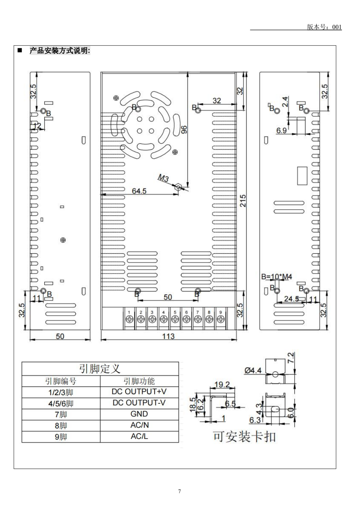

# S-250-24 规格书读取记录（原PDF待补）

2026-09-24 已在本会话完整读取用户提供的8页《规格承认书 S-250-24》，版本001、日期2024-09-20。归档时原剪贴板临时PDF已不存在，Downloads与原临时目录未找到副本。以下为当时读取结果，不是原始PDF替代品；原件SHA-256不可得。供应商栏为空，不能据此确认具体制造商或到货批次。

| 页 | 读取结果 |
|---|---|
| 2 | 24V、10.4A、250W；出厂23.7–24.3V；调压22.7–25.2V；写明交流输入通过开关选择 |
| 3 | 输入100–240Vac、额定115/230Vac，但同时写启动电压180Vac；需核对选择档位。过功率300–350W恒功率；过流12.5–14.5A恒功率，消除后自动恢复；短路消除后恢复；尺寸215×113×50mm |
| 7 | 风扇面朝上、端子朝向观察者：从左至右1–9；1/2/3 +V，4/5/6 −V，7 GND（保护地），8 AC/N，9 AC/L |
| 8 | 要求可靠保护接地，不频繁开关；接地导线“大于AWG18#”为原文，未据此直接指定项目线径 |

第2页列举过压/过温保护，但未获得明确触发阈值，不编造。无回生吸收能力、端子紧固扭矩或项目急停方案。第7页渲染图为先前读取PDF时生成的派生图，现保留供复核：

