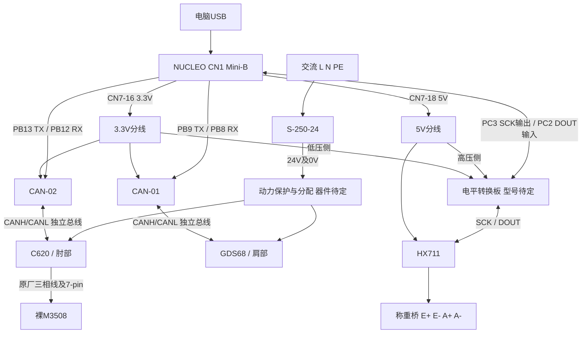

# 硬件接口编码表

> 状态：型号资料接口登记 + 2026-09-24台架接线设计分配；尚未实物通电验证。
>
> 本文件是当前项目的权威接口登记。历史目录中的同名文件仅作为旧副本，不再被项目文档引用。
>
> 硬件范围：严格来自同目录 `hardware_components_reference.md`。
>
> 规则：厂家资料确认与项目设计分配分开记录；第10节列出已选引脚和逐线关系，不代表实物一致性、保护器件或运行参数均已验证。

## 1. 编码与证据规则

| 对象 | 格式 | 示例 | 含义 |
|---|---|---|---|
| 设备 | `类别-序号` | `ACT-01` | 沿用 Hardware List 的设备编号 |
| 物理接口组 | `设备.IF序号` | `ACT-01.IF01` | 连接器、焊盘或固定线缆接口 |
| 接口信号 | `接口组.S序号` | `ACT-01.IF01.S01` | 接口内的一条厂家定义信号 |
| 板上操作件 | `设备.CTL序号` | `ESC-01.CTL01` | 按键、选择开关等非线缆接口 |
| 软件资源槽 | `设备.LR序号` | `MCU-01.LR01` | MCU逻辑需求；已选引脚见第10节 |
| 电源域 | `PD-名称` | `PD-24V-MOTOR` | 具有共同电气性质的电源范围 |
| 逻辑网络 | `NET-名称` | `NET-CAN-ELBOW` | 后续连接映射使用的逻辑网络身份 |

编码只表达稳定身份。厂家端子名称可以记录，但“某信号接到另一设备的哪一针”在第10节接线映射表中单独记录。

### 1.1 状态

| 状态 | 含义 |
|---|---|
| `CONFIRMED` | 对应型号官方资料明确给出，且型号身份已确认 |
| `REFERENCE_ONLY` | 资料来自参考板、芯片或商品页，尚不能证明到货实物完全一致 |
| `PLANNED` | 当前架构需要，但尚未分配物理资源 |
| `DESIGN_SELECTED` | 项目已选择连接关系或物理资源，尚未实物验证；不是厂家证据等级 |
| `TBD` | 缺少型号、版本、实物标识或对应资料，不能继续细化 |
| `INACTIVE` | 设备存在，但当前编码器控制架构不使用 |

### 1.2 证据等级

| 等级 | 证据 | 可确认范围 |
|---|---|---|
| `A` | 对应型号的厂家官方手册、数据手册或官方原理图 | 可确认该型号的接口名称、信号职责和厂家限制 |
| `B` | 对应芯片数据手册或官方参考板资料 | 只能确认芯片或参考板，不能自动等同于当前模块 |
| `C` | 用户提供的商品页、订单截图或商家资料 | 只记录直接可见的信息，必须核对实物 |
| `D` | 项目规划或待验证假设 | 不能作为接线依据 |

## 2. 型号与资料绑定

| 设备 | 已确认型号 | 主资料 | 证据 | 资料边界 |
|---|---|---|---|---|
| `MCU-01` | NUCLEO-F446RE；MB1136 rev C；STM32F446RET6 | ST `UM1724 Rev 17` | A | 未确认 C03/C04，暂不使用版本专属原理图锁定焊桥差异 |
| `ACT-01` | GIM6010-8；GDS68；订单 Y-48、12–48 V 选项 | SteadyWin《GIM6010-8 使用手册 rev2.2》 | A+C | 扩展口是否存在取决于驱动板硬件版本 |
| `ESC-01` | RoboMaster C620 | DJI《C620 无刷电机调速器使用说明 V1.01》 | A | 接口以中文版第 23–25 页为准 |
| `MOTOR-01` | 裸 RoboMaster M3508 | DJI《M3508 直流无刷电机使用说明 v1.0 2025.10》 | A | 不使用 P19 减速器资料 |
| `FORCE-01` | 5 kg 直梁式四线全桥应变称重传感器 | 随购买套装提供的技术参数表、安装图和接线图 | C | 已确认所购规格与资料基准；尺寸、线色和桥阻仍需到货实测 |
| `ADC-01` | HX711-BF / HX711AD 模块；资料原理图版本 | 随购买套装原理图及 Avia《HX711 数据手册》 | B+C | 原理图确认 `RATE`接地、固定10 SPS；实物排针和PCB一致性待核对 |
| `CAN-01/02` | 商品页展示为 Waveshare SN65HVD230 CAN Board 样式 | Waveshare 参考板原理图；TI 数据手册 | B+C | 到货板是否同版尚未确认 |
| `PWR-01` | S-250-24；商品24V/10A，规格书24V/10.4A | 卖家规格书001读取记录、第7页派生图、商品截图 | C | 原PDF待补；供应商/到货批次、输入档位未核对 |
| `IMU-01/02` | WitMotion WT901C-TTL | WitMotion 官方产品页、协议和教程 | A | 当前停用；排针物理顺序仍需实物核对 |

## 3. 电源域

| 编码 | 名称 | 已知范围 | 状态与边界 |
|---|---|---|---|
| `PD-AC-MAINS` | 台架交流输入域 | `PWR-01` 交流输入、保护接地和防触碰边界 | `DESIGN_SELECTED`：规格书针号已记录；实物与输入档位待核对 |
| `PD-24V-MOTOR` | 24 V 动力域 | `PWR-01` 计划向 `ACT-01`、`ESC-01` 供电 | `DESIGN_SELECTED`：两驱动独立支路已选；保护、开关和载流验证待定 |
| `PD-LOGIC-3V3` | 3.3 V 逻辑域 | `CAN-01/02` 和可能的 MCU 扩展逻辑 | `DESIGN_SELECTED`：CN7-16供3.3V，容量待核验 |
| `PD-MCU-5V` | MCU 板 5 V 域 | NUCLEO 的 USB 5 V、E5V 或板载 5 V 路径 | `DESIGN_SELECTED`：CN1 USB供电，CN7-18向逻辑模块分线 |
| `PD-SENSOR-LOW-VOLTAGE` | 传感器低压域 | `ADC-01`、`FORCE-01`；IMU 库存保留 | `DESIGN_SELECTED`：HX711选CN7-18的5V供电；称重桥由HX711激励，IMU停用 |

## 4. 设备接口详细编码

### 4.1 MCU-01：NUCLEO-F446RE

#### 4.1.1 板级接口

| 接口编码 | 官方连接器 | 作用 | 状态 | 官方依据 |
|---|---|---|---|---|
| `MCU-01.IF01` | `CN1` USB Mini-B | ST-LINK 调试、下载、Mass Storage、VCP，并可供电 | `CONFIRMED` | UM1724 第 7.4、7.5.1 节 |
| `MCU-01.IF02` | `CN2` ST-LINK/NUCLEO 跳线 | 选择 ST-LINK 与板载目标 MCU 的连接关系 | `CONFIRMED` | UM1724 第 7.4 节、表 4 |
| `MCU-01.IF03` | `CN4` SWD | 板载 ST-LINK 调试外部目标板 | `CONFIRMED` | UM1724 第 7.4.5 节、表 5 |
| `MCU-01.IF04` | `CN5/CN6/CN8/CN9` | Arduino Uno V3 扩展接口组 | `CONFIRMED` | UM1724 第 7.13 节、表 19 |
| `MCU-01.IF05` | `CN7/CN10` | ST Morpho 扩展接口组 | `CONFIRMED` | UM1724 第 7.14 节、表 29 |
| `MCU-01.IF06` | 板载 VCP 内部路径 | 默认连接 `USART2 PA2/PA3`，受焊桥配置影响 | `CONFIRMED` | UM1724 第 7.10、7.11 节 |
| `MCU-01.IF07` | `B1` USER | 用户输入，连接 `PC13` | `CONFIRMED` | UM1724 第 7.7 节 |
| `MCU-01.IF08` | `B2` RESET | 目标 MCU 复位 | `CONFIRMED` | UM1724 第 7.7 节 |
| `MCU-01.IF09` | `LD2` USER LED | 用户输出，连接 D13 / `PA5` | `CONFIRMED` | UM1724 第 7.6 节 |

`CN4` 用于板载 ST-LINK 调试另一块目标板。UM1724 要求此时移除 CN2 两只跳线；当前不把 CN4 与板载目标调试路径同时使用。

#### 4.1.2 CN4 信号

| 编码 | 针位 | 信号 | 方向（相对 ST-LINK） |
|---|---:|---|---|
| `MCU-01.IF03.S01` | 1 | `VDD_TARGET` | 采样输入 |
| `MCU-01.IF03.S02` | 2 | `SWCLK` | 输出 |
| `MCU-01.IF03.S03` | 3 | `GND` | 参考地 |
| `MCU-01.IF03.S04` | 4 | `SWDIO` | 双向 |
| `MCU-01.IF03.S05` | 5 | `NRST` | 输出 |
| `MCU-01.IF03.S06` | 6 | `SWO` | 保留/未用 |

#### 4.1.3 可用供电入口和电源脚

| 编码 | 位置 | 功能与官方范围 | 状态 |
|---|---|---|---|
| `MCU-01.IF01.S01` | `CN1` | USB 5 V 路径，板及扩展负载受 UM1724 USB 电流限制约束 | `CONFIRMED` |
| `MCU-01.IF04.S01` | `CN6 pin 8` | `VIN`，外部 7–12 V 输入 | `CONFIRMED` |
| `MCU-01.IF05.S01` | `CN7 pin 24` | `VIN` | `CONFIRMED` |
| `MCU-01.IF05.S02` | `CN7 pin 6` | `E5V`，外部 4.75–5.25 V 输入 | `CONFIRMED` |
| `MCU-01.IF04.S02` | `CN6 pin 4` | `+3V3` | `CONFIRMED` |
| `MCU-01.IF04.S03` | `CN6 pin 5` | `+5V` | `CONFIRMED` |
| `MCU-01.IF04.S04` | `CN6 pin 6/7` | `GND` | `CONFIRMED` |

本项目选择CN1 USB供电；不并联外部VIN/E5V/3.3V入口。按UM1724第21–23页核对JP1、JP5、JP6及USB供电总预算，见第10节。

#### 4.1.4 资源槽与设计分配

| 编码 | 用途 | 所需能力 | 状态 | 分配或待定内容 |
|---|---|---|---|---|
| `MCU-01.LR01` | `SHOULDER_SIDE` | 1 路 CAN TX/RX | `DESIGN_SELECTED` | CAN1 PB9/TX、PB8/RX、AF9；IRQ/滤波器待固件设计 |
| `MCU-01.LR02` | `ELBOW` | 1 路 CAN TX/RX | `DESIGN_SELECTED` | CAN2 PB13/TX、PB12/RX、AF9；IRQ/滤波器待固件设计 |
| `MCU-01.LR03` | 命令与遥测 | 1 路串口，可评估 VCP | `PLANNED` | USART、波特率、DMA |
| `MCU-01.LR04` | HX711 | 数字输出 `PD_SCK`、数字输入 `DOUT` | `DESIGN_SELECTED` | PC3/SCK输出、PC2/DOUT输入无上下拉；电平转换，10SPS新样本 |
| `MCU-01.LR05` | 未来 `assist_enable_permission` | 安全定义的数字输入 | `PLANNED` | 硬件、GPIO、电平、去抖 |

### 4.2 ACT-01：GIM6010-8 + GDS68

`ACT-01` 绑定右臂 `SHOULDER_SIDE`。接口来自 GDS68，不表示全部启用。

| 编码 | 手册序号 | 连接器/形式 | 功能 | 状态 | 依据 |
|---|---:|---|---|---|---|
| `ACT-01.IF01` | 1 | 板端 `XT30PB(2+2)-M`；线端 `XT30(2+2)-F` | 电源与 CAN/复用通信 | `CONFIRMED` | rev2.2 第 2.4.1 节，第 10 页 |
| `ACT-01.IF02` | 2 | USB Type-C | 调试与上位机通信，不给驱动器供电 | `CONFIRMED` | 第 2.4.2、3.1 节 |
| `ACT-01.IF03` | 3 | 20-pin 扩展插槽 | SPI/USART/I2C/PWM/ADC/GPIO | `TBD` | 第 2.4.3 节；硬件 v3.9+ 无此口 |
| `ACT-01.IF04` | 4 | 2.00 mm 焊盘 | SWD 调试/下载 | `CONFIRMED` | 第 2.4.4 节，第 11–12 页 |
| `ACT-01.IF05` | 5 | 2.00 mm 焊盘 | 第二编码器 USART/I2C | `CONFIRMED` | 第 2.4.5 节，第 12 页 |
| `ACT-01.IF06` | 6 | 焊盘 | 电机 10 kΩ NTC | `CONFIRMED` | 第 2.4.6 节，第 12 页 |
| `ACT-01.IF07` | 7a | 2.00 mm 焊盘 | 抱闸或制动/泄放电阻 | `CONFIRMED` | 第 2.4.7 节，第 13 页 |
| `ACT-01.IF08` | 7b | 2.00 mm 焊盘 | 最小/最大限位及 12 V 辅助电源 | `CONFIRMED` | 第 2.4.8 节，第 13–14 页 |
| `ACT-01.IF09` | U/V/W | 三相绕组焊接孔 | GIM6010-8 三相绕组 | `CONFIRMED` | 第 2.2 节，第 9 页 |

#### 4.2.1 电源与 CAN

| 编码 | 信号 | 功能 | 项目状态 |
|---|---|---|---|
| `ACT-01.IF01.S01` | `VBUS` | 直流母线正端 | `PLANNED` |
| `ACT-01.IF01.S02` | `GND` | 直流母线负端/参考地 | `PLANNED` |
| `ACT-01.IF01.S03` | `CANH` | CAN 高线；其他模式可复用 | `PLANNED`：只计划 CAN |
| `ACT-01.IF01.S04` | `CANL` | CAN 低线；其他模式可复用 | `PLANNED`：只计划 CAN |

GDS68 手册明确说明驱动板没有电源反接保护。本表把它记录为接线验证约束，不据此新增未选型的保护器件。

#### 4.2.2 调试与辅助信号

| 编码 | 信号 | 功能 | 状态 |
|---|---|---|---|
| `ACT-01.IF04.S01` | `SWDIO` | SWD 数据 | `CONFIRMED` |
| `ACT-01.IF04.S02` | `GND` | 调试参考地 | `CONFIRMED` |
| `ACT-01.IF04.S03` | `SWDCLK` | SWD 时钟 | `CONFIRMED` |
| `ACT-01.IF04.S04` | `3.3V` | 调试电平参考 | `CONFIRMED` |
| `ACT-01.IF05.S01` | `GND` | 第二编码器参考地 | `CONFIRMED` |
| `ACT-01.IF05.S02` | `3.3V` | 第二编码器供电 | `CONFIRMED` |
| `ACT-01.IF05.S03` | `TX/SCL` | USART TX 或 I2C SCL | `CONFIRMED` |
| `ACT-01.IF05.S04` | `RX/SDA` | USART RX 或 I2C SDA | `CONFIRMED` |
| `ACT-01.IF06.S01` | `MOT_TEMP` | 10 kΩ NTC 信号 | `CONFIRMED` |
| `ACT-01.IF06.S02` | `GND` | 温度参考地；手册称两线无极性 | `CONFIRMED` |
| `ACT-01.IF07.S01` | `EMG` | 抱闸电流输出或制动电阻端 | `CONFIRMED`：未启用 |
| `ACT-01.IF07.S02` | `GND` | 抱闸/制动回路参考端 | `CONFIRMED`：未启用 |
| `ACT-01.IF08.S01` | `GND` | 限位参考地 | `CONFIRMED`：未启用 |
| `ACT-01.IF08.S02` | `12V` | 限位开关辅助供电 | `CONFIRMED`：未启用 |
| `ACT-01.IF08.S03` | `LW1` | 最小位置限位输入 | `CONFIRMED`：未启用 |
| `ACT-01.IF08.S04` | `LW2` | 最大位置限位输入 | `CONFIRMED`：未启用 |

限位口允许两线开关或三线 NPN 开关，但项目未选定开关。20-pin 扩展口的板端为 `X0812FVS-20CS-9TV01`，扩展板端为 `X0812WVS-20AS-9TV01`；因 ACT-01 板版本未知，不为其内部信号建立项目连接。

### 4.3 ESC-01：RoboMaster C620

`ESC-01` 与 `MOTOR-01` 共同绑定右臂 `ELBOW`。

| 编码 | 官方接口 | 功能 | 状态 | 依据 |
|---|---|---|---|---|
| `ESC-01.IF01` | 7-Pin 电机数据端口 | 与 M3508 数据交互 | `CONFIRMED` | C620 中文第 23、25 页 |
| `ESC-01.IF02` | 三相动力线接头 | 向 M3508 输出三相动力 | `CONFIRMED` | 第 23、25 页 |
| `ESC-01.IF03` | 兼容 XT30 的电源线 | 24 V 输入 | `CONFIRMED` | 第 24 页 |
| `ESC-01.IF04` | CAN 信号端口 | 1 Mbps CAN 控制与反馈 | `CONFIRMED` | 第 24–25 页 |
| `ESC-01.IF05` | PWM 信号端口 | PWM 控制或配置/升级 | `CONFIRMED` | 第 24–25、27 页 |
| `ESC-01.CTL01` | 终端电阻开关 | 接入/断开板载 120 Ω | `CONFIRMED` | 第 24 页 |
| `ESC-01.CTL02` | SET 按键 | 设置 ID、快速编号、电机校准 | `CONFIRMED` | 第 24、30–32 页 |

| 编码 | 标记/线色 | 方向（相对 C620） | 项目状态 |
|---|---|---|---|
| `ESC-01.IF03.S01` | 电源正，XT30 极性依连接器 | 输入 | `PLANNED`：核对实物 |
| `ESC-01.IF03.S02` | 电源负，XT30 极性依连接器 | 输入 | `PLANNED` |
| `ESC-01.IF04.S01` | A，黑色，`CAN_L` | 双向总线 | `PLANNED` |
| `ESC-01.IF04.S02` | B，红色，`CAN_H` | 双向总线 | `PLANNED` |
| `ESC-01.IF05.S01` | A，黑色，`GND` | 参考地 | `CONFIRMED`：不作运行控制 |
| `ESC-01.IF05.S02` | B，灰色，`TX` | 输出 | `CONFIRMED`：不作运行控制 |
| `ESC-01.IF05.S03` | C，白色，`PWM/RX` | 输入 | `CONFIRMED`：不作运行控制 |

C620 手册禁止同时接入 CAN 与 PWM，切换方式前必须断电。本项目固定选择 CAN 运行路径。7-Pin 内部针位未在当前官方手册展开，因此不猜测。

### 4.4 MOTOR-01：裸 M3508

| 编码 | 官方接口 | 功能 | 状态 | 依据 |
|---|---|---|---|---|
| `MOTOR-01.IF01` | 7-Pin 数据端口 | 用随附线连接 C620 | `CONFIRMED` | M3508 v1.0 第 2、6 页 |
| `MOTOR-01.IF02` | 三相输入接头 | 连接 C620，相同颜色对应且不可反插 | `CONFIRMED` | M3508 v1.0 第 2、6 页 |

不添加 P19 接口。手册没有公开 7-Pin 内部针位，也未在文字中定义三相 U/V/W，因此只把原厂线束视为完整接口。M3508 的动力必须来自 C620 三相输出，不能直接接 24 V 直流母线。

### 4.5 FORCE-01：5 kg 直梁式应变称重传感器

以下信息来自随购买套装提供的5 kg技术参数表、安装图和接线图，证据等级为商品配套资料。到货后仍需核对实物。

| 编码 | 商品资料线色 | 商品资料定义 | 方向 | 状态 |
|---|---|---|---|---|
| `FORCE-01.IF01.S01` | 红 | `E+` 激励正 | 输入 | `REFERENCE_ONLY` |
| `FORCE-01.IF01.S02` | 黑 | `E-` 激励负 | 输入 | `REFERENCE_ONLY` |
| `FORCE-01.IF01.S03` | 绿 | `A+` 信号正 | 输出 | `REFERENCE_ONLY` |
| `FORCE-01.IF01.S04` | 白 | `A-` 信号负 | 输出 | `REFERENCE_ONLY` |

资料给出额定载荷5 kg、灵敏度1.0 ± 0.1 mV/V、推荐激励3–12 V以及输入/输出电阻1000 ± 50 Ω。安装采用一端固定、另一端悬空的悬臂方式；连接ADC前仍需测量桥路并通过已知方向加载确定正负方向。

### 4.6 ADC-01：HX711 模块

随购买套装资料给出了HX711-BF模块原理图和接线图。原理图明确把`RATE`（15脚）接至`GND`，因此本项目按固定10 SPS的低速采集模块登记；具体排针顺序仍需到货后按板上丝印确认。

| 编码 | 逻辑接口组 | 芯片功能 | 模块状态 |
|---|---|---|---|
| `ADC-01.IF01` | 通道 A 称重桥输入 | `E+`、`E-`、`A+`、`A-` | `REFERENCE_ONLY`：按套装接线图，待实物丝印确认 |
| `ADC-01.IF02` | 通道 B 输入 | `B+`、`B-` | `INACTIVE`：当前不使用 |
| `ADC-01.IF03` | MCU 数字接口 | `DT/DOUT`、`SCK/PD_SCK`、`GND` | `REFERENCE_ONLY`：待实物排针确认 |
| `ADC-01.IF04` | 模块供电 | `VCC`、`GND` | `DESIGN_SELECTED`：CN7-18 +5V，实物板待核对 |
| `ADC-01.CFG01` | HX711 `RATE`硬件配置 | 15脚接`GND`，固定10 SPS | `REFERENCE_ONLY`：套装原理图已确认，实物PCB待核对 |

ADC-01只发布低速辅助力监测值，用于显示、记录、标定观察和后续研究。它不作为快速助力触发、关节主控制反馈、安全触发或高带宽力闭环输入。软件不得把重复读取旧样本描述为高于10 SPS的新测量。

| 参考编码 | HX711 针位 | 信号 | 官方功能 |
|---|---:|---|---|
| `ADC-01.IF01.S01` | 8 | `INA+` | 通道 A 正输入 |
| `ADC-01.IF01.S02` | 7 | `INA-` | 通道 A 负输入 |
| `ADC-01.IF02.S01` | 10 | `INB+` | 通道 B 正输入 |
| `ADC-01.IF02.S02` | 9 | `INB-` | 通道 B 负输入 |
| `ADC-01.IF03.S01` | 12 | `DOUT` | 数据输出；低电平表示就绪 |
| `ADC-01.IF03.S02` | 11 | `PD_SCK` | 时钟兼断电控制；高电平超过 60 µs 断电 |

依据为 Avia HX711 数据手册第 2、4–6、10 页。数据手册要求 DOUT 对应的 MCU 输入不接内部上拉/下拉；本地开源 STM32 示例 README 建议上拉，与芯片手册冲突，后续必须以芯片手册和实际模块电路为先。

### 4.7 CAN-01 / CAN-02：SN65HVD230 CAN Board 样式模块

两块模块结构相同。排针顺序来自 Waveshare 参考板原理图，实物未核对，全部为 `REFERENCE_ONLY`。

下表使用公共后缀压缩重复内容。例如 `.IF01.S01` 分别展开为 `CAN-01.IF01.S01` 和 `CAN-02.IF01.S01`，两者仍是独立且唯一的信号编码。

| 信号后缀 | 参考板针位 | 信号 | 方向（相对模块） |
|---|---:|---|---|
| `.IF01.S01` | P1-1 | `CAN_TX`，接收发器 D | 输入 |
| `.IF01.S02` | P1-2 | `GND` | 参考地 |
| `.IF01.S03` | P1-3 | `3.3V` | 电源输入 |
| `.IF01.S04` | P1-4 | `CAN_RX`，来自收发器 R | 输出 |
| `.IF02.S01` | can1-1 | `CANL` | 双向总线 |
| `.IF02.S02` | can1-2 | `CANH` | 双向总线 |

Waveshare 原理图确认：`Rs` 经 10 kΩ 接地，CANH/CANL 固定跨接 120 Ω；未显示终端使能开关、隔离器或 TVS。TI 数据手册第 5 页确认 SN65HVD230 芯片信号和 3.3 V 供电。接线前必须逐块核对芯片顶标、P1 丝印方向、CANH/CANL 丝印、3.3 V/GND 极性及断电端间电阻。

### 4.8 PWR-01：S-250-24

卖家规格书001第7页已给针号。原PDF临时文件在归档时失效，保留[第7页派生图](all_hardware_relevant_documents/S-250-24_power_supply/specification_page7_render.png)与[读取记录](all_hardware_relevant_documents/S-250-24_power_supply/specification_reading_record.md)，证据等级C，实物仍待核对。

| 接口/信号编码 | 针号或名称 | 职责 | 状态 |
|---|---|---|---|
| `PWR-01.IF01.S01` | 9 / AC/L | 交流火线 | `REFERENCE_ONLY` |
| `PWR-01.IF01.S02` | 8 / AC/N | 交流零线 | `REFERENCE_ONLY` |
| `PWR-01.IF01.S03` | 7 / GND保护接地 | PE；不是DC负极 | `REFERENCE_ONLY` |
| `PWR-01.IF02.S01` | 1/2/3 / +V | 同一路+24V输出 | `REFERENCE_ONLY` |
| `PWR-01.IF02.S02` | 4/5/6 / −V | 同一路动力0V | `REFERENCE_ONLY` |
| `PWR-01.IF03` | ADJ | 输出调节；规格書22.7–25.2V | `REFERENCE_ONLY` |

观察方向：风扇面朝上、端子朝向观察者，从左向右1–9，调压器不计入针号。三组正负端子共享电源总额定10.4A，不乘三；原商品标10A的差异保留。L接火线，N接零线，不采纳卖家“无需区分”说法。输入选择档位、接线端子扭矩和回生吸收能力未确认。

### 4.9 IMU-01 / IMU-02：WT901C-TTL

IMU 当前不进入控制架构，仅登记库存能力。

下表公共后缀分别展开到 `IMU-01` 与 `IMU-02`，例如 `.IF01.S02` 对应两个设备各自独立的 TX 信号。

| 信号后缀 | 官方信号 | 方向（相对 IMU） | 状态 |
|---|---|---|---|
| `.IF01.S01` | `VCC` | 电源输入 | `INACTIVE`：电压按实物版本复核 |
| `.IF01.S02` | `TX` | 串口输出 | `INACTIVE` |
| `.IF01.S03` | `RX` | 串口输入 | `INACTIVE` |
| `.IF01.S04` | `GND` | 参考地 | `INACTIVE` |

WitMotion 官方教程确认串口交叉连接，即传感器 TX 对主控 RX、传感器 RX 对主控 TX。当前没有本批产品排针实物证据，不登记物理针序；未来启用时须先读取当前波特率和输出配置。

## 5. 逻辑网络

| 编码 | 功能 | 端点角色 | 状态 | 尚未决定 |
|---|---|---|---|---|
| `NET-PWR-24V-MOTOR` | 24 V 动力母线 | `PWR-01.IF02`、`ACT-01.IF01`、`ESC-01.IF03` | `PLANNED` | 分支、保护、线径、连接器、同时输出能力 |
| `NET-CAN-SHOULDER-SIDE` | SHOULDER_SIDE CAN | `MCU-01.LR01`、`CAN-01`、`ACT-01.IF01` | `DESIGN_SELECTED` | MCU引脚见第10节；实物终端、线束、CAN配置待验证 |
| `NET-CAN-ELBOW` | ELBOW CAN | `MCU-01.LR02`、`CAN-02`、`ESC-01.IF04` | `DESIGN_SELECTED` | MCU引脚见第10节；实物终端、线束、C620 ID待验证 |
| `NET-M3508-DATA` | M3508 数据链 | `ESC-01.IF01`、`MOTOR-01.IF01`、原厂 7-Pin 线 | `CONFIRMED` | 不拆未公开针位 |
| `NET-M3508-PHASE` | M3508 三相链 | `ESC-01.IF02`、`MOTOR-01.IF02` | `CONFIRMED` | 实物线色和接头检查 |
| `NET-FORCE-BRIDGE` | 力传感器桥路 | `FORCE-01.IF01`、`ADC-01.IF01/04` | `PLANNED` | 实物端子、激励、桥阻和方向标定 |
| `NET-HX711-DIGITAL` | HX711 10 SPS低速数字采集 | `ADC-01.IF03`、`MCU-01.LR04` | `DESIGN_SELECTED` | GPIO见第10节；实物排针、电平转换板、读取超时待落实 |
| `NET-DEBUG-VCP` | 调试与遥测 | PC、`MCU-01.IF01/06`、`MCU-01.LR03` | `PLANNED` | USART2 是否占用、波特率、格式 |

## 6. 无法由型号资料确认的项目

1. `MCU-01` 背面完整版本贴纸未确认，不能在 C03/C04 原理图之间选定。
2. `ACT-01` 的 GDS68 板版本未确认，不能认定 20-pin 扩展口存在。
3. `FORCE-01`已确定购买5 kg规格，但缺少到货实物、厂家型号和铭牌，线色、桥阻及尺寸仍需实测。
4. `ADC-01`已有套装原理图并确认固定10 SPS，但缺少到货PCB正反面照片，不能把资料排针顺序直接视为实物事实。
5. `CAN-01/02` 未核对到货板，Waveshare 参考板针序不能视为实物事实。
6. `PWR-01` 已读取S-250-24规格书并保存第7页派生图；原PDF待补，实物铭牌、输入档位和端子一致性未核对。
7. `IMU-01/02` 当前停用且缺少本批排针照片，不登记物理针序。

## 7. 接线设计前的实物核对

| 对象 | 必须获取或测量 | 解锁工作 |
|---|---|---|
| `MCU-01` | C03/C04 贴纸、当前焊桥/跳线 | CubeMX 资源锁定 |
| `ACT-01` | GDS68 板版本、端子朝向、CAN 模式与配置 | SHOULDER_SIDE 线束 |
| `ESC-01` | XT30 极性、终端开关、ID、CAN/PWM 未同时接入 | ELBOW 线束 |
| `MOTOR-01` | 原厂 7-Pin 与三相线完好、同色对应 | C620-M3508 配套确认 |
| `FORCE-01` | 铭牌/订单型号、5 kg规格、尺寸、线色、桥阻和已知方向加载 | 接HX711并完成方向标定 |
| `ADC-01` | PCB正反面、丝印、芯片顶标，并核对`RATE`确实接地 | 两侧针位编码和10 SPS采样验证 |
| `CAN-01/02` | 正反面、芯片顶标、丝印、断电总线电阻 | CAN 接线与终端 |
| `PWR-01` | 铭牌、输入选择、端子排和丝印 | 交流与 24 V 支路 |
| `IMU-01/02` | 未来启用时核对排针、供电版本和配置 | IMU 资源分配 |

## 8. 尚未完成的设计与验证

- CAN1/CAN2及HX711引脚已分配；CAN ID、实际波特率配置、控制周期、控制限值、DMA/IRQ/滤波器仍由固件设计与设备读取落实。C620要求1Mbps不是另一条GDS68总线已配置的证明。
- 24V两支路拓扑已选；保险、急停/接触器、浪涌、回生处理、线束载流与电平转换板具体型号未选定。图中占位不代表已安装器件。
- 不把旧款商品参数、参考板针序、规格书数值或开源程序提升为实物已验证结论。IMU保持停用。

## 9. 资料索引

| 编号 | 本地资料 | 用途 |
|---|---|---|
| `SRC-MCU-01` | `all_hardware_relevant_documents/um1724-stm32-nucleo64-boards-mb1136-stmicroelectronics.pdf` | NUCLEO 接口、供电、VCP、按键和 LED |
| `SRC-ACT-01` | `all_hardware_relevant_documents/ABUIABA9GAAgzpi6wQYoh9D9CQ.pdf` | GIM6010-8/GDS68 rev2.2 第 2.2–2.4 节 |
| `SRC-ESC-01` | `all_hardware_relevant_documents/RoboMaster_C620_Brushless_DC_Motor_Speed_Controller_V1.01.pdf` | C620 接口、线色、终端和限制 |
| `SRC-MOTOR-01` | `all_hardware_relevant_documents/RoboMaster_M3508_Brushless_DC_Motor_User_Guide_v1.0_2025.10.pdf` | 裸 M3508 接口 |
| `SRC-ADC-01` | `all_hardware_relevant_documents/电子秤HX71..料包/电子秤HX711AD模块资料包/hx711(海芯).pdf` | HX711 芯片信号与时序 |
| `SRC-FORCE-01` | `all_hardware_relevant_documents/电子秤HX71..料包/电子秤HX711AD模块资料包/称重传感器的原理及使用.pdf`（旧技术参数表目录不在当前树中） | 5 kg传感器参数、尺寸、安装与线色 |
| `SRC-ADC-REF` | `all_hardware_relevant_documents/电子秤HX71..料包/电子秤HX711AD模块资料包/ADC模块原理图.pdf` | 确认资料版本固定10 SPS；不直接证明到货排针 |
| `SRC-CAN-BOARD` | `all_hardware_relevant_documents/SN65HVD230_CAN_module/Waveshare_SN65HVD230_CAN_Board_Schematic.pdf` | 参考板排针、120 Ω 与 10 kΩ |
| `SRC-CAN-IC` | `all_hardware_relevant_documents/SN65HVD230_CAN_module/TI_SN65HVD23x_3.3V_CAN_Transceivers_RevO.pdf` | 芯片引脚和职责 |
| `SRC-PWR-01` | [来源及派生资料](all_hardware_relevant_documents/S-250-24_power_supply/SOURCE.md) | 商品、规格书读取记录与第7页派生图；原PDF待补 |
| `SRC-IMU-01` | WitMotion 官方 WT901C 产品页及 WIT Standard Protocol | WT901C-TTL 串口角色；当前停用 |

## 10. 台架接线设计分配（2026-09-24）

以下均为`DESIGN_SELECTED`，与厂家资料级`CONFIRMED`分开。CN7-35指连接器第35针，不是MCU芯片封装第35脚。针号见UM1724 Rev17第59页表29；CAN复用AF9见STM32F446RE DS10693复用功能表。板上针1标记/单双排方向按实物核对，不能按照片左右猜针号。

### 10.1 整体连接图

图省略各逻辑GND线，实际必须按下表接地。两条CAN不合并H/L；非隔离系统通过专用参考连接共地，电机回流直接到动力0V分配，不经过开发板、面包板或杜邦线。PE与DC0V分开标识，不能任意短接。

### 10.2 逐线连接表

| 网络/用途 | 起点 | 终点 | 要求 |
|---|---|---|---|
| USB逻辑供电/调试 | 电脑USB | NUCLEO CN1 Mini-B | 已有数据线；不为电机供动力 |
| 肩部CAN发送 | PB9 / CN10-5 / CAN1_TX AF9 | CAN-01 TX（D） | TX对TX，不交叉 |
| 肩部CAN接收 | CAN-01 RX（R） | PB8 / CN10-3 / CAN1_RX AF9 | 3.3V逻辑 |
| 肘部CAN发送 | PB13 / CN10-30 / CAN2_TX AF9 | CAN-02 TX（D） | TX对TX |
| 肘部CAN接收 | CAN-02 RX（R） | PB12 / CN10-16 / CAN2_RX AF9 | 3.3V逻辑 |
| 3.3V | CN7-16 | 两CAN模块3.3V及转换板低压侧 | 通过分线，不接5V |
| 5V | CN7-18 | HX711 VCC及转换板高压侧 | 不直接进入MCU信号脚 |
| 逻辑地 | CN7-20 | 两CAN GND、HX711 GND、转换板GND | 分线端子互联建立同一逻辑地 |
| HX711时钟 | PC3 / CN7-37 | 转换板3.3→5V通道→HX711 SCK | 复位/上电默认低；高脉冲不超过50µs |
| HX711数据 | HX711 DOUT | 转换板5→3.3V通道→PC2 / CN7-35 | GPIO输入无内部上下拉；不误接桥路B+ |
| 肩部CAN高/低 | CAN-01 H/L | GDS68配套线CANH/CANL | 一对双绞线；按触点功能核对线束，不猜颜色 |
| 肘部CAN高 | CAN-02 H | C620 CAN B红线 | 此红线不是24V |
| 肘部CAN低 | CAN-02 L | C620 CAN A黑线 | 此黑线不是GND |
| +24V主干 | 电源+V（1/2/3选一） | 动力保护/正极分配 | 具体保护器件待选；总电流不乘三 |
| 动力0V主干 | 电源−V（4/5/6选一） | 动力负极分配 | 按总回流选线 |
| 肩部动力 | 动力正/负分配 | GDS68 VBUS/GND | 使用已有XT30(2+2)-F配套线 |
| 肘部动力 | 动力正/负分配 | C620电源正/负 | 使用已有配套电源线，核对极性 |
| 公共参考地 | 动力0V分配 | 逻辑GND分配 | 专用连接；不承担电机负载回流 |
| 电机连接 | C620三相和7-pin接口 | M3508同色三相与7-pin | 原厂线束，不定义未公开内部针序 |
| 称重桥 | 传感器红/黑/绿（部分图蓝）/白 | HX711 E+/E−/A+/A− | 核对实际传感器；B通道不接 |
| 交流输入 | 火线/零线/PE | 电源9/L、8/N、7/保护地 | 先核对输入档位及防触碰结构 |

### 10.3 供电、终端与线束约束

- USB供电按UM1724第21–23页：JP5选U5V（1–2），JP6接通，JP1按相应USB枚举方案核对；JP1 OFF枚举方案总板及扩展负载上限300mA，不能把该值当扩展余量。还须计入NUCLEO、两收发器、HX711和转换板；3.3V稳压器额定值不替代USB总预算。
- 每条CAN总线设计为两个末端各120Ω：收发器参考板固定120Ω，远端GDS68软件使能/C620开关接入。实物确认后全系统断电测H/L约60Ω；不是用万用表验证线缆特性阻抗。GDS68参数与板版本对应后再设置，不盲目加第三只120Ω。
- 参考板P1为1TX/2GND/3V3.3/4RX，商品图却显示3.3V/GND/RX/TX顺序；接线以实物信号丝印和电路一致性为准。黄色双针为H/L并行接口，不是终端开关。
- HX711参考板VCC连DVDD，选5V供电并做双向相反通道的电平转换。具体板及端子编号TBD，不直接采购仅写“自动双向”的板；须满足DOUT输入负载及SCK默认低的要求。
- RV2.5mm²红/黑各2m是固定台架主干采购建议，不是厂家规定或已验证载流能力；关节活动段另核验柔性、弯折和应力释放。CAN建议2×0.3mm²双绞线，特性阻抗向供应商核实。
- WAGO221-415六个仅为分线用量预估（动力两组、3.3V、5V、逻辑地两组）；221-412四个仅在两路CAN都需延长时使用。一只端子各孔同电位，不能将正负或H/L插入同一只。需确认实际产品适用细绞线截面积；0.14mm²下限不适合常见26/28AWG细线，优先匹配0.2–0.3mm²逻辑线。不得把杜邦金属接头当裸线夹入。数量及品牌不作为已采购事实。

### 10.4 后续验证与配置边界

电源输入档位和实物丝印、GDS68硬件/固件、CAN模块排针及电阻、HX711 PCB一致性尚待核对。终端配置、GDS68协议/波特率/ID、C620 ID、限流与控制周期在通信/动力调试前落实；手册通信方法存在不代表当前设备已经配置。初次测试前还需完成动力保护、急停和回生设计；不得用本表宣称系统已经可以直接上电或穿戴。C620控制模式固定CAN，不同时连接PWM。
