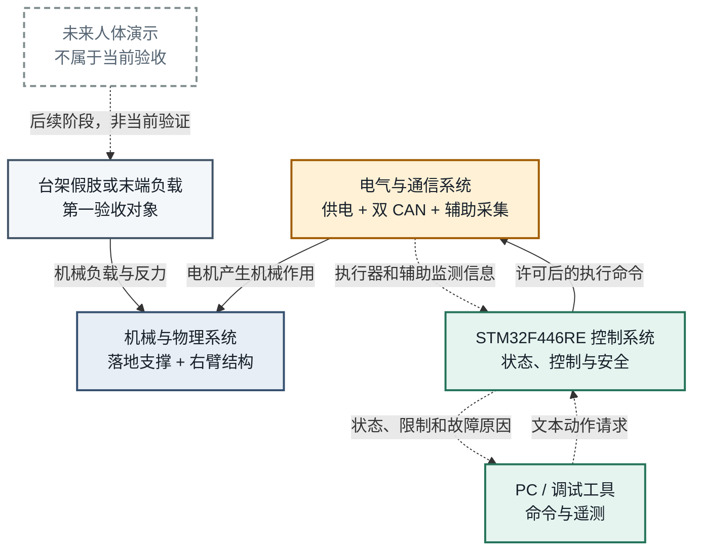
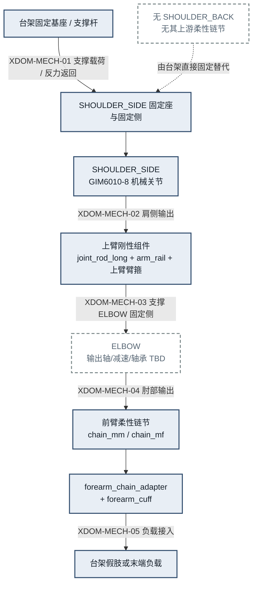
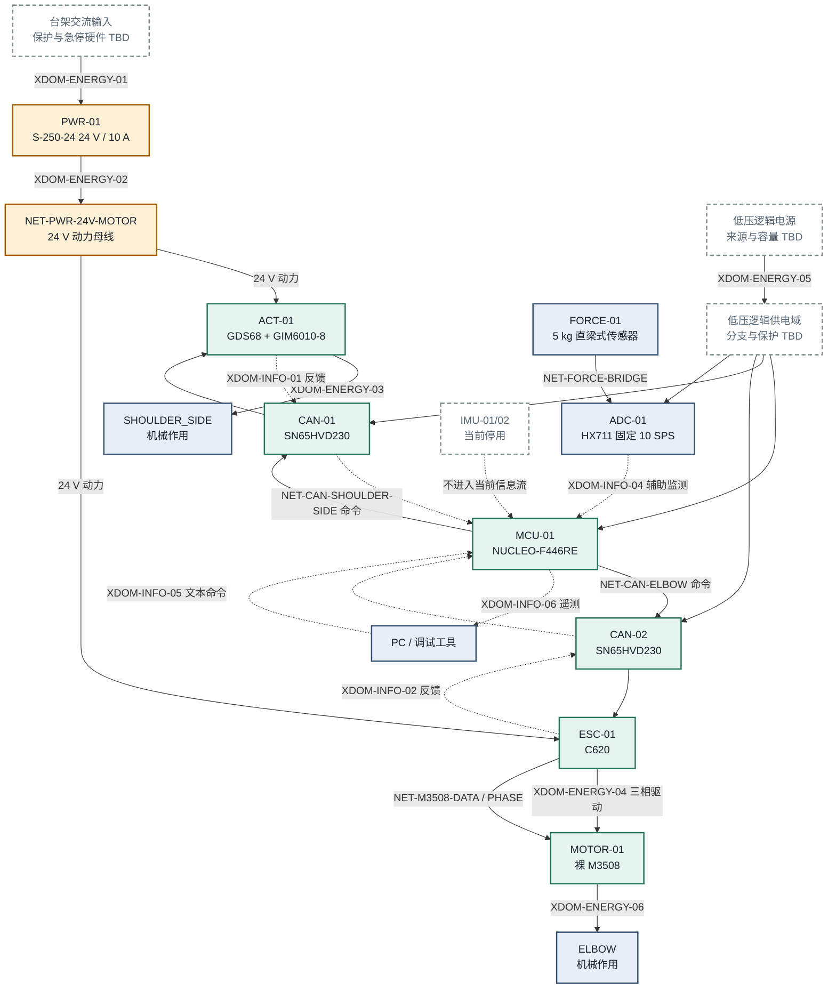
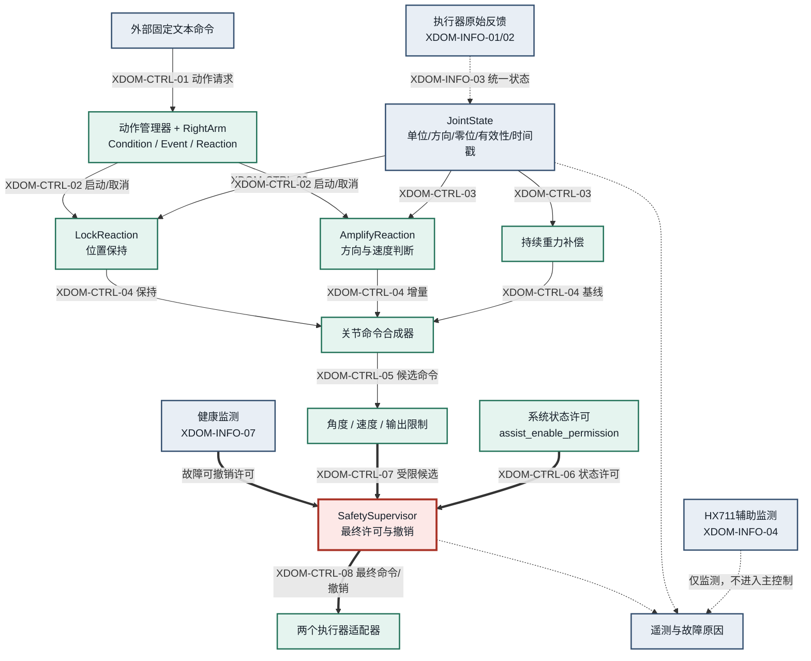
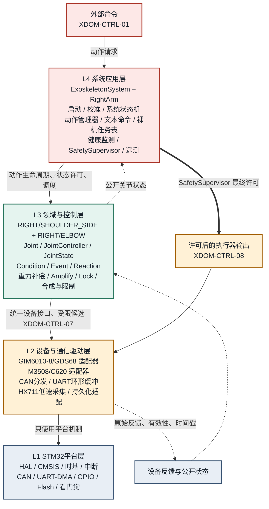

# 上肢助力外骨骼系统架构蓝图

> 本文件是当前项目技术路线与系统架构的权威来源。它定义模块边界、依赖方向、跨域接口和安全控制权，但不构成具体接线图、机械承载证明、人体安全验证或临床验证。需求优先级见 [`project_requirements_blueprint.md`](project_requirements_blueprint.md)，设备端点与证据等级见 [`hardware_list/hardware_interface_registry.md`](hardware_list/hardware_interface_registry.md)。

## 1. 阅读规则与固定边界

- 当前系统是落地承重、单右臂、台架优先的学生原型，第一验收对象是台架假肢或末端负载。
- 关节统一使用 ExoKit 语义名：`RIGHT/SHOULDER_SIDE`和`RIGHT/ELBOW`；机械、电气图使用`SHOULDER_SIDE`和`ELBOW`。
- `SHOULDER_SIDE`使用 GIM6010-8/GDS68；`ELBOW`使用裸 M3508/C620，不采用 P19 总成参数。
- 本系统不配置`SHOULDER_BACK`。台架固定座直接连接`SHOULDER_SIDE`固定侧；从该关节向下继续采用 ExoKit 的上臂刚性连接、`ELBOW`、前臂柔性链节和臂箍关系。
- 持续重力补偿是正常运行基础；Amplify 根据关节编码器方向与速度叠加增量助力；HX711 只作固定 10 SPS 的低速辅助监测；IMU 当前停用。
- 关系状态使用：`CONFIRMED`表示文档层架构决定，`PLANNED`表示已选路线但尚未实物验证，`TBD`表示必须经资料、接线门禁或台架试验确定。
- 图形颜色只作辅助。每条线均带方向、关系编号或文字标签，图后的 Markdown 表是无图形渲染时的完整等价表达。

### 1.1 关系图例

| 关系 | 编号 | 图中表达 | 含义 |
|---|---|---|---|
| 机械载荷 | `XDOM-MECH-*` | 实线、机械标签 | 结构连接、作用力、反力和负载接入 |
| 能量 | `XDOM-ENERGY-*` | 实线、能量标签 | 电源域和电能到机械作用的转换 |
| 信息 | `XDOM-INFO-*` | 虚线、信息标签 | 反馈、状态、命令字节和遥测 |
| 控制与权限 | `XDOM-CTRL-*` | 粗线、控制标签 | 动作请求、候选输出、许可和撤销 |
| 待确定 | `TBD` | 点线或节点内`TBD` | 尚未得到足够证据，不能自行补齐 |

## 2. 系统边界总览

本图回答：系统由哪些专业域组成，用户/台架负载、系统本体和外部调试工具分别位于哪里？

### 2.1 文字关系图

`PC/调试工具 -> STM32控制系统 -> 电气与通信系统 -> 机械系统 -> 台架假肢或末端负载`

反馈沿独立方向返回：`执行器/辅助监测 -> STM32控制系统 -> PC遥测`。未来人体演示只是一项后续目标，不能替代当前台架验证，也不能由本蓝图推导出人体安全结论。

### 2.2 总览关系表

| 来源 | 目标 | 方向 | 交换内容 | 失效处理 | 验证状态 |
|---|---|---|---|---|---|
| 台架假肢或末端负载 | 机械系统 | 负载进入结构链 | 重力、外力和约束反力 | 停止主动输出并检查结构 | `PLANNED` |
| STM32控制系统 | 电气与通信系统 | 控制器到执行链 | 许可后的关节命令 | 通信或反馈异常进入`FAULT` | `PLANNED` |
| 电气与通信系统 | 机械系统 | 执行器到关节 | 电能转换后的机械作用 | 驱动器保护与系统安全门共同撤销输出 | `PLANNED` |
| 电气与通信系统 | STM32控制系统 | 反馈返回 | 位置、速度、设备状态和辅助监测 | 关键反馈失效进入`FAULT` | `PLANNED` |
| PC/调试工具 | STM32控制系统 | 外部请求 | ExoKit风格固定文本命令 | 无效命令拒绝，不改变当前有效状态 | `CONFIRMED` |
| STM32控制系统 | PC/调试工具 | 遥测输出 | 状态、候选/最终命令、限制和故障 | 遥测丢失不绕过本地控制 | `CONFIRMED` |

### 2.3 边界与 TBD

- 已确认：单右臂、台架优先、落地承重、双主动关节、STM32F446RE 集中控制。
- `TBD`：人体连接与承载能力、物理急停链、最终线束和任何临床使用条件。

## 3. 机械与物理架构

本图回答：机械作用、负载和反力沿哪些结构传递，当前系统相对 ExoKit 替换了哪一段？

### 3.1 文字关系图

`台架固定基座/支撑杆 -> SHOULDER_SIDE固定座 -> SHOULDER_SIDE -> joint_rod_long + arm_rail -> ELBOW -> chain_mm/chain_mf -> forearm_chain_adapter + forearm_cuff -> 台架假肢或末端负载`

载荷和执行反力可沿同一结构链反向返回台架。这个反向机械反力不定义软件角度正负，软件方向必须通过固定基座、低输出和小角度命令的台架试验确认。

### 3.2 机械接口表

| 接口 | 来源 | 目标 | 方向与交换内容 | 失效处理 | 验证状态 |
|---|---|---|---|---|---|
| `XDOM-MECH-01` | 台架固定基座/支撑杆 | `SHOULDER_SIDE`固定座和固定侧 | 支撑载荷进入结构；执行反力返回台架 | 发现松动、变形或异常位移时停止主动输出 | `PLANNED`，强度未验证 |
| `XDOM-MECH-02` | `SHOULDER_SIDE`输出侧 | 上臂刚性组件 | 肩侧机械作用进入`joint_rod_long + arm_rail` | 方向、零位或范围不明时禁止正常控制 | `PLANNED` |
| `XDOM-MECH-03` | 上臂刚性组件 | `ELBOW`固定侧 | 支撑肘关节并传递载荷和反力 | 未确定输出支撑结构前不得声明承载能力 | `PLANNED` |
| `XDOM-MECH-04` | `ELBOW`输出侧 | 前臂链节与转接件 | 肘部输出经柔性链节传向前臂 | 异常间隙、干涉或卡滞时停止测试 | `PLANNED` |
| `XDOM-MECH-05` | 上臂/前臂臂箍 | 台架假肢或末端负载 | 负载通过臂箍接入主链 | 滑移或松脱时停止主动输出 | `PLANNED`，非人体验证 |

### 3.3 边界与 TBD

- 已确认：只替换 ExoKit `SHOULDER_SIDE`上游的背架、`SHOULDER_BACK`和肩部柔性链节；其下游结构语义保持一致。
- `TBD`：`ELBOW`最终减速、独立输出轴、轴承、机械限位、结构强度、允许载荷和活动范围。

## 4. 电气与通信架构

本图回答：电能、执行器反馈、辅助监测和外部命令分别沿哪些独立网络流动？

### 4.1 文字关系图

动力路径：`交流输入 -> PWR-01 24 V -> GDS68/GIM6010-8 与 C620/M3508 -> 两个机械关节`。

通信路径：`STM32F446RE -> CAN-01 -> GDS68/GIM6010-8`，以及`STM32F446RE -> CAN-02 -> C620 -> M3508`。辅助监测路径为`直梁式传感器 -> HX711固定10 SPS -> STM32`，不参与主动助力主判断或安全触发。

### 4.2 能量接口表

| 接口 | 来源 | 目标 | 方向与交换内容 | 失效处理 | 验证状态 |
|---|---|---|---|---|---|
| `XDOM-ENERGY-01` | 台架交流输入域 | `PWR-01` | 交流输入与保护接地边界 | 保护器件未确定前不形成最终接线 | `TBD safety hardware` |
| `XDOM-ENERGY-02` | `PWR-01` | GDS68与C620 | 计划共享24 V动力来源 | 分支、保险、线径和容量未确认前限制测试 | `PLANNED` |
| `XDOM-ENERGY-03` | GDS68 | GIM6010-8/`SHOULDER_SIDE` | 电能转换为肩侧机械作用 | 驱动异常由安全门撤销输出 | `PLANNED` |
| `XDOM-ENERGY-04` | C620 | 裸M3508 | 原厂三相驱动链 | 禁止M3508直接连接24 V母线 | `CONFIRMED`设备关系 |
| `XDOM-ENERGY-05` | 低压逻辑电源域 | MCU、CAN模块、HX711 | 逻辑供电 | 来源、容量和接线确定前保持`TBD` | `TBD` |
| `XDOM-ENERGY-06` | 两个执行器 | 对应机械关节 | 电磁输出转换为机械作用 | 实际输出只由受限台架试验确认 | `PLANNED` |

### 4.3 电气信息接口表

| 接口 | 来源 | 目标 | 方向与交换内容 | 失效处理 | 验证状态 |
|---|---|---|---|---|---|
| `XDOM-INFO-01` | GDS68/GIM6010-8 | `SHOULDER_SIDE`适配器 | 原始位置、速度和可用设备状态 | 关键反馈无效或超时进入`FAULT` | `PLANNED`，字段待验证 |
| `XDOM-INFO-02` | C620/M3508 | `ELBOW`适配器 | 转子位置、速度、电流、温度等反馈 | 关键反馈无效或超时进入`FAULT` | `PLANNED`，换算依赖机械关系 |
| `XDOM-INFO-04` | FORCE-01/HX711 | 辅助监测与遥测 | 10 SPS样本、标定状态、有效性和时间戳 | 只报告监测降级，不进入`FAULT` | `PLANNED` |
| `XDOM-INFO-05` | PC/调试工具 | UART缓冲与文本解析器 | ExoKit风格命令字节 | 无效命令拒绝；串口不是控制心跳 | `CONFIRMED`逻辑合同 |
| `XDOM-INFO-06` | 系统公开状态 | PC/调试工具 | 状态、命令、限制和故障原因 | 遥测丢失不影响本地安全门 | `CONFIRMED`逻辑合同 |

### 4.4 边界与 TBD

- 已确认：两个异构执行链分别使用独立 CAN 逻辑网络；C620与M3508保留原厂数据和三相链。
- `TBD`：MCU外设实例和引脚、CAN ID/字段/波特率、终端电阻、线束、保险、连接器、低压电源及物理急停断电器件。

## 5. 功能、控制与安全权限

本图回答：状态如何形成候选控制量，谁拥有最终输出许可，以及异常如何覆盖正常动作？

### 5.1 文字关系图

正常控制链：`执行器反馈 -> 原始解析与有效性 -> JointState -> 重力补偿/Amplify/Lock -> 命令合成 -> 关节限制 -> SafetySupervisor -> 执行器适配器`。

控制权固定为：`SafetySupervisor > 系统状态许可 > 关节限制 > 命令合成器 > Reaction > 外部命令`。任何 Reaction 都只能形成候选请求，不能直接发送 CAN 命令。

### 5.2 功能信息接口表

| 接口 | 来源 | 目标 | 方向与交换内容 | 失效处理 | 验证状态 |
|---|---|---|---|---|---|
| `XDOM-INFO-03` | 两个执行器适配器 | JointState | 统一单位、方向、零位、有效性和时间戳 | 无效状态不得进入正常控制 | `CONFIRMED`逻辑合同 |
| `XDOM-INFO-07` | 设备在线、任务健康和状态检查 | `SafetySupervisor` | 关键反馈、任务失期和故障原因 | 无法证明健康时撤销两个关节输出 | `CONFIRMED`逻辑合同 |

### 5.3 控制与权限接口表

| 接口 | 来源 | 目标 | 方向与交换内容 | 失效处理 | 验证状态 |
|---|---|---|---|---|---|
| `XDOM-CTRL-01` | 外部文本命令 | 动作管理器 | 请求Amplify、Lock、Cancel、校准或调试动作 | 外部请求不能直接写执行器 | `CONFIRMED` |
| `XDOM-CTRL-02` | 动作管理器/RightArm | 两个关节Reaction | 启动、取消和协调动作生命周期 | 新动作先取消并清理旧动作 | `CONFIRMED` |
| `XDOM-CTRL-03` | JointState | 重力补偿、Amplify、Lock | 提供当前有效关节状态 | 状态无效时不计算正常候选量 | `CONFIRMED` |
| `XDOM-CTRL-04` | 重力补偿与Reaction | 命令合成器 | 基线、增量和保持候选量 | Cancel只移除当前动作并返回基线 | `CONFIRMED` |
| `XDOM-CTRL-05` | 命令合成器 | 关节限制层 | 提交各关节候选命令 | 超界候选被限制或拒绝 | `CONFIRMED`，阈值`TBD` |
| `XDOM-CTRL-06` | 系统状态和许可 | `SafetySupervisor` | 表示是否允许主动输出 | 无许可不得进入或保持主动状态 | `CONFIRMED` |
| `XDOM-CTRL-07` | 受限候选命令 | `SafetySupervisor` | 请求最终发送许可 | 安全门可以拒绝、替换或撤销 | `CONFIRMED` |
| `XDOM-CTRL-08` | `SafetySupervisor` | 两个执行器适配器 | 下发最终命令或安全撤销请求 | 不允许旁路该路径 | `CONFIRMED` |

### 5.4 系统状态与转换

| 当前状态 | 进入条件 | 允许行为 | 主要退出方向 |
|---|---|---|---|
| `STARTUP_CHECK` | 上电或复位 | 加载配置、检查服务与关键反馈；主动输出关闭 | 有效零位到`SAFE_OFF`；无有效零位到`CALIBRATION`；异常到`FAULT` |
| `CALIBRATION` | 强制标定或零位无效 | 逐关节tare；主动助力与保持关闭 | 标定成功到`SAFE_OFF`；异常到`FAULT` |
| `SAFE_OFF` | 启动检查后安全等待、人工停止或恢复检查 | 主动输出未许可 | `assist_enable_permission`成立到`FOLLOW`；异常到`FAULT` |
| `FOLLOW` | 正常许可且无额外动作 | 持续重力补偿 | Amplify请求到`ASSIST`；Lock请求到`LOCK`；许可撤销到`SAFE_OFF` |
| `ASSIST` | Amplify动作有效 | 重力补偿加方向/速度相关增量 | Cancel、停止或反向回`FOLLOW`；Lock请求到`LOCK` |
| `LOCK` | Lock动作有效 | 重力补偿加当前位置保持 | Cancel回`FOLLOW`；Amplify请求按动作替换规则进入`ASSIST` |
| `FAULT` | 关键反馈、状态、任务、驱动或急停故障 | 锁存原因、取消动作、撤销两个关节主动输出 | 只能经后续确定的人工恢复流程到`SAFE_OFF`或重新上电 |

### 5.5 安全覆盖规则

| 事件 | 处理 | 是否进入`FAULT` |
|---|---|---|
| Cancel或新动作替换 | 清理当前Reaction并返回`FOLLOW`或进入新动作 | 否 |
| 无效文本命令 | 拒绝并报告，不改变当前状态 | 否 |
| HX711无效或超时 | 报告辅助监测降级，主控制不变 | 否 |
| 任一执行器关键反馈失效 | 撤销两个关节主动输出 | 是 |
| 关节状态无效、越界或不可解释跳变 | 拒绝候选命令并撤销输出 | 是 |
| 控制或安全任务失期 | 能执行时先撤销输出，并停止喂狗 | 是或看门狗复位 |
| 紧急停止 | 最高优先级取消动作并请求关闭主动输出 | 是，普通Cancel不能清除 |

### 5.6 边界与 TBD

- 已确认：重力补偿持续存在；Amplify只叠加增量；Lock保留重力补偿；安全监督拥有最终控制权。
- `TBD`：控制周期、滤波参数、角度/速度/输出阈值、故障撤销时序、物理急停是否切断24 V以及故障恢复流程。

## 6. 嵌入式软件依赖

本图回答：四层软件分别拥有什么职责，依赖方向如何避免动作逻辑绕过硬件抽象和安全门？

### 6.1 文字关系图

依赖方向固定为：`L4系统应用 -> L3领域与控制 -> L2设备与通信驱动 -> L1 STM32平台`。下层只能实现接口或发布状态，不能反向调用上层动作，也不能通过全局可写变量绕过边界。

外部命令路径为：`UART/DMA字节流 -> 环形缓冲 -> L4固定文本解析 -> 动作管理器 -> RightArm/Joint Reaction -> L3候选请求`。最终输出仍必须经`SafetySupervisor -> L2执行器适配器`。

### 6.2 软件依赖表

| 来源 | 目标 | 方向 | 交换内容 | 失效处理 | 验证状态 |
|---|---|---|---|---|---|
| L4系统应用 | L3领域与控制 | 上层调用下层接口 | 状态许可、动作生命周期、调度调用 | 禁止应用层直接访问CAN字段 | `CONFIRMED`架构 |
| L3领域与控制 | L2设备适配 | 通过统一接口 | 状态读取与候选执行请求 | Reaction不得直接写执行器 | `CONFIRMED`架构 |
| L2设备适配 | L1平台 | 驱动使用平台机制 | CAN、UART、GPIO、Flash和时间 | 中断只收发数据和设置就绪标志 | `CONFIRMED`架构 |
| L2/L3公开状态 | L4遥测与安全 | 状态发布 | 时间戳、有效性、健康和故障 | 不允许遥测反向控制驱动 | `CONFIRMED`架构 |

### 6.3 层级职责

| 层 | 拥有的职责 | 明确不拥有的职责 |
|---|---|---|
| L4 | 启动检查、校准、状态机、动作管理、裸机任务表、遥测、健康监测和最终安全门 | 设备协议解析、重力补偿数学和直接CAN输出 |
| L3 | ExoKit领域对象、JointState、重力补偿、Amplify、Lock、命令合成和平滑限幅 | CAN/UART/Flash细节、最终安全许可 |
| L2 | CAN分发、串口缓冲、两个执行器适配器、原始状态、HX711采集和持久化适配 | 系统模式、Reaction生命周期和安全状态 |
| L1 | HAL/CMSIS、时基、中断、外设、Flash与看门狗平台机制 | 关节、动作和助力语义 |

### 6.4 ExoKit继承与替换

| 保留 | 替换或新增 |
|---|---|
| `ExoskeletonSystem -> RightArm -> Joint`对象归属 | Arduino/Dynamixel替换为STM32F446RE和两个异构执行器适配器 |
| `Condition / Event / Reaction`和开始、循环、取消、清理语义 | TaskManagerIO和动态对象替换为静态裸机任务表与静态动作集合 |
| 新动作取消旧动作、Lock与Cancel行为语义 | 新增持续重力补偿、关节命令合成、系统状态机和最终安全门 |
| ExoKit文本命令名称和右臂/语义关节参数 | 固定缓冲解析器；拒绝`left`和`shoulderback`组合 |

### 6.5 边界与 TBD

- 已确认：不使用RTOS；各周期模块独立调度；中断不执行控制算法；只持久化两个关节零位。
- `TBD`：任务周期、缓冲区尺寸、协议字段、Flash布局、看门狗时限和所有控制参数。

## 7. 跨视图映射

| 领域对象 | 机械 | 电气与反馈 | 软件与控制 | 最终权限 |
|---|---|---|---|---|
| `RIGHT/SHOULDER_SIDE` | 台架固定座 -> GIM6010-8关节 -> 上臂刚性组件 | GDS68/GIM6010-8 -> CAN-01 -> 执行器适配器 -> JointState | 肩侧重力分量、Amplify、Lock、合成与限制 | `SafetySupervisor`许可后返回肩侧适配器 |
| `RIGHT/ELBOW` | 上臂刚性组件 -> ELBOW -> 前臂链节和臂箍 | C620/裸M3508 -> CAN-02 -> 执行器适配器 -> JointState | 肘部重力分量、Amplify、Lock、合成与限制 | `SafetySupervisor`许可后返回肘部适配器 |

## 8. 集中 TBD 与验证门禁

| 类别 | 尚未确定 | 解除条件 |
|---|---|---|
| 机械 | ELBOW减速、输出轴、轴承、限位、强度、载荷和活动范围 | CAD审查、装配检查和分级静载/低输出台架测试 |
| 接线 | MCU引脚、外设实例、连接器、线束、保险、终端和物理急停 | 依据硬件接口登记表完成实物识别并由用户确认 |
| 通信 | GDS68/C620设备ID、字段、倍率、方向、周期和超时 | 官方资料核对、只解析反馈、断连测试 |
| 控制 | 零位、正方向、传动比、重力参数、滤波、限幅和增益 | 固定基座、低输出、小角度和已知负载试验 |
| 安全 | 急停是否物理切断24 V、撤销时序和故障恢复方式 | 确定安全硬件并完成故障注入测试 |
| 人体 | 对齐、绑缚、舒适性、快速释放和允许载荷 | 台架阶段完成后另行设计；本蓝图不构成验证 |

## 9. 证据与复用追踪

- ExoKit：保留右臂/Joint对象、语义关节名、Reaction生命周期、文本命令和下游机械关系；不移植Arduino、Dynamixel、TaskManagerIO和动态内存实现。
- OpenExo：参考`Exo -> Side -> Joint -> Controller/Motor/Sensor`领域分层及校准流程组织。
- UICRM-Embedded与BetaRobot：参考统一电机接口、CAN分发、M3508/C620状态组织、设备在线与超时监测。
- GALAXEA-A1Z：参考重力基线、附加控制项、统一合成和逐关节限制的顺序；不复用其参数。
- StateSmith：参考系统状态机表达和流程结构，不由其决定本项目状态语义。
- STM32CubeF4、LwRB、CMSIS-DSP及设备官方资料：分别用于平台机制、静态缓冲、必要滤波和硬件事实；具体采用范围以开源索引及对应Wayfinder票据为准。

任何参考项目中的参数、接线、协议字段和测试结果都不能自动成为本项目事实。
