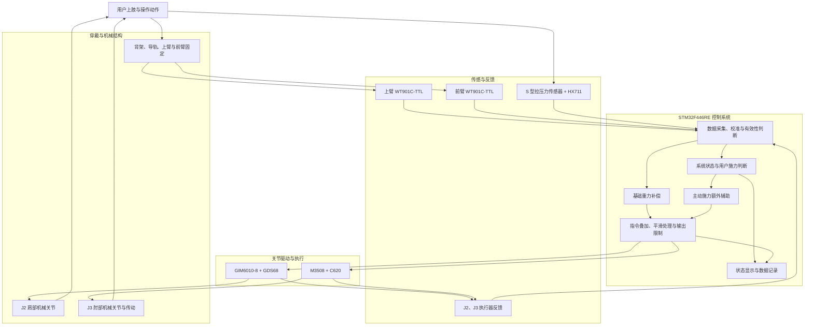

# 上肢助力外骨骼系统技术文档

## 1. 项目概述

### 1.1 项目背景

骨科手术过程中，医生及手术助手需要频繁完成拉钩、支镜、持械、拨、撬、推、钻等上肢操作。不同任务虽然操作形式不同，但都可能对上肢产生持续或瞬时的较高负荷。

其中，手术助手在拉钩、支镜和持械等任务中，往往需要长时间维持手臂姿态，并不断进行小范围的位置调整。其主要问题并不是单次动作所需力量过大，而是长时间支撑手臂及器械所产生的持续性肩部和上肢疲劳。

另一方面，骨科医生在拨、撬、推、钻等操作中，需要在保持动作方向、精度和控制权的同时，短时间输出较大的力量。这类任务的需求不是持续获得较大的辅助，而是在真正需要发力时获得额外支持，同时不能影响医生自身对器械和动作的控制。

因此，本项目希望构建一种面向骨科手术上肢操作的辅助系统：在正常使用过程中持续减轻上肢自身重量造成的负担，并在用户出现明显主动施力需求时进一步提供辅助。

系统强调辅助而非替代用户操作，并尽量减少额外的模式切换和主动交互，项目严格围绕直觉设计，使辅助能够自然地融入原有手术操作流程。

### 1.2 使用场景

本系统的目标使用场景为骨科手术过程中存在上肢持续负荷或短时高力操作的场景，包括手术助手长时间拉钩、支镜、持械，以及骨科医生进行拨、撬、推、钻等操作。

当前系统不直接面向正式临床应用，而是作为上肢助力外骨骼的原型系统，用于验证机械结构、传感方式、助力控制逻辑和用户交互方式是否具备进一步开发价值。

### 1.3 目标用户

本项目主要面向骨科手术过程中承担上肢持续负荷或高力操作的医护人员，根据任务特征分为两类主要用户。

在实际使用中，同一台设备可能服务于不同角色；同一名用户在不同操作阶段也可能同时具有“静态支撑”和“主动施力”两类需求。因此，以下用户分类用于描述任务特征，而不是将系统拆分为互不相干的两套设备。

#### 1.3.1 静态支撑型手术助手

主要包括骨科第一助手、第二助手、住院医师及规培医生等。

典型任务包括：

- 拉钩；
- 支镜；
- 持械；
- 长时间保持特定上肢姿态；
- 在保持过程中进行小范围位置调整。

这类用户的核心需求是**降低长时间静态或低速操作造成的上肢持续负荷**。

系统需要在不妨碍用户自由调整手臂位置的前提下，为其持续提供稳定的基础辅助，使用户不需要依靠自身肌肉长时间承担全部手臂和器械重量。

#### 1.3.2 高力量操作型骨科医生

主要包括需要完成拨、撬、推、钻以及植入等高力操作的骨科术者。

这类任务通常具有明显的主动施力阶段，用户需要在短时间内输出较大力量，同时保持：

- 操作方向；
- 动作精度；
- 器械控制权；
- 动作节奏。

这类用户需要的不是系统持续输出较大的辅助力量，而是**在正常操作时保持自然运动，在用户真正开始发力时提供额外辅助，并在施力结束后及时退出额外辅助。**

系统仅承担辅助作用，用户始终决定动作的方向、幅度和时机。

#### 1.3.3 两类用户的共同需求

虽然两类用户的任务负荷不同，但共同需求可以归纳为：

**在不改变原有操作习惯、不频繁进行模式切换，并保持用户直接控制权的前提下，根据当前任务状态提供适当的上肢辅助。**

因此，本系统并不是分别为两类用户建立完全独立的工作模式，而是希望通过同一套辅助逻辑覆盖两类典型需求：

**基础重力补偿持续存在，高负荷辅助按实际需求叠加。**

### 1.4 系统设计目标

具体设计目标包括：

- 提供基础重力补偿，减轻手臂及所持器械造成的持续负担；

- 在用户出现明显主动施力需求时，叠加额外助力，而不是持续输出大力矩；

- 保持用户对动作方向、幅度、节奏和器械位置的直接控制；

- 减少按钮、脚踏等额外模式切换，使系统尽量根据动作状态自动调整辅助方式；

- 保证助力进入、变化和退出过程平滑，避免突然助力影响操作稳定性；

- 基于现有硬件条件完成可验证的原型系统，而不是直接追求完整医疗产品；

- 最大程度保留开源项目中可复用的结构思路、交互逻辑和系统分层方式，在尽量减少新增复杂硬件的前提下，根据本项目硬件重新设计关键驱动与控制部分。

### 1.5 系统边界

本项目当前定位为面向骨科上肢操作的助力外骨骼原型系统，主要用于验证机械结构、驱动方案、传感方式、控制逻辑和人机交互方式。系统边界如下。

- 第一，本系统是助力系统，不是自动手术系统。系统只能根据用户的运动状态和主动施力趋势提供辅助，不能替代医生或手术助手完成操作，也不能自主决定器械的运动方向、操作幅度或动作时机。用户始终保留对动作的直接控制权。
- 第二，本系统当前不作为正式医疗器械使用。现阶段工作重点是原型设计、台架测试、低风险穿戴适配和控制逻辑验证，不包含临床有效性验证、灭菌流程验证、医疗器械注册认证或真实手术环境部署。
- 第三，本系统不覆盖全部骨科手术动作。当前重点关注两类典型上肢负荷场景：一类是拉钩、支镜、持械等静态或低速支撑任务；另一类是拨、撬、推、钻等短时主动施力任务。对于高复杂度、多器械协同、双臂协同或直接作用于患者组织的精密自动化操作，均不属于当前原型阶段的设计范围。
- 第四，本系统当前以单侧上肢辅助为主要开发对象，不直接扩展为全身外骨骼、双臂协作系统或完整手术机器人系统。后续是否扩展到更多自由度，需要在现有单侧结构、驱动能力和安全机制验证完成后再决定。
- 第五，本系统的安全能力以原型验证阶段为边界。在进入人体穿戴测试或更高负载测试前，需要进一步完善机械限位、急停、过流保护、温度保护、通信超时处理、传感器异常判断和助力上限限制。电机额定能力、开源项目参数或仿真结果不能直接等同于人体安全性。
- 第六，本系统的软件与控制程序当前以功能验证为目标，不直接承诺达到医疗级软件可靠性。开发顺序以基础功能实现为主，但涉及电机输出、助力控制和异常停止的代码，仍需要经过编译检查、接口核对和必要的台架验证后，才能进入下一阶段集成。

### 1.6 开源复用与 AI 辅助开发原则

#### 1.6.1 开源项目复用原则

本项目在遇到技术难题、新功能开发或架构设计问题时，优先检索已有开源项目、公开技术资料和工程经验，而不是直接从零开始闭门实现。可参考的来源包括 GitHub、Gitee、公开论文、官方手册、开发者社区和相关问题讨论，但所有参考内容都需要结合本项目硬件条件重新判断。

本地已经收集的项目、具体存放位置、对应模块和当前复用判断统一记录在[《上肢外骨骼开源项目本地索引》](../Open-source%20projects/OPEN_SOURCE_PROJECTS_INDEX.md)中。该索引只是部分参考库；本地没有合适项目时，仍必须按照索引列出的 GitHub、Gitee、GitCode、AtomGit、GitLink 等入口继续联网检索，不能直接转入从零编写。

- 第一，优先复用系统和逻辑思想，而不是直接复制完整硬件。开源项目中的背架、绑带、连杆、关节布置、交互模式和软件分层方式可以作为参考，但具体电机、驱动器、主控板、安装结构和传动形式需要根据本项目硬件重新设计。
- 第二，明确区分“可直接复用”“需要修改”和“仅作参考”的内容。对于机械结构、控制程序、传感方案和通信协议，需要分别说明来源、使用方式和修改原因，避免将开源项目中的设计直接视为本项目可用方案。
- 第三，保留开源项目中有价值的人机交互逻辑。例如自由跟随、助力、保持、故障保护等状态思想可以作为本项目控制模式设计的基础，但底层驱动、通信接口、传感器读取和安全监督逻辑需要重新实现。
- 第四，所有开源参考都需要经过本项目条件下的重新验证。开源项目中的尺寸、力矩、控制效果和安全性不能直接视为适用于本系统，必须结合实际电机、传动结构、负载条件、传感器精度和测试结果重新评估。

#### 1.6.2 AI 辅助开发原则

本项目的软件开发可以使用 AI 编程工具辅助完成。AI 的主要作用包括检索已有实现路径、对比开源方案、生成代码草案、修改局部模块、整理接口和排查错误。AI 不应在没有参考现有路线依据的情况下从零假设一套功能或架构；对于稍复杂的问题，应优先查找已有资料、参考项目和本项目已经确定的设计约束。

AI 辅助开发遵循以下原则：

- 第一，需求由项目设计确定，代码由 AI 辅助实现。开发前需要先明确硬件连接关系、控制目标、输入输出接口、状态机逻辑和安全限制，再由 AI 根据这些约束生成或修改代码。
- 第二，AI 在遇到难题、问题时（稍微复杂的问题），先向用户报告现在的问题和思路。在没有查明根本原因时，绝对禁止修改代码。严禁盲目猜测 Bug 原因。未查明 Root Cause（根本原因）前，禁止修改代码。
- 第三，关键控制逻辑必须可解释。对于重力补偿、主动施力判断、助力平滑过渡、故障保护和急停处理等核心模块，需要保留清晰的模块结构、变量含义和状态转换关系，避免出现无法理解、无法调试的黑箱式代码。要尽可能的解耦。
- 第四，代码修改应保持小步迭代。每次修改尽量对应一个明确目标，例如完成一个驱动接口、增加一个状态判断、修复一个通信问题或补充一个安全检查。修改后应记录变化，并通过编译或测试确认结果。
- 第五，当出现“随便改一行试试看”的倾向时，应立即停止修改。必须先通过日志、复现步骤或测试结果确认问题位置，再决定修改方案。
- 第六，同一处 Bug 连续尝试修复三次仍失败时，应视为可能存在架构或接口设计问题，必须暂停局部修补，并重新讨论是否需要调整模块设计。
- 第七，修复问题应形成验证闭环。能构造失败测试或复现条件时，应先保留失败现象，再通过修改证明问题被修复。修复过程中不得顺便重构无关代码。

---

## 2. 系统功能
>本系统可以分成两大模式重力补偿（一直）和主动施力辅助（偶尔）

### 2.1 持续重力补偿

持续重力补偿是本系统的基础功能。系统在使用过程中持续为用户上肢提供基础支撑，用于抵消部分手臂及所持器械产生的重力负荷。

在拉钩、支镜、持械等需要长时间保持姿态的任务中，系统能够持续提供稳定辅助，减少用户维持手臂位置所需要的肌肉力量，从而减轻肩部和上肢疲劳。

该功能要求系统承担手臂的至少80%，但用户仍能主动调整手臂位置，不能妨碍自由移动。基础辅助应在正常运动、静态保持和小范围微调过程中持续存在，避免用户在不同操作阶段频繁切换模式。

### 2.2 主动施力辅助

当用户进行更大力量的操作时，系统能够识别用户主动增加力量的意图，并在基础重力补偿之外自动增加辅助。

额外辅助的大小能够根据用户实际施力程度进行变化，而不是简单地在“有助力”和“无助力”之间切换，使系统在不同操作强度下提供相匹配的辅助。如果该需求实现复杂可以固定助力力量。

主动施力辅助只在用户出现明确发力趋势时叠加，不作为系统的常态输出。施力结束后，系统应逐步退出额外助力，并回到基础重力补偿状态，避免在用户重新定位或精细调整时继续施加强辅助。

### 2.3 两种模式的切换原则

当检测到用户开始明显主动施力时，再开始助力。 这种主动施力主要通过人机之间的交互力进行识别。
### 2.4 平滑助力调节（助力模式下）

系统提供的额外辅助能够随着用户施力逐渐增加，并在用户停止施力后逐渐减小或者切换到重力补偿。

助力的进入、变化和退出过程应保持连续和平滑，避免突然增加或撤去辅助对用户动作造成干扰。

平滑调节主要用于避免两类问题：一是助力突然进入导致用户动作方向被改变；二是助力突然退出导致用户瞬间承担全部负荷。

### 2.5 保持用户主动控制

系统的作用是辅助用户完成操作，而不是替代用户进行动作。

无论处于基础重力补偿还是额外助力状态，用户始终保持对手臂运动方向、操作节奏和器械位置的主动控制，系统根据用户行为提供相应辅助。

### 2.6 基本安全功能

在原型阶段，系统需要具备基本安全功能，以保证机械、电气和软件异常不会直接转化为不可控输出。

基本安全功能包括：

- 助力输出上限限制；
- 关节角度和速度限制；
- 电机电流与温度限制；
- 通信超时处理；
- 传感器异常判断；
- 急停或快速停止接口；
- 故障状态下的持续零输出或受限输出。

本章只定义系统应具备的功能方向，具体安全策略将在第 10 章“安全与异常处理”中展开。

### 2.7 核心功能概述

系统的核心功能可以概括为：

**持续提供基础重力补偿，并根据用户实际主动施力情况自动、连续地增加额外辅助，使静态保持任务获得稳定支撑，高负荷操作获得更强辅助，保持用户对动作的直接控制，不得干扰用户移动，并在异常情况下限制或停止输出。**

---

## 3. 开源项目参考与技术来源

### 3.1 开源项目筛选原则

本项目采用“ExoKit 主参考项目优先”的开源复用原则。第三章中涉及的每一个模块，在开始设计、建模或编程前，都应先检查 ExoKit 中是否已有可直接借鉴的结构、代码、状态逻辑或模块接口。

如果基于 ExoKit 的修改量预计小于约 40%，则优先沿用 ExoKit 的方案，并在其基础上做局部适配。这里的“修改量”不是严格的数学比例，而是用于判断工作方向：如果主要结构、连接关系、交互逻辑或模块分层仍来自 ExoKit，只是因为电机、传感器、尺寸或接口不同而进行局部修改，则应继续把 ExoKit 作为底版，而不是重新设计一套系统。

如果 ExoKit 中没有合适方案，再检索其他开源项目、官方示例、技术手册、论文和公开问题讨论。检索优先级如下：

1. 直接可用项目：结构、代码、接线、协议或测试方法与本项目高度一致，经过核对后可以直接采用或少量修改。(最好)
2. 部分可用项目：不能整体复用，但其中某一部分可以用于本项目，例如 CAN 通信、传感器读取、状态机、机械连接方式或测试流程。(好)
3. 思路借鉴项目：不能直接复用，但可以参考其架构、控制逻辑、问题处理方式或验证方法。（需要与用户进行汇报）
4. 自主实现：只有在 ExoKit 和其他公开资料都不适合时，才进入自主设计或 AI 辅助从头实现。进入该阶段前，必须先向用户说明已经检查了哪些方向、为什么不能复用、从零实现会带来什么风险，并在用户确认后再继续。

因此，本项目不是默认从零开发，而是遵循以下顺序：

**先查 ExoKit，ExoKit 不适合再查其他开源；优先直接复用，其次部分复用，再次思路借鉴；全部不适合时，先与用户讨论确认，再自主实现。**

每次开始新的机械、传感器、执行器或软件模块前，应先查看[本地开源项目索引](../Open-source%20projects/OPEN_SOURCE_PROJECTS_INDEX.md)。索引中的项目不是完整清单；如果没有对应项目，需要继续联网搜索并记录新项目的位置和用途。

### 3.2 参考开源项目总览

| 参考来源 | 参考内容 | 使用方式 | 修改内容 |
|---|---|---|---|
| ExoKit | 上肢外骨骼整体结构、穿戴关系、模块分层、人机交互模式 | 基础底版 | 在 ExoKit 原有结构基础上，围绕现有电机、传感器、小臂长度、关节安装和线束走向进行改型 |
| ExoKit 相关机械结构 | 背架、肩部布置、上臂固定、前臂固定、导轨、连杆、绑带和穿戴方式 | 优先直接借鉴或局部修改 | 原 Dynamixel 关节执行结构不能直接沿用，需要根据 J2 肩部 GIM6010-8 和 J3 肘部 M3508+C620 重新设计安装与输出连接 |
| GIM6010-8 官方资料及示例 | GIM6010-8 电机参数、GDS68 驱动器接口、CAN 控制方式 | 模块开发前核对 | 用于 J2 肩部关节驱动，不直接替代 ExoKit 整体架构 |
| RoboMaster M3508 / C620 官方资料及示例 | C620 控制指令、CAN 反馈、电流控制、转子位置和温度反馈 | 模块开发前核对 | 用于 J3 肘部关节执行源；M3508 为裸电机，不能直接作为人体侧承力输出关节 |
| WT901C-TTL 官方资料及开源读取示例 | 姿态、角速度、加速度、串口协议和数据解析 | 模块开发前核对 | 用于上臂和前臂姿态采集，不能直接等同于高精度关节编码器 |
| S 型拉压力传感器与 HX711 相关资料 | 拉压力采集、应变桥放大、标定和滤波 | 模块开发前核对 | 用于人机交互力识别，具体安装方向、量程和标定方法需由实物测试确定 |
| 其他上肢外骨骼、肘关节助力、重力补偿和力控制项目 | 重力补偿算法、人机交互力控制、状态切换、测试方法 | ExoKit 不覆盖时再检索 | 只能在核对硬件、许可证和测试条件后作为直接复用、部分复用或思路借鉴来源
具体硬件信息请参考hardware_list文件夹（与本文件同在一个文件夹）其中有技术文档和具体型号
|

### 3.3 机械结构参考

机械结构以 ExoKit 作为基础底版。本项目优先参考 ExoKit 的整体穿戴方式、背部支撑结构、肩部布置、上臂固定、前臂固定、导轨、连杆和绑带关系。

本项目的机械修改不应理解为重新设计一套外骨骼，而是在 ExoKit 底版上适配现有硬件。当前主要修改方向包括：

- 根据 J2 肩部 GIM6010-8 重新设计肩部电机安装、输出连接和必要的限位结构；
- 根据 J3 肘部 M3508+C620 重新设计肘部电机安装、传动连接、输出端承力结构和限位结构；
- 根据用户前臂长度、绑带位置和穿戴舒适性调整小臂相关结构；
- 根据 WT901C-TTL、S 型拉压力传感器和线束布置增加传感器安装位置；
- 根据实际装配情况检查导轨、连杆、绑带、电机座和关节之间是否存在干涉。

### 3.4 驱动与传动结构参考

驱动与传动结构应先检查 ExoKit 原始关节执行方式是否能直接适配。如果 ExoKit 的原方案不能匹配本项目硬件，则在保留其关节位置和系统逻辑的基础上，重新设计电机安装、输出连接和承力路径。

本项目当前已确认的主动关节硬件为：

- J2 肩部关节：使用 SteadyWin GIM6010-8 集成减速电机及 GDS68 驱动器；
- J3 肘部关节：使用 RoboMaster M3508 直流无刷电机及 C620 无刷电机调速器。

J2 肩部关节的 GIM6010-8 自带 8:1 减速，官方参数中额定扭矩为 5 N·m，可作为肩部主动关节的主要执行器进行设计。后续需要核对其 CAN 控制接口、位置 / 速度 / 力矩相关指令、供电范围、安装尺寸和散热条件。

J3 肘部关节的 M3508 当前确认是 120 g 裸电机，不是 M3508 P19 减速电机总成。根据现有硬件清单，M3508 搭配 C620 时官方额定转矩为 0.16 N·m，峰值转矩为 0.33 N·m。

### 3.5 传感系统参考

传感系统也遵循 ExoKit 优先原则。应先检查 ExoKit 中已有的传感器布置、数据读取和用户状态判断方式；如果 ExoKit 不能覆盖本项目现有硬件，再分别查找 WT901C-TTL、S 型拉压力传感器和 HX711 的官方资料及开源读取示例。

本项目当前已确认的传感硬件包括：

- 两个 WitMotion WT901C-TTL 九轴姿态传感器；
- 一个微小方 S 型拉压力传感器；
- 一个 HX711 称重传感器 ADC / 放大模块。

两个 WT901C-TTL 可用于上臂和前臂姿态采集，辅助判断手臂姿态、运动趋势和重力补偿方向。它可以提供加速度、角速度、磁场、Euler 角和 Quaternion 等数据，但在本项目中不能直接等同于高精度关节编码器。后续如果需要更精确的关节角度，应结合结构几何、安装位置和实际标定结果判断。

S 型拉压力传感器和 HX711 主要用于人机交互力识别。相比仅依靠 IMU 或电机电流估算用户意图，直接测量人机接触或传力结构中的拉压力更符合主动施力辅助的目标。后续设计需要确认传感器量程、安装方向、受力路径、采样频率、滤波方法和零点标定方式。

### 3.6 重力补偿控制参考

重力补偿控制应先检查 ExoKit 中是否已有可借鉴的助力模式、跟随逻辑和关节控制结构。如果 ExoKit 的控制代码不能直接适配 STM32F446RE、GIM6010-8、M3508+C620 和 WT901C-TTL，则保留其控制思想和状态模式，重新实现底层算法与驱动接口。

本项目的重力补偿目标是持续减轻上肢重量造成的负担，使用户在拉钩、支镜、持械和低速微调过程中不需要长期承担全部手臂负荷。当前文档中“至少承担手臂 80%”应作为设计目标和后续测试指标，而不是已经验证完成的结果。

如果 ExoKit 和已有开源项目中没有可直接复用的重力补偿算法，应先整理可用传感器、关节自由度、目标输出和测试方法，再与用户确认是否进入自主算法设计。github上应该有合适的请你先依据当前情况去找，找到最合适的和用户汇报。

### 3.7 人机交互力控制参考

人机交互力控制用于识别用户是否开始主动施力，并决定是否在基础重力补偿之外叠加额外辅助。该部分应先检查 ExoKit 是否已有相近的交互模式或反应逻辑；如果 ExoKit 没有直接可用的力识别方案，再检索基于拉压力传感器、电机电流、弹性元件或关节阻抗控制的开源项目。

本项目当前已有 S 型拉压力传感器和 HX711，因此主动施力识别应优先围绕该硬件展开。基本思路是：当传感器检测到用户与设备之间的交互力超过设定阈值，并且方向、持续时间和变化趋势满足条件时，系统认为用户进入主动施力状态；当交互力下降到阈值以下或持续时间结束后，系统逐步退出额外助力，回到重力补偿状态。注意切换时，不要出现两个模式都没有的情况，应该以重力补偿为底版

该模块后续需要重点参考和验证：

- 拉压力传感器的安装位置是否能真实反映用户主动施力；
- 传感器输出方向与拉 / 压方向的对应关系；
- HX711 的采样率、噪声、零点漂移和滤波方式；
- 主动施力阈值、持续时间阈值和退出阈值；
- 助力进入和退出过程是否足够平滑；
- 是否需要结合 IMU 姿态、速度或电机反馈辅助判断。

如果传感器方案在实际装配中不能可靠识别主动施力，再考虑电机电流、弹性结构或其他力估算方案。该类替换属于核心交互逻辑变化，应先与用户讨论确认。

### 3.8 软件与控制程序参考

软件与控制程序同样以 ExoKit 为主参考。ExoKit 的价值主要在于系统分层、交互模式、状态逻辑和上层控制思想，而不是底层代码可直接搬运。本项目使用 STM32F446RE、GIM6010-8、M3508+C620、WT901C-TTL、S 型拉压力传感器和 HX711，因此底层通信、驱动和数据采集程序需要按当前硬件重新实现。（详细规则看1.6 开源复用与 AI 辅助开发原则）

开始编写任何驱动或控制模块前，还需要先查看[本地开源项目索引](../Open-source%20projects/OPEN_SOURCE_PROJECTS_INDEX.md)中的对应项目、代码入口和复用等级。本地参考不足时，应使用索引中列出的国内外开源网站继续检索。

软件参考和实现顺序如下：

1. 先检查 ExoKit 中是否已有对应的状态模式、交互逻辑或模块分层可以沿用。
2. ExoKit 可用时，优先保留其逻辑结构，并修改底层硬件适配层。
3. ExoKit 不覆盖时，再检索 STM32、CAN、GIM6010、C620、WT901、HX711 等对应模块的官方示例和开源工程（详细规则看1.6 开源复用与 AI 辅助开发原则）。
4. 如果找到直接可用或部分可用的驱动代码，应先核对许可证、接口、电压、通信协议、数据格式和测试条件，再决定是否复用。
5. 如果没有合适资料，不允许直接凭空编写复杂模块，应先向用户汇报检索结果和实现风险。

本项目的软件分层可参考以下方向：

**ExoKit 交互 / 上层 API → 系统状态管理 → 关节控制器 → 安全监督 → 硬件驱动层 → STM32 HAL / CAN / UART / GPIO。**

其中，GIM6010-8 和 M3508+C620 应抽象为不同的关节执行器接口；WT901C-TTL、S 型拉压力传感器和 HX711 应作为数据采集模块；重力补偿、主动施力辅助和平滑过渡应位于控制逻辑层，而不是散落在底层驱动代码中。

---

## 4. 系统需求

本章将前述使用场景和系统功能转化为后续机械、硬件、软件和测试工作可以逐项检查的系统需求。需求主要来自本项目已经确定的目标与硬件条件，同时参考 ExoKit 的模块化结构和交互逻辑、LEAP-Upper-Limb 的 STM32F446RE 上肢外骨骼实现、OpenExo 的控制器组织与故障管理方式，以及外骨骼人机交互与安全评价资料。

其中，ExoKit 仍是本项目的整体底版；其他开源项目只用于补充 ExoKit 未覆盖的 STM32 实现、安全监督和测试方法。ISO 14971、ISO 13482 和 ASTM F48 相关资料在当前阶段仅用于建立风险意识和验证思路，不表示本原型已经符合医疗器械或机器人安全认证要求。

本章采用以下需求状态：

- **必须满足**：进入相应测试阶段之前必须具备；
- **初始目标**：根据当前项目目标提出，需通过台架试验确认是否合理；
- **实测后确定**：当前硬件或结构信息不足，必须完成实物标定后才能确定最终数值。

需求的主要验证方式包括文档检查、代码检查、静态分析、无负载台架测试。所有人体穿戴测试都必须晚于机械限位、急停、通信超时、输出限制和台架故障测试。

本章主要调研依据包括：[ExoKit 官方仓库](https://github.com/HCI-Lab-Saarland/ExoKit)、[ExoKit CHI 2025 论文](https://doi.org/10.1145/3706598.3713815)、[LEAP-Upper-Limb](https://github.com/ziteh/LEAP-upper-limb)、[OpenExo](https://github.com/naubiomech/OpenExo)、[WitMotion 官方 STM32 SDK 说明](https://wit-motion.gitbook.io/witmotion-sdk/wit-standard-protocol/sdk/stm32_sdk-quick-start)、[SteadyWin 官方下载中心](https://www.edo-moution.com/h-col-124.html)、[ISO 14971:2019](https://www.iso.org/standard/72704.html)、[ISO/FDIS 13482](https://www.iso.org/standard/83498.html)、[ASTM F3474-20](https://store.astm.org/f3474-20.html)及[人机外骨骼交互评价综述](https://pmc.ncbi.nlm.nih.gov/articles/PMC9183080/)。后续第 13 章将统一整理资料用途、适用范围和许可证状态。

### 4.1 功能需求

| 编号 | 功能需求 | 状态 | 验证方式 |
|---|---|---|---|
| FR-01 | 系统正常首先进入无助力初始化状态。在主控、电机、传感器、通信和校准状态检查完成前，J2 肩部和 J3 肘部不得产生主动助力。 | 必须满足 | 上电流程检查、断点或日志检查、台架测试 |
| FR-02 | 系统应支持 J2、J3 关节零位，两块 WT901C-TTL 的安装姿态，以及 S 型拉压力传感器零点和比例系数的校准。校准失败时不得进入正常助力状态。 | 必须满足 | 校准流程测试、异常输入测试 |
| FR-03 | 正常工作时，系统应持续提供基础重力补偿，并允许用户在补偿状态下主动移动、静态保持。 | 必须满足 | 模拟手臂负载测试、低速轨迹测试 |
| FR-04 | 重力补偿应同时考虑上臂、前臂和允许范围内的持物负载。不同用户、臂长或负载变化后，应能够重新设置或标定补偿参数。 | 必须满足 | 参数检查、不同模拟负载测试 |
| FR-05 | 系统应通过 S 型拉压力传感器和 HX711 识别用户主动施力趋势。识别至少应考虑力的方向、幅值、持续时间和退出条件，不能仅由单个瞬时采样值触发。 | 必须满足 | 力输入阶跃、缓慢加载、冲击和噪声测试 |
| FR-06 | 主动施力被确认后，系统应在基础重力补偿之上叠加额外辅助。模式切换过程中不得出现基础重力补偿和额外辅助同时失效的空档。 | 必须满足 | 状态切换日志、输出曲线检查 |
| FR-07 | 额外辅助应优先根据交互力连续调节；如果第一阶段无法稳定实现连续调节，可采用经过限制的固定助力，但固定助力值必须可配置并通过低负载台架测试。 | 初始目标 | 多级力输入测试、输出记录 |
| FR-08 | 主动施力结束后，系统应平滑撤去额外辅助并回到基础重力补偿，不得直接跳变为零输出。 | 必须满足 | 力释放测试、输出曲线检查 |
| FR-09 | 用户应始终决定运动方向、动作幅度和动作时机。系统不得根据预设轨迹主动带动用户完成手术动作。 | 必须满足 | 控制逻辑检查、方向反转与中途停止测试 |
| FR-10 | 系统应至少具有初始化、基础重力补偿、主动施力辅助、保持、故障和停止状态。保持状态属于通电位置保持，不得描述为断电机械锁定。 | 必须满足 | 状态机检查、状态转换测试 |
| FR-11 | 系统应记录关键运行数据，包括时间戳、系统状态、J2/J3 指令与反馈、两块 IMU 数据、交互力、限制器状态和故障原因，以支持问题复现和后续调参。 | 必须满足 | 日志字段检查、故障复现测试 |
| FR-12 | 故障消除后，系统不得自动恢复大力矩输出。重新进入助力状态前，应经过人工确认或重新初始化。 | 必须满足 | 故障恢复测试 |

### 4.2 性能需求

性能需求用于定义原型阶段需要测量的结果，不把电机额定参数直接等同于系统输出能力。最终助力能力取决于关节结构、传动比、力臂、负载、效率、温升和控制稳定性，必须以关节输出端实测结果为准。

| 编号 | 性能需求 | 指标或判定方法 | 状态 |
|---|---|---|---|
| PR-01 | 基础重力补偿能力 | 在规定测试姿态、臂长和模拟负载范围内，系统承担不少于 80% 的静态重力负荷。 | 初始目标 |
| PR-02 | 重力补偿连续性 | 用户在验证范围内缓慢移动或停止时，补偿输出应随姿态连续变化，不得出现方向突变、明显振荡或无指令运动。 | 必须满足 |
| PR-03 | 主动施力识别延迟 | 从交互力稳定超过进入阈值到系统开始增加额外助力，第一阶段目标不超过 200 ms；最终值应结合 HX711 实际输出速率、滤波窗口和误触发测试确定。 | 初始目标 |
| PR-04 | 主动施力退出延迟 | 用户停止施力后，系统应在可配置的短延时内开始撤去额外辅助，避免因瞬时波动反复切换。具体延时通过模拟操作测试确定。 | 实测后确定 |
| PR-05 | 控制更新能力 | 关节控制与安全监督应采用确定周期运行；初始目标为关节控制循环不低于 500 Hz，姿态与交互力状态更新不低于有效传感器输出速率。若 HX711 模块不能稳定工作在满足识别需求的速率，应先报告并重新评估方案。 | 初始目标 |
| PR-06 | 助力平滑性 | J2、J3 的目标力矩、电流、速度和位置指令应设置斜率或变化率限制。允许变化率由无负载和模拟负载台架测试分别确定，不能直接照搬其他电机或开源项目参数。 | 必须满足，数值实测后确定 |
| PR-07 | 交互力信号稳定性 | 完成预热和校零后，静止状态下的零点漂移及噪声带不得接近主动施力阈值；建议将静态噪声峰峰值控制在进入阈值的 20% 以内。 | 初始目标 |
| PR-08 | 误触发控制 | 在正常自由移动、静态保持和小范围调整测试中，不应因 IMU 抖动、传感器噪声或方向变化误进入主动施力状态。每组参数至少完成 20 次重复动作记录。 | 初始目标 |
 | |

### 4.3 人机交互需求

外骨骼与人体通过背部结构、上臂绑带和前臂绑带直接接触。公开研究指出，关节轴线不对齐、绑带滑移和局部压力会造成额外的人机交互力，因此人机交互需求不能只评价“能否运动”，还应检查穿戴适配、相对滑移、舒适性和退出方式。

| 编号 | 人机交互需求 | 状态 | 验证方式 |
|---|---|---|---|
| HR-01 | 用户在正常操作中不应频繁通过按钮或界面切换重力补偿与主动施力辅助。主动施力辅助应由交互力触发，人工控制主要用于启动、停止、参数设置和故障复位。 | 必须满足 | 操作流程评审、状态切换测试 |
| HR-02 | 用户主动改变运动方向、停止动作或降低施力时，系统应能够及时跟随，不得继续沿原方向推动。 | 必须满足 | 方向反转、突然停止和力释放测试 |
| HR-03 | 上臂和前臂固定位置应可调，以适应目标用户臂长和围度，并尽量使装置关节轴线与人体肩、肘运动关系保持一致。 | 必须满足 | 尺寸调整检查、穿戴对齐检查 |
| HR-04 | 绑带和支撑结构应限制明显滑移，但不得依靠过度收紧获得稳定性。接触区域应避免锐边、突出紧固件和直接压迫传感器或线束。 | 必须满足 | 外观检查、低风险静态穿戴检查 |
| HR-05 | 用户或测试人员应能够快速解除上臂和前臂固定。快速释放动作不得依赖软件正常运行。 | 人体测试前必须满足 | 断电释放演练 |
| HR-06 | 系统应通过现有 LED、串口界面或上位机清楚区分未初始化、校准、正常助力、主动施力、故障和停止状态。故障信息应说明阻止启动或停止输出的原因。 | 必须满足 | 状态显示检查、故障注入测试 |
| HR-07 | 首次穿戴测试应记录穿戴时间、调整时间、局部压迫、绑带滑移、关节错位感和动作受限情况。出现疼痛、麻木、明显摩擦或非预期牵拉时，应立即停止。 | 必须满足 | 观察记录和用户反馈 |
| HR-08 | 当前 3D 打印件、绑带、电子元件和线束不应被表述为已满足手术室清洁、消毒或灭菌要求。若未来进入模拟手术环境，应另行设计可清洁表面、线束防护和污染控制方案。 | 必须满足 | 材料与使用边界检查 |

### 4.4 安全需求

本项目与人体直接连接并包含主动电机，因此安全需求高于一般桌面机器人。安全设计应同时覆盖机械结构、电气供电、传感器、通信、控制软件和测试流程。ExoKit 的角度越界断力矩和急停逻辑可以作为概念参考，OpenExo 的传感器、执行器和控制器故障分类可以作为错误管理参考，但均需根据本项目硬件重新实现。

| 编号 | 安全需求 | 状态 | 验证方式 |
|---|---|---|---|
| SR-01 | J2 和 J3 应具有与软件限位独立的机械限位，限制范围必须根据人体允许活动范围、装配干涉和实际穿戴对齐情况确定。 | 人体测试前必须满足 | 尺寸检查、手动极限测试 |
| SR-02 | 软件应同时限制关节角度、速度、目标力矩或电流以及指令变化率。限制值应按关节分别配置，默认采用低输出值启动。 | 必须满足 | 代码检查、边界值测试 |
| SR-03 | GIM6010-8/GDS68 和 M3508/C620 应分别执行电流、温度和通信状态检查。安全阈值应在厂家允许范围内进一步降额，不能直接使用堵转值或峰值作为连续工作上限。 | 必须满足 | 参数检查、模拟负载与温升测试 |
| SR-04 | 每个关键设备都应具有反馈超时判断。初始规则可设为连续丢失 3 个预期更新周期即判定异常，同时设置不大于 100 ms 的总超时上限；最终值按实际通信频率确定。 | 初始目标 | 拔线、停发报文和总线异常测试 |
| SR-05 | 任一关键 IMU、交互力传感器或关节反馈无效时，系统不得继续增加主动助力。若重力补偿所需输入也失效，应进入受限输出或零输出故障状态。 | 必须满足 | 传感器断线、冻结和异常值测试 |
| SR-06 | 系统应设置独立、易触及的急停或硬件禁止输出接口。触发后应立即撤销电机使能或输出命令并保持锁存，只有人工复位和重新初始化后才能恢复。 | 动力穿戴测试前必须满足 | 急停测试、复位测试 |
| SR-07 | 主控应使用看门狗或等效机制监测程序卡死，并监测关键控制任务是否按时执行。复位、掉电、欠压或程序异常时，不得产生非零瞬态助力命令。 | 必须满足 | 看门狗、复位和断电测试 |
| SR-08 | J3 的裸 M3508 不得直接作为人体侧承力关节。肘部必须具有减速或传动结构、独立关节轴和轴承支撑，使人体侧弯矩不由电机输出齿或电机轴单独承担。 | 结构设计必须满足 | CAD 检查、装配检查、静载测试 |
| SR-09 | 电机、电源线、CAN、UART 和传感器线束应固定并提供应力释放，避免关节运动造成拉脱、夹线、磨损或接触人体。 | 必须满足 | 全行程线束检查 |
| SR-10 | 故障状态下的输出策略必须明确且可重复验证。软件应记录首个故障原因，避免后续连锁错误覆盖根本原因。 | 必须满足 | 故障注入与日志检查 |
| SR-11 | 测试顺序必须遵循单模块通信测试、无电机输出测试、无负载低输出测试、模拟负载测试和低风险穿戴测试。前一级未通过时不得进入后一级。 | 必须满足 | 测试记录审查 |
| SR-12 | 在任何人体测试中，应有另一名测试人员负责急停和观察；不得由穿戴者单独完成首次动力测试。 | 必须满足 | 测试流程检查 |

当前原型不宣称符合 ISO 14971、ISO 13482、IEC 60601 或其他医疗器械标准。相关标准只用于指导危害识别、风险控制和验证记录；是否进入正式医疗器械开发，需要在原型有效性验证之后单独立项评估。

---

## 5. 系统总体架构

本章在第二章功能和第四章需求的基础上，定义机械、传感、控制、执行和用户交互之间的总体关系。这里描述的是后续硬件与软件设计应遵守的架构，不表示所有模块已经完成装配、编程或验证。各模块进入详细设计前，均应先查看[《上肢外骨骼开源项目本地索引》](../Open-source%20projects/OPEN_SOURCE_PROJECTS_INDEX.md)，并按照“ExoKit 底版、现有本地参考、继续联网检索、再决定直接或部分复用”的顺序开展工作。

### 5.1 系统总体组成

本系统围绕单侧上肢助力构成，由穿戴与机械结构、传感、主控与通信、关节执行以及控制与交互五部分组成。各部分的职责如下。

| 组成部分 | 当前组成 | 在总体架构中的职责 |
|---|---|---|
| 穿戴与机械结构 | ExoKit 背架、肩部结构、上臂固定、前臂固定、导轨和连杆，以及针对现有电机修改的 J2、J3 安装与输出结构 | 将装置固定在人体上，传递助力，并在允许范围内保持人体关节与装置关节的运动关系 |
| 传感部分 | 两个 WT901C-TTL、S 型拉压力传感器、HX711，以及 GIM6010-8/GDS68 和 M3508/C620 可提供的反馈信息 | 获取上臂与前臂姿态、用户与设备之间的交互力、关节执行器运行状态，为重力补偿和主动施力判断提供输入 |
| 主控与通信部分 | NUCLEO-F446RE 及其 CAN、UART、GPIO 等接口资源 | 完成数据接收、时间组织、状态判断、控制计算、指令发送和运行记录。具体接口分配与电气连接在第 6 章确定 |
| 关节执行部分 | J2 肩部 GIM6010-8+GDS68；J3 肘部裸 M3508+C620 及后续确定的减速、输出轴和支撑结构 | 将主控输出转换为肩部和肘部的辅助作用。J2、J3 使用不同驱动方式，不能共用未经适配的底层控制代码 |
| 控制与交互部分 | 初始化与校准、基础重力补偿、主动施力识别、额外助力叠加、保持、平滑退出、状态显示和数据记录 | 保证基础重力补偿持续存在，在识别到用户主动施力后增加辅助，并保持用户对动作方向、幅度和时机的直接控制 |

总体设计采用分层方式：机械结构负责穿戴和传力，传感器负责提供测量信息，STM32F446RE 负责集中计算与状态管理，关节驱动模块负责执行命令，上层控制逻辑负责决定“何时补偿、何时增加助力以及如何平滑退出”。这样可以在更换某个传感器或执行器时，尽量不改变整个系统逻辑。

### 5.2 系统架构图

下面的架构图用于说明模块关系，不代表最终接线图，也不表示图中模块已经完成实物验证。

图中基础重力补偿和主动施力额外辅助不是两个互相替代的独立输出。基础重力补偿是正常工作的底版，主动施力辅助是在其上叠加的附加量；用户停止施力后，只撤去附加量并回到基础重力补偿。

### 5.3 信息流与控制流

系统中的信息流从用户动作、传感器和执行器反馈开始，经过数据处理与状态判断后形成 J2、J3 的控制命令，再由机械关节把辅助作用传递给用户。主要流程如下。

1. 两个 WT901C-TTL 分别提供上臂和前臂的姿态与运动信息；S 型拉压力传感器经 HX711 提供人机交互力数据；J2、J3 驱动器提供各自可获得的运行反馈。
2. STM32F446RE 对不同来源的数据进行接收、校准、时间对应、滤波和有效性判断。WT901C-TTL 数据用于姿态与运动趋势判断，不能代替关节输出端编码器；交互力数据不能由单个瞬时值直接触发助力。
3. 基础重力补偿模块根据当前姿态、已标定的上臂/前臂参数和允许范围内的负载参数计算基础辅助量。该输出在正常运动、静态保持和主动施力过程中持续存在。
4. 用户施力判断模块根据交互力的方向、幅值、持续时间和变化趋势判断是否需要额外辅助。必要时可结合 IMU 运动趋势和执行器反馈排除噪声或错误触发。
5. 当主动施力成立时，系统在基础重力补偿上叠加额外辅助；当施力减小或结束时，额外辅助逐步减小，系统回到基础重力补偿。
6. 两部分控制量经过叠加、变化率处理和输出限制后，分别转换为适用于 GIM6010-8/GDS68 和 M3508/C620 的命令。J2、J3 可以共享上层控制目标，但必须通过各自的执行器适配模块输出。
7. 指令、反馈、传感器数据、系统状态和限制状态被统一记录，用于检查模式切换、定位异常和调整参数。

控制关系可概括为：

**传感与执行器反馈 → 数据校准与有效性判断 → 基础重力补偿 + 主动施力判断 → 额外辅助叠加 → 平滑处理与输出限制 → J2/J3 执行 → 新反馈。**

### 5.4 用户—设备交互关系

用户是动作的发起者，设备只根据用户当前姿态和主动施力情况提供辅助。系统不得通过预设手术轨迹主动带动用户完成操作，也不得替用户决定动作方向、幅度和时机。

在正常工作中，用户与设备之间形成以下关系：

- 用户移动或保持手臂时，穿戴结构把人体运动传递给装置，传感器同步获取姿态和交互力信息；
- 系统持续提供基础重力补偿，减少用户维持上肢和器械重量所需的肌肉负担，同时允许用户主动改变位置；
- 用户进行拨、撬、推、钻等短时高力量操作并形成明确交互力趋势时，系统在基础重力补偿上增加额外辅助；
- 用户减小施力、停止动作或改变方向时，附加辅助应随之减小，不得继续沿原方向推动；
- 上臂与前臂固定结构用于传递辅助和限制明显滑移，但不能通过过度收紧代替合理的关节对齐和结构支撑；
- 启动、停止、校准、参数设置和故障复位属于人工操作；重力补偿与主动施力辅助之间不要求用户在操作过程中频繁手动切换。

这一交互关系的核心是“用户控制动作，系统分担负荷”。评价系统是否有效时，除检查输出大小外，还需要检查装置是否妨碍自由移动、是否产生误触发、是否存在明显关节错位或绑带滑移，以及额外辅助退出后基础重力补偿是否仍然连续。

### 5.5 系统模块与开源参考对应关系

本节只确定每个模块首先应该查阅哪些已有项目，不在总体架构阶段假定具体代码一定可直接使用。完整的本地路径、代码入口、当前下载版本和后续联网检索入口见[本地开源项目索引](../Open-source%20projects/OPEN_SOURCE_PROJECTS_INDEX.md)。

| 系统模块 | 第一参考来源 | 当前使用方式 | 本项目必须核对或修改的内容 |
|---|---|---|---|
| 整体穿戴与机械结构 | ExoKit | 基础底版，优先直接借鉴或局部修改 | 按现有电机、用户臂长、传感器和线束位置调整；不能照搬 Dynamixel 关节执行结构 |
| J2 肩部结构与执行 | ExoKit、GIM6010-8 官方资料；本地不足时继续联网检索 | 保留 ExoKit 肩部位置和穿戴关系，驱动适配方式待检索后确定 | GIM6010-8 安装、输出连接、实际控制接口、反馈数据和参数范围 |
| J3 肘部结构与执行 | ExoKit、UICRM-Embedded、Penn 单肘外骨骼、RoboMaster 官方资料 | ExoKit 作为整体结构底版；UICRM 提供 M3508+C620 驱动部分参考；其他项目补充肘部结构思路 | 裸 M3508 的传动、独立输出轴与支撑结构，以及 C620 驱动代码与本项目 STM32 工程的适配 |
| STM32F446RE 工程组织 | LEAP-Upper-Limb、UICRM-Embedded | 部分复用和工程组织参考 | 保留本项目实际外设配置，避免把其他项目的板级初始化和引脚定义直接搬入 |
| WT901C-TTL 数据采集 | WitMotion `WitStandardProtocol_JY901` | 协议解析和 STM32 示例参考 | 将 STM32F1 示例适配到 STM32F446RE，并核对两块传感器的串口配置、输出内容和安装姿态 |
| S 型拉压力传感器与 HX711 | ExoKit 传感思路、`STM32-Libraries-HX711` | STM32 HX711 驱动作为优先直接适配候选，ExoKit 用于交互逻辑参考 | 核对实际模块引脚、采样率、阻塞行为、零点、比例系数、方向、漂移和滤波方式 |
| 系统分层、状态和交互模式 | ExoKit、OpenExo | 保留状态、交互和模块分层思想，根据现有硬件重新实现 | 使基础重力补偿、主动施力辅助、保持、故障和停止状态与本项目输入输出一致 |
| 基础重力补偿与主动施力控制 | ExoKit 及后续联网检索得到的外骨骼控制项目 | 先比较可直接使用、部分可用和思路借鉴方案，再决定实现方式 | 不直接照搬其他装置的动力学参数、力矩值、阈值或控制增益，参数由本项目模型和测试确定 |
| 状态显示与数据记录 | ExoKit Processing 接口、OpenExo 数据组织 | 部分参考 | 记录本项目 J2/J3、两块 IMU、交互力、状态和限制信息；具体界面形式后续确定 |

因此，第 6 章和第 7 章在展开硬件连接与软件实现时，不能只依据本章表格开始编写。每个模块都需要再次查看本地索引；本地项目没有覆盖时，先在索引列出的国内外开源平台进行检索。只有检索后仍没有合适方案，才向用户说明缺口并讨论是否自主实现。

---

## 6. 硬件系统

### 6.1 主控系统

- 硬件组成；
- 参考项目 / 方案；
- 本项目修改。

### 6.2 传感系统

- 硬件组成；
- 参考项目 / 方案；
- 本项目修改。

### 6.3 驱动与执行系统

- 硬件组成；
- 参考项目 / 方案；
- 本项目修改。

### 6.4 机械结构

- 结构组成；
- 参考开源结构；
- 直接复用部分；
- 修改设计部分。

### 6.5 电源系统

> 待补充

### 6.6 通信与连接

> 待补充

### 6.7 硬件连接关系

> 待补充

---

## 7. 软件与控制系统

### 7.1 软件总体架构

> 待补充

### 7.2 数据采集

> 待补充

### 7.3 用户状态识别

> 待补充

### 7.4 重力补偿控制

> 待补充

### 7.5 主动助力控制

> 待补充

### 7.6 助力平滑过渡

> 待补充

### 7.7 系统状态管理

> 待补充

### 7.8 开源代码与算法参考

> 待补充

### 7.9 本项目修改内容

> 待补充

---

## 8. 系统工作流程

### 8.1 系统启动

> 待补充

### 8.2 初始化与校准

> 待补充

### 8.3 正常运动

> 待补充

### 8.4 静态保持

> 待补充

### 8.5 主动施力

> 待补充

### 8.6 助力退出

> 待补充

### 8.7 系统停止

> 待补充

### 8.8 整体工作流程图

> 待补充

---

## 9. 人机交互设计

### 9.1 用户与系统的交互方式

> 待补充

### 9.2 自动辅助逻辑

> 待补充

### 9.3 用户反馈

> 待补充

### 9.4 模式切换原则

> 待补充

### 9.5 异常情况下的人工控制

> 待补充

---

## 10. 安全与异常处理

> 当前阶段为 Demo 原型，仅考虑最基本的安全措施。

### 10.1 基本安全原则

> 待补充

### 10.2 传感器异常

> 待补充

### 10.3 助力异常

> 待补充

### 10.4 紧急停止

> 待补充

### 10.5 断电 / 系统失效状态

> 待补充

---

## 11. 系统测试与验证

### 11.1 功能测试

> 待补充

### 11.2 重力补偿测试

> 待补充

### 11.3 主动助力测试

> 待补充

### 11.4 状态识别测试

> 待补充

### 11.5 响应与平滑性测试

> 待补充

### 11.6 基础安全测试

> 待补充

### 11.7 用户实验

> 待补充

---

## 12. 整体开源资源与参考资料

### 12.1 GitHub 项目

> 待补充

### 12.2 开源机械模型

> 待补充

### 12.3 开源控制代码

> 待补充

### 12.4 论文与技术资料

> 待补充

### 12.5 官方硬件技术手册

> 待补充

