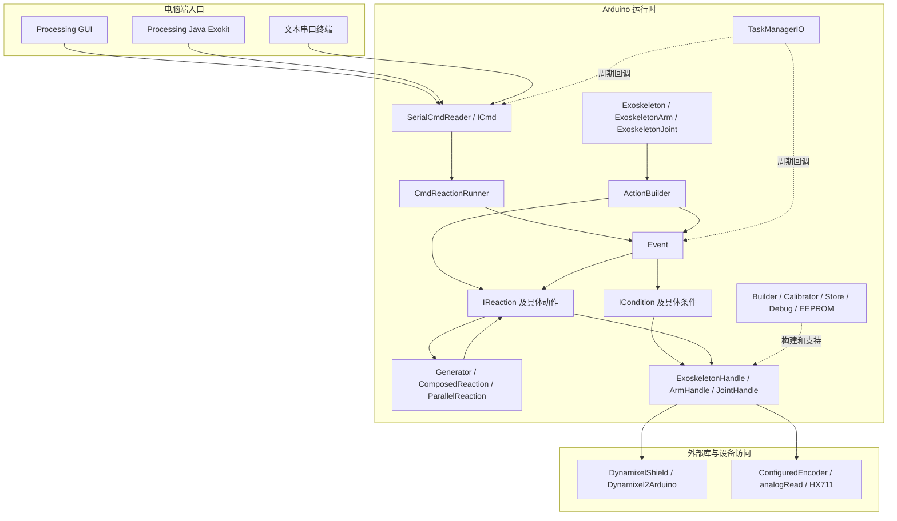
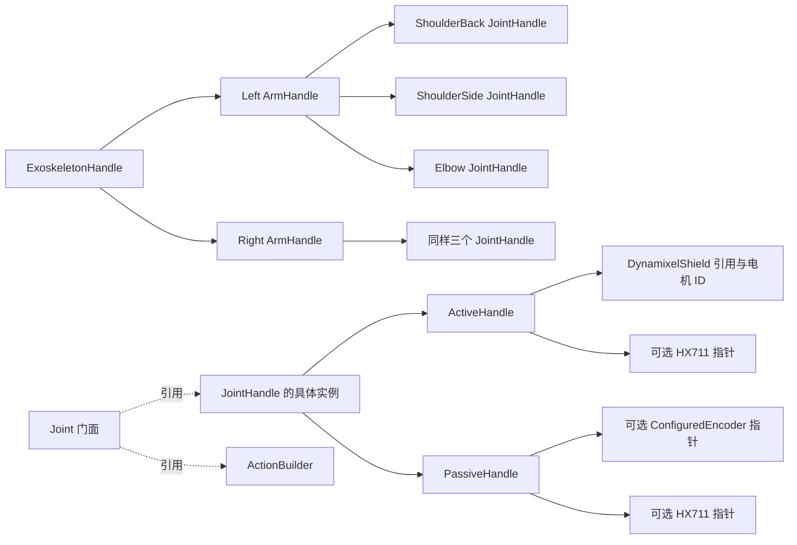
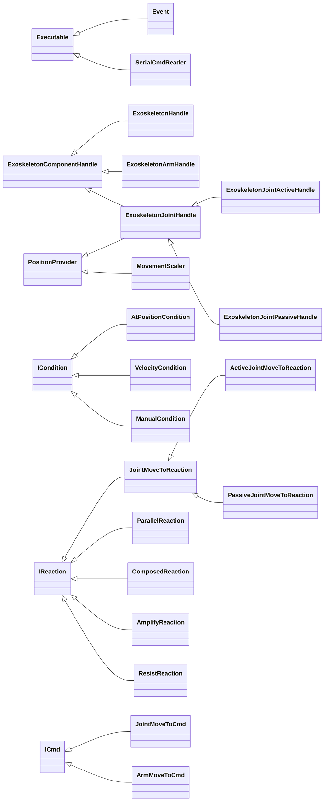
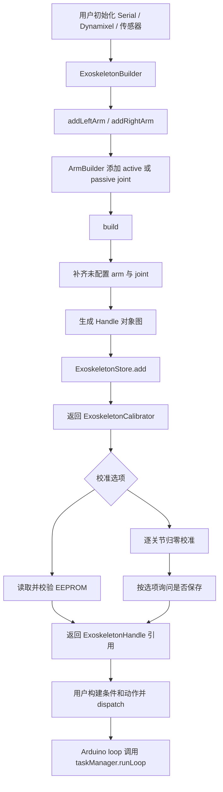
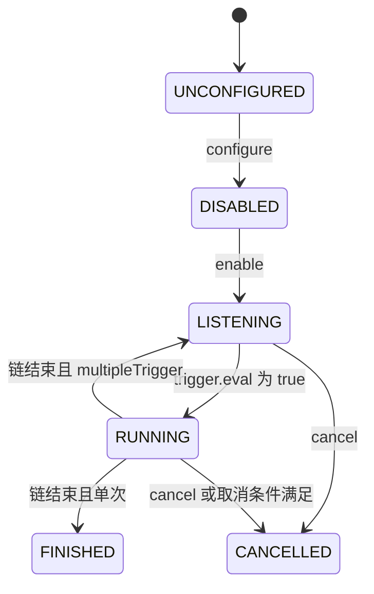
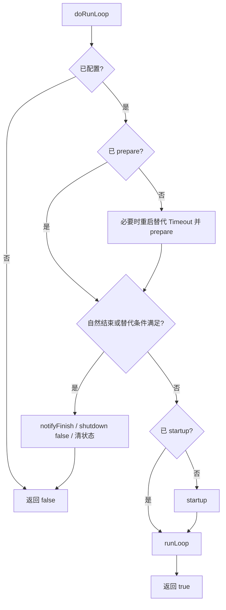
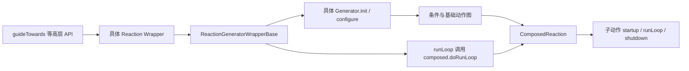
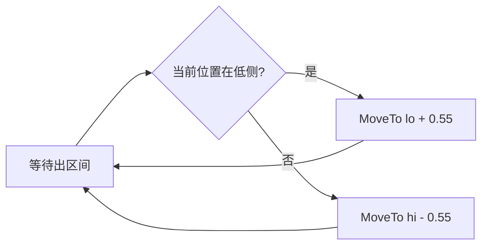
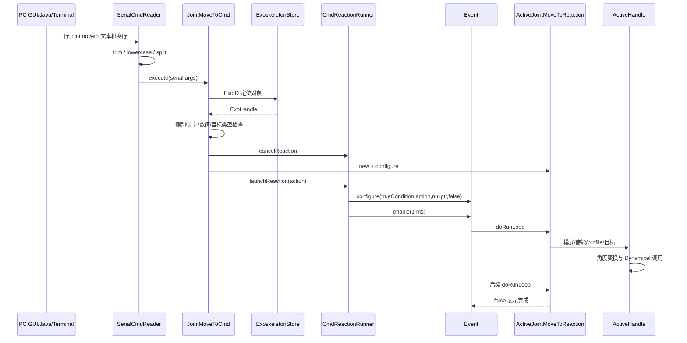

# ExoKit 软件架构与实现细节参考

> 分析日期：2026-09-24。对象：用户提供的本地 ExoKit-main 快照与《ExoKit Manual V1》。交付形式：Markdown，包含 Mermaid 层级图、执行流程、算法说明、协议表和源码接口附录。范围不含机械结构、装配、尺寸设计或力学承载分析。

## 阅读说明

**ExoKit 的软件核心是一套运行于 Arduino 环境的“条件触发—动作执行—动作组合”框架。** 高层用 `ActionBuilder` 描述交互行为，中间用 `Event`、`ICondition`、`IReaction` 调度和推进，底层通过 `ExoskeletonJointActiveHandle` 等设备对象访问 Dynamixel、电位器和 HX711。Processing 库与 GUI 提供电脑端入口，但核心行为仍在微控制器执行。

这份文档回答三个不同问题：系统怎样分层；每个主要类和函数具体做什么；手册描述与当前代码有什么差异。正文解释实现，附录保存逐文件接口声明及实现函数索引，便于查参数和跳回原文件。**声明存在、示例存在、静态路径成立，都不等于工程已编译通过或硬件行为已验证。** 本次没有运行电机，没有烧录，没有进行人体或临床验证，也没有修改参考项目。

证据标记：

- **源码事实**：能直接由本地声明、函数体、配置或字节码确认。
- **手册说明**：来自所提供 Word 的功能解释；与代码不一致时另行列出。
- **静态推断**：根据代码路径判断可能结果，尚未通过编译、模拟或设备实验确认。
- **待验证**：需要依赖库、构建环境或硬件才能确定的行为。

本报告只描述原始 ExoKit。用户另一个项目里的 STM32F446RE、GIM6010-8、裸 M3508/C620，不是这里已经实现的底层驱动。

### 目录

1. [资料范围、目录与构建入口](#s01)
2. [整体架构和两套对象模型](#s02)
3. [核心数据、坐标和单位](#s03)
4. [设备 Handle 与底层访问](#s04)
5. [构建、启动、校准与 EEPROM](#s05)
6. [调度器与 Event 状态机](#s06)
7. [IReaction 生命周期与动作链](#s07)
8. [ActionBuilder 与高层编程接口](#s08)
9. [全部条件类型及判断公式](#s09)
10. [基础动作：移动、锁定、等待、采样](#s10)
11. [生成器与整臂动作组合](#s11)
12. [增强算法：Amplify 与 Resist](#s12)
13. [引导算法：Constrain、Towards、Away](#s13)
14. [运动风格：FilterSpeed 与 Jerk](#s14)
15. [Mirror、Vibration 与 Gesture](#s15)
16. [串口通信及全部标准命令](#s16)
17. [Processing Java 库](#s17)
18. [Processing GUI](#s18)
19. [示例工程逐项解析](#s19)
20. [时序、资源与软件保护边界](#s20)
21. [手册差异、源码问题与验证建议](#s21)
22. [按技术问题查阅和复用边界](#s22)
23. [附录 A：源码文件清单与摘要](#appendix-a)
24. [附录 B：全部 C++ 头文件声明](#appendix-b)
25. [附录 C：C++ 实现函数定位](#appendix-c)
26. [附录 D：Java / Processing 函数定位](#appendix-d)
27. [附录 E：原始串口帮助文本](#appendix-e)
28. [附录 F：手册章节对照及核查记录](#appendix-f)

<a id="s01"></a>
## 1. 资料范围、目录与构建入口

### 1.1 使用了哪些资料

主证据是当前目录中的全部 `.h`、`.cpp`、`.java`、`.pde` 文件，以及 PlatformIO 配置、相关 README、Java 库描述文件。辅助证据是 [ExoKit Manual V1.docx](</Users/mzc/Desktop/Surgery_upper_exoskeleton/Open-source projects/ExoKit-main/ExoKit Manual V1.docx>) 的软件章节及 `misc/Algorithms.pdf` 的算法说明。Java 随附 `Exokit.jar` 另检查了类签名和相关字节码。

源码根目录：`/Users/mzc/Desktop/Surgery_upper_exoskeleton/Open-source projects/ExoKit-main`。

正文中的 `src/` 若没有其他限定，指 `Arduino API/lib/exokit_api/src/`。所有源码引用使用原文件绝对路径与当前行号；代码更新后行号可能漂移。附录记录文件摘要，便于识别分析对应的版本。文档没有把 README 的论文成果描述当成本次测试结果。

### 1.2 软件目录树

```text
ExoKit-main/
├── Arduino API/
│   ├── platformio.ini                 AVR / Arduino 构建配置
│   ├── CMakeLists.txt                 当前内容异常，不能当作有效 AVR 入口
│   ├── src/                          4 个示例文件，主体全部在块注释中
│   └── lib/
│       ├── platformio.ini            另一份配置
│       ├── src/                      另 4 个示例副本，主体同样被注释
│       └── exokit_api/src/
│           ├── exo/                  设备、关节、编码器、位置源
│           │   └── builder/          装配软件对象、校准
│           ├── model/                ExoArmAngles
│           ├── event/
│           │   ├── Event.*           条件触发与调度
│           │   ├── condition/        17 类条件接口/实现文件组
│           │   ├── reaction/         基础动作与组合动作
│           │   │   └── fabric/       生成动作图的 Generator
│           │   ├── concept/          高层交互行为封装
│           │   └── simpleactionbuilder/  面向使用者的编排 API
│           ├── com/                  文本命令接入
│           │   └── serialreactions/  当前串口动作与命令类
│           └── util/                 调试串口、单位转换、EEPROM CRC
├── Processing Library/exokit/
│   ├── src/exokit/                   3 个 Java 源文件
│   ├── library/Exokit.jar            发布的 Java 二进制
│   ├── example/processing_sample/    1 个 Processing 示例 PDE
│   └── library.properties
├── Processing GUI/                   7 个 GUI PDE 文件
├── ExoKit Manual V1.docx
└── misc/Algorithms.pdf
```

这里的 `fabric` 实际承担“工厂/生成器”的作用：先创建多个条件和动作，再把它们连接成一张运行图。文件目录分层不等于继承层级。

### 1.3 构建配置与外部库

[Arduino API/platformio.ini:1](</Users/mzc/Desktop/Surgery_upper_exoskeleton/Open-source projects/ExoKit-main/Arduino API/platformio.ini:1>)

| 项目 | 当前声明 | 在软件中的作用 |
|---|---|---|
| 平台 | `atmelavr` / `arduino` | Arduino API、时间、串口、GPIO、EEPROM |
| 环境 | `uno`、`megaatmega2560` | 两个声明的构建目标；不代表都已验证可用 |
| Mega CPU | `atmega2560`、16 MHz | 配置字段 |
| TaskManagerIO | `^1.4.3` | `Executable`、周期任务与协作式调度 |
| Dynamixel2Arduino | `^0.7.0` | Dynamixel 协议、控制表和模式枚举 |
| DynamixelShield | `^0.2.6` | 电机访问对象，直接被 ActiveHandle 持有 |
| HX711 | `^0.7.5` | 载荷传感器读数，标定由外部调用方负责 |
| ArxSmartPtr | `^0.3.0` | 依赖表声明；不能据此认为项目已统一采用智能指针 |
| avr-debugger | `~1.4` | 调试相关依赖 |
| LinkedList | `0.0.0-alpha+sha.dac3874d28` | 动作、条件、命令、设备集合 |
| SoftwareSerial | 未固定版本 | 软件串口相关支持 |
| monitor_speed | 1,000,000 | PlatformIO 监视器配置；不是全系统统一串口波特率 |

`^` 依赖并非完整锁定到唯一安装结果。本地代码没有附带所有外部库的完整实现，因此这里解释的是 ExoKit 如何调用它们，不冒充已经审核了依赖内部驱动。

`CMakeLists.txt` 的开头拼接了 `xcode-select --installcmake_minimum_required(...)`，又引用 `IDF_PATH` 的 ESP-IDF project.cmake，与上述 AVR PlatformIO 目标不构成清晰一致的入口。八个示例 `.cpp` 去除注释后没有有效主体。因此“下载项目后直接编译某个现成 main”并未由本快照成立。[Arduino API/CMakeLists.txt:1](</Users/mzc/Desktop/Surgery_upper_exoskeleton/Open-source projects/ExoKit-main/Arduino API/CMakeLists.txt:1>)

<a id="s02"></a>
## 2. 整体架构和两套对象模型

### 2.1 整体层级图


[查看可缩放 SVG](<exokit_reference_figures/figure_01.svg>)

<details>
<summary>展开 Mermaid 源码：软件分层与依赖</summary>



</details>

文字关系：电脑端发送一行命令，`SerialCmdReader` 解析后交给具体 `ICmd`，命令构造一个动作并交 `CmdReactionRunner` 启动。Arduino 用户也可以直接使用门面和 `ActionBuilder` 构建动作链。两条路线在 `Event` / `IReaction` 汇合。条件读取设备状态，动作读取状态并写目标；设备 Handle 再调用外部硬件库。校准与存储是侧向支持，不是每次动作必经的一层。

### 2.2 最容易混淆的两套对象

| 行为门面：描述“要做什么” | 设备 Handle：描述“操作哪个设备” |
|---|---|
| `Exoskeleton` | `ExoskeletonHandle` |
| `ExoskeletonArm` | `ExoskeletonArmHandle` |
| `ExoskeletonJoint` | `ExoskeletonJointHandle` |
| 保存 `ActionBuilder&` 与对应 Handle 引用 | 保存电机、传感器、所属手臂、范围等 |
| `moveTo` / `resist` 等通常创建并追加动作 | `setGoalPosition` / `getVelocity` 等实际读写设备 |
| 调用时主要在搭建执行图 | 被运行中的条件或动作反复访问 |
| `unwrap()` 可取回底层 Handle | 没有自动知道自己属于哪个编排动作 |

例如 `joint.moveToActive(...)` 的主要工作是 `new ActiveJointMoveToReaction()`、`configure(...)`、设置替代结束条件、`ab.nextReaction(...)`。它不是当场阻塞到目标位置的函数。[Arduino API/lib/exokit_api/src/event/simpleactionbuilder/ExoskeletonJoint.cpp:24](</Users/mzc/Desktop/Surgery_upper_exoskeleton/Open-source projects/ExoKit-main/Arduino API/lib/exokit_api/src/event/simpleactionbuilder/ExoskeletonJoint.cpp:24>)

### 2.3 对象包含/引用关系


[查看可缩放 SVG](<exokit_reference_figures/figure_02.svg>)

<details>
<summary>展开 Mermaid 源码：设备对象引用层级</summary>



</details>

一条手臂的软件模型总是有三个关节槽位。没有配置的槽位由 Builder 补成无传感器的 PassiveHandle，不表示真实存在相应传感器或电机。图中的箭头表示模型关系，不能据此推断 C++ 析构会递归释放整棵树。

### 2.4 主要继承关系


[查看可缩放 SVG](<exokit_reference_figures/figure_03.svg>)

<details>
<summary>展开 Mermaid 源码：主要类继承关系</summary>



</details>

此图只列主干，全部具体声明见附录 B。`Event`、串口读取器和保护检查同为调度任务；`Condition` 与 `Reaction` 本身通常由 Event 或组合动作调用。

<a id="s03"></a>
## 3. 核心数据、坐标和单位

### 3.1 名称、ID 与方向

`ArmSide` 是 `LEFT` / `RIGHT`。关节用 `ELBOW`、`SHOULDER_SIDE`、`SHOULDER_BACK` 区分。本文沿用源码符号，不把这些符号自动映射为用户现有项目的 J1/J2/J3 或具体电机。

`ExoskeletonStore` 分配的 ExoID 用于在串口命令中寻找一个 `ExoskeletonHandle`，起始分配为 1，类型 `int8_t`；ActiveHandle 的 `dxl_id` 是另一层的 Dynamixel 电机 ID。两者没有等值要求。Store 用链表线性检索；并没有设备发现、网络注册或设备重连协议。[Arduino API/lib/exokit_api/src/exo/ExoskeletonStore.cpp:1](</Users/mzc/Desktop/Surgery_upper_exoskeleton/Open-source projects/ExoKit-main/Arduino API/lib/exokit_api/src/exo/ExoskeletonStore.cpp:1>)

`MovementDirection` 中正方向使用 flexion/abduction 对应枚举，负方向使用 extension/adduction；解析函数将两组文字合并为相同的软件方向。不要仅根据正负号声称真实右臂一定向某个方向移动。[Arduino API/lib/exokit_api/src/com/serialreactions/cmd/CmdUtils.cpp:197](</Users/mzc/Desktop/Surgery_upper_exoskeleton/Open-source projects/ExoKit-main/Arduino API/lib/exokit_api/src/com/serialreactions/cmd/CmdUtils.cpp:197>)

### 3.2 电机角度到关节角度

`negateAngles()` 的条件是：

```cpp
(getType() == SHOULDER_SIDE) != (getSide() != LEFT)
```

| 侧别 | ELBOW | SHOULDER_SIDE | SHOULDER_BACK |
|---|---:|---:|---:|
| LEFT | +1 | −1 | +1 |
| RIGHT | −1 | +1 | −1 |

设表中符号为 `s`，电机原始角度为 `q_motor`，校准零偏为 `q_zero`：

```text
读取：q_joint = s × (q_motor − q_zero)
写入：q_motor_goal = s × clamp(q_goal, −lowerRange, upperRange) + q_zero
```

负方向限制保存为 `lowerRange` 的幅度，实际最低目标为 `−lowerRange`。软件目标裁剪不等于保证设备绝不越界。[Arduino API/lib/exokit_api/src/exo/ExoskeletonJointHandle.cpp:51](</Users/mzc/Desktop/Surgery_upper_exoskeleton/Open-source projects/ExoKit-main/Arduino API/lib/exokit_api/src/exo/ExoskeletonJointHandle.cpp:51>) [Arduino API/lib/exokit_api/src/exo/ExoskeletonJointActiveHandle.cpp:57](</Users/mzc/Desktop/Surgery_upper_exoskeleton/Open-source projects/ExoKit-main/Arduino API/lib/exokit_api/src/exo/ExoskeletonJointActiveHandle.cpp:57>)

### 3.3 常见量及单位

| 量 | 原始软件含义 | 注意点 |
|---|---|---|
| angle / position / radius / tolerance | 度 | 不采用弧度作为主接口单位 |
| velocity / speed | 度/秒 | velocity 有符号；speed 通常取绝对值 |
| acceleration | 代码试图使用度/秒² | 当前实现不是连续采样间的标准差分，见第 9 节 |
| interval / duration / timeout | 毫秒 | 基于 `millis()`，不是微秒周期 |
| frequency | Hz，若干接口为 `uint8_t` | 振动实际实现不完全满足该含义 |
| current / torquePercentage | 电流控制量的比例 | 不是直接的牛顿米；命名不构成扭矩标定 |
| load cell reading | `HX711::get_units(1)` 返回值 | 单位由外部 `set_scale` 等标定决定 |
| profile velocity = 0 | 写入设备的特殊零 profile 值 | 手册解释为最大速度；不能用它表示“停止” |

`UnitConversions` 的公式有 RPM×6→度/秒、度/秒÷6→RPM、Hz×60→RPM；弧度转换使用近似常数 57.3。[Arduino API/lib/exokit_api/src/util/UnitConversions.cpp:1](</Users/mzc/Desktop/Surgery_upper_exoskeleton/Open-source projects/ExoKit-main/Arduino API/lib/exokit_api/src/util/UnitConversions.cpp:1>)

### 3.4 ExoArmAngles 的三值与三标志

`ExoArmAngles` 分别保存 elbow、shoulderSide、shoulderBack 的浮点角度，以及三个 `has...` 标志。`set...Angle` 同时设置值和标志；`del...Angle` 清除选中状态；`isHas...` 判断是否参与当前操作。

“未设置”与“设置为 0°”不同：未设置通常表示该关节不参与本次动作或比较。串口用 `false` 表示未设置。串口角度次序固定为 **elbow、shoulderSide、shoulderBack**；设备保存和某些内部数组采用 back、side、elbow 次序，必须在边界显式转换。[Arduino API/lib/exokit_api/src/model/ExoArmAngles.h:1](</Users/mzc/Desktop/Surgery_upper_exoskeleton/Open-source projects/ExoKit-main/Arduino API/lib/exokit_api/src/model/ExoArmAngles.h:1>) [Arduino API/lib/exokit_api/src/model/ExoArmAngles.cpp:1](</Users/mzc/Desktop/Surgery_upper_exoskeleton/Open-source projects/ExoKit-main/Arduino API/lib/exokit_api/src/model/ExoArmAngles.cpp:1>)

<a id="s04"></a>
## 4. 设备 Handle 与底层访问

### 4.1 基础接口职责

| 类 | 核心职责与函数 |
|---|---|
| `ExoskeletonComponentHandle` | `printInfo()`、EEPROM 读写、类型标识 `getEepromId()` |
| `PositionProvider` | 抽象 `getPosition()`，为动态位置目标提供统一入口 |
| `MovementScaler` | `configure(provider, factor)`；`getPosition()` 返回 `factor × provider.getPosition()` |
| `ExoskeletonJointHandle` | 保存类型、侧别、范围和所属 arm；统一位置、速度、传感器与能力接口 |
| `ExoskeletonArmHandle` | 引用三个 JointHandle，取得姿态、保存所属 Exo 与侧别 |
| `ExoskeletonHandle` | 引用左右 ArmHandle，ID、ROM 检查、可选急停输入、整体 EEPROM |

`MovementScaler` 没有零点差补偿、滤波、延迟补偿或时间戳判断；这是 Mirror 的核心数学映射。JointHandle 的默认位置、速度能力返回 0 / false，具体子类覆盖。使用时应先看 `canTrack...` / `isActive()`，不能将 0 自动视为有效传感器测量。[Arduino API/lib/exokit_api/src/exo/MovementScaler.cpp:1](</Users/mzc/Desktop/Surgery_upper_exoskeleton/Open-source projects/ExoKit-main/Arduino API/lib/exokit_api/src/exo/MovementScaler.cpp:1>) [Arduino API/lib/exokit_api/src/exo/ExoskeletonJointHandle.cpp:1](</Users/mzc/Desktop/Surgery_upper_exoskeleton/Open-source projects/ExoKit-main/Arduino API/lib/exokit_api/src/exo/ExoskeletonJointHandle.cpp:1>)

### 4.2 ExoskeletonJointActiveHandle

这是最靠近电机的一层，直接绑定 `DynamixelShield&`，不是可替换所有驱动的通用执行器接口。它保存 `dxl_id`、零点、软件目标位置、模式、电流/速度常量以及可选 HX711 指针。

| 函数 | 实现步骤 / 实际调用 | 使用上的关键点 |
|---|---|---|
| 构造函数 | 查询型号、选取常量、关闭力矩、设置模式、写初始目标 | 构建设备对象本身就会访问设备 |
| `setGoalPosition(q)` | 目标裁剪→符号变换→加零偏→`dxl.setGoalPosition(...UNIT_DEGREE)` | 保存的目标是裁剪后的关节目标 |
| `getPresentPosition()` | `getPresentPosition`→减零偏→乘符号 | 返回软件关节角度 |
| `getVelocity()` | 读 `UNIT_RPM`→乘 6→乘符号 | 实时串口读取，不是统一缓存快照 |
| `setGoalVelocity(v)` | 符号转换→度/秒转 RPM→设备 Goal Velocity | 与 Profile Velocity 不同 |
| `setProfileVelocity(v)` | `v<0.01` 写 0；否则 `int((v/6)/0.229)` | 正常路径按速度幅值使用；负输入也落到 0 |
| `getProfileVelocity()` | 读原始值→乘 0.229→乘 6 | 返回度/秒量纲 |
| `setProfileAcceleration(a)` | 当前忽略参数，始终写 `PROFILE_ACCELERATION=0` | 接口名字不能保证传入加速度生效 |
| `setJointMode(mode)` | 记住 enable 状态→关闭→改模式→恢复 | 依赖软件保存的 torque 标志 |
| `setTorque(bool)` | 调用 torqueOn/Off 并保存状态 | 这里的状态不构成真实电机反馈确认 |
| `readLoadCell()` | 有 HX711 则 `get_units(1)`，没有则 0 | 没有本地单位换算或独立就绪状态 |
| `tare(currentAngle)` | 根据现位置计算新零点，再重写既有目标 | 会影响后续目标坐标转换 |
| `getTrajectory()` | 读 `POSITION_TRAJECTORY`，乘 0.0878，再转关节坐标 | Amplify 用它决定是否重发远端目标 |

[Arduino API/lib/exokit_api/src/exo/ExoskeletonJointActiveHandle.cpp:1](</Users/mzc/Desktop/Surgery_upper_exoskeleton/Open-source projects/ExoKit-main/Arduino API/lib/exokit_api/src/exo/ExoskeletonJointActiveHandle.cpp:1>)

构造函数内的型号常量如下，仅报告代码取值，不当作经过实测的设备能力：

| 型号枚举 | max velocity（RPM） | max current 原始量 |
|---|---:|---:|
| XM430_W210 | 77 | 1193 |
| XM430_W350 | 46 | 1193 |
| XM540_W150 | 53 | 2047 |
| XM540_W270 | 30 | 2047 |
| 其他分支 | 30 | 1193 |

### 4.3 电流接口的比例关系和一个重要不对称

设代码常量 `M=maxMotorCurrent`、设备限流寄存器值 `L`、目标电流寄存器值 `G`：

```text
setCurrentLimit(p)  → L = int(M × p)
getCurrentLimit()   → L / M
setGoalCurrent(p)   → G = int(M × getCurrentLimit() × p) = int(L × p)
getGoalCurrent()    → G / getCurrentLimit() = G × M / L
```

因此当前 `getGoalCurrent()` 并不返回 `setGoalCurrent()` 所接受的同一比例，差了一个 `M` 因子；`L=0` 时还出现除零路径。Amplify、Resist 会读旧目标电流并在退出时恢复，因而这个不对称可能传播至清理阶段。这个结论来自函数公式比对，尚未通过电机验证。[Arduino API/lib/exokit_api/src/exo/ExoskeletonJointActiveHandle.cpp:85](</Users/mzc/Desktop/Surgery_upper_exoskeleton/Open-source projects/ExoKit-main/Arduino API/lib/exokit_api/src/exo/ExoskeletonJointActiveHandle.cpp:85>)

### 4.4 PassiveHandle 与 ConfiguredEncoder

PassiveHandle 可以持有电位器编码器和载荷传感器；也可以两个都没有。`isActive()` 返回 false；有编码器才支持位置/速度跟踪。`getPresentPosition()`、`getVelocity()` 还应用对应关节方向符号。无电机意味着它不能驱动目标位置，但可以作为条件和 Mirror 的位置源。[Arduino API/lib/exokit_api/src/exo/ExoskeletonJointPassiveHandle.cpp:1](</Users/mzc/Desktop/Surgery_upper_exoskeleton/Open-source projects/ExoKit-main/Arduino API/lib/exokit_api/src/exo/ExoskeletonJointPassiveHandle.cpp:1>)

`ConfiguredEncoder` 的 `countsPerRevolution` 参数名容易误导：实现里对应 `potiMaxRoM`，用于 `raw/1023.0 × potiMaxRoM`，即模拟 ADC 值线性映射角度。它不是读取正交 AB 相增量编码器。

```text
readRaw()     = analogRead(potiPin)
readAngle()   = (raw / 1023.0) × potiMaxRoM − zeroPos
getVelocity()= (currentAngle − referenceAngle) / elapsedSeconds
```

构造时开启速度参考点任务；`maxVelocityReferenceAgeMs=100`，每 25 ms 请求执行采样，在两组参考点之间轮换。参考太旧（>100 ms）、结果 NaN/Inf 或未建立时间戳时返回 0。这是差分估计，不是电机自身的速度反馈。调度延迟会影响它；报告 0 不一定意味着物理上静止。

`tare()` 调整零点时对历史角度数组执行加偏移操作。结合 `readAngle=rawAngle−zeroPos`，历史参考值所需的符号值得单独验证；本次不将校准后的首批速度当作已确认正确。[Arduino API/lib/exokit_api/src/exo/ConfiguredEncoder.cpp:19](</Users/mzc/Desktop/Surgery_upper_exoskeleton/Open-source projects/ExoKit-main/Arduino API/lib/exokit_api/src/exo/ConfiguredEncoder.cpp:19>) [Arduino API/lib/exokit_api/src/exo/ConfiguredEncoder.cpp:47](</Users/mzc/Desktop/Surgery_upper_exoskeleton/Open-source projects/ExoKit-main/Arduino API/lib/exokit_api/src/exo/ConfiguredEncoder.cpp:47>)

### 4.5 Arm / Exo 的额外数据与资源

ArmHandle 有三个长度/距离字段，存储类型为 `uint16_t`、部分 setter 参数为 `uint8_t`。在已检查的控制算法中没有用它们建立重力力矩、惯量或逆运动学模型。字段存在不代表项目已经实现动力学补偿。[Arduino API/lib/exokit_api/src/exo/ExoskeletonArmHandle.h:1](</Users/mzc/Desktop/Surgery_upper_exoskeleton/Open-source projects/ExoKit-main/Arduino API/lib/exokit_api/src/exo/ExoskeletonArmHandle.h:1>)

Handle、传感器、Builder、动作多数通过引用与裸指针连接。ExoHandle 析构只显式取消 ROM 任务；不要假定删除 Exo 会释放全部 arms、joints、传感器、动作和已注册急停任务。更适合把这一快照理解为“启动后长期存在的软件对象图”。

<a id="s05"></a>
## 5. 构建、启动、校准与 EEPROM

### 5.1 Builder 调用链


[查看可缩放 SVG](<exokit_reference_figures/figure_04.svg>)

<details>
<summary>展开 Mermaid 源码：对象构建与校准流程</summary>



</details>

文字关系：Builder 建立对象图，Calibrator 处理零点配置，门面/动作对象再引用这个 Handle。`build()` 并不直接等价于“构建完即可无条件运行”；它把下一步校准接口返回给调用者。[Arduino API/lib/exokit_api/src/exo/builder/ExoskeletonBuilder.cpp:1](</Users/mzc/Desktop/Surgery_upper_exoskeleton/Open-source projects/ExoKit-main/Arduino API/lib/exokit_api/src/exo/builder/ExoskeletonBuilder.cpp:1>) [Arduino API/lib/exokit_api/src/exo/builder/ArmBuilder.cpp:1](</Users/mzc/Desktop/Surgery_upper_exoskeleton/Open-source projects/ExoKit-main/Arduino API/lib/exokit_api/src/exo/builder/ArmBuilder.cpp:1>)

### 5.2 ExoskeletonBuilder / ArmBuilder 的职责

`addLeftArm()` / `addRightArm()` 创建或返回对应 ArmBuilder。ArmBuilder 的关节添加重载区分 Dynamixel 主动关节与 ConfiguredEncoder 被动关节，也允许载荷传感器。`JointBuilderActive::build()` / `JointBuilderPassive::build()` 创建具体 Handle。

`ExoskeletonBuilder::build()` 补齐缺失 arm，ArmBuilder 补齐缺失 joint 为无传感器 passive joint；连接所属关系；可配置急停；将 Exo 加入 Store；清理中间 builder 后返回 Calibrator。清理函数删除指针但没有全面清空已删除的成员指针，因此同一个 Builder 重复使用不是已经证明可靠的操作。

范围计算属于软件配置：

| 槽位 | lowerRange 计算 | upperRange 计算 |
|---|---|---|
| elbow | `0 − lowerRestriction` | `115 − upperRestriction` |
| shoulderSide | `20 − lowerRestriction` | `115 − upperRestriction` |
| shoulderBack | `0 − lowerRestriction` | `90 − upperRestriction` |

中间 JointBuilder 的范围字段使用无符号小整数，存在下溢或截断风险。以上数值是原代码默认值，不能直接当作任何使用者的活动范围或安全阈值。[Arduino API/lib/exokit_api/src/exo/builder/JointBuilderActive.h:1](</Users/mzc/Desktop/Surgery_upper_exoskeleton/Open-source projects/ExoKit-main/Arduino API/lib/exokit_api/src/exo/builder/JointBuilderActive.h:1>) [Arduino API/lib/exokit_api/src/exo/builder/JointBuilderPassive.h:1](</Users/mzc/Desktop/Surgery_upper_exoskeleton/Open-source projects/ExoKit-main/Arduino API/lib/exokit_api/src/exo/builder/JointBuilderPassive.h:1>)

### 5.3 三种校准策略

| 选项 | 源码行为 |
|---|---|
| `ASK_CREATE` | EEPROM 有可用配置时询问是否加载；否则进入新校准；按流程询问保存 |
| `PREFER_LOAD` | 优先加载，加载不可用时新校准；后续按流程处理保存 |
| `CREATE` | 强制新校准；当前流程跳过保存询问及写入 |

Calibrator 初始化会关闭主动关节力矩。新校准按左 elbow/back/side，再右 elbow/back/side 检查可跟踪的关节，提示摆到校准位置，等串口输入确认后 `tare()`。等待串口的循环不会自动推进 `taskManager.runLoop()`，所以这是会阻塞 setup 的交互流程。

此处保存的是角度零点，不等于自动完成 HX711 比例系数、测力方向或扭矩标定。外围硬件初始化、连接波特率、传感器 scale 等仍由使用者代码提供。[Arduino API/lib/exokit_api/src/exo/builder/ExoskeletonCalibrator.cpp:1](</Users/mzc/Desktop/Surgery_upper_exoskeleton/Open-source projects/ExoKit-main/Arduino API/lib/exokit_api/src/exo/builder/ExoskeletonCalibrator.cpp:1>)

### 5.4 EEPROM 数据结构

```text
偏移 0                       : bool 配置可用标志
偏移 sizeof(bool)            : int16_t configSize
偏移 sizeof(bool)+sizeof(int16_t): Exo 配置 payload
payload                      : EXO 标识 → left arm → right arm
arm                          : 类型标识、距离字段、back → side → elbow 配置
active joint                 : 类型标识、zeroPositionDegree
passive joint                : 类型标识、是否含 encoder、可选 encoder 配置
encoder                      : CONFIGURED_ENCODER 标识、zeroPos
payload 之后                 : unsigned long CRC
```

读取函数一般返回下一个偏移；类型不符返回 `-1`。这有助于发现结构不匹配，但没有完善的 schema 版本、长度边界检查、跨 MCU 字节序协议或升级迁移。原始 `sizeof`、枚举与浮点布局参与存储，不能把 AVR EEPROM 直接当作通用二进制文件格式。

`isPersistedConfigAvailable()` 先取长度再校验，不能从 CRC 存在推断所有长度访问都安全；`EepromCrc.h` 是本项目自己的表驱动实现，报告不将它未经验证地称为与任意标准 CRC32 实现互通。[Arduino API/lib/exokit_api/src/util/EepromCrc.h:1](</Users/mzc/Desktop/Surgery_upper_exoskeleton/Open-source projects/ExoKit-main/Arduino API/lib/exokit_api/src/util/EepromCrc.h:1>) [Arduino API/lib/exokit_api/src/exo/builder/ExoskeletonCalibrator.cpp:37](</Users/mzc/Desktop/Surgery_upper_exoskeleton/Open-source projects/ExoKit-main/Arduino API/lib/exokit_api/src/exo/builder/ExoskeletonCalibrator.cpp:37>)

<a id="s06"></a>
## 6. 调度器与 Event 状态机

### 6.1 单线程协作执行

Arduino `loop()` 应反复调用 `taskManager.runLoop()`。Event、串口读取、编码器采样和保护检查都靠这个调度体系得到执行机会。`parallel()` 是交替推进两个动作分支，不是 RTOS 双线程，也不意味着两个电机的寄存器在同一时刻写入。

指定 1 ms、10 ms 或 50 ms 是请求的回调间隔，不是已测得的硬实时周期。串口阻塞、HX711 读取、繁忙等待、一次复杂动作链执行，都可能推迟其他任务。

### 6.2 Event 状态图


[查看可缩放 SVG](<exokit_reference_figures/figure_05.svg>)

<details>
<summary>展开 Mermaid 源码：Event 状态机</summary>



</details>

`configure(trigger, firstReaction, cancelCondition, multipleTrigger)` 保存指针。`enable(interval)` 注册任务，开始监听。LISTENING 中条件满足后恢复触发条件状态；若取消条件本身是计时器，重启相应计时；再进入 RUNNING。RUNNING 中检查取消条件，再推进动作链。`cancel()` 对正在运行的动作调用取消路径并移除调度任务。[Arduino API/lib/exokit_api/src/event/Event.cpp:1](</Users/mzc/Desktop/Surgery_upper_exoskeleton/Open-source projects/ExoKit-main/Arduino API/lib/exokit_api/src/event/Event.cpp:1>)

### 6.3 一个 tick 如何推进链

`performRunning()` 大致为：

```text
调用 current.doRunLoop()
├─ 返回 true：动作仍在进行，等下一次 Event 回调
└─ 返回 false：动作结束
   ├─ findNextReaction 有结果：切换 current，可能同一个 tick 继续执行
   └─ 无结果：链完成；重回 LISTENING 或置 FINISHED
```

该循环带约 100 ms 的软件预算判断，但预算在子函数返回后才能检查。如果子函数自己阻塞 500 ms，这个检查不会在 100 ms 抢占它。直接 `Event::configure` 默认单次；`ActionBuilder::dispatch` 默认 `multipleTrigger=true`；串口 Runner 则明确单次。三个入口不能混为一个默认值。

<a id="s07"></a>
## 7. IReaction 生命周期与动作链

### 7.1 六个核心阶段

[Arduino API/lib/exokit_api/src/event/reaction/IReaction.h:1](</Users/mzc/Desktop/Surgery_upper_exoskeleton/Open-source projects/ExoKit-main/Arduino API/lib/exokit_api/src/event/reaction/IReaction.h:1>) [Arduino API/lib/exokit_api/src/event/reaction/IReaction.cpp:1](</Users/mzc/Desktop/Surgery_upper_exoskeleton/Open-source projects/ExoKit-main/Arduino API/lib/exokit_api/src/event/reaction/IReaction.cpp:1>)

| 函数 | 谁调用 | 实际含义 |
|---|---|---|
| `configure(...)` | 门面、Cmd、Generator 或用户 | 保存参数，通常通过 Guard 标记配置完成 |
| `prepare()` | `doRunLoop()` 的首次准备阶段 | 计算启动时相对目标、准备整臂速度等 |
| `finishCondition()` | 每次 `doRunLoop()` | 判断自然完成；在 startup 前也会调用 |
| `startup()` | 首次且尚未满足结束条件时 | 保存设备旧状态，切换模式，启用或写初始目标 |
| `runLoop()` | 每个未完成的 tick | 读取状态、更新目标、推进子动作 |
| `shutdown(isCancel)` | 完成、取消、重新配置等路径 | 恢复或清理；具体恢复内容由子类决定 |


[查看可缩放 SVG](<exokit_reference_figures/figure_06.svg>)

<details>
<summary>展开 Mermaid 源码：Reaction 生命周期</summary>



</details>

关键细节：若移动动作在开始前已经到目标，可能直接完成，根本不进入 startup。`runLoop()` 里刚刚到达完成条件，通常要下一次 `doRunLoop()` 才确认结束。替代条件是“提前结束当前动作”的机制，不等同于系统急停。

### 7.2 下一步、分支与重置

`then(next)` 保存无条件后继；`ifThen` / `ifThenElse` 保存分支条件及两个后继。`findNextReaction()` 评估分支并恢复条件，还会恢复替代结束条件，返回下一个动作指针。

`notifyCancel()` 调用 `shutdown(true)` 并清理 started/prepared 状态；自然完成用 `shutdown(false)`。`ReactionConfigurationGuard` 在重新配置已启动动作时先关停，再在作用域退出时标记为已配置。它是状态辅助类，不是线程锁。

同一个条件可能同时作为触发、分支、结束条件；如果对象共享，某一方的 `restore()` 会影响另一方。当前框架没有自动复制条件状态，也没有独立的事件上下文隔离。

### 7.3 ComposedReaction 与 ParallelReaction

`ComposedReaction` 保存 `startingReaction` / `currentReaction`，在内部推进顺序链；`ParallelReaction` 保存两条链各自的起点和当前位置。Parallel 在两分支均存在时每分支预算约 50 ms，只有一分支时约 100 ms；两条链都结束才自然结束。[Arduino API/lib/exokit_api/src/event/reaction/ParallelReaction.cpp:1](</Users/mzc/Desktop/Surgery_upper_exoskeleton/Open-source projects/ExoKit-main/Arduino API/lib/exokit_api/src/event/reaction/ParallelReaction.cpp:1>)

当前 Composed 实现有两点值得直接注意：链末尾设置 `finished=true` 并回到起点后没有立刻跳出内部 while，因此有同 tick 再次推进起始动作的路径；空组合配置后清理路径会访问空的 `currentReaction`。Parallel 直接调用子动作 `shutdown()`，没有统一经过 `notifyCancel()`，因此子动作生命周期标志的一致性需要针对嵌套/重入验证。[Arduino API/lib/exokit_api/src/event/reaction/ComposedReaction.cpp:1](</Users/mzc/Desktop/Surgery_upper_exoskeleton/Open-source projects/ExoKit-main/Arduino API/lib/exokit_api/src/event/reaction/ComposedReaction.cpp:1>)

<a id="s08"></a>
## 8. ActionBuilder 与高层编程接口

### 8.1 构建动作图的过程

ActionBuilder 管理 `firstReaction`、`prevReaction`、嵌套块栈 `reactionStack`、生成的 reaction / condition 链表与 dispatcher。`nextReaction()` 把新动作接在前一个动作后，并按参数绑定所有权。调用门面动作时是在生成这张图，dispatch 后才按图运行。

| 编排函数 | 图结构 / 行为 |
|---|---|
| `delay(ms)` | 追加 DelayReaction |
| `waitFor(condition)` | 追加 WaitForConditionReaction |
| `parallel(callback1, callback2)` | 建立 ParallelReaction；两个回调分别生成分支 |
| `loop(condition, body)` | 用 NoOp 与条件分支连接循环体；尾部回到条件节点 |
| `breakableBlock(condition, body)` | 用 ComposedReaction 包裹内部链，条件作替代结束 |
| `ifThenElse(condition, then, else)` | 本意生成条件分支；当前 then 回调判断写反，见下文 |
| `dispatch(condition, interval, multipleTrigger=true)` | 创建/配置 Event 并开始调度 |
| `reset()` | 清理已绑定动作与条件，以及部分 Event 状态 |

[Arduino API/lib/exokit_api/src/event/simpleactionbuilder/ActionBuilder.cpp:1](</Users/mzc/Desktop/Surgery_upper_exoskeleton/Open-source projects/ExoKit-main/Arduino API/lib/exokit_api/src/event/simpleactionbuilder/ActionBuilder.cpp:1>)

回调类型是普通函数指针 `void (*)(ActionBuilder&)`，不是任意 `std::function`。无捕获 lambda 可作为这类入口；捕获外部变量的 lambda 不能仅因为语法类似就认为兼容。

### 8.2 门面方法到执行类的对应

| 用户方法族 | 创建/使用的底层类 |
|---|---|
| `Exoskeleton.getLeftArm/getRightArm` | ExoskeletonArm 门面 |
| `ExoskeletonArm.getElbow/getShoulderSide/getShoulderBack` | ExoskeletonJoint 门面 |
| joint `moveToActive` / `moveToPassive` | ActiveJointMoveToReaction / PassiveJointMoveToReaction |
| arm `moveTo` | ArmMoveToReaction → ArmMoveToReactionGenerator |
| joint `lock`、`unlock`；底层整臂 Lock 类 | JointLock / ArmLock + ManualConditionSwitchReaction；当前 arm 门面无 lock/unlock |
| `amplify`、`resist` | 单关节直接算法类；整臂包装生成器 |
| `constrainTo`、`guideAway`、`guideTowards` | 对应 wrapper → generator → 组合动作图 |
| `filterVelocity` | 名称为 FilterSpeedReaction 的类；文件有 Velocity/Speed 混用 |
| `jerk` | JerkReaction；整臂组合多个关节实例 |
| joint `mirror` | MovementScaler + ActiveJointMoveToReaction |
| arm `mirror` | ArmMirrorReactionGenerator |
| joint `vibrate` | VibrationReaction → VibrationGenerator |
| arm `gesture` | GestureReaction → GestureWaveGenerator |
| `isAtPosition`、速度/力等条件入口 | new 具体 ICondition 并绑定到 ActionBuilder |

精确参数类型、重载、默认值见附录 B 中 `ExoskeletonJoint.h`、`ExoskeletonArm.h`、`ActionBuilder.h`；它们比手册示意代码更适合核对编译接口。[Arduino API/lib/exokit_api/src/event/simpleactionbuilder/ExoskeletonJoint.h:1](</Users/mzc/Desktop/Surgery_upper_exoskeleton/Open-source projects/ExoKit-main/Arduino API/lib/exokit_api/src/event/simpleactionbuilder/ExoskeletonJoint.h:1>) [Arduino API/lib/exokit_api/src/event/simpleactionbuilder/ExoskeletonArm.h:1](</Users/mzc/Desktop/Surgery_upper_exoskeleton/Open-source projects/ExoKit-main/Arduino API/lib/exokit_api/src/event/simpleactionbuilder/ExoskeletonArm.h:1>)

### 8.3 一条典型链如何阅读

下面是解释性的逻辑表示，不是宣称已编译的示例：

```text
创建 Exo Handle → 门面引用 Handle 与 ActionBuilder
→ 追加关节移动到目标的动作
→ 追加等待某条件的动作
→ 追加抵抗动作，并给它一个 timeout 替代结束条件
→ dispatch(trueCondition, interval, false)
→ loop 持续调用 taskManager.runLoop
```

移动会自然结束，等待由条件结束；Resist 的自然结束条件一直为 false，若没有替代结束或外部取消，链就会停留在它上面。`loop(...)` 不会自动打断循环体中的永久动作。

### 8.4 当前编排实现的薄弱点

`ifThenElse` 使用 `if (thenBlock == nullptr) thenBlock(*this);`，正常非空 then 回调被跳过，空指针反而被调用。这是明确的分支判断问题，不能把手册示例视为当前已经正常工作的 if/else。[Arduino API/lib/exokit_api/src/event/simpleactionbuilder/ActionBuilder.cpp:97](</Users/mzc/Desktop/Surgery_upper_exoskeleton/Open-source projects/ExoKit-main/Arduino API/lib/exokit_api/src/event/simpleactionbuilder/ActionBuilder.cpp:97>)

`reset()` 只在部分运行状态删除 dispatcher，完成/取消后的对象存在残留风险；`dispatcher` 成员没有显式初始化，非静态默认初始化的 Builder 需特别检查。`ICondition::objectOwner` 的赋值与 `bindOwnership` 没有形成完善对应，逻辑运算符重载会读取它，不能假定组合条件自动获得可靠的内存管理。以上在第 21 节列为源码问题，不在本次修改。

<a id="s09"></a>
## 9. 全部条件类型及判断公式

### 9.1 ICondition 约定

`eval()` 是对外入口，内部调用具体 `evalCondition()`；`restore()` 用于重置触发状态、计时或组合条件；`isTimer()` / `getTimeout()` 为 Timeout 提供特殊处理。一般条件只读取状态，不主动写电机目标。

当前构造函数接收 `requiresConfigure` 却把 `c_requiresConfigure` 固定初始化为 false，导致 `isConfigured()` 的配置保护失效。即使某个子类用 `ICondition(true)` 声明需要配置，也不能据此保证未配置时不会进入 `evalCondition()`。[Arduino API/lib/exokit_api/src/event/condition/ICondition.cpp:8](</Users/mzc/Desktop/Surgery_upper_exoskeleton/Open-source projects/ExoKit-main/Arduino API/lib/exokit_api/src/event/condition/ICondition.cpp:8>)

以下用 `q` 表示当前位置，`v` 表示有符号速度，`x` 表示目标阈值，`t` 表示 tolerance。所有边界符号按当前代码记载。

### 9.2 条件总表

| 类 | 输入与当前判断 | restore / 状态 |
|---|---|---|
| `TrueCondition` | 永远 true | 无状态 |
| `FalseCondition` | 永远 false | 无状态 |
| `AtPositionCondition` | EQUAL：`abs(q-x)<t+0.01`；LOWER_THEN：`q+t<x`；HIGHER_EQUAL_THEN：`q-t>=x` | restore 无操作 |
| `VelocityCondition` | FASTER_THAN：`v>x-t`；SLOWER_THAN：`v<x+t`；WITHIN：`abs(v-x)<t` | 有符号比较；restore 无操作 |
| `SpeedCondition` | 把速度和目标取绝对值，再用上行阈值方式比较 | WITHIN 且 t=0 时无法满足严格小于 |
| `IsMovingCondition` | `abs(v)>0` | 没有噪声死区 |
| `IsMovingTowardCondition` | 正向 `v>abs(x)`；负向 `v<-abs(x)`；BOTH 当前为 `abs(v)<abs(x)` | BOTH 的比较与“正在运动”含义相反 |
| `AccelerationCondition` | `(v-priorV)/((now-start)/1000)`，按快/慢/范围比较 | priorV 初始化为 0，之后未更新；WITHIN 多加 0.01 容差 |
| `IsAcceleratingCondition` | 计算上行式；正速度要求 a>threshold，非正速度要求 a<−threshold | 每次打印加速度；参考时间与速度未推进 |
| `ForceCondition` | STRONGER：`measurement>x-t`；WEAKER：`measurement<x+t`；WITHIN：`abs(measurement-x)<t` | 缓存读数；采样时序有问题 |
| `AtExoArmAngleCondition` | 所选、可跟踪的关节都在目标容差内，持续 duration | 越出时清 startTime；restore 无操作 |
| `TimeoutCondition` | `start+wait<=millis()` | configure 启动计时；restore 重新计时；isTimer=true |
| `ManualCondition` | 返回内部 fulfilled 状态 | 可配置恢复时清除、首次 eval 后才允许触发 |
| `AndCondition` | `left.eval() && right.eval()` | 内部短路；restore 两边 |
| `OrCondition` | `left.eval() || right.eval()` | 内部短路；restore 两边 |
| `NotCondition` | `!child.eval()` | restore 子条件 |

[Arduino API/lib/exokit_api/src/event/condition/AtPositionCondition.cpp:1](</Users/mzc/Desktop/Surgery_upper_exoskeleton/Open-source projects/ExoKit-main/Arduino API/lib/exokit_api/src/event/condition/AtPositionCondition.cpp:1>) [Arduino API/lib/exokit_api/src/event/condition/VelocityCondition.cpp:1](</Users/mzc/Desktop/Surgery_upper_exoskeleton/Open-source projects/ExoKit-main/Arduino API/lib/exokit_api/src/event/condition/VelocityCondition.cpp:1>) [Arduino API/lib/exokit_api/src/event/condition/SpeedCondition.cpp:1](</Users/mzc/Desktop/Surgery_upper_exoskeleton/Open-source projects/ExoKit-main/Arduino API/lib/exokit_api/src/event/condition/SpeedCondition.cpp:1>) [Arduino API/lib/exokit_api/src/event/condition/IsMovingTowardCondition.cpp:1](</Users/mzc/Desktop/Surgery_upper_exoskeleton/Open-source projects/ExoKit-main/Arduino API/lib/exokit_api/src/event/condition/IsMovingTowardCondition.cpp:1>)

### 9.3 Timeout 的起点与组合陷阱

手册把 timeout 描述为首次检查后开始。当前 `configure(wait)` 直接记录 `millis()`，并不是一个普遍的“首次 eval 才启动”实现。框架会在部分入口检测 `isTimer()` 并重置，所以实际时间起点还取决于它放在哪一层：触发条件、动作替代结束、事件取消，不能只看变量的创建时间或手册一句话。

若把 Timeout 包进 And/Or，这些组合类没有将 `isTimer()` 递归向上传递；外层只看到普通条件。计时器复用、组合后的重置、`restore()` 时机应通过具体调用路径确定。所有使用 `start+wait` 比较的地方还要考虑 `millis()` 回绕，而非默认无限运行都正确。[Arduino API/lib/exokit_api/src/event/condition/TimeoutCondition.cpp:1](</Users/mzc/Desktop/Surgery_upper_exoskeleton/Open-source projects/ExoKit-main/Arduino API/lib/exokit_api/src/event/condition/TimeoutCondition.cpp:1>) [Arduino API/lib/exokit_api/src/event/reaction/IReaction.cpp:1](</Users/mzc/Desktop/Surgery_upper_exoskeleton/Open-source projects/ExoKit-main/Arduino API/lib/exokit_api/src/event/reaction/IReaction.cpp:1>)

### 9.4 ManualCondition 的触发与消耗

默认 `unfulfillOnRestore=true`，一次动作/分支消费后恢复会清 fulfilled。默认 `armOnFirstEval=false`；开启后，`setFulfilled()` 在首次评估前可能不生效。它适合明确的人工触发，但不是消息队列：连续两次触发不等于累计两个待执行事件。

`ManualConditionTriggerCmd` 把自定义串口标识映射到 `setFulfilled()`。命令要用 `SerialCmdReader::registerCmd(...)` 注册；不能照手册某处出现的 `add(...)` 假定存在同名 API。[Arduino API/lib/exokit_api/src/event/condition/ManualCondition.cpp:1](</Users/mzc/Desktop/Surgery_upper_exoskeleton/Open-source projects/ExoKit-main/Arduino API/lib/exokit_api/src/event/condition/ManualCondition.cpp:1>) [Arduino API/lib/exokit_api/src/com/ManualConditionTriggerCmd.cpp:1](</Users/mzc/Desktop/Surgery_upper_exoskeleton/Open-source projects/ExoKit-main/Arduino API/lib/exokit_api/src/com/ManualConditionTriggerCmd.cpp:1>)

### 9.5 姿态条件的跳过逻辑

`AtExoArmAngleCondition` 对未指定角度或者无法跟踪位置的关节直接跳过。如果选中的所有关节都没有可用反馈，整体仍可能在持续时间后为 true。这是逻辑上的“没有任何不满足项”，不是确认真实姿态达标。

其 `restore()` 没有清持续时间，`configure()` 也没有完整重置 startTime；重用对象时有继承先前计时状态的风险。头文件成员初始化同样需要注意。[Arduino API/lib/exokit_api/src/event/condition/AtExoarmAngleCondition.cpp:1](</Users/mzc/Desktop/Surgery_upper_exoskeleton/Open-source projects/ExoKit-main/Arduino API/lib/exokit_api/src/event/condition/AtExoarmAngleCondition.cpp:1>)

### 9.6 加速度与力条件的实现限制

Acceleration 两类条件的 `prior_velocity` 与 `millis_start` 在 configure 后不更新，因此越晚评估，分母越大；它更接近“当前速度相对初始化参考的平均变化”，不满足通常预期的相邻采样加速度。初始化同毫秒评估还可能遇到零时间间隔。`IsAcceleratingCondition` 又额外读取一次速度用于方向判定，两个读数并非原子快照。[Arduino API/lib/exokit_api/src/event/condition/AccelerationCondition.cpp:1](</Users/mzc/Desktop/Surgery_upper_exoskeleton/Open-source projects/ExoKit-main/Arduino API/lib/exokit_api/src/event/condition/AccelerationCondition.cpp:1>) [Arduino API/lib/exokit_api/src/event/condition/IsAcceleratingCondition.cpp:1](</Users/mzc/Desktop/Surgery_upper_exoskeleton/Open-source projects/ExoKit-main/Arduino API/lib/exokit_api/src/event/condition/IsAcceleratingCondition.cpp:1>)

ForceCondition 仅当 `millis()-last_print>=12.5` 才更新读数，却在每次 eval 的末尾都把 last_print 设成现在。如果持续每 1 ms 或 10 ms 评估，差值一直不足，缓存可能长期停留在初值或旧值。这个问题发生在 ExoKit 的调度代码层，不需要先讨论 HX711 的标称采样率就能判断。缺少 load cell 时 configure 只打印错误仍继续配置，也没有独立“传感器无效”结果。[Arduino API/lib/exokit_api/src/event/condition/ForceCondition.cpp:1](</Users/mzc/Desktop/Surgery_upper_exoskeleton/Open-source projects/ExoKit-main/Arduino API/lib/exokit_api/src/event/condition/ForceCondition.cpp:1>)

<a id="s10"></a>
## 10. 基础动作：移动、锁定、等待、采样

### 10.1 ActiveJointMoveToReaction 的三种固定目标

| TargetType | 目标角计算时刻 | 公式 |
|---|---|---|
| `ABSOLUTE` | configure 时保存 | `target=q_argument` |
| `RELATIVE_CURRENT_POS` | configure 时读取当前位置 | `target=q_at_configure+offset` |
| `RELATIVE_STARTING_POS` | prepare 时读取当前位置 | `target=q_at_execution_start+offset` |

“当前”与“启动”区别在排队期间尤其重要：动作链编好后可能过几秒才轮到这个动作，期间关节位置已经改变。串口 `relative` 映射到 `RELATIVE_STARTING_POS`。[Arduino API/lib/exokit_api/src/event/reaction/ActiveJointMoveToReaction.cpp:1](</Users/mzc/Desktop/Surgery_upper_exoskeleton/Open-source projects/ExoKit-main/Arduino API/lib/exokit_api/src/event/reaction/ActiveJointMoveToReaction.cpp:1>) [Arduino API/lib/exokit_api/src/com/serialreactions/cmd/CmdUtils.cpp:164](</Users/mzc/Desktop/Surgery_upper_exoskeleton/Open-source projects/ExoKit-main/Arduino API/lib/exokit_api/src/com/serialreactions/cmd/CmdUtils.cpp:164>)

生命周期：

1. configure 保存 joint、target/provider、速度、容差；prepare 必要时计算启动相对目标。
2. startup 保存 torque enable、profile velocity、operating mode；设置扩展位置模式、使能、profile velocity 与目标。
3. 固定目标的 runLoop 无须每 tick 重新规划；位置源目标会每 tick 从 PositionProvider 取值并写入。
4. 启动前完成检查以当前角度对目标；启动后调用 joint 的 `isGoalPositionReached(tolerance)`，判断的是经过限幅保存的 goal。
5. shutdown 把目标设置为当前位置，再恢复之前的 torque/profile/mode。

固定位置动作没有自动附加默认超时；永远到不了目标时会一直占据动作链。动态 PositionProvider 版本自然结束条件一直为 false，适用于 Mirror 等持续跟随。

同一个 ActiveMove 实例重新 configure 时，某些分支没有统一重写 targetType；从启动相对模式切换到其他模式的复用路径需要核对旧状态残留。门面每次 new 新对象时不一定触发此路径，不能把“复用风险”说成所有调用都失败。

### 10.2 PassiveJointMoveToReaction

被动 MoveTo 不写电机；它表示“等使用者/外部因素把这个可跟踪关节移动到目标”。可跟踪时按角差和容差完成，无法跟踪时直接完成。它不是用传感器驱动被动关节。TargetType 的含义仍涉及配置时与执行时取参考值。[Arduino API/lib/exokit_api/src/event/reaction/PassiveJointMoveToReaction.cpp:1](</Users/mzc/Desktop/Surgery_upper_exoskeleton/Open-source projects/ExoKit-main/Arduino API/lib/exokit_api/src/event/reaction/PassiveJointMoveToReaction.cpp:1>)

### 10.3 ArmMoveToReaction

ArmMove 通过 Generator 为三个槽位准备主动/被动动作，只把 `ExoArmAngles` 标记为选中的关节接入运行图。选择 1 个关节可直接使用其动作，2 个使用 Parallel，3 个再嵌套 Parallel。整臂完成取决于所有参与分支完成。

生成器的 prepare 尝试用路程比例分配速度，令不同关节接近同时到达。但是当前距离表达式为 `abs(abs(current)-abs(target))`，不是 `abs(target-current)`。例如 −30°→+30°，真实角差为 60°，该表达式算得 0°；所有距离为 0 时还需检查分母。随后有最小速度处理，但不能据此证明已修复零分母或同步误差。[Arduino API/lib/exokit_api/src/event/reaction/fabric/ArmMoveToReactionGenerator.cpp:1](</Users/mzc/Desktop/Surgery_upper_exoskeleton/Open-source projects/ExoKit-main/Arduino API/lib/exokit_api/src/event/reaction/fabric/ArmMoveToReactionGenerator.cpp:1>)

### 10.4 Lock / Unlock

`JointLockReaction` 保存旧模式和使能状态，切到扩展位置模式，以当前角度作为目标并开启电机。结束条件来自配套 ManualCondition；解锁动作通过 `ManualConditionSwitchReaction` 设置条件，锁定动作在后续 tick 退出并恢复旧状态。`ArmLockReaction` 对主动关节组合类似行为。[Arduino API/lib/exokit_api/src/event/reaction/JointLockReaction.cpp:1](</Users/mzc/Desktop/Surgery_upper_exoskeleton/Open-source projects/ExoKit-main/Arduino API/lib/exokit_api/src/event/reaction/JointLockReaction.cpp:1>) [Arduino API/lib/exokit_api/src/event/reaction/fabric/ArmLockReactionGenerator.cpp:1](</Users/mzc/Desktop/Surgery_upper_exoskeleton/Open-source projects/ExoKit-main/Arduino API/lib/exokit_api/src/event/reaction/fabric/ArmLockReactionGenerator.cpp:1>)

这是通电位置保持。若写成同一顺序链中的“lock → unlock”，第一步一直等解锁信号，后面的 unlock 就没有机会运行。手册的 lockId 示例使用并行分支或其他结束路径，正是为解决这个依赖。应区分“解除某个 lockId 对应动作”与“cancel 当前串口动作”。

### 10.5 Delay、WaitFor、ManualSwitch

| 类 | 启动 / 循环 | 结束与清理 |
|---|---|---|
| `DelayReaction` | startup 记录 millis；runLoop 不忙等 | started 且 start+duration 到期；shutdown 清时间 |
| `WaitForConditionReaction` | 无硬件动作 | 给定 condition.eval 为 true；shutdown restore 条件 |
| `ManualConditionSwitchReaction` | startup 调用 setFulfilled | fulfilled 后结束 |
| ActionBuilder 内部 `NoOpReaction` | 无硬件动作 | 立即完成，充当分支连接点 |

DelayReaction 是让出执行机会的状态动作，与 Arduino `delay()` 阻塞整个线程不同。但这个优点不能推广到所有 Reaction，例如 VibrationTest 仍有忙等。[Arduino API/lib/exokit_api/src/event/reaction/DelayReaction.cpp:1](</Users/mzc/Desktop/Surgery_upper_exoskeleton/Open-source projects/ExoKit-main/Arduino API/lib/exokit_api/src/event/reaction/DelayReaction.cpp:1>) [Arduino API/lib/exokit_api/src/event/reaction/WaitForConditionReaction.cpp:1](</Users/mzc/Desktop/Surgery_upper_exoskeleton/Open-source projects/ExoKit-main/Arduino API/lib/exokit_api/src/event/reaction/WaitForConditionReaction.cpp:1>)

### 10.6 SenseReaction

按配置输出位置、velocity、speed、load cell 到 `DEBUG_SERIAL`，以空格分隔；它本身持续运行，不自动完成。没有统一时间戳、传感器有效位、joint ID、二进制帧校验或主机端订阅管理。若同时选 velocity 和 speed，会分别读取，不能假定它们来自同一采样时刻。手册功能表也将 sensing 主要放在 Arduino API，标准 24 条串口命令没有对应完整 telemetry API。[Arduino API/lib/exokit_api/src/event/reaction/SenseReaction.cpp:1](</Users/mzc/Desktop/Surgery_upper_exoskeleton/Open-source projects/ExoKit-main/Arduino API/lib/exokit_api/src/event/reaction/SenseReaction.cpp:1>)

<a id="s11"></a>
## 11. 生成器与整臂动作组合

### 11.1 为什么存在 Wrapper 和 Generator

`AmplifyReaction` 可以自己实现运行循环；GuideAway 等行为更适合由“等条件→判断→移动→增强/抵抗→再等待”组成。Generator 负责创建并连接这张图，Wrapper 将整个图重新包装成普通 IReaction，因此它还能放进 ActionBuilder 的顺序链、并行块或替代结束条件中。


[查看可缩放 SVG](<exokit_reference_figures/figure_07.svg>)

<details>
<summary>展开 Mermaid 源码：Wrapper 与 Generator</summary>



</details>

文字关系：生成器属于构建阶段；被生成的 ComposedReaction 与子动作属于执行阶段。Generator 自己不是一个额外后台线程。[Arduino API/lib/exokit_api/src/event/concept/ReactionGeneratorWrapperBase.h:1](</Users/mzc/Desktop/Surgery_upper_exoskeleton/Open-source projects/ExoKit-main/Arduino API/lib/exokit_api/src/event/concept/ReactionGeneratorWrapperBase.h:1>) [Arduino API/lib/exokit_api/src/event/concept/ReactionGeneratorWrapper.h:1](</Users/mzc/Desktop/Surgery_upper_exoskeleton/Open-source projects/ExoKit-main/Arduino API/lib/exokit_api/src/event/concept/ReactionGeneratorWrapper.h:1>)

### 11.2 各层的工作

- `ReactionGeneratorWrapperBase` 保存 generator、composed 指针与 finished 状态；init 触发具体初始化；runLoop 用 composed 返回值更新完成状态；shutdown 清理子图；析构删除 generator。
- `ReactionGeneratorWrapper<T>` 调用普通 generator 的 init。
- `ArmReactionGeneratorWrapper<T>` 记住之前 arm 与新 arm；目标 arm 改变时重建相关图，再 init。
- `ArmComposedReactionGenerator<T>` 为可用主动关节生成子 Reaction，按数量并行化。零可用关节会形成空组合，这与 ComposedReaction 的空指针清理问题相交。
- 具体 `configure()` 把公共参数传播给子节点，有的还建立条件组合和跳转连接。

[Arduino API/lib/exokit_api/src/event/concept/ArmReactionGeneratorWrapper.h:1](</Users/mzc/Desktop/Surgery_upper_exoskeleton/Open-source projects/ExoKit-main/Arduino API/lib/exokit_api/src/event/concept/ArmReactionGeneratorWrapper.h:1>) [Arduino API/lib/exokit_api/src/event/reaction/fabric/ArmComposedReactionGenerator.h:1](</Users/mzc/Desktop/Surgery_upper_exoskeleton/Open-source projects/ExoKit-main/Arduino API/lib/exokit_api/src/event/reaction/fabric/ArmComposedReactionGenerator.h:1>)

### 11.3 Generator 家族对照

| Generator | 生成内容 |
|---|---|
| ArmMoveTo | 按姿态选中关节，主动/被动 MoveTo，速度准备器 |
| ArmLock | 多主动关节锁定及共同释放条件 |
| ArmAmplify / ArmResist | 各主动关节增强/抵抗并行 |
| ArmConstrainTo / ArmGuideAway / ArmGuideTowards | 对所选姿态分量建立引导行为 |
| ArmFilterSpeed / ArmJerk | 各主动关节运动风格行为 |
| ArmMirror | 对所选源/目标对应关节创建位置跟随 |
| ArmVibrate | 多关节 VibrationTest |
| DirectionalAmplifyResist | 检测方向，在 Amplify 与 Resist 之间切换 |
| ConstrainTo / GuideAway / GuideTowards | 区间条件和纠正/引导动作图 |
| FilterSpeed | 速度区间、方向、增强/抵抗分支 |
| VibrationGenerator | 交替移动动作图；频率当前没有完整落实 |
| GestureWave | 肩部锁定与肘部往复动作 |

附录保存每个 generator 的成员和函数声明，能看出它持有哪些条件节点、动作节点、parallel 节点以及 reset 路径。

<a id="s12"></a>
## 12. 增强算法：Amplify 与 Resist

### 12.1 两者的共同底层策略

两者均使用 `OP_CURRENT_BASED_POSITION`。软件根据当前位置、速度和方向切换 torque enable、目标位置与目标电流比例；电机内部执行它自己的控制。这里没有 ExoKit 自己实现的电流采样 ISR、FOC、PID 数值环，也没有质量/重心参数输入到重力补偿模型。

因此手册的“增强/抵抗”是交互行为抽象；源码实际更接近“依据运动状态切换限流位置行为”。两者都自然不结束，必须由取消、替代结束或外层组合结束。

### 12.2 Amplify：参数与状态

| 参数 / 状态 | 当前代码 |
|---|---|
| amplifyPercentage | configure 钳到 0.001～0.999 |
| direction | BOTH / 正向 / 负向 |
| startingVelocity | 取绝对值，常用默认 30°/s |
| maxVelocity | 取绝对值，默认 0；仅大于 0.01 才启用速度上限分支 |
| dirChangeSuspensionTime | 头文件常量 400 ms；算法 PDF 的 200 ms 不能替代它 |
| currentDirFlex / initialMovement | 记录方向和初次运动处理 |
| lastDirChange / lastTorqueEnable | 方向暂停与关闭时机 |

[Arduino API/lib/exokit_api/src/event/concept/EffortModulation/AmplifyReaction.h:1](</Users/mzc/Desktop/Surgery_upper_exoskeleton/Open-source projects/ExoKit-main/Arduino API/lib/exokit_api/src/event/concept/EffortModulation/AmplifyReaction.h:1>) [Arduino API/lib/exokit_api/src/event/concept/EffortModulation/AmplifyReaction.cpp:1](</Users/mzc/Desktop/Surgery_upper_exoskeleton/Open-source projects/ExoKit-main/Arduino API/lib/exokit_api/src/event/concept/EffortModulation/AmplifyReaction.cpp:1>)

startup 先保存原 torque/mode/current，切模式，关闭 torque，将 profile velocity 设为 maxVelocity，profile acceleration 设 0，把当前位置作为目标，目标电流置 0。

每次 runLoop：

1. 读取有符号速度。如果 abs(v) 超过有效 maxVelocity，关闭 torque。
2. 否则，只有运动方向被允许且超过 startingVelocity 才进入增强分支。
3. 检测方向变化，更新方向，关闭 torque；除首次运动特殊处理外，记录方向变化时间。
4. 等待 400 ms 暂停窗口结束。若尚未使能，开启 torque，写增强电流比例、profile velocity，将位置目标指向正上限或负下限。
5. 比较设备内部 trajectory 和当前角度；当轨迹与当前位置相差超过约 5° 且符合方向时，重新写远端边界目标。
6. 未达到增强分支时，符合时间条件后关闭 torque。

这不是“测得人体力矩后乘放大系数”。该算法没有读取 load cell。它借助远端位置目标与电流限制给当前运动方向施加趋势；实际作用大小还取决于舵机控制和状态，不能将 percentage 直接换成确定扭矩。

shutdown 先把目标放回当前位置，恢复所存 current、torque 和 mode，重置方向相关状态；并没有保存并恢复所有 profile 配置，而且受前述 current getter 比例错误影响。

### 12.3 Resist：速度相关的电流比例

主要参数为 resistancePercentage、方向、minVelocity。原始 configure 直接保存 resistancePercentage 和 minVelocity，没有像 Amplify 那样统一钳比例和取绝对值。

设 `p` 为配置的 resistancePercentage，`v_min` 为 minVelocity，线性增长常量为 100，则：

```text
scale = min(1, max(0, abs(v) − v_min) / max(1, v_min + 100))
actualCurrentRatio = p × scale
```

这是代码本身的公式，分母为 `v_min+100`，不能改写成恒定 100 后再称为原实现。[Arduino API/lib/exokit_api/src/event/concept/EffortModulation/ResistReaction.cpp:4](</Users/mzc/Desktop/Surgery_upper_exoskeleton/Open-source projects/ExoKit-main/Arduino API/lib/exokit_api/src/event/concept/EffortModulation/ResistReaction.cpp:4>)

startup 保存状态，切 current-based position、关闭 torque、设置 profile、当前位置目标与零目标电流。runLoop 先判断低于 minVelocity 是否关闭；只有速度超过 ±1°/s 且方向允许时进入抵抗：刚使能时捕捉当前位置作为保持目标，方向变化时按状态再次捕捉目标，然后写计算出的电流比例；不满足方向/速度条件则关闭 torque。

它通过限流位置保持产生阻碍趋势，不是直接计算 `torque=-damping×velocity` 的粘性阻尼控制器。退出恢复 enable、mode、current；恢复比例仍受 Handle getter 问题影响。

### 12.4 DirectionalAmplifyResistReactionGenerator

该生成器先等待正或负方向速度超过启动阈值，再根据方向进入 Amplify 或 Resist；二者的替代结束条件监测反方向切换，然后回到等待节点。配置为“朝正向增强”时，正向用 Amplify、负向用 Resist；配置相反则交换。GuideTowards / GuideAway 就在不同位置区间内选用这类策略。[Arduino API/lib/exokit_api/src/event/reaction/fabric/DirectionalAmplifyResistReactionGenerator.cpp:1](</Users/mzc/Desktop/Surgery_upper_exoskeleton/Open-source projects/ExoKit-main/Arduino API/lib/exokit_api/src/event/reaction/fabric/DirectionalAmplifyResistReactionGenerator.cpp:1>)

<a id="s13"></a>
## 13. 引导算法：Constrain、Towards、Away

三者参数都有中心 `angle` 和半径 `radius`，区间为 `[angle-radius, angle+radius]` 附近；边界包含关系由条件枚举决定。它们都使用离散条件和已有动作组合，没有连续势场或带形式保证的约束求解器。

### 13.1 ConstrainTo

Wrapper 将中心/半径变成下界 `lo` 和上界 `hi`。生成器等待 `q<lo` 或 `q>=hi`：低侧越界则 MoveTo `lo+0.55`，高侧越界则 MoveTo `hi-0.55`，移动容差 0.5、速度参数 0；完成后重新等待。[Arduino API/lib/exokit_api/src/event/concept/Guidance/ConstrainToReaction.cpp:1](</Users/mzc/Desktop/Surgery_upper_exoskeleton/Open-source projects/ExoKit-main/Arduino API/lib/exokit_api/src/event/concept/Guidance/ConstrainToReaction.cpp:1>) [Arduino API/lib/exokit_api/src/event/reaction/fabric/ConstrainToReactionGenerator.cpp:1](</Users/mzc/Desktop/Surgery_upper_exoskeleton/Open-source projects/ExoKit-main/Arduino API/lib/exokit_api/src/event/reaction/fabric/ConstrainToReactionGenerator.cpp:1>)


[查看可缩放 SVG](<exokit_reference_figures/figure_08.svg>)

<details>
<summary>展开 Mermaid 源码：ConstrainTo 运行循环</summary>



</details>

文字关系：区间内没有持续维持中心的动作；实际越界后才触发纠正。采样间隔、设备惯性、速度参数与通讯延迟会影响纠正时机，因此不能理解为不可穿越的硬边界。

### 13.2 GuideTowards

区间外，根据当前在中心两侧的哪一边，选择“朝区间增强、离开区间抵抗”的方向组合；进入区间后退出该组合，回到等待。高侧时朝负方向增强，低侧时朝正方向增强。内部使用 DirectionalAmplifyResist，启动阈值配置为 0。[Arduino API/lib/exokit_api/src/event/reaction/fabric/GuideTowardsReactionGenerator.cpp:1](</Users/mzc/Desktop/Surgery_upper_exoskeleton/Open-source projects/ExoKit-main/Arduino API/lib/exokit_api/src/event/reaction/fabric/GuideTowardsReactionGenerator.cpp:1>)

这主要改变使用者移动时感受到的趋势，区间内并不自动等同于持续 lock。默认 amplify/resist 比例常为 0.05；这些只是代码默认，不是个体化参数。

### 13.3 GuideAway

若当前位置已经在指定区间内，先根据中点选择一侧，通过 MoveTo 把目标放在 `hi+1` 或 `lo-1`，速度 0、容差 0.5。区间外则用方向组合增强远离、抵抗靠近；触及边界又进入纠正分支。[Arduino API/lib/exokit_api/src/event/reaction/fabric/GuideAwayReactionGenerator.cpp:1](</Users/mzc/Desktop/Surgery_upper_exoskeleton/Open-source projects/ExoKit-main/Arduino API/lib/exokit_api/src/event/reaction/fabric/GuideAwayReactionGenerator.cpp:1>)

它不是单纯将 GuideTowards 的系数取负：多了“已经落在区间内时主动移出”的步骤。参数可能被目标范围限幅，是否能到达指定区间外取决于实际 Handle 范围及执行情况。源码不能证明所有配置下都能成功离开。

### 13.4 整臂版本的含义

整臂 Constrain / Guide 接收 ExoArmAngles，为参与的各关节分别建立上述一维区间算法，再并行执行。它没有在三维末端空间建立球形区域；`radius` 是关节角度半径，不是毫米或空间距离。手册的姿态引导应按这个实现层面理解。

<a id="s14"></a>
## 14. 运动风格：FilterSpeed 与 Jerk

### 14.1 FilterSpeed 的命名与入口

类名通常为 `FilterSpeedReaction`，门面方法是 `filterVelocity(...)`，部分实现文件却叫 `FilterVelocityReaction.cpp`。这些是同一功能族的历史命名混用，不是已经实现了两套不同滤波器。

它的“filter”不是对测量数据做低通滤波，而是根据速度区间选择增强或抵抗行为，使运动趋向指定速度范围。输入包括 minSpeed、maxSpeed、方向，以及正/负方向各自的 amplify 和 resist 比例，默认多为 0.05。[Arduino API/lib/exokit_api/src/event/reaction/fabric/FilterVelocityReactionGenerator.cpp:1](</Users/mzc/Desktop/Surgery_upper_exoskeleton/Open-source projects/ExoKit-main/Arduino API/lib/exokit_api/src/event/reaction/fabric/FilterVelocityReactionGenerator.cpp:1>)

### 14.2 生成的策略

生成器构造正速度区间、负速度区间、接近静止条件和区间中点条件；速度偏低时趋向增强，速度偏高时趋向抵抗，再用替代结束条件退出当前子行为并重新判断。BOTH 分支还把 −10°/s 到 +10°/s 的近静止区间纳入特殊处理，不能简单理解成“低于 minSpeed 就总是主动加速”。

代码先对局部 min/max 做 abs 和排序，但正向部分条件及部分 configure 仍使用原始参数；负向部分用了转换后的局部量。因此“传入负数或反序参数也会统一正确归一化”并不成立。具体边界组合需要沿该 Generator 的各节点读取，而不是只看开头的 abs/swap。

reset 存在创建的区间组合条件未完全对应 delete 的路径；这在反复 configure / 重建时比只启动一次更值得关注。它不改变算法的概念目的，但影响长期资源行为。

### 14.3 Jerk 的内部过程

`JerkReaction` 接收最小/最大角度、最小/最大间隔、左右累计位移上限、速度和次数。多数量在 configure 中取绝对值。当前动作是随机相对位置移动序列，不是严格定义的三阶导数 jerk 控制。[Arduino API/lib/exokit_api/src/event/concept/MotionStyle/JerkReaction.cpp:1](</Users/mzc/Desktop/Surgery_upper_exoskeleton/Open-source projects/ExoKit-main/Arduino API/lib/exokit_api/src/event/concept/MotionStyle/JerkReaction.cpp:1>)

每次 runLoop：

1. 如果前一次子 MoveTo 已启动，先推进它，直到它结束。
2. 读取速度与时间。如果 abs(v)<5°/s，把等待时间基准顺延，减少静止时触发。
3. 到随机间隔后选随机方向与角度。角度按 0.1° 步进生成，方向通过 `random(0,100)>50` 选择。
4. 检查累计移动是否超过配置的左/右范围，目标是否落在关节软件范围内。不合格继续尝试，尝试循环带约 100 ms 预算。
5. 配置子 ActiveMove 为相对当前目标，给定速度、2° 容差，启动并累加次数。
6. 达到有限次数且最后一个子动作结束后完成；`nrJerks=0` 表示持续。

“jerk 一次”不是保证向前一下再退回原点的一对运动；源码用累计随机相对位移限制漂移。选择分布、伪随机种子、时间预算以及累积状态复用会影响实际表现，不能从示例参数推断可重复的物理波形。

### 14.4 两份 Jerk / Filter 文件

`event/concept/` 根层与 `event/concept/MotionStyle/` 存在重名文件。其中多份 `.cpp` 字节相同，有些头文件不同。它们定义相同类的方法，若构建系统同时编译两份，会形成重复定义风险；是否实际进入某个构建由源过滤/依赖发现决定，本次没有运行链接器。附录 A 保留两套路径与摘要，不把重复文件静默去掉。

<a id="s15"></a>
## 15. Mirror、Vibration 与 Gesture

### 15.1 Joint Mirror

门面创建 `MovementScaler` 并绑定 source JointHandle，再让 target ActiveMove 使用这个 PositionProvider：

```text
source.getPosition → × scaleFactor → target.setGoalPosition → target 软件范围裁剪
```

目标每 tick 更新，动作不自然结束。没有源/目标零点差、镜像几何矩阵、通信时间戳或源失联保持策略；scale 可以改变幅度与符号。目标必须是主动关节，源应有可用位置跟踪能力。门面直接 static_cast 目标，未统一替用户检查类型；串口命令的 active 检查是另一条路径。[Arduino API/lib/exokit_api/src/event/simpleactionbuilder/ExoskeletonJoint.cpp:32](</Users/mzc/Desktop/Surgery_upper_exoskeleton/Open-source projects/ExoKit-main/Arduino API/lib/exokit_api/src/event/simpleactionbuilder/ExoskeletonJoint.cpp:32>) [Arduino API/lib/exokit_api/src/exo/MovementScaler.cpp:1](</Users/mzc/Desktop/Surgery_upper_exoskeleton/Open-source projects/ExoKit-main/Arduino API/lib/exokit_api/src/exo/MovementScaler.cpp:1>)

### 15.2 Arm Mirror 的代码偏差

ArmMirror 为 elbow、side、back 建立对应位置源和移动动作，并允许分别选择与缩放。但当前 Generator 的 shoulderBack 选择由 `mirrorShoulderSide` 控制，shoulderSide 反由 `mirrorShoulderBack` 控制，两个选择标志交叉。源关节即使只是 canTrackPosition 的 passive joint，代码仍有向 ActiveHandle 的不当转换路径。[Arduino API/lib/exokit_api/src/event/reaction/fabric/ArmMirrorReactionGenerator.cpp:1](</Users/mzc/Desktop/Surgery_upper_exoskeleton/Open-source projects/ExoKit-main/Arduino API/lib/exokit_api/src/event/reaction/fabric/ArmMirrorReactionGenerator.cpp:1>)

因此手册“右侧被动关节作为左侧主动关节输入”的概念，与当前所有整臂实现细节不能直接划等号。单关节 PositionProvider 思路清楚，但整臂重用需先解决类型及选择映射问题。

### 15.3 振动存在两条实现路径

| 入口 | 实际运行类 | 当前特点 |
|---|---|---|
| Arduino joint 门面 `vibrate` | VibrationReaction → VibrationGenerator | 交替相对 MoveTo；频率计算未真正决定运行时间 |
| 串口 `jointvibrate` | VibrationTest | 在 runLoop 内忙等 |
| 串口 `armvibrate` / ArmVibrationReaction | ArmVibrateGenerator → 多个 VibrationTest | 多关节仍是协作串行推进 |
| 手册提及的 arm 门面 `vibrate` | 当前 ExoskeletonArm 门面未声明该函数 | 不能照搬此调用 |

[Arduino API/lib/exokit_api/src/event/reaction/fabric/VibrationGenerator.cpp:1](</Users/mzc/Desktop/Surgery_upper_exoskeleton/Open-source projects/ExoKit-main/Arduino API/lib/exokit_api/src/event/reaction/fabric/VibrationGenerator.cpp:1>) [Arduino API/lib/exokit_api/src/event/concept/GesturesNotifications/VibrationTest.cpp:1](</Users/mzc/Desktop/Surgery_upper_exoskeleton/Open-source projects/ExoKit-main/Arduino API/lib/exokit_api/src/event/concept/GesturesNotifications/VibrationTest.cpp:1>) [Arduino API/lib/exokit_api/src/com/serialreactions/cmd/JointVibrationCmd.cpp:1](</Users/mzc/Desktop/Surgery_upper_exoskeleton/Open-source projects/ExoKit-main/Arduino API/lib/exokit_api/src/com/serialreactions/cmd/JointVibrationCmd.cpp:1>)

### 15.4 VibrationGenerator 的真实使用参数

计算 `T=1/frequency`，并计算约 `4×amplitude×frequency` 的所需速度、按设备最大速度裁剪；但该计算出的速度没有进入两个 MoveTo 的有效速度参数，MoveTo 实际使用 0。生成的动作以 `±2×amplitude` 的启动相对位移交替，容差 0.2。计时条件虽有分配，却没有成为完整有效的周期控制。

因此 API 中出现 frequency，不等于输出会按给定 Hz 运动。这里最应复用的是“动作图如何封装”的思路，频率实现必须独立核查。

### 15.5 VibrationTest 的忙等周期

VibrationTest 计算 `4af` 速度和周期，超过速度限制时会调整一个 uint8 频率。startup 切扩展位置模式并调用 `setGoalVelocity`，不能与设置 profile velocity 混同。一次 runLoop 的目标与等待顺序是：

```text
捕捉 base → base+amplitude，等待 T/2
→ base，等待 T/4
→ base-amplitude，等待 T/4
→ base，等待 T/4
```

总忙等约 `1.25T`，还没计入总线调用耗时；这与常规一个 T 的振动周期不同。等待过程不会主动让 TaskManagerIO 推进其他任务。frequency 为 0，或裁剪后 uint8 频率变为 0，有除零/异常等待风险；本次只做静态推断，没有实际执行。

### 15.6 GestureWave

当前手势生成器实现 wave。开始先将整臂目标设为 elbow=90、shoulderBack=90、shoulderSide=0，速度 70；随后肩部锁定与肘部动作并行，肘部按 45→90→45→90→45（速度 50）执行，尾部通过 ManualConditionSwitch 解除锁定。[Arduino API/lib/exokit_api/src/event/reaction/fabric/GestureWaveGenerator.cpp:1](</Users/mzc/Desktop/Surgery_upper_exoskeleton/Open-source projects/ExoKit-main/Arduino API/lib/exokit_api/src/event/reaction/fabric/GestureWaveGenerator.cpp:1>)

这组常量是源代码的示例手势参数。它没有姿态规划求解、人体尺度适配或用户动作捕捉。缺少主动关节时会打印错误，但不能仅靠日志认为生成器已经安全拒绝后续图构造。图中还存在分配后未接入的动作与重复分配 result 等资源问题，应与功能流程分别理解。

<a id="s16"></a>
## 16. 串口通信及全部标准命令

### 16.1 SerialCmdReader 的职责和生命周期

构造接收 `HardwareSerial&` 和 interval（头文件默认 100 ms），注册调度任务。`enableSerialControlCommands()` 创建并注册 24 个标准 Cmd：1 个 cancel、11 个 joint 命令、12 个 arm 命令。重复启用有布尔保护，重复 identifier 注册返回 false。

`exec()` 的解析过程为：检查 available→`readStringUntil('\n')`→trim→整行转小写→按第一个空格拆 command 和 args→遍历 commands 匹配 identifier→execute。命令 execute 返回负值时打印 Syntax 和 usage。找不到命令时，`help` / `h` / `?` 列出帮助，其他输入显示 Unknown command。[Arduino API/lib/exokit_api/src/com/SerialCmdReader.cpp:1](</Users/mzc/Desktop/Surgery_upper_exoskeleton/Open-source projects/ExoKit-main/Arduino API/lib/exokit_api/src/com/SerialCmdReader.cpp:1>)

析构取消任务并删除自己创建的标准命令；用户传入的自定义命令对象需要由外部保持生命周期。`ICmd::getIdentifier()` 从 usage 的首个词得到命令标识；每个命令实现 `execute` 和 `getUsage`。[Arduino API/lib/exokit_api/src/com/ICmd.cpp:1](</Users/mzc/Desktop/Surgery_upper_exoskeleton/Open-source projects/ExoKit-main/Arduino API/lib/exokit_api/src/com/ICmd.cpp:1>)

### 16.2 串口命令到电机的时序


[查看可缩放 SVG](<exokit_reference_figures/figure_09.svg>)

<details>
<summary>展开 Mermaid 源码：串口移动命令调用时序</summary>



</details>

主机发送完成、解析成功、动作启动、动作完成是四件不同的事。当前没有统一 request ID、ACK、DONE、故障码帧或完成回执，不能仅看 `serial.write()` 返回就认为关节到位。

### 16.3 CmdReactionRunner 的单槽语义

Runner 是单例，保存一个 Event 和一个 Reaction。启动新命令前取消并删除旧 Event / Reaction；新 Event 使用 TrueCondition、multipleTrigger=false、请求间隔 1 ms。`cancel` 只作用于该 Runner 当前持有的串口动作。独立 `ActionBuilder` 已 dispatch 的事件不归它管理，因此 cancel 不是全局动作管理器。[Arduino API/lib/exokit_api/src/com/serialreactions/CmdReactionRunner.cpp:1](</Users/mzc/Desktop/Surgery_upper_exoskeleton/Open-source projects/ExoKit-main/Arduino API/lib/exokit_api/src/com/serialreactions/CmdReactionRunner.cpp:1>)

不同串口命令之间通常互相替换，不能通过连续发送三个 joint 命令就假定获得三个并行持续动作。要实现多关节同时行为，应该看 arm 命令或 Arduino 端的 Parallel 组合。

### 16.4 协议字段和解析细节

```text
A = exoId side
J = exoId side joint
P = elbowAngle shoulderSideAngle shoulderBackAngle
side = left | right
joint = elbow | shoulderside | shoulderback
angle = 普通浮点数；P 内允许 false 表示不参与
direction = both | flexion | abduction | extension | adduction
```

`CmdUtils` 用手工字符串切分和数值检查，不是执行真正正则表达式。`CMD_PARSE_..._REGEX` 宏只是帮助文本拼接片段。整数支持首位负号与数字；浮点支持普通十进制小数，要求小数点前后有数字，不接受 `+1`、`.5`、`1.`、`1e-3` 等形式。ID 转成 `int8_t` 后检索，缺少完善的宽整数溢出边界。以空格分词，不提供引号转义或通用 shell 语法。[Arduino API/lib/exokit_api/src/com/serialreactions/cmd/CmdUtils.cpp:1](</Users/mzc/Desktop/Surgery_upper_exoskeleton/Open-source projects/ExoKit-main/Arduino API/lib/exokit_api/src/com/serialreactions/cmd/CmdUtils.cpp:1>)

空格协议对字段顺序敏感；`false` 是姿态缺省值而不是角度 0；某个尾部字段不传则采用默认，但不能任意跳过中间字段。额外尾部参数并非所有命令都会拒绝，版本错位时可能被忽略而非报错。

### 16.5 24 条标准命令语法表

方括号表示可省略的尾部参数；不应把方括号本身发送出去。`Jt/At` 是 target，`Js/As` 是 source。这里按 MCU 解析顺序说明；Java API 参数顺序的差异见第 17 节。

| 命令 | 参数顺序 | 创建行为 / 结束 |
|---|---|---|
| `cancel` | 无 | 取消 Runner 当前动作 |
| `jointmoveto` | `J angle velocity absolute/relative` | ActiveMove；到位自然结束 |
| `jointlock` | `J` | JointLock；后续 cancel / 新串口命令解除 |
| `jointamplify` | `J ratio [direction=both] [startingVelocity=30] [maxVelocity=0]` | Amplify；持续 |
| `jointresist` | `J ratio [direction=both] [minVelocity=0]` | Resist；持续 |
| `jointconstrainto` | `J angle radius` | ConstrainTo；持续 |
| `jointguideaway` | `J angle radius [amplify=0.05] [resist=0.05]` | GuideAway；持续 |
| `jointguidetowards` | `J angle radius [amplify=0.05] [resist=0.05]` | GuideTowards；当前两个比例读取同一参数 |
| `jointfilterspeed` | `J min max [direction=both] [amplifyFlex=0.05] [resistFlex=0.05] [amplifyExtension=0.05] [resistExtension=0.05]` | FilterSpeed；持续 |
| `jointjerk` | `J minAngle maxAngle minMs maxMs maxAccumLeft maxAccumRight [velocity=0] [nrJerks=0]` | Jerk；次数 0 为持续 |
| `jointmirror` | `Jt Js [scaleFactor=1]` | Provider MoveTo；持续；没有 velocity 参数 |
| `jointvibrate` | `J frequency amplitude` | VibrationTest；持续 |
| `armmoveto` | `A P velocity` | ArmMove；选中关节都结束 |
| `armlock` | `A` | ArmLock；持续 |
| `armamplify` | `A ratio [direction=both] [startingVelocity=30] [maxVelocity=0]` | ArmAmplify；持续 |
| `armresist` | `A ratio [direction=both] [minVelocity=0]` | ArmResist；持续 |
| `armconstrainto` | `A P radius` | ArmConstrain；持续 |
| `armguideaway` | `A P radius [amplify=0.05] [resist=0.05]` | ArmGuideAway；持续 |
| `armguidetowards` | `A P radius [amplify=0.05] [resist=0.05]` | ArmGuideTowards；持续 |
| `armfilterspeed` | `A min max [direction=both] [amplifyFlex=0.05] [resistFlex=0.05] [amplifyExtension=0.05] [resistExtension=0.05]` | ArmFilterSpeed；持续 |
| `armjerk` | `A minAngle maxAngle minMs maxMs maxAccumLeft maxAccumRight [velocity=0] [nrJerks=0]` | ArmJerk；多个子动作 |
| `armmirror` | `At As [mirrorElbow=true] [mirrorSide=true] [mirrorBack=true] [scaleElbow=1] [scaleSide=1] [scaleBack=1]` | ArmMirror；持续 |
| `armvibrate` | `A frequency amplitude` | ArmVibration；持续 |
| `armgesture` | `A [gesture=wave]` | GestureWave；序列完成后结束 |

原始帮助字符串、源文件和解析中的 abs 归一化语句在附录 E 中逐命令列出。上表是查阅表；细节以 `execute()` 为准，不能仅按 usage 推断实际行为。

### 16.6 输入被改写的情况

单关节 ConstrainTo、GuideAway、GuideTowards 将 `angle=abs(angle)`，所以通过这些命令发送负中心角会变成正值。整臂版本通过 `tryParseArmAngle` 保存带符号姿态，行为并不完全相同。[Arduino API/lib/exokit_api/src/com/serialreactions/cmd/JointConstrainToCmd.cpp:1](</Users/mzc/Desktop/Surgery_upper_exoskeleton/Open-source projects/ExoKit-main/Arduino API/lib/exokit_api/src/com/serialreactions/cmd/JointConstrainToCmd.cpp:1>) [Arduino API/lib/exokit_api/src/com/serialreactions/cmd/JointGuideAwayCmd.cpp:1](</Users/mzc/Desktop/Surgery_upper_exoskeleton/Open-source projects/ExoKit-main/Arduino API/lib/exokit_api/src/com/serialreactions/cmd/JointGuideAwayCmd.cpp:1>)

Mirror 命令把比例取绝对值，因此 MCU 文本命令不能简单用负 scale 得到反向跟随；直接 MovementScaler 则可保存带符号因子。大部分 ratio 取 abs 并不代表已经限制到 `[0,1]`；例如 Resist 底层仍无同等钳位。

`JointGuideTowardsCmd` 把 amplify 和 resist 都从 `getArg(args,5)` 读取；协议中的后一个比例实际未按预期生效。[Arduino API/lib/exokit_api/src/com/serialreactions/cmd/JointGuideTowardsCmd.cpp:44](</Users/mzc/Desktop/Surgery_upper_exoskeleton/Open-source projects/ExoKit-main/Arduino API/lib/exokit_api/src/com/serialreactions/cmd/JointGuideTowardsCmd.cpp:44>)

### 16.7 仅用于理解字段的报文例子

```text
jointmoveto 1 right elbow 30 20 absolute
armmoveto 1 right 30 false 0 20
jointmirror 1 left elbow 1 right elbow 1
cancel
```

第一行目标为 Exo 1 的 right elbow；第二行只选择 elbow 与 shoulderBack，跳过 shoulderSide；第三行 target 在前 source 在后。本节没有发送这些报文，也没有将其中数值作为实际设备调试建议。

<a id="s17"></a>
## 17. Processing Java 库

### 17.1 三个 Java 文件的角色

| 文件 / 类 | 实现内容 |
|---|---|
| `ExokitLibrary.java` / ExokitLibrary | 版本信息与 `openConnection(Serial)` 工厂，返回 Exokit |
| `Exokit.java` / Exokit | 枚举、重载和各命令文本拼接；保存外部创建的 Serial |
| `ExoArmAngles.java` / ExoArmAngles | 三个浮点角度与三个是否设置标志；串口序列化 |

`openConnection` 没有自己完成端口扫描、波特率协商、设备握手或身份验证。调用者先初始化 Processing Serial，再交给库。`Exokit` 的多数短重载将缺省参数补齐后调用最长重载，最终一条 `serial.write(...)`。没有与 MCU Event 状态对应的 Future/Promise、动作完成回调或事务机制。[Processing Library/exokit/src/exokit/ExokitLibrary.java:1](</Users/mzc/Desktop/Surgery_upper_exoskeleton/Open-source projects/ExoKit-main/Processing Library/exokit/src/exokit/ExokitLibrary.java:1>) [Processing Library/exokit/src/exokit/Exokit.java:1](</Users/mzc/Desktop/Surgery_upper_exoskeleton/Open-source projects/ExoKit-main/Processing Library/exokit/src/exokit/Exokit.java:1>)

### 17.2 枚举和大小写

ArmSide、JointType、JointMovementDirection、Gesture、MoveToTargetType 把调用侧参数约束为枚举。部分命令使用 `.serialName`，部分直接拼枚举对象。因为 MCU 会整行转小写，单纯把 `ABSOLUTE` 发送成大写不是这里的确定性错误；必须区分“大小写可被接收端容忍”与“缺空格/顺序错位不可被容忍”。

### 17.3 已确认的序列化问题

| 位置 | 当前源码 | 对 MCU 解析的影响 |
|---|---|---|
| ExoArmAngles 方法权限 | setter/getter/toSerialString 没有 public | 包外 sketch 无法按常规 public API 调用这些 setter |
| `toSerialString()` | 连续 append 三个值，中间没有空格 | `30.0false0.0` 不是三个角度 token |
| `armGuideAway/Towards` | 调用 `armAngles.toString()` | 类没覆盖 toString，得到对象标识文字而非角度序列 |
| `armMirror` | source 先输出；MCU target 先解析 | 源目标语义颠倒 |
| `armMirror` | mirrorElbow 与 mirrorShoulderSide 间缺空格 | 形成 `truetrue` 等无法解析为 bool 的 token |
| `jointMirror` | source 先、target 后，然后 velocity、scale | MCU 按 target/source/scale 读取；velocity 被当 scale，后一个字段可能被忽略 |

[Processing Library/exokit/src/exokit/ExoArmAngles.java:64](</Users/mzc/Desktop/Surgery_upper_exoskeleton/Open-source projects/ExoKit-main/Processing Library/exokit/src/exokit/ExoArmAngles.java:64>) [Processing Library/exokit/src/exokit/Exokit.java:121](</Users/mzc/Desktop/Surgery_upper_exoskeleton/Open-source projects/ExoKit-main/Processing Library/exokit/src/exokit/Exokit.java:121>) [Processing Library/exokit/src/exokit/Exokit.java:166](</Users/mzc/Desktop/Surgery_upper_exoskeleton/Open-source projects/ExoKit-main/Processing Library/exokit/src/exokit/Exokit.java:166>) [Processing Library/exokit/src/exokit/Exokit.java:283](</Users/mzc/Desktop/Surgery_upper_exoskeleton/Open-source projects/ExoKit-main/Processing Library/exokit/src/exokit/Exokit.java:283>)

通过 `javap -p -c` 额外检查了随附 Exokit.jar 的相关类。至少 ExoArmAngles 的包级方法权限与串口拼接缺空格在发布二进制中也能确认，因此不能仅假设“源码旧但 JAR 已修好”。没有据此宣称已完成整个 JAR 与源码的二进制等价性验证。

### 17.4 如何理解其可复用部分

库有价值的是把串口词汇组织成类型化 Java 方法，并为默认值提供重载入口。但当前快照不能作为所有命令都已互通的依据。最合适的无硬件验证是让 Serial.write 进入记录器，逐个方法比较生成行与 MCU token 顺序；这是一项后续建议，本次没有修改库或执行这组测试。

<a id="s18"></a>
## 18. Processing GUI

### 18.1 GUI 独立直接拼串口

GUI 使用 ControlP5 控件和 Processing Serial，直接通过 `CommandMenu` 生成协议文本，并不经由前面的 Java `Exokit` 类。因此 Java 的所有问题不能自动套到 GUI；同样，GUI 正确的某条命令也不能证明 Java 库正确。

`processing_gui.pde` 默认串口路径写为 `/dev/cu.usbserial-14110`，初始化 Serial 为 115200。该值是源文件中的本机示例配置；必须与真实固件端口和 baud 匹配，不能拿 PlatformIO monitor_speed=1,000,000 自动替代。[Processing GUI/processing_gui.pde:1](</Users/mzc/Desktop/Surgery_upper_exoskeleton/Open-source projects/ExoKit-main/Processing GUI/processing_gui.pde:1>)

### 18.2 类与函数职责

| 类 / 函数 | 详细职责 |
|---|---|
| `setup()` | 创建窗口、Serial、ControlP5、各按钮/滑块/输入框/选择条，建立菜单与 RenderGroup |
| `draw()` | 背景重绘，调用 WindowManager.update |
| `WindowManager.addMenu/setActive` | 注册菜单、改变当前菜单并标记需要刷新 |
| `WindowManager.update()` | 仅在状态变化时隐藏菜单，再显示名字匹配的活动菜单 |
| `WindowManager.clickCommandRun()` | 活动菜单为 CommandMenu 时调用 onRun |
| `Menu.addGroup / setVisible` | 管理一组 RenderGroup 的显示隐藏 |
| `RenderGroup.Component` | 包装 Controller、事件 listener 与 isArgumentPart |
| `RenderGroup.addComponent` | 把已有控件按顺序加入组，记录是否参与协议参数 |
| `RenderGroup` 布局/显示函数 | 计算网格位置、尺寸，显示时绑定 listener、隐藏时移除 |
| `CommandMenu.onRun()` | 按组和控件加入顺序拼接参数，最后写 Serial |
| `CommandMenu.getStringValue()` | 根据控件类型生成整数、浮点、文本或选项文字 |
| `BtnCfg`、`Point` | 辅助数据类；实际主流程主要由以上类承担 |

[Processing GUI/WindowManager.pde:1](</Users/mzc/Desktop/Surgery_upper_exoskeleton/Open-source projects/ExoKit-main/Processing GUI/WindowManager.pde:1>) [Processing GUI/RenderGroup.pde:1](</Users/mzc/Desktop/Surgery_upper_exoskeleton/Open-source projects/ExoKit-main/Processing GUI/RenderGroup.pde:1>) [Processing GUI/CommandMenu.pde:1](</Users/mzc/Desktop/Surgery_upper_exoskeleton/Open-source projects/ExoKit-main/Processing GUI/CommandMenu.pde:1>)

### 18.3 参数如何从控件变成字符串

`onRun()` 从 baseCommand 开始，遍历 `renderGroups` 与 `controllers`；isArgumentPart=false 的控件跳过。Numberbox 若 multiplier 接近 1 输出整数；Slider 若刻度覆盖整数范围输出整数；Textfield 空字符串返回 null；ButtonBar 返回被选项的 value；其他默认浮点字符串。空值把控件标红并阻止整条发送。

这只是 UI 层的基本检查。非空文本不代表满足 float 语法，滑块范围不代表 firmware 对其他入口也有相同限制；GUI 没有完整动作完成、驱动故障或传感器有效性反馈模型。

共享 `runAndBack` 组的 run/back/cancel 都不参与参数，避免按钮标签混入协议。菜单的控件添加顺序则直接决定串口字段顺序，这是 GUI 的关键接口契约。

### 18.4 三个整臂菜单的肩部角度顺序错误

| 菜单 | GUI 添加顺序 | MCU 期待 |
|---|---|---|
| Arm ConstrainTo | elbow、shoulderBack、shoulderSide | elbow、shoulderSide、shoulderBack |
| Arm GuideAway | elbow、shoulderBack、shoulderSide | elbow、shoulderSide、shoulderBack |
| Arm GuideTowards | elbow、shoulderBack、shoulderSide | elbow、shoulderSide、shoulderBack |
| Arm MoveTo | elbow、shoulderSide、shoulderBack | 相符 |

所以同一界面输入的 shoulderBack / shoulderSide 可能被交换地解释；这可以通过控件顺序与 CmdUtils 的解析顺序直接核对。GUI Mirror 使用 target 在前 source 在后，和 MCU 一致，与 Java Mirror 的问题不同。[Processing GUI/processing_gui.pde:256](</Users/mzc/Desktop/Surgery_upper_exoskeleton/Open-source projects/ExoKit-main/Processing GUI/processing_gui.pde:256>) [Processing GUI/processing_gui.pde:368](</Users/mzc/Desktop/Surgery_upper_exoskeleton/Open-source projects/ExoKit-main/Processing GUI/processing_gui.pde:368>)

<a id="s19"></a>
## 19. 示例工程逐项解析

### 19.1 示例的当前可执行状态

`Arduino API/src` 和 `Arduino API/lib/src` 各有 4 个示例，主体全部被 `/* ... */` 包住。它们是待选择启用的参考文本。README 明确提醒遇到 setup/loop 未定义时只启用一个示例；这能解释注释状态的意图，但并不证明取消注释后所有内容都兼容当前 API。[Arduino API/README.txt:1](</Users/mzc/Desktop/Surgery_upper_exoskeleton/Open-source projects/ExoKit-main/Arduino API/README.txt:1>)

### 19.2 MotionGuidance.cpp

使用右臂主动 elbow 与 shoulderSide。动作分两个并行分支：side 先 moveTo 0，再 guideTowards 0 附近（半径 5，比例约 0.03）；elbow 先 moveTo 0，再 lock。dispatch 请求 100 ms。它展示单臂局部引导和锁定的组合；没有末端笛卡尔空间路径规划。具体串口初始化、ID 与参数是示例设置，不能替代当前用户设备资源表。[Arduino API/src/MotionGuidance.cpp:1](</Users/mzc/Desktop/Surgery_upper_exoskeleton/Open-source projects/ExoKit-main/Arduino API/src/MotionGuidance.cpp:1>)

### 19.3 VRexperience.cpp

构建左右两臂的主动关节，分别应用 Resist 并并行执行。外层 true loop 包裹持续反应，但持续 Resist 不自然完成，通常停留在当前双分支；loop 语法不是每帧重建动作。

这个文件体现 VR 场景所需阻力体验的本地行为示例，没有在该文件里实现 Unity/XR 网络协议、场景碰撞事件接入或 VR 位姿同步。不能从文件名推断已经交付完整 VR 集成层。[Arduino API/src/VRexperience.cpp:1](</Users/mzc/Desktop/Surgery_upper_exoskeleton/Open-source projects/ExoKit-main/Arduino API/src/VRexperience.cpp:1>)

### 19.4 SkillTransfer.cpp

示例用一侧主动关节跟随另一侧电位器输入；源位置→MovementScaler→目标位置是主要思想。样例中 A2/A0/A1 的配置属于其示例硬件，不是用户当前接线。

当前 `mirror(...)` 示例传入 Handle，且带 `(1, nullptr)` 这样的后续参数，而门面声明要求 `ExoskeletonJoint` 和显式 velocity 等参数；这反映示例/API 版本脱节。主体被注释掩盖了编译接口问题，因此这里把它视为设计示例，未称为已通过构建的教程。[Arduino API/src/SkillTransfer.cpp:1](</Users/mzc/Desktop/Surgery_upper_exoskeleton/Open-source projects/ExoKit-main/Arduino API/src/SkillTransfer.cpp:1>) [Arduino API/lib/exokit_api/src/event/simpleactionbuilder/ExoskeletonJoint.h:77](</Users/mzc/Desktop/Surgery_upper_exoskeleton/Open-source projects/ExoKit-main/Arduino API/lib/exokit_api/src/event/simpleactionbuilder/ExoskeletonJoint.h:77>)

### 19.5 AlterBodilyExpression.cpp

构建双臂并组合 Jerk，示例参数包含 20° 量级和约 1500 ms 的间隔设置。用两侧肘部接近 0 的姿态条件作为 dispatch 触发。代码虽然定义/注册了 `do1jerk` 自定义 ManualCondition 命令，但该动作实际 dispatch 的触发条件是姿态条件，并非这个手动变量；发送该命令不能自动推导出示例动作会启动。[Arduino API/src/AlterBodilyExpression.cpp:1](</Users/mzc/Desktop/Surgery_upper_exoskeleton/Open-source projects/ExoKit-main/Arduino API/src/AlterBodilyExpression.cpp:1>)

### 19.6 两个 src 目录的参考策略

附录完整记录两套文件，不认定它们永远是同一版本。阅读时应选定同一组 API 头文件核对每个调用；不能从一个示例复制初始化，再从另一版本复制动作调用，而忽略类型与参数变化。

### 19.7 Processing 的 processing_sample.pde

Java 库另带一个 PDE 示例，和 GUI 的 7 个 PDE 合计 8 个。示例 setup 创建 115200 baud 的 Serial，调用 openConnection，然后依次给 right elbow 与 right shoulderSide 发送绝对 MoveTo，目标 0、速度 30，中间使用 Processing delay(1000)。draw 为空。它展示主机端调用形式，没有等待 MCU 的动作完成回执；固定等 1 秒不保证前一动作完成。文件里创建的 ExoArmAngles 对象没有参与后续命令。[Processing Library/exokit/example/processing_sample/processing_sample.pde:1](</Users/mzc/Desktop/Surgery_upper_exoskeleton/Open-source projects/ExoKit-main/Processing Library/exokit/example/processing_sample/processing_sample.pde:1>)

<a id="s20"></a>
## 20. 时序、资源与软件保护边界

### 20.1 周期请求一览

| 对象 / 任务 | 当前请求周期或预算 | 真实约束 |
|---|---|---|
| CmdReactionRunner 的 Event | 1 ms | 不是已确认 1 kHz 闭环 |
| ActionBuilder Event | 调用者提供 | 示例存在 10/100 ms 等不同值 |
| SerialCmdReader | 默认 100 ms，可传参 | readStringUntil 会等待换行或超时 |
| ROM Kill Switch | 50 ms | 同一协作调度器；会被阻塞动作延迟 |
| Emergency button | 启用后 50 ms | 软件轮询；不是硬件断电线路 |
| ConfiguredEncoder 参考采样 | 默认 25 ms 请求 | 参考点有效期默认 100 ms |
| Event / Composed 内部链 | 约 100 ms 预算 | 只在子调用返回后检查 |
| Parallel 两分支 | 各约 50 ms，单分支约 100 ms | 两支顺序推进 |
| ForceCondition | 代码阈值 12.5 ms | last_print 更新逻辑可阻止实际采样 |
| VibrationTest | 每轮约 1.25T 忙等 | 阻塞其他任务机会 |

### 20.2 软件 ROM 检查

ExoskeletonHandle 构造时启用 ROM 检查。它检查主动关节，若位置低于 `−lowerRange−10°` 或高于 `upperRange+10°`，遍历两臂主动关节调用 torqueOff，打印信息并 `exit(1)`。不检查无驱动的 passive joint。[Arduino API/lib/exokit_api/src/exo/ExoskeletonHandle.cpp:101](</Users/mzc/Desktop/Surgery_upper_exoskeleton/Open-source projects/ExoKit-main/Arduino API/lib/exokit_api/src/exo/ExoskeletonHandle.cpp:101>) [Arduino API/lib/exokit_api/src/exo/ExoskeletonHandle.h:11](</Users/mzc/Desktop/Surgery_upper_exoskeleton/Open-source projects/ExoKit-main/Arduino API/lib/exokit_api/src/exo/ExoskeletonHandle.h:11>)

10° 是代码中的额外容差；与 setGoalPosition 的目标裁剪是两个机制。检查依赖反馈读取、调度机会和关机命令成功送达。`exit(1)` 的具体 MCU 运行结果还依赖运行库，不能将它当成已证实的硬件电源切断。

### 20.3 Emergency button

`enableEmergencyBtn(pin,isPullUp)` 配置输入并注册任务。`isPullUp` 只影响 pinMode，exec 一直以 LOW 为触发，HIGH 为返回。触发时遍历六关节关闭主动关节 torque，flush 日志，exit。[Arduino API/lib/exokit_api/src/exo/ExoskeletonHandle.cpp:140](</Users/mzc/Desktop/Surgery_upper_exoskeleton/Open-source projects/ExoKit-main/Arduino API/lib/exokit_api/src/exo/ExoskeletonHandle.cpp:140>)

这描述了原工程存在的软件保护，没有证明它独立于主线程，也没有提供通信异常下的硬件切断保证。本文不涉及机械急停结构或人体使用方案。

### 20.4 没有统一实现的监督能力

在已分析的核心代码中，没有发现一套统一覆盖所有动作的关节命令所有权仲裁、主机心跳超时、传感器 stale 标志、电机通信故障锁存、温度/电压监督、错误码上报与恢复状态机。外部 Dynamixel 库或电机本身可能有其他保护，但这些不能视为 ExoKit 已在应用层协调好了。

两个独立事件可以写同一个 joint；软件没有自动阻止先后写入互相覆盖。自然结束和取消恢复旧状态时，也可能覆盖另一个已开始动作希望保持的状态。复用前应先明确谁拥有当前执行权。

### 20.5 内存与生命周期

LinkedList、Arduino String、`new/delete` 被广泛使用。Builder 生成长期存在的 Handle；ActionBuilder 绑定一组动作与条件；各 Generator 自己分配并 reset 子节点；串口 Runner 负责当前 Reaction。它们不是统一资源容器。

主要后果包括：频繁重建行为图会增加动态分配；成员指针没有完全显式初始化；某些 reset 缺少对应 delete；部分清理只调用 shutdown 不重置完整生命周期；外部持有的门面引用、条件引用与 lock 注册表可能在 Builder reset 后失效。具体是否在某个使用场景发生，取决于创建方式、复用和析构顺序。

### 20.6 调试输出与控制串口

Mega 下 `DEBUG_SERIAL` 是 `Serial2` 的引用，与手册调试串口说明一致。UNO 的头文件声明为 `HardwareSerial`，cpp 定义却是 `SoftwareSerial`；其他平台也有不完整声明分支。这说明“配置里列出 Uno”不足以证明相关调试模块已适配成功。[Arduino API/lib/exokit_api/src/util/DebugSerial.h:1](</Users/mzc/Desktop/Surgery_upper_exoskeleton/Open-source projects/ExoKit-main/Arduino API/lib/exokit_api/src/util/DebugSerial.h:1>) [Arduino API/lib/exokit_api/src/util/DebugSerial.cpp:1](</Users/mzc/Desktop/Surgery_upper_exoskeleton/Open-source projects/ExoKit-main/Arduino API/lib/exokit_api/src/util/DebugSerial.cpp:1>)

日志打印可能参与时序，例如 IsAccelerating 每次评估都输出，紧急退出前 flush。项目没有集中日志等级、统一结构化 telemetry 或避免控制路径阻塞的日志队列。

<a id="s21"></a>
## 21. 手册差异、源码问题与验证建议

### 21.1 手册用于理解意图，源代码用于确认实现

手册 §4 解释交互功能分类；§5、§6、§7 分别讲 GUI、Processing 与 Arduino；§7.3～7.5 是本报告的条件、动作和编排主要语义来源。以下明确列出不可直接照搬的部分。

| 手册/表面接口 | 当前代码情况 | 应如何参考 |
|---|---|---|
| Timeout 首次检查时开始 | configure 已记录时间，部分使用点另重置 | 按实际生命周期确定起点 |
| `SerialCmdReader.add(...)` 示例称法 | 实际为 registerCmd | 按头文件方法名 |
| Arduino arm.vibrate | ArmVibrationReaction 存在，arm 门面缺此方法 | 区分底层类存在和门面暴露 |
| 并行执行 | 单线程交替推进链 | 不推定同步采样/同时写入 |
| 加速度条件 | 没有逐采样更新速度与时间 | 不能当标准加速度检测器 |
| frequency 参数 | 两条振动实现均有时序偏差 | 不能按名称认定 Hz 输出 |
| Processing 姿态/镜像调用 | 序列化存在缺空格、toString、顺序不一致 | 先比对 token 契约 |
| 示例代码 | 主体注释且存在接口脱节 | 作为阅读路线，不作为构建通过证据 |
| Amplify 算法暂停时间 | PDF 说明为 200 ms，当前代码 400 ms | 使用当前 header 常量描述实现 |

### 21.2 影响行为正确性的源码问题

“确定”表示代码事实可静态确认；影响列仍是相应输入/路径下的推断。建议验证方法均是后续工作，不能理解为本次已经运行。

| 编号 | 位置 / 事实 | 影响与建议验证 |
|---|---|---|
| B01 | ActionBuilder thenBlock 判断反向 | 先用无硬件回调计数验证 then/else/null 三种路径 |
| B02 | ICondition 忽略 requiresConfigure | 未配置条件可能读取无效成员；验证构造后 eval |
| B03 | ActiveHandle getGoalCurrent 比例不对称 | 旧目标恢复错误；用寄存器假对象做 set/get 往返 |
| B04 | setProfileAcceleration 忽略参数 | 非零参数无效；记录写入控制表值 |
| B05 | IsMovingToward BOTH 使用小于阈值 | 静止或低速更可能为真；表格化输入速度测试 |
| B06 | Acceleration 参考值不更新 | 长时间运行判断偏离预期；用确定速度/时间序列 |
| B07 | ForceCondition 每次更新 last_print | 快速轮询不采样；以 1/10/20 ms 模拟调用间隔 |
| B08 | ArmMove 距离使用绝对值之差 | 跨零行程比例错误；测试 −30→+30、0→0 |
| B09 | JointGuideTowards 两比例均读 arg5 | 尾部 resist 失效；比较不同双比例报文 |
| B10 | Joint 引导命令对中心 angle 取 abs | 负中心丢失；对比直接 API 与串口输出配置 |
| B11 | Java 角度缺分隔 / guide 用 toString | 整臂报文不可按协议解析；记录 Serial.write |
| B12 | Java Mirror 源目标顺序/字段不匹配 | 错目标或语法错；双端 token golden test |
| B13 | Java ExoArmAngles setter 包级权限 | 包外无法常规调用；最小 Java 编译用例 |
| B14 | GUI 三菜单 side/back 顺序交换 | 角度施加到另一个槽位；检查生成报文 |
| B15 | ArmMirror 两肩选择标志交叉 | 单独选择一个肩部时选错；假对象测试 |
| B16 | ArmMirror source 向 active 不当转换 | 被动位置源路径存在未定义行为风险；类型检查 |
| B17 | VibrationGenerator 计算频率/速度未有效接入 | 实际周期不服从参数；先图结构与写入轨迹测试 |
| B18 | VibrationTest 忙等约 1.25T 与零频风险 | 拖延其他任务，异常值可能无法及时返回；假时钟测试 |
| B19 | Composed 到链尾未立刻 break | 同 tick 重入起始节点；记录调用次序 |
| B20 | 空 Composed shutdown 解引用空指针 | 零主动关节或空组合清理风险；主机端 sanitizer |
| B21 | Range 的无符号中间存储 | restriction 超界可能回绕；参数边界测试 |
| B22 | ActiveMove 重配置未统一改 targetType | 复用模式残留；依次 relative-start→absolute 测试 |
| B23 | Pose 条件跳过不可跟踪关节且 restore 不清时间 | 可能无测量仍触发或沿用时间；能力组合与重用测试 |
| B24 | Encoder tare 历史样本偏移方向 | 校准后速度估计瞬态需核对；模拟固定原始角度 |

证据入口：B01～B08 对应第 4、8、9、10 节；B09～B16 对应第 15～18 节；B17～B24 对应第 4、5、7、9、10、15 节。每节的源文件链接和附录函数索引可继续定位具体语句。

### 21.3 构建和资源问题

| 编号 | 观察 | 界限 |
|---|---|---|
| R01 | 八个 Arduino 示例全部注释 | 没有当前有效 setup/loop 示例入口；README 提供启用说明 |
| R02 | 根 concept 与 MotionStyle 多份重复定义 | 是否形成链接冲突取决于构建收录；未编译确认 |
| R03 | CMakeLists 混入异常 shell/ESP-IDF 内容 | 不能直接作为 AVR 构建入口 |
| R04 | DebugSerial UNO 声明/定义类型不符 | 需实际针对该环境构建定位；Mega 另有正确引用分支 |
| R05 | ActionBuilder dispatcher / ICondition owner 初始化与管理不全 | 与对象创建方式、reset 路径相关；不能简单概括为所有实例立即崩溃 |
| R06 | 部分 generator 分配/释放不对称 | 反复重建可能泄漏；静态分析及主机替身可先覆盖 |
| R07 | Exo 析构未统一取消全部任务/释放对象树 | 动态销毁后任务持引用的路径要测试 |
| R08 | Example/API 签名不同步 | 启用前逐调用核对当前声明 |

### 21.4 本次实际做了什么、没有做什么

已完成：枚举软件源文件；阅读各模块声明和实现；提取 Word 正文与表格；读取本地 Algorithms PDF；核对串口 usage 与 execute 参数；核对 Java、GUI 两条序列化路线；检查 JAR 的相关权限与序列化字节码；提取文件摘要、接口声明和函数定位；检查文档链接、目录锚点与图代码。

未完成也未声称完成：PlatformIO 依赖安装后的编译/链接、Arduino 烧录、设备通断与运动测试、传感器计量校准、调度周期实测、故障注入、人体佩戴或临床验证。本报告中的问题没有被本次自动修复，参考仓库保持原样。

### 21.5 后续验证的合理顺序

1. 在独立副本确认唯一构建入口、重复源文件和依赖版本，先完成编译与告警检查。
2. 用假时钟、假 joint、假 Serial 覆盖状态机、条件公式、参数解析与序列化；此阶段不需要让电机运动。
3. 对设备访问先核对读回和单位/符号，再验证命令写入；将失败状态与正常数值分离。
4. 测试实际执行间隔、最长阻塞与取消响应，再逐项验证交互算法。

这是基于上述具体实现问题的验证路线，不是本项目已经达到的成熟度声明。

<a id="s22"></a>
## 22. 按技术问题查阅和复用边界

### 22.1 想查某个技术点，从哪里进入

| 想知道什么 | 首读 | 接着追 |
|---|---|---|
| 一个动作何时真正开始 | IReaction::doRunLoop | prepare / startup / finishCondition |
| 多个动作怎样顺序连接 | ActionBuilder::nextReaction | IReaction::then / findNextReaction |
| parallel 为什么不是真线程 | ParallelReaction::runLoop | TaskManagerIO 调用点 |
| 电机目标怎样转成设备值 | ActiveHandle::setGoalPosition | negateAngles / zeroPositionDegree |
| 电流百分比是什么 | setCurrentLimit / setGoalCurrent | getGoalCurrent / Amplify / Resist |
| 读取被动角度和速度 | ConfiguredEncoder | PassiveHandle / PositionProvider |
| 一个命令为什么覆盖旧动作 | CmdReactionRunner::launchReaction | cancelReaction / Event |
| guide 如何转成运行图 | GuideTowardsReactionGenerator | DirectionalAmplifyResistReactionGenerator |
| 源关节如何驱动目标关节 | MovementScaler | ActiveMove Provider configure |
| GUI 输入如何变成参数 | CommandMenu::onRun | processing_gui 的 addComponent 顺序 |
| 参数默认值 / 具体重载 | 附录 B 的 `.h` 声明 | 附录 C 同类 configure 的实现 |
| 手册示例为什么编译失败 | 当前门面头文件 | 第 19、21 节 |

### 22.2 原始架构值得保留的思路

条件与动作分开，让姿态、速度、人工输入等触发源能复用；IReaction 统一 prepare/start/run/finish/stop，让基础动作与复合动作使用同一个调用方式；PositionProvider 让静态位置移动扩展成动态镜像；生成器把复杂交互拆成已有动作与条件的组合；文本串口与门面 API 共用行为核心。

这些是设计层的复用点。具体实现里仍有裸指针、状态重置、错误传播和协议一致性问题，不应把抽象清楚等同于实现已足够健壮。

### 22.3 与其他控制器工程的边界

若以后在 STM32 工程参考它，最容易保留的是交互术语、命令语义、条件—动作分解和生命周期思想。Dynamixel 控制模式、寄存器单位、Arduino String、TaskManagerIO、AVR EEPROM 格式、GPIO/串口初始化不能直接当作 STM32 驱动使用。应先记录旧接口契约，再映射到目标硬件实际具备的控制能力。

本报告没有替换用户项目的技术文档，没有修改硬件映射，也没有创建新的固件模块。它是一份对原始 ExoKit 软件快照的实现参考。


<a id="appendix-a"></a>
## 附录 A：源码文件清单与摘要

共纳入 **274 个代码文件**：131 个 `.h`、132 个 `.cpp`、3 个 `.java`、8 个 `.pde`。C++ 示例即使完全注释，也列入文件清单；不把它们记作已编译函数。

SHA-256 显示前 12 位，用于快速识别本次快照；行数按原文件统计。声明索引保留重复路径，未用文件名去重。

| 文件 | 分工 | 行数 | SHA-256 前缀 |
|---|---|---:|---|
| [Arduino API/lib/exokit_api/src/com/ICmd.cpp](</Users/mzc/Desktop/Surgery_upper_exoskeleton/Open-source projects/ExoKit-main/Arduino API/lib/exokit_api/src/com/ICmd.cpp>) | 串口接入与当前动作管理 | 11 | `d7ac4b7d477b` |
| [Arduino API/lib/exokit_api/src/com/ICmd.h](</Users/mzc/Desktop/Surgery_upper_exoskeleton/Open-source projects/ExoKit-main/Arduino API/lib/exokit_api/src/com/ICmd.h>) | 串口接入与当前动作管理 | 17 | `3e4579e549ee` |
| [Arduino API/lib/exokit_api/src/com/ManualConditionTriggerCmd.cpp](</Users/mzc/Desktop/Surgery_upper_exoskeleton/Open-source projects/ExoKit-main/Arduino API/lib/exokit_api/src/com/ManualConditionTriggerCmd.cpp>) | 串口接入与当前动作管理 | 20 | `b494516e3b5d` |
| [Arduino API/lib/exokit_api/src/com/ManualConditionTriggerCmd.h](</Users/mzc/Desktop/Surgery_upper_exoskeleton/Open-source projects/ExoKit-main/Arduino API/lib/exokit_api/src/com/ManualConditionTriggerCmd.h>) | 串口接入与当前动作管理 | 46 | `957fd01d231c` |
| [Arduino API/lib/exokit_api/src/com/SerialCmdReader.cpp](</Users/mzc/Desktop/Surgery_upper_exoskeleton/Open-source projects/ExoKit-main/Arduino API/lib/exokit_api/src/com/SerialCmdReader.cpp>) | 串口接入与当前动作管理 | 142 | `2e8c7738522b` |
| [Arduino API/lib/exokit_api/src/com/SerialCmdReader.h](</Users/mzc/Desktop/Surgery_upper_exoskeleton/Open-source projects/ExoKit-main/Arduino API/lib/exokit_api/src/com/SerialCmdReader.h>) | 串口接入与当前动作管理 | 62 | `415e633822a3` |
| [Arduino API/lib/exokit_api/src/com/serialreactions/CmdReactionRunner.cpp](</Users/mzc/Desktop/Surgery_upper_exoskeleton/Open-source projects/ExoKit-main/Arduino API/lib/exokit_api/src/com/serialreactions/CmdReactionRunner.cpp>) | 串口接入与当前动作管理 | 33 | `ed888265c476` |
| [Arduino API/lib/exokit_api/src/com/serialreactions/CmdReactionRunner.h](</Users/mzc/Desktop/Surgery_upper_exoskeleton/Open-source projects/ExoKit-main/Arduino API/lib/exokit_api/src/com/serialreactions/CmdReactionRunner.h>) | 串口接入与当前动作管理 | 37 | `0311a757cadb` |
| [Arduino API/lib/exokit_api/src/com/serialreactions/cmd/ArmAmplifyCmd.cpp](</Users/mzc/Desktop/Surgery_upper_exoskeleton/Open-source projects/ExoKit-main/Arduino API/lib/exokit_api/src/com/serialreactions/cmd/ArmAmplifyCmd.cpp>) | 串口参数解析及 Reaction 启动 | 60 | `3aec4e267cc2` |
| [Arduino API/lib/exokit_api/src/com/serialreactions/cmd/ArmAmplifyCmd.h](</Users/mzc/Desktop/Surgery_upper_exoskeleton/Open-source projects/ExoKit-main/Arduino API/lib/exokit_api/src/com/serialreactions/cmd/ArmAmplifyCmd.h>) | 串口参数解析及 Reaction 启动 | 19 | `57689078a31a` |
| [Arduino API/lib/exokit_api/src/com/serialreactions/cmd/ArmConstrainToCmd.cpp](</Users/mzc/Desktop/Surgery_upper_exoskeleton/Open-source projects/ExoKit-main/Arduino API/lib/exokit_api/src/com/serialreactions/cmd/ArmConstrainToCmd.cpp>) | 串口参数解析及 Reaction 启动 | 34 | `8fce588df9d6` |
| [Arduino API/lib/exokit_api/src/com/serialreactions/cmd/ArmConstrainToCmd.h](</Users/mzc/Desktop/Surgery_upper_exoskeleton/Open-source projects/ExoKit-main/Arduino API/lib/exokit_api/src/com/serialreactions/cmd/ArmConstrainToCmd.h>) | 串口参数解析及 Reaction 启动 | 17 | `c4d836a1fbd9` |
| [Arduino API/lib/exokit_api/src/com/serialreactions/cmd/ArmFilterSpeedCmd.h](</Users/mzc/Desktop/Surgery_upper_exoskeleton/Open-source projects/ExoKit-main/Arduino API/lib/exokit_api/src/com/serialreactions/cmd/ArmFilterSpeedCmd.h>) | 串口参数解析及 Reaction 启动 | 22 | `610c6e259cc6` |
| [Arduino API/lib/exokit_api/src/com/serialreactions/cmd/ArmFilterVelocityCmd.cpp](</Users/mzc/Desktop/Surgery_upper_exoskeleton/Open-source projects/ExoKit-main/Arduino API/lib/exokit_api/src/com/serialreactions/cmd/ArmFilterVelocityCmd.cpp>) | 串口参数解析及 Reaction 启动 | 81 | `bee4bd45b2a7` |
| [Arduino API/lib/exokit_api/src/com/serialreactions/cmd/ArmGestureCmd.cpp](</Users/mzc/Desktop/Surgery_upper_exoskeleton/Open-source projects/ExoKit-main/Arduino API/lib/exokit_api/src/com/serialreactions/cmd/ArmGestureCmd.cpp>) | 串口参数解析及 Reaction 启动 | 36 | `4017fa0aa331` |
| [Arduino API/lib/exokit_api/src/com/serialreactions/cmd/ArmGestureCmd.h](</Users/mzc/Desktop/Surgery_upper_exoskeleton/Open-source projects/ExoKit-main/Arduino API/lib/exokit_api/src/com/serialreactions/cmd/ArmGestureCmd.h>) | 串口参数解析及 Reaction 启动 | 17 | `46ecb895d246` |
| [Arduino API/lib/exokit_api/src/com/serialreactions/cmd/ArmGuideAwayCmd.cpp](</Users/mzc/Desktop/Surgery_upper_exoskeleton/Open-source projects/ExoKit-main/Arduino API/lib/exokit_api/src/com/serialreactions/cmd/ArmGuideAwayCmd.cpp>) | 串口参数解析及 Reaction 启动 | 52 | `9932b64a86ad` |
| [Arduino API/lib/exokit_api/src/com/serialreactions/cmd/ArmGuideAwayCmd.h](</Users/mzc/Desktop/Surgery_upper_exoskeleton/Open-source projects/ExoKit-main/Arduino API/lib/exokit_api/src/com/serialreactions/cmd/ArmGuideAwayCmd.h>) | 串口参数解析及 Reaction 启动 | 18 | `865c76c64a98` |
| [Arduino API/lib/exokit_api/src/com/serialreactions/cmd/ArmGuideTowardsCmd.cpp](</Users/mzc/Desktop/Surgery_upper_exoskeleton/Open-source projects/ExoKit-main/Arduino API/lib/exokit_api/src/com/serialreactions/cmd/ArmGuideTowardsCmd.cpp>) | 串口参数解析及 Reaction 启动 | 53 | `b2dcff14abd6` |
| [Arduino API/lib/exokit_api/src/com/serialreactions/cmd/ArmGuideTowardsCmd.h](</Users/mzc/Desktop/Surgery_upper_exoskeleton/Open-source projects/ExoKit-main/Arduino API/lib/exokit_api/src/com/serialreactions/cmd/ArmGuideTowardsCmd.h>) | 串口参数解析及 Reaction 启动 | 19 | `be8203cd0dc9` |
| [Arduino API/lib/exokit_api/src/com/serialreactions/cmd/ArmJerkCmd.cpp](</Users/mzc/Desktop/Surgery_upper_exoskeleton/Open-source projects/ExoKit-main/Arduino API/lib/exokit_api/src/com/serialreactions/cmd/ArmJerkCmd.cpp>) | 串口参数解析及 Reaction 启动 | 77 | `b54a8508e3d1` |
| [Arduino API/lib/exokit_api/src/com/serialreactions/cmd/ArmJerkCmd.h](</Users/mzc/Desktop/Surgery_upper_exoskeleton/Open-source projects/ExoKit-main/Arduino API/lib/exokit_api/src/com/serialreactions/cmd/ArmJerkCmd.h>) | 串口参数解析及 Reaction 启动 | 18 | `43b826227d9f` |
| [Arduino API/lib/exokit_api/src/com/serialreactions/cmd/ArmLockCmd.cpp](</Users/mzc/Desktop/Surgery_upper_exoskeleton/Open-source projects/ExoKit-main/Arduino API/lib/exokit_api/src/com/serialreactions/cmd/ArmLockCmd.cpp>) | 串口参数解析及 Reaction 启动 | 23 | `9ade1bb9435f` |
| [Arduino API/lib/exokit_api/src/com/serialreactions/cmd/ArmLockCmd.h](</Users/mzc/Desktop/Surgery_upper_exoskeleton/Open-source projects/ExoKit-main/Arduino API/lib/exokit_api/src/com/serialreactions/cmd/ArmLockCmd.h>) | 串口参数解析及 Reaction 启动 | 18 | `ccf04ccd6680` |
| [Arduino API/lib/exokit_api/src/com/serialreactions/cmd/ArmMirrorCmd.cpp](</Users/mzc/Desktop/Surgery_upper_exoskeleton/Open-source projects/ExoKit-main/Arduino API/lib/exokit_api/src/com/serialreactions/cmd/ArmMirrorCmd.cpp>) | 串口参数解析及 Reaction 启动 | 81 | `bdc1880d0513` |
| [Arduino API/lib/exokit_api/src/com/serialreactions/cmd/ArmMirrorCmd.h](</Users/mzc/Desktop/Surgery_upper_exoskeleton/Open-source projects/ExoKit-main/Arduino API/lib/exokit_api/src/com/serialreactions/cmd/ArmMirrorCmd.h>) | 串口参数解析及 Reaction 启动 | 22 | `fca22c9633fa` |
| [Arduino API/lib/exokit_api/src/com/serialreactions/cmd/ArmMoveToCmd.cpp](</Users/mzc/Desktop/Surgery_upper_exoskeleton/Open-source projects/ExoKit-main/Arduino API/lib/exokit_api/src/com/serialreactions/cmd/ArmMoveToCmd.cpp>) | 串口参数解析及 Reaction 启动 | 34 | `b2fc82743e7d` |
| [Arduino API/lib/exokit_api/src/com/serialreactions/cmd/ArmMoveToCmd.h](</Users/mzc/Desktop/Surgery_upper_exoskeleton/Open-source projects/ExoKit-main/Arduino API/lib/exokit_api/src/com/serialreactions/cmd/ArmMoveToCmd.h>) | 串口参数解析及 Reaction 启动 | 19 | `d782403f6bb8` |
| [Arduino API/lib/exokit_api/src/com/serialreactions/cmd/ArmResistCmd.cpp](</Users/mzc/Desktop/Surgery_upper_exoskeleton/Open-source projects/ExoKit-main/Arduino API/lib/exokit_api/src/com/serialreactions/cmd/ArmResistCmd.cpp>) | 串口参数解析及 Reaction 启动 | 46 | `99919149a312` |
| [Arduino API/lib/exokit_api/src/com/serialreactions/cmd/ArmResistCmd.h](</Users/mzc/Desktop/Surgery_upper_exoskeleton/Open-source projects/ExoKit-main/Arduino API/lib/exokit_api/src/com/serialreactions/cmd/ArmResistCmd.h>) | 串口参数解析及 Reaction 启动 | 17 | `dc6246ae8124` |
| [Arduino API/lib/exokit_api/src/com/serialreactions/cmd/ArmVibrateCmd.cpp](</Users/mzc/Desktop/Surgery_upper_exoskeleton/Open-source projects/ExoKit-main/Arduino API/lib/exokit_api/src/com/serialreactions/cmd/ArmVibrateCmd.cpp>) | 串口参数解析及 Reaction 启动 | 37 | `e9e3ca2ca9d1` |
| [Arduino API/lib/exokit_api/src/com/serialreactions/cmd/ArmVibrateCmd.h](</Users/mzc/Desktop/Surgery_upper_exoskeleton/Open-source projects/ExoKit-main/Arduino API/lib/exokit_api/src/com/serialreactions/cmd/ArmVibrateCmd.h>) | 串口参数解析及 Reaction 启动 | 18 | `b369741bdd7a` |
| [Arduino API/lib/exokit_api/src/com/serialreactions/cmd/CancelRunningCmd.cpp](</Users/mzc/Desktop/Surgery_upper_exoskeleton/Open-source projects/ExoKit-main/Arduino API/lib/exokit_api/src/com/serialreactions/cmd/CancelRunningCmd.cpp>) | 串口参数解析及 Reaction 启动 | 14 | `bfb0be748aba` |
| [Arduino API/lib/exokit_api/src/com/serialreactions/cmd/CancelRunningCmd.h](</Users/mzc/Desktop/Surgery_upper_exoskeleton/Open-source projects/ExoKit-main/Arduino API/lib/exokit_api/src/com/serialreactions/cmd/CancelRunningCmd.h>) | 串口参数解析及 Reaction 启动 | 18 | `9ef11a46c83c` |
| [Arduino API/lib/exokit_api/src/com/serialreactions/cmd/CmdUtils.cpp](</Users/mzc/Desktop/Surgery_upper_exoskeleton/Open-source projects/ExoKit-main/Arduino API/lib/exokit_api/src/com/serialreactions/cmd/CmdUtils.cpp>) | 串口参数解析及 Reaction 启动 | 292 | `18f47efc740e` |
| [Arduino API/lib/exokit_api/src/com/serialreactions/cmd/CmdUtils.h](</Users/mzc/Desktop/Surgery_upper_exoskeleton/Open-source projects/ExoKit-main/Arduino API/lib/exokit_api/src/com/serialreactions/cmd/CmdUtils.h>) | 串口参数解析及 Reaction 启动 | 70 | `131556d14ff8` |
| [Arduino API/lib/exokit_api/src/com/serialreactions/cmd/JointAmplifyCmd.cpp](</Users/mzc/Desktop/Surgery_upper_exoskeleton/Open-source projects/ExoKit-main/Arduino API/lib/exokit_api/src/com/serialreactions/cmd/JointAmplifyCmd.cpp>) | 串口参数解析及 Reaction 启动 | 59 | `f2a8bf793d01` |
| [Arduino API/lib/exokit_api/src/com/serialreactions/cmd/JointAmplifyCmd.h](</Users/mzc/Desktop/Surgery_upper_exoskeleton/Open-source projects/ExoKit-main/Arduino API/lib/exokit_api/src/com/serialreactions/cmd/JointAmplifyCmd.h>) | 串口参数解析及 Reaction 启动 | 18 | `4948a6918265` |
| [Arduino API/lib/exokit_api/src/com/serialreactions/cmd/JointConstrainToCmd.cpp](</Users/mzc/Desktop/Surgery_upper_exoskeleton/Open-source projects/ExoKit-main/Arduino API/lib/exokit_api/src/com/serialreactions/cmd/JointConstrainToCmd.cpp>) | 串口参数解析及 Reaction 启动 | 39 | `9bd5423e2998` |
| [Arduino API/lib/exokit_api/src/com/serialreactions/cmd/JointConstrainToCmd.h](</Users/mzc/Desktop/Surgery_upper_exoskeleton/Open-source projects/ExoKit-main/Arduino API/lib/exokit_api/src/com/serialreactions/cmd/JointConstrainToCmd.h>) | 串口参数解析及 Reaction 启动 | 18 | `fb1b7c3901d3` |
| [Arduino API/lib/exokit_api/src/com/serialreactions/cmd/JointFilterSpeedCmd.h](</Users/mzc/Desktop/Surgery_upper_exoskeleton/Open-source projects/ExoKit-main/Arduino API/lib/exokit_api/src/com/serialreactions/cmd/JointFilterSpeedCmd.h>) | 串口参数解析及 Reaction 启动 | 19 | `14a1d410e986` |
| [Arduino API/lib/exokit_api/src/com/serialreactions/cmd/JointFilterVelocityCmd.cpp](</Users/mzc/Desktop/Surgery_upper_exoskeleton/Open-source projects/ExoKit-main/Arduino API/lib/exokit_api/src/com/serialreactions/cmd/JointFilterVelocityCmd.cpp>) | 串口参数解析及 Reaction 启动 | 84 | `58b90509996b` |
| [Arduino API/lib/exokit_api/src/com/serialreactions/cmd/JointGuideAwayCmd.cpp](</Users/mzc/Desktop/Surgery_upper_exoskeleton/Open-source projects/ExoKit-main/Arduino API/lib/exokit_api/src/com/serialreactions/cmd/JointGuideAwayCmd.cpp>) | 串口参数解析及 Reaction 启动 | 57 | `d68f9618bb11` |
| [Arduino API/lib/exokit_api/src/com/serialreactions/cmd/JointGuideAwayCmd.h](</Users/mzc/Desktop/Surgery_upper_exoskeleton/Open-source projects/ExoKit-main/Arduino API/lib/exokit_api/src/com/serialreactions/cmd/JointGuideAwayCmd.h>) | 串口参数解析及 Reaction 启动 | 18 | `74a7b08c46e2` |
| [Arduino API/lib/exokit_api/src/com/serialreactions/cmd/JointGuideTowardsCmd.cpp](</Users/mzc/Desktop/Surgery_upper_exoskeleton/Open-source projects/ExoKit-main/Arduino API/lib/exokit_api/src/com/serialreactions/cmd/JointGuideTowardsCmd.cpp>) | 串口参数解析及 Reaction 启动 | 57 | `1d9097119e24` |
| [Arduino API/lib/exokit_api/src/com/serialreactions/cmd/JointGuideTowardsCmd.h](</Users/mzc/Desktop/Surgery_upper_exoskeleton/Open-source projects/ExoKit-main/Arduino API/lib/exokit_api/src/com/serialreactions/cmd/JointGuideTowardsCmd.h>) | 串口参数解析及 Reaction 启动 | 18 | `7fcb3c71b946` |
| [Arduino API/lib/exokit_api/src/com/serialreactions/cmd/JointJerkCmd.cpp](</Users/mzc/Desktop/Surgery_upper_exoskeleton/Open-source projects/ExoKit-main/Arduino API/lib/exokit_api/src/com/serialreactions/cmd/JointJerkCmd.cpp>) | 串口参数解析及 Reaction 启动 | 83 | `613e075eb3c4` |
| [Arduino API/lib/exokit_api/src/com/serialreactions/cmd/JointJerkCmd.h](</Users/mzc/Desktop/Surgery_upper_exoskeleton/Open-source projects/ExoKit-main/Arduino API/lib/exokit_api/src/com/serialreactions/cmd/JointJerkCmd.h>) | 串口参数解析及 Reaction 启动 | 19 | `6bc1ce5cf017` |
| [Arduino API/lib/exokit_api/src/com/serialreactions/cmd/JointLockCmd.cpp](</Users/mzc/Desktop/Surgery_upper_exoskeleton/Open-source projects/ExoKit-main/Arduino API/lib/exokit_api/src/com/serialreactions/cmd/JointLockCmd.cpp>) | 串口参数解析及 Reaction 启动 | 28 | `ed4f81623dcc` |
| [Arduino API/lib/exokit_api/src/com/serialreactions/cmd/JointLockCmd.h](</Users/mzc/Desktop/Surgery_upper_exoskeleton/Open-source projects/ExoKit-main/Arduino API/lib/exokit_api/src/com/serialreactions/cmd/JointLockCmd.h>) | 串口参数解析及 Reaction 启动 | 20 | `b57837e63121` |
| [Arduino API/lib/exokit_api/src/com/serialreactions/cmd/JointMirrorCmd.cpp](</Users/mzc/Desktop/Surgery_upper_exoskeleton/Open-source projects/ExoKit-main/Arduino API/lib/exokit_api/src/com/serialreactions/cmd/JointMirrorCmd.cpp>) | 串口参数解析及 Reaction 启动 | 42 | `79484facf9de` |
| [Arduino API/lib/exokit_api/src/com/serialreactions/cmd/JointMirrorCmd.h](</Users/mzc/Desktop/Surgery_upper_exoskeleton/Open-source projects/ExoKit-main/Arduino API/lib/exokit_api/src/com/serialreactions/cmd/JointMirrorCmd.h>) | 串口参数解析及 Reaction 启动 | 21 | `605de1263a75` |
| [Arduino API/lib/exokit_api/src/com/serialreactions/cmd/JointMoveToCmd.cpp](</Users/mzc/Desktop/Surgery_upper_exoskeleton/Open-source projects/ExoKit-main/Arduino API/lib/exokit_api/src/com/serialreactions/cmd/JointMoveToCmd.cpp>) | 串口参数解析及 Reaction 启动 | 41 | `66e1c7abcd8f` |
| [Arduino API/lib/exokit_api/src/com/serialreactions/cmd/JointMoveToCmd.h](</Users/mzc/Desktop/Surgery_upper_exoskeleton/Open-source projects/ExoKit-main/Arduino API/lib/exokit_api/src/com/serialreactions/cmd/JointMoveToCmd.h>) | 串口参数解析及 Reaction 启动 | 19 | `363889d00cc2` |
| [Arduino API/lib/exokit_api/src/com/serialreactions/cmd/JointResistCmd.cpp](</Users/mzc/Desktop/Surgery_upper_exoskeleton/Open-source projects/ExoKit-main/Arduino API/lib/exokit_api/src/com/serialreactions/cmd/JointResistCmd.cpp>) | 串口参数解析及 Reaction 启动 | 50 | `847d2c2840a1` |
| [Arduino API/lib/exokit_api/src/com/serialreactions/cmd/JointResistCmd.h](</Users/mzc/Desktop/Surgery_upper_exoskeleton/Open-source projects/ExoKit-main/Arduino API/lib/exokit_api/src/com/serialreactions/cmd/JointResistCmd.h>) | 串口参数解析及 Reaction 启动 | 19 | `90bd847baa4c` |
| [Arduino API/lib/exokit_api/src/com/serialreactions/cmd/JointVibrationCmd.cpp](</Users/mzc/Desktop/Surgery_upper_exoskeleton/Open-source projects/ExoKit-main/Arduino API/lib/exokit_api/src/com/serialreactions/cmd/JointVibrationCmd.cpp>) | 串口参数解析及 Reaction 启动 | 44 | `66a8c09160e1` |
| [Arduino API/lib/exokit_api/src/com/serialreactions/cmd/JointVibrationCmd.h](</Users/mzc/Desktop/Surgery_upper_exoskeleton/Open-source projects/ExoKit-main/Arduino API/lib/exokit_api/src/com/serialreactions/cmd/JointVibrationCmd.h>) | 串口参数解析及 Reaction 启动 | 18 | `d7a83658514f` |
| [Arduino API/lib/exokit_api/src/event/Event.cpp](</Users/mzc/Desktop/Surgery_upper_exoskeleton/Open-source projects/ExoKit-main/Arduino API/lib/exokit_api/src/event/Event.cpp>) | 调度 / 调试 / 工具 | 106 | `35a726c73fa8` |
| [Arduino API/lib/exokit_api/src/event/Event.h](</Users/mzc/Desktop/Surgery_upper_exoskeleton/Open-source projects/ExoKit-main/Arduino API/lib/exokit_api/src/event/Event.h>) | 调度 / 调试 / 工具 | 79 | `ec88fefa159b` |
| [Arduino API/lib/exokit_api/src/event/concept/ArmFilterSpeedReaction.h](</Users/mzc/Desktop/Surgery_upper_exoskeleton/Open-source projects/ExoKit-main/Arduino API/lib/exokit_api/src/event/concept/ArmFilterSpeedReaction.h>) | 高层交互行为 | 20 | `bc5dce4b07cb` |
| [Arduino API/lib/exokit_api/src/event/concept/ArmFilterVelocityReaction.cpp](</Users/mzc/Desktop/Surgery_upper_exoskeleton/Open-source projects/ExoKit-main/Arduino API/lib/exokit_api/src/event/concept/ArmFilterVelocityReaction.cpp>) | 高层交互行为 | 13 | `37582565965f` |
| [Arduino API/lib/exokit_api/src/event/concept/ArmJerkReaction.cpp](</Users/mzc/Desktop/Surgery_upper_exoskeleton/Open-source projects/ExoKit-main/Arduino API/lib/exokit_api/src/event/concept/ArmJerkReaction.cpp>) | 高层交互行为 | 14 | `34388a561859` |
| [Arduino API/lib/exokit_api/src/event/concept/ArmJerkReaction.h](</Users/mzc/Desktop/Surgery_upper_exoskeleton/Open-source projects/ExoKit-main/Arduino API/lib/exokit_api/src/event/concept/ArmJerkReaction.h>) | 高层交互行为 | 19 | `e9e3f1505ea5` |
| [Arduino API/lib/exokit_api/src/event/concept/ArmReactionGeneratorWrapper.h](</Users/mzc/Desktop/Surgery_upper_exoskeleton/Open-source projects/ExoKit-main/Arduino API/lib/exokit_api/src/event/concept/ArmReactionGeneratorWrapper.h>) | 高层交互行为 | 37 | `d67f288e3528` |
| [Arduino API/lib/exokit_api/src/event/concept/EffortModulation/AmplifyReaction.cpp](</Users/mzc/Desktop/Surgery_upper_exoskeleton/Open-source projects/ExoKit-main/Arduino API/lib/exokit_api/src/event/concept/EffortModulation/AmplifyReaction.cpp>) | 高层交互行为 | 81 | `4899717693ff` |
| [Arduino API/lib/exokit_api/src/event/concept/EffortModulation/AmplifyReaction.h](</Users/mzc/Desktop/Surgery_upper_exoskeleton/Open-source projects/ExoKit-main/Arduino API/lib/exokit_api/src/event/concept/EffortModulation/AmplifyReaction.h>) | 高层交互行为 | 37 | `d4d3b2f3cca6` |
| [Arduino API/lib/exokit_api/src/event/concept/EffortModulation/ArmAmplifyReaction.cpp](</Users/mzc/Desktop/Surgery_upper_exoskeleton/Open-source projects/ExoKit-main/Arduino API/lib/exokit_api/src/event/concept/EffortModulation/ArmAmplifyReaction.cpp>) | 高层交互行为 | 11 | `cc5ea156e9c5` |
| [Arduino API/lib/exokit_api/src/event/concept/EffortModulation/ArmAmplifyReaction.h](</Users/mzc/Desktop/Surgery_upper_exoskeleton/Open-source projects/ExoKit-main/Arduino API/lib/exokit_api/src/event/concept/EffortModulation/ArmAmplifyReaction.h>) | 高层交互行为 | 18 | `3d58ca18808f` |
| [Arduino API/lib/exokit_api/src/event/concept/EffortModulation/ArmResistReaction.cpp](</Users/mzc/Desktop/Surgery_upper_exoskeleton/Open-source projects/ExoKit-main/Arduino API/lib/exokit_api/src/event/concept/EffortModulation/ArmResistReaction.cpp>) | 高层交互行为 | 10 | `3ddac4835091` |
| [Arduino API/lib/exokit_api/src/event/concept/EffortModulation/ArmResistReaction.h](</Users/mzc/Desktop/Surgery_upper_exoskeleton/Open-source projects/ExoKit-main/Arduino API/lib/exokit_api/src/event/concept/EffortModulation/ArmResistReaction.h>) | 高层交互行为 | 18 | `32850b0471ed` |
| [Arduino API/lib/exokit_api/src/event/concept/EffortModulation/DirectionalAmplifyReaction.cpp](</Users/mzc/Desktop/Surgery_upper_exoskeleton/Open-source projects/ExoKit-main/Arduino API/lib/exokit_api/src/event/concept/EffortModulation/DirectionalAmplifyReaction.cpp>) | 高层交互行为 | 2 | `3bfb3bc242e5` |
| [Arduino API/lib/exokit_api/src/event/concept/EffortModulation/DirectionalAmplifyReaction.h](</Users/mzc/Desktop/Surgery_upper_exoskeleton/Open-source projects/ExoKit-main/Arduino API/lib/exokit_api/src/event/concept/EffortModulation/DirectionalAmplifyReaction.h>) | 高层交互行为 | 21 | `a0f0e377d0c7` |
| [Arduino API/lib/exokit_api/src/event/concept/EffortModulation/ResistReaction.cpp](</Users/mzc/Desktop/Surgery_upper_exoskeleton/Open-source projects/ExoKit-main/Arduino API/lib/exokit_api/src/event/concept/EffortModulation/ResistReaction.cpp>) | 高层交互行为 | 71 | `9c8990e1a3cd` |
| [Arduino API/lib/exokit_api/src/event/concept/EffortModulation/ResistReaction.h](</Users/mzc/Desktop/Surgery_upper_exoskeleton/Open-source projects/ExoKit-main/Arduino API/lib/exokit_api/src/event/concept/EffortModulation/ResistReaction.h>) | 高层交互行为 | 36 | `c24c2e1ea91f` |
| [Arduino API/lib/exokit_api/src/event/concept/FilterSpeedReaction.h](</Users/mzc/Desktop/Surgery_upper_exoskeleton/Open-source projects/ExoKit-main/Arduino API/lib/exokit_api/src/event/concept/FilterSpeedReaction.h>) | 高层交互行为 | 19 | `b587b653a6b6` |
| [Arduino API/lib/exokit_api/src/event/concept/FilterVelocityReaction.cpp](</Users/mzc/Desktop/Surgery_upper_exoskeleton/Open-source projects/ExoKit-main/Arduino API/lib/exokit_api/src/event/concept/FilterVelocityReaction.cpp>) | 高层交互行为 | 11 | `ba7f135798de` |
| [Arduino API/lib/exokit_api/src/event/concept/GesturesNotifications/ArmVibrationReaction.cpp](</Users/mzc/Desktop/Surgery_upper_exoskeleton/Open-source projects/ExoKit-main/Arduino API/lib/exokit_api/src/event/concept/GesturesNotifications/ArmVibrationReaction.cpp>) | 高层交互行为 | 8 | `a1443b2c2343` |
| [Arduino API/lib/exokit_api/src/event/concept/GesturesNotifications/ArmVibrationReaction.h](</Users/mzc/Desktop/Surgery_upper_exoskeleton/Open-source projects/ExoKit-main/Arduino API/lib/exokit_api/src/event/concept/GesturesNotifications/ArmVibrationReaction.h>) | 高层交互行为 | 14 | `0dc09e675846` |
| [Arduino API/lib/exokit_api/src/event/concept/GesturesNotifications/GestureReaction.cpp](</Users/mzc/Desktop/Surgery_upper_exoskeleton/Open-source projects/ExoKit-main/Arduino API/lib/exokit_api/src/event/concept/GesturesNotifications/GestureReaction.cpp>) | 高层交互行为 | 10 | `74c2ce5f71ca` |
| [Arduino API/lib/exokit_api/src/event/concept/GesturesNotifications/GestureReaction.h](</Users/mzc/Desktop/Surgery_upper_exoskeleton/Open-source projects/ExoKit-main/Arduino API/lib/exokit_api/src/event/concept/GesturesNotifications/GestureReaction.h>) | 高层交互行为 | 20 | `10f4a72b95b6` |
| [Arduino API/lib/exokit_api/src/event/concept/GesturesNotifications/VibrationReaction.cpp](</Users/mzc/Desktop/Surgery_upper_exoskeleton/Open-source projects/ExoKit-main/Arduino API/lib/exokit_api/src/event/concept/GesturesNotifications/VibrationReaction.cpp>) | 高层交互行为 | 7 | `293210f55752` |
| [Arduino API/lib/exokit_api/src/event/concept/GesturesNotifications/VibrationReaction.h](</Users/mzc/Desktop/Surgery_upper_exoskeleton/Open-source projects/ExoKit-main/Arduino API/lib/exokit_api/src/event/concept/GesturesNotifications/VibrationReaction.h>) | 高层交互行为 | 15 | `59a4eb64e671` |
| [Arduino API/lib/exokit_api/src/event/concept/GesturesNotifications/VibrationTest.cpp](</Users/mzc/Desktop/Surgery_upper_exoskeleton/Open-source projects/ExoKit-main/Arduino API/lib/exokit_api/src/event/concept/GesturesNotifications/VibrationTest.cpp>) | 高层交互行为 | 77 | `b66a8ca8324c` |
| [Arduino API/lib/exokit_api/src/event/concept/GesturesNotifications/VibrationTest.h](</Users/mzc/Desktop/Surgery_upper_exoskeleton/Open-source projects/ExoKit-main/Arduino API/lib/exokit_api/src/event/concept/GesturesNotifications/VibrationTest.h>) | 高层交互行为 | 35 | `b2b35b9ad513` |
| [Arduino API/lib/exokit_api/src/event/concept/Guidance/ArmConstrainToReaction.cpp](</Users/mzc/Desktop/Surgery_upper_exoskeleton/Open-source projects/ExoKit-main/Arduino API/lib/exokit_api/src/event/concept/Guidance/ArmConstrainToReaction.cpp>) | 高层交互行为 | 8 | `1d79fe415434` |
| [Arduino API/lib/exokit_api/src/event/concept/Guidance/ArmConstrainToReaction.h](</Users/mzc/Desktop/Surgery_upper_exoskeleton/Open-source projects/ExoKit-main/Arduino API/lib/exokit_api/src/event/concept/Guidance/ArmConstrainToReaction.h>) | 高层交互行为 | 17 | `3dbd8f8dc44f` |
| [Arduino API/lib/exokit_api/src/event/concept/Guidance/ArmGuideAwayReaction.cpp](</Users/mzc/Desktop/Surgery_upper_exoskeleton/Open-source projects/ExoKit-main/Arduino API/lib/exokit_api/src/event/concept/Guidance/ArmGuideAwayReaction.cpp>) | 高层交互行为 | 9 | `49d61400ca11` |
| [Arduino API/lib/exokit_api/src/event/concept/Guidance/ArmGuideAwayReaction.h](</Users/mzc/Desktop/Surgery_upper_exoskeleton/Open-source projects/ExoKit-main/Arduino API/lib/exokit_api/src/event/concept/Guidance/ArmGuideAwayReaction.h>) | 高层交互行为 | 18 | `a9fbeb71069a` |
| [Arduino API/lib/exokit_api/src/event/concept/Guidance/ArmGuideTowardsReaction.cpp](</Users/mzc/Desktop/Surgery_upper_exoskeleton/Open-source projects/ExoKit-main/Arduino API/lib/exokit_api/src/event/concept/Guidance/ArmGuideTowardsReaction.cpp>) | 高层交互行为 | 11 | `f13b45aaf1a4` |
| [Arduino API/lib/exokit_api/src/event/concept/Guidance/ArmGuideTowardsReaction.h](</Users/mzc/Desktop/Surgery_upper_exoskeleton/Open-source projects/ExoKit-main/Arduino API/lib/exokit_api/src/event/concept/Guidance/ArmGuideTowardsReaction.h>) | 高层交互行为 | 18 | `64aa0c0a24c9` |
| [Arduino API/lib/exokit_api/src/event/concept/Guidance/ConstrainToReaction.cpp](</Users/mzc/Desktop/Surgery_upper_exoskeleton/Open-source projects/ExoKit-main/Arduino API/lib/exokit_api/src/event/concept/Guidance/ConstrainToReaction.cpp>) | 高层交互行为 | 8 | `008a9d518c8b` |
| [Arduino API/lib/exokit_api/src/event/concept/Guidance/ConstrainToReaction.h](</Users/mzc/Desktop/Surgery_upper_exoskeleton/Open-source projects/ExoKit-main/Arduino API/lib/exokit_api/src/event/concept/Guidance/ConstrainToReaction.h>) | 高层交互行为 | 16 | `22d670c8e524` |
| [Arduino API/lib/exokit_api/src/event/concept/Guidance/GuideAwayReaction.cpp](</Users/mzc/Desktop/Surgery_upper_exoskeleton/Open-source projects/ExoKit-main/Arduino API/lib/exokit_api/src/event/concept/Guidance/GuideAwayReaction.cpp>) | 高层交互行为 | 9 | `8d683409e361` |
| [Arduino API/lib/exokit_api/src/event/concept/Guidance/GuideAwayReaction.h](</Users/mzc/Desktop/Surgery_upper_exoskeleton/Open-source projects/ExoKit-main/Arduino API/lib/exokit_api/src/event/concept/Guidance/GuideAwayReaction.h>) | 高层交互行为 | 16 | `97e639888e05` |
| [Arduino API/lib/exokit_api/src/event/concept/Guidance/GuideTowardsReaction.cpp](</Users/mzc/Desktop/Surgery_upper_exoskeleton/Open-source projects/ExoKit-main/Arduino API/lib/exokit_api/src/event/concept/Guidance/GuideTowardsReaction.cpp>) | 高层交互行为 | 8 | `f72400021d3b` |
| [Arduino API/lib/exokit_api/src/event/concept/Guidance/GuideTowardsReaction.h](</Users/mzc/Desktop/Surgery_upper_exoskeleton/Open-source projects/ExoKit-main/Arduino API/lib/exokit_api/src/event/concept/Guidance/GuideTowardsReaction.h>) | 高层交互行为 | 14 | `4c8bcff03ae5` |
| [Arduino API/lib/exokit_api/src/event/concept/JerkReaction.cpp](</Users/mzc/Desktop/Surgery_upper_exoskeleton/Open-source projects/ExoKit-main/Arduino API/lib/exokit_api/src/event/concept/JerkReaction.cpp>) | 高层交互行为 | 108 | `5638eb55086e` |
| [Arduino API/lib/exokit_api/src/event/concept/JerkReaction.h](</Users/mzc/Desktop/Surgery_upper_exoskeleton/Open-source projects/ExoKit-main/Arduino API/lib/exokit_api/src/event/concept/JerkReaction.h>) | 高层交互行为 | 45 | `b54d4232b376` |
| [Arduino API/lib/exokit_api/src/event/concept/MotionStyle/ArmFilterSpeedReaction.h](</Users/mzc/Desktop/Surgery_upper_exoskeleton/Open-source projects/ExoKit-main/Arduino API/lib/exokit_api/src/event/concept/MotionStyle/ArmFilterSpeedReaction.h>) | 高层交互行为 | 21 | `20008746a9e9` |
| [Arduino API/lib/exokit_api/src/event/concept/MotionStyle/ArmFilterVelocityReaction.cpp](</Users/mzc/Desktop/Surgery_upper_exoskeleton/Open-source projects/ExoKit-main/Arduino API/lib/exokit_api/src/event/concept/MotionStyle/ArmFilterVelocityReaction.cpp>) | 高层交互行为 | 13 | `37582565965f` |
| [Arduino API/lib/exokit_api/src/event/concept/MotionStyle/ArmJerkReaction.cpp](</Users/mzc/Desktop/Surgery_upper_exoskeleton/Open-source projects/ExoKit-main/Arduino API/lib/exokit_api/src/event/concept/MotionStyle/ArmJerkReaction.cpp>) | 高层交互行为 | 14 | `34388a561859` |
| [Arduino API/lib/exokit_api/src/event/concept/MotionStyle/ArmJerkReaction.h](</Users/mzc/Desktop/Surgery_upper_exoskeleton/Open-source projects/ExoKit-main/Arduino API/lib/exokit_api/src/event/concept/MotionStyle/ArmJerkReaction.h>) | 高层交互行为 | 19 | `e9e3f1505ea5` |
| [Arduino API/lib/exokit_api/src/event/concept/MotionStyle/FilterSpeedReaction.h](</Users/mzc/Desktop/Surgery_upper_exoskeleton/Open-source projects/ExoKit-main/Arduino API/lib/exokit_api/src/event/concept/MotionStyle/FilterSpeedReaction.h>) | 高层交互行为 | 19 | `b587b653a6b6` |
| [Arduino API/lib/exokit_api/src/event/concept/MotionStyle/FilterVelocityReaction.cpp](</Users/mzc/Desktop/Surgery_upper_exoskeleton/Open-source projects/ExoKit-main/Arduino API/lib/exokit_api/src/event/concept/MotionStyle/FilterVelocityReaction.cpp>) | 高层交互行为 | 11 | `ba7f135798de` |
| [Arduino API/lib/exokit_api/src/event/concept/MotionStyle/JerkReaction.cpp](</Users/mzc/Desktop/Surgery_upper_exoskeleton/Open-source projects/ExoKit-main/Arduino API/lib/exokit_api/src/event/concept/MotionStyle/JerkReaction.cpp>) | 高层交互行为 | 108 | `5638eb55086e` |
| [Arduino API/lib/exokit_api/src/event/concept/MotionStyle/JerkReaction.h](</Users/mzc/Desktop/Surgery_upper_exoskeleton/Open-source projects/ExoKit-main/Arduino API/lib/exokit_api/src/event/concept/MotionStyle/JerkReaction.h>) | 高层交互行为 | 46 | `446780044178` |
| [Arduino API/lib/exokit_api/src/event/concept/MotionTransfer/ArmMirrorReaction.cpp](</Users/mzc/Desktop/Surgery_upper_exoskeleton/Open-source projects/ExoKit-main/Arduino API/lib/exokit_api/src/event/concept/MotionTransfer/ArmMirrorReaction.cpp>) | 高层交互行为 | 13 | `50421c311eb7` |
| [Arduino API/lib/exokit_api/src/event/concept/MotionTransfer/ArmMirrorReaction.h](</Users/mzc/Desktop/Surgery_upper_exoskeleton/Open-source projects/ExoKit-main/Arduino API/lib/exokit_api/src/event/concept/MotionTransfer/ArmMirrorReaction.h>) | 高层交互行为 | 18 | `583e80e9ec11` |
| [Arduino API/lib/exokit_api/src/event/concept/ReactionGeneratorWrapper.h](</Users/mzc/Desktop/Surgery_upper_exoskeleton/Open-source projects/ExoKit-main/Arduino API/lib/exokit_api/src/event/concept/ReactionGeneratorWrapper.h>) | 高层交互行为 | 22 | `1a2ecc8cb429` |
| [Arduino API/lib/exokit_api/src/event/concept/ReactionGeneratorWrapperBase.h](</Users/mzc/Desktop/Surgery_upper_exoskeleton/Open-source projects/ExoKit-main/Arduino API/lib/exokit_api/src/event/concept/ReactionGeneratorWrapperBase.h>) | 高层交互行为 | 73 | `b9ef177cada8` |
| [Arduino API/lib/exokit_api/src/event/condition/AccelerationCondition.cpp](</Users/mzc/Desktop/Surgery_upper_exoskeleton/Open-source projects/ExoKit-main/Arduino API/lib/exokit_api/src/event/condition/AccelerationCondition.cpp>) | 条件求值 | 48 | `40a9c15eefce` |
| [Arduino API/lib/exokit_api/src/event/condition/AccelerationCondition.h](</Users/mzc/Desktop/Surgery_upper_exoskeleton/Open-source projects/ExoKit-main/Arduino API/lib/exokit_api/src/event/condition/AccelerationCondition.h>) | 条件求值 | 26 | `8cbc9c92308b` |
| [Arduino API/lib/exokit_api/src/event/condition/AndCondition.cpp](</Users/mzc/Desktop/Surgery_upper_exoskeleton/Open-source projects/ExoKit-main/Arduino API/lib/exokit_api/src/event/condition/AndCondition.cpp>) | 条件求值 | 17 | `cd5483c1f9f6` |
| [Arduino API/lib/exokit_api/src/event/condition/AndCondition.h](</Users/mzc/Desktop/Surgery_upper_exoskeleton/Open-source projects/ExoKit-main/Arduino API/lib/exokit_api/src/event/condition/AndCondition.h>) | 条件求值 | 21 | `6670c5667c5d` |
| [Arduino API/lib/exokit_api/src/event/condition/AtExoArmAngleCondition.h](</Users/mzc/Desktop/Surgery_upper_exoskeleton/Open-source projects/ExoKit-main/Arduino API/lib/exokit_api/src/event/condition/AtExoArmAngleCondition.h>) | 条件求值 | 31 | `d4a015d6d098` |
| [Arduino API/lib/exokit_api/src/event/condition/AtExoarmAngleCondition.cpp](</Users/mzc/Desktop/Surgery_upper_exoskeleton/Open-source projects/ExoKit-main/Arduino API/lib/exokit_api/src/event/condition/AtExoarmAngleCondition.cpp>) | 条件求值 | 44 | `5b6b3ee513a8` |
| [Arduino API/lib/exokit_api/src/event/condition/AtPositionCondition.cpp](</Users/mzc/Desktop/Surgery_upper_exoskeleton/Open-source projects/ExoKit-main/Arduino API/lib/exokit_api/src/event/condition/AtPositionCondition.cpp>) | 条件求值 | 29 | `ad6ec0ee94c9` |
| [Arduino API/lib/exokit_api/src/event/condition/AtPositionCondition.h](</Users/mzc/Desktop/Surgery_upper_exoskeleton/Open-source projects/ExoKit-main/Arduino API/lib/exokit_api/src/event/condition/AtPositionCondition.h>) | 条件求值 | 28 | `37f30e99b31a` |
| [Arduino API/lib/exokit_api/src/event/condition/FalseCondition.cpp](</Users/mzc/Desktop/Surgery_upper_exoskeleton/Open-source projects/ExoKit-main/Arduino API/lib/exokit_api/src/event/condition/FalseCondition.cpp>) | 条件求值 | 9 | `c78e89ed6885` |
| [Arduino API/lib/exokit_api/src/event/condition/FalseCondition.h](</Users/mzc/Desktop/Surgery_upper_exoskeleton/Open-source projects/ExoKit-main/Arduino API/lib/exokit_api/src/event/condition/FalseCondition.h>) | 条件求值 | 15 | `78a941a8e3e9` |
| [Arduino API/lib/exokit_api/src/event/condition/ForceCondition.cpp](</Users/mzc/Desktop/Surgery_upper_exoskeleton/Open-source projects/ExoKit-main/Arduino API/lib/exokit_api/src/event/condition/ForceCondition.cpp>) | 条件求值 | 42 | `9b1d7956aa64` |
| [Arduino API/lib/exokit_api/src/event/condition/ForceCondition.h](</Users/mzc/Desktop/Surgery_upper_exoskeleton/Open-source projects/ExoKit-main/Arduino API/lib/exokit_api/src/event/condition/ForceCondition.h>) | 条件求值 | 27 | `0d0446e9c985` |
| [Arduino API/lib/exokit_api/src/event/condition/ICondition.cpp](</Users/mzc/Desktop/Surgery_upper_exoskeleton/Open-source projects/ExoKit-main/Arduino API/lib/exokit_api/src/event/condition/ICondition.cpp>) | 条件求值 | 75 | `259fd9d07281` |
| [Arduino API/lib/exokit_api/src/event/condition/ICondition.h](</Users/mzc/Desktop/Surgery_upper_exoskeleton/Open-source projects/ExoKit-main/Arduino API/lib/exokit_api/src/event/condition/ICondition.h>) | 条件求值 | 36 | `7c53e71cc995` |
| [Arduino API/lib/exokit_api/src/event/condition/IsAcceleratingCondition.cpp](</Users/mzc/Desktop/Surgery_upper_exoskeleton/Open-source projects/ExoKit-main/Arduino API/lib/exokit_api/src/event/condition/IsAcceleratingCondition.cpp>) | 条件求值 | 44 | `29fdab849b9a` |
| [Arduino API/lib/exokit_api/src/event/condition/IsAcceleratingCondition.h](</Users/mzc/Desktop/Surgery_upper_exoskeleton/Open-source projects/ExoKit-main/Arduino API/lib/exokit_api/src/event/condition/IsAcceleratingCondition.h>) | 条件求值 | 21 | `ea7542d1f992` |
| [Arduino API/lib/exokit_api/src/event/condition/IsMovingCondition.cpp](</Users/mzc/Desktop/Surgery_upper_exoskeleton/Open-source projects/ExoKit-main/Arduino API/lib/exokit_api/src/event/condition/IsMovingCondition.cpp>) | 条件求值 | 24 | `16784c747c84` |
| [Arduino API/lib/exokit_api/src/event/condition/IsMovingCondition.h](</Users/mzc/Desktop/Surgery_upper_exoskeleton/Open-source projects/ExoKit-main/Arduino API/lib/exokit_api/src/event/condition/IsMovingCondition.h>) | 条件求值 | 19 | `0bcf0dd0fec1` |
| [Arduino API/lib/exokit_api/src/event/condition/IsMovingTowardCondition.cpp](</Users/mzc/Desktop/Surgery_upper_exoskeleton/Open-source projects/ExoKit-main/Arduino API/lib/exokit_api/src/event/condition/IsMovingTowardCondition.cpp>) | 条件求值 | 25 | `c09d5e475ead` |
| [Arduino API/lib/exokit_api/src/event/condition/IsMovingTowardCondition.h](</Users/mzc/Desktop/Surgery_upper_exoskeleton/Open-source projects/ExoKit-main/Arduino API/lib/exokit_api/src/event/condition/IsMovingTowardCondition.h>) | 条件求值 | 24 | `9543ec10443c` |
| [Arduino API/lib/exokit_api/src/event/condition/ManualCondition.cpp](</Users/mzc/Desktop/Surgery_upper_exoskeleton/Open-source projects/ExoKit-main/Arduino API/lib/exokit_api/src/event/condition/ManualCondition.cpp>) | 条件求值 | 38 | `760a1d87f043` |
| [Arduino API/lib/exokit_api/src/event/condition/ManualCondition.h](</Users/mzc/Desktop/Surgery_upper_exoskeleton/Open-source projects/ExoKit-main/Arduino API/lib/exokit_api/src/event/condition/ManualCondition.h>) | 条件求值 | 25 | `4eb1bd95abc8` |
| [Arduino API/lib/exokit_api/src/event/condition/NotCondition.cpp](</Users/mzc/Desktop/Surgery_upper_exoskeleton/Open-source projects/ExoKit-main/Arduino API/lib/exokit_api/src/event/condition/NotCondition.cpp>) | 条件求值 | 17 | `7e676f64277c` |
| [Arduino API/lib/exokit_api/src/event/condition/NotCondition.h](</Users/mzc/Desktop/Surgery_upper_exoskeleton/Open-source projects/ExoKit-main/Arduino API/lib/exokit_api/src/event/condition/NotCondition.h>) | 条件求值 | 19 | `68bf5eafc826` |
| [Arduino API/lib/exokit_api/src/event/condition/OrCondition.cpp](</Users/mzc/Desktop/Surgery_upper_exoskeleton/Open-source projects/ExoKit-main/Arduino API/lib/exokit_api/src/event/condition/OrCondition.cpp>) | 条件求值 | 20 | `873ebfb7d2fd` |
| [Arduino API/lib/exokit_api/src/event/condition/OrCondition.h](</Users/mzc/Desktop/Surgery_upper_exoskeleton/Open-source projects/ExoKit-main/Arduino API/lib/exokit_api/src/event/condition/OrCondition.h>) | 条件求值 | 19 | `55640f8f0171` |
| [Arduino API/lib/exokit_api/src/event/condition/SpeedCondition.cpp](</Users/mzc/Desktop/Surgery_upper_exoskeleton/Open-source projects/ExoKit-main/Arduino API/lib/exokit_api/src/event/condition/SpeedCondition.cpp>) | 条件求值 | 39 | `a8c0e877771a` |
| [Arduino API/lib/exokit_api/src/event/condition/SpeedCondition.h](</Users/mzc/Desktop/Surgery_upper_exoskeleton/Open-source projects/ExoKit-main/Arduino API/lib/exokit_api/src/event/condition/SpeedCondition.h>) | 条件求值 | 28 | `c0199f28534f` |
| [Arduino API/lib/exokit_api/src/event/condition/TimeoutCondition.cpp](</Users/mzc/Desktop/Surgery_upper_exoskeleton/Open-source projects/ExoKit-main/Arduino API/lib/exokit_api/src/event/condition/TimeoutCondition.cpp>) | 条件求值 | 32 | `e34280189c71` |
| [Arduino API/lib/exokit_api/src/event/condition/TimeoutCondition.h](</Users/mzc/Desktop/Surgery_upper_exoskeleton/Open-source projects/ExoKit-main/Arduino API/lib/exokit_api/src/event/condition/TimeoutCondition.h>) | 条件求值 | 20 | `4e10e7139e66` |
| [Arduino API/lib/exokit_api/src/event/condition/TrueCondition.cpp](</Users/mzc/Desktop/Surgery_upper_exoskeleton/Open-source projects/ExoKit-main/Arduino API/lib/exokit_api/src/event/condition/TrueCondition.cpp>) | 条件求值 | 8 | `ea3125542d7e` |
| [Arduino API/lib/exokit_api/src/event/condition/TrueCondition.h](</Users/mzc/Desktop/Surgery_upper_exoskeleton/Open-source projects/ExoKit-main/Arduino API/lib/exokit_api/src/event/condition/TrueCondition.h>) | 条件求值 | 15 | `76331a7deb90` |
| [Arduino API/lib/exokit_api/src/event/condition/VelocityCondition.cpp](</Users/mzc/Desktop/Surgery_upper_exoskeleton/Open-source projects/ExoKit-main/Arduino API/lib/exokit_api/src/event/condition/VelocityCondition.cpp>) | 条件求值 | 41 | `c31c68f2b724` |
| [Arduino API/lib/exokit_api/src/event/condition/VelocityCondition.h](</Users/mzc/Desktop/Surgery_upper_exoskeleton/Open-source projects/ExoKit-main/Arduino API/lib/exokit_api/src/event/condition/VelocityCondition.h>) | 条件求值 | 27 | `724471b56095` |
| [Arduino API/lib/exokit_api/src/event/reaction/ActiveJointMoveToReaction.cpp](</Users/mzc/Desktop/Surgery_upper_exoskeleton/Open-source projects/ExoKit-main/Arduino API/lib/exokit_api/src/event/reaction/ActiveJointMoveToReaction.cpp>) | 动作执行与生命周期 | 95 | `16a9ac166600` |
| [Arduino API/lib/exokit_api/src/event/reaction/ActiveJointMoveToReaction.h](</Users/mzc/Desktop/Surgery_upper_exoskeleton/Open-source projects/ExoKit-main/Arduino API/lib/exokit_api/src/event/reaction/ActiveJointMoveToReaction.h>) | 动作执行与生命周期 | 30 | `f6bca432f8b2` |
| [Arduino API/lib/exokit_api/src/event/reaction/ArmLockReaction.cpp](</Users/mzc/Desktop/Surgery_upper_exoskeleton/Open-source projects/ExoKit-main/Arduino API/lib/exokit_api/src/event/reaction/ArmLockReaction.cpp>) | 动作执行与生命周期 | 8 | `9537d8c2f717` |
| [Arduino API/lib/exokit_api/src/event/reaction/ArmLockReaction.h](</Users/mzc/Desktop/Surgery_upper_exoskeleton/Open-source projects/ExoKit-main/Arduino API/lib/exokit_api/src/event/reaction/ArmLockReaction.h>) | 动作执行与生命周期 | 14 | `398a060606e0` |
| [Arduino API/lib/exokit_api/src/event/reaction/ArmMoveToReaction.cpp](</Users/mzc/Desktop/Surgery_upper_exoskeleton/Open-source projects/ExoKit-main/Arduino API/lib/exokit_api/src/event/reaction/ArmMoveToReaction.cpp>) | 动作执行与生命周期 | 7 | `d266781172ab` |
| [Arduino API/lib/exokit_api/src/event/reaction/ArmMoveToReaction.h](</Users/mzc/Desktop/Surgery_upper_exoskeleton/Open-source projects/ExoKit-main/Arduino API/lib/exokit_api/src/event/reaction/ArmMoveToReaction.h>) | 动作执行与生命周期 | 16 | `1baefc2157df` |
| [Arduino API/lib/exokit_api/src/event/reaction/ComposedReaction.cpp](</Users/mzc/Desktop/Surgery_upper_exoskeleton/Open-source projects/ExoKit-main/Arduino API/lib/exokit_api/src/event/reaction/ComposedReaction.cpp>) | 动作执行与生命周期 | 44 | `244d1422be50` |
| [Arduino API/lib/exokit_api/src/event/reaction/ComposedReaction.h](</Users/mzc/Desktop/Surgery_upper_exoskeleton/Open-source projects/ExoKit-main/Arduino API/lib/exokit_api/src/event/reaction/ComposedReaction.h>) | 动作执行与生命周期 | 28 | `948ca562fa45` |
| [Arduino API/lib/exokit_api/src/event/reaction/DelayReaction.cpp](</Users/mzc/Desktop/Surgery_upper_exoskeleton/Open-source projects/ExoKit-main/Arduino API/lib/exokit_api/src/event/reaction/DelayReaction.cpp>) | 动作执行与生命周期 | 26 | `9805fad4d2c3` |
| [Arduino API/lib/exokit_api/src/event/reaction/DelayReaction.h](</Users/mzc/Desktop/Surgery_upper_exoskeleton/Open-source projects/ExoKit-main/Arduino API/lib/exokit_api/src/event/reaction/DelayReaction.h>) | 动作执行与生命周期 | 26 | `1f094bace89d` |
| [Arduino API/lib/exokit_api/src/event/reaction/IReaction.cpp](</Users/mzc/Desktop/Surgery_upper_exoskeleton/Open-source projects/ExoKit-main/Arduino API/lib/exokit_api/src/event/reaction/IReaction.cpp>) | 动作执行与生命周期 | 134 | `57d309863ab3` |
| [Arduino API/lib/exokit_api/src/event/reaction/IReaction.h](</Users/mzc/Desktop/Surgery_upper_exoskeleton/Open-source projects/ExoKit-main/Arduino API/lib/exokit_api/src/event/reaction/IReaction.h>) | 动作执行与生命周期 | 59 | `f71c1e2d5768` |
| [Arduino API/lib/exokit_api/src/event/reaction/JointLockReaction.cpp](</Users/mzc/Desktop/Surgery_upper_exoskeleton/Open-source projects/ExoKit-main/Arduino API/lib/exokit_api/src/event/reaction/JointLockReaction.cpp>) | 动作执行与生命周期 | 49 | `4e2162dddef2` |
| [Arduino API/lib/exokit_api/src/event/reaction/JointLockReaction.h](</Users/mzc/Desktop/Surgery_upper_exoskeleton/Open-source projects/ExoKit-main/Arduino API/lib/exokit_api/src/event/reaction/JointLockReaction.h>) | 动作执行与生命周期 | 33 | `c1c82ca0a1cf` |
| [Arduino API/lib/exokit_api/src/event/reaction/JointMoveToReaction.cpp](</Users/mzc/Desktop/Surgery_upper_exoskeleton/Open-source projects/ExoKit-main/Arduino API/lib/exokit_api/src/event/reaction/JointMoveToReaction.cpp>) | 动作执行与生命周期 | 4 | `6259e3273cc9` |
| [Arduino API/lib/exokit_api/src/event/reaction/JointMoveToReaction.h](</Users/mzc/Desktop/Surgery_upper_exoskeleton/Open-source projects/ExoKit-main/Arduino API/lib/exokit_api/src/event/reaction/JointMoveToReaction.h>) | 动作执行与生命周期 | 28 | `ae5886b59794` |
| [Arduino API/lib/exokit_api/src/event/reaction/ManualConditionSwitchReaction.cpp](</Users/mzc/Desktop/Surgery_upper_exoskeleton/Open-source projects/ExoKit-main/Arduino API/lib/exokit_api/src/event/reaction/ManualConditionSwitchReaction.cpp>) | 动作执行与生命周期 | 29 | `79b7dbfe86fd` |
| [Arduino API/lib/exokit_api/src/event/reaction/ManualConditionSwitchReaction.h](</Users/mzc/Desktop/Surgery_upper_exoskeleton/Open-source projects/ExoKit-main/Arduino API/lib/exokit_api/src/event/reaction/ManualConditionSwitchReaction.h>) | 动作执行与生命周期 | 25 | `b996e97a5d56` |
| [Arduino API/lib/exokit_api/src/event/reaction/ParallelReaction.cpp](</Users/mzc/Desktop/Surgery_upper_exoskeleton/Open-source projects/ExoKit-main/Arduino API/lib/exokit_api/src/event/reaction/ParallelReaction.cpp>) | 动作执行与生命周期 | 56 | `08335c688f66` |
| [Arduino API/lib/exokit_api/src/event/reaction/ParallelReaction.h](</Users/mzc/Desktop/Surgery_upper_exoskeleton/Open-source projects/ExoKit-main/Arduino API/lib/exokit_api/src/event/reaction/ParallelReaction.h>) | 动作执行与生命周期 | 34 | `aa29f53313b5` |
| [Arduino API/lib/exokit_api/src/event/reaction/PassiveJointMoveToReaction.cpp](</Users/mzc/Desktop/Surgery_upper_exoskeleton/Open-source projects/ExoKit-main/Arduino API/lib/exokit_api/src/event/reaction/PassiveJointMoveToReaction.cpp>) | 动作执行与生命周期 | 51 | `b519451d14b5` |
| [Arduino API/lib/exokit_api/src/event/reaction/PassiveJointMoveToReaction.h](</Users/mzc/Desktop/Surgery_upper_exoskeleton/Open-source projects/ExoKit-main/Arduino API/lib/exokit_api/src/event/reaction/PassiveJointMoveToReaction.h>) | 动作执行与生命周期 | 25 | `4cc3df787b5a` |
| [Arduino API/lib/exokit_api/src/event/reaction/SenseReaction.cpp](</Users/mzc/Desktop/Surgery_upper_exoskeleton/Open-source projects/ExoKit-main/Arduino API/lib/exokit_api/src/event/reaction/SenseReaction.cpp>) | 动作执行与生命周期 | 60 | `adf2b32df0d1` |
| [Arduino API/lib/exokit_api/src/event/reaction/SenseReaction.h](</Users/mzc/Desktop/Surgery_upper_exoskeleton/Open-source projects/ExoKit-main/Arduino API/lib/exokit_api/src/event/reaction/SenseReaction.h>) | 动作执行与生命周期 | 33 | `4e46466d24d5` |
| [Arduino API/lib/exokit_api/src/event/reaction/WaitForConditionReaction.cpp](</Users/mzc/Desktop/Surgery_upper_exoskeleton/Open-source projects/ExoKit-main/Arduino API/lib/exokit_api/src/event/reaction/WaitForConditionReaction.cpp>) | 动作执行与生命周期 | 23 | `a4c7f02ecd43` |
| [Arduino API/lib/exokit_api/src/event/reaction/WaitForConditionReaction.h](</Users/mzc/Desktop/Surgery_upper_exoskeleton/Open-source projects/ExoKit-main/Arduino API/lib/exokit_api/src/event/reaction/WaitForConditionReaction.h>) | 动作执行与生命周期 | 27 | `f14cb2c1723d` |
| [Arduino API/lib/exokit_api/src/event/reaction/fabric/ArmAmplifyReactionGenerator.cpp](</Users/mzc/Desktop/Surgery_upper_exoskeleton/Open-source projects/ExoKit-main/Arduino API/lib/exokit_api/src/event/reaction/fabric/ArmAmplifyReactionGenerator.cpp>) | 组合动作图生成 | 91 | `5e0f689876bc` |
| [Arduino API/lib/exokit_api/src/event/reaction/fabric/ArmAmplifyReactionGenerator.h](</Users/mzc/Desktop/Surgery_upper_exoskeleton/Open-source projects/ExoKit-main/Arduino API/lib/exokit_api/src/event/reaction/fabric/ArmAmplifyReactionGenerator.h>) | 组合动作图生成 | 26 | `e773aa9d396c` |
| [Arduino API/lib/exokit_api/src/event/reaction/fabric/ArmComposedReactionGenerator.h](</Users/mzc/Desktop/Surgery_upper_exoskeleton/Open-source projects/ExoKit-main/Arduino API/lib/exokit_api/src/event/reaction/fabric/ArmComposedReactionGenerator.h>) | 组合动作图生成 | 101 | `de6644d0e265` |
| [Arduino API/lib/exokit_api/src/event/reaction/fabric/ArmConstrainToReactionGenerator.cpp](</Users/mzc/Desktop/Surgery_upper_exoskeleton/Open-source projects/ExoKit-main/Arduino API/lib/exokit_api/src/event/reaction/fabric/ArmConstrainToReactionGenerator.cpp>) | 组合动作图生成 | 32 | `da815b7d9ab3` |
| [Arduino API/lib/exokit_api/src/event/reaction/fabric/ArmConstrainToReactionGenerator.h](</Users/mzc/Desktop/Surgery_upper_exoskeleton/Open-source projects/ExoKit-main/Arduino API/lib/exokit_api/src/event/reaction/fabric/ArmConstrainToReactionGenerator.h>) | 组合动作图生成 | 21 | `b7b9f2004992` |
| [Arduino API/lib/exokit_api/src/event/reaction/fabric/ArmFilterSpeedReactionGenerator.h](</Users/mzc/Desktop/Surgery_upper_exoskeleton/Open-source projects/ExoKit-main/Arduino API/lib/exokit_api/src/event/reaction/fabric/ArmFilterSpeedReactionGenerator.h>) | 组合动作图生成 | 22 | `1593ca83d009` |
| [Arduino API/lib/exokit_api/src/event/reaction/fabric/ArmFilterVelocityReactionGenerator.cpp](</Users/mzc/Desktop/Surgery_upper_exoskeleton/Open-source projects/ExoKit-main/Arduino API/lib/exokit_api/src/event/reaction/fabric/ArmFilterVelocityReactionGenerator.cpp>) | 组合动作图生成 | 36 | `f43acc0166c7` |
| [Arduino API/lib/exokit_api/src/event/reaction/fabric/ArmGuideAwayReactionGenerator.cpp](</Users/mzc/Desktop/Surgery_upper_exoskeleton/Open-source projects/ExoKit-main/Arduino API/lib/exokit_api/src/event/reaction/fabric/ArmGuideAwayReactionGenerator.cpp>) | 组合动作图生成 | 34 | `68ee3376fd07` |
| [Arduino API/lib/exokit_api/src/event/reaction/fabric/ArmGuideAwayReactionGenerator.h](</Users/mzc/Desktop/Surgery_upper_exoskeleton/Open-source projects/ExoKit-main/Arduino API/lib/exokit_api/src/event/reaction/fabric/ArmGuideAwayReactionGenerator.h>) | 组合动作图生成 | 17 | `1eb4710f22a9` |
| [Arduino API/lib/exokit_api/src/event/reaction/fabric/ArmGuideTowardsReactionGenerator.cpp](</Users/mzc/Desktop/Surgery_upper_exoskeleton/Open-source projects/ExoKit-main/Arduino API/lib/exokit_api/src/event/reaction/fabric/ArmGuideTowardsReactionGenerator.cpp>) | 组合动作图生成 | 32 | `39f823f5ecc3` |
| [Arduino API/lib/exokit_api/src/event/reaction/fabric/ArmGuideTowardsReactionGenerator.h](</Users/mzc/Desktop/Surgery_upper_exoskeleton/Open-source projects/ExoKit-main/Arduino API/lib/exokit_api/src/event/reaction/fabric/ArmGuideTowardsReactionGenerator.h>) | 组合动作图生成 | 20 | `a7b03b5e0361` |
| [Arduino API/lib/exokit_api/src/event/reaction/fabric/ArmJerkReactionGenerator.cpp](</Users/mzc/Desktop/Surgery_upper_exoskeleton/Open-source projects/ExoKit-main/Arduino API/lib/exokit_api/src/event/reaction/fabric/ArmJerkReactionGenerator.cpp>) | 组合动作图生成 | 88 | `4f1884520043` |
| [Arduino API/lib/exokit_api/src/event/reaction/fabric/ArmJerkReactionGenerator.h](</Users/mzc/Desktop/Surgery_upper_exoskeleton/Open-source projects/ExoKit-main/Arduino API/lib/exokit_api/src/event/reaction/fabric/ArmJerkReactionGenerator.h>) | 组合动作图生成 | 28 | `43768c15a8fc` |
| [Arduino API/lib/exokit_api/src/event/reaction/fabric/ArmLockReactionGenerator.cpp](</Users/mzc/Desktop/Surgery_upper_exoskeleton/Open-source projects/ExoKit-main/Arduino API/lib/exokit_api/src/event/reaction/fabric/ArmLockReactionGenerator.cpp>) | 组合动作图生成 | 82 | `dde3abeca55a` |
| [Arduino API/lib/exokit_api/src/event/reaction/fabric/ArmLockReactionGenerator.h](</Users/mzc/Desktop/Surgery_upper_exoskeleton/Open-source projects/ExoKit-main/Arduino API/lib/exokit_api/src/event/reaction/fabric/ArmLockReactionGenerator.h>) | 组合动作图生成 | 24 | `ec4b30cef727` |
| [Arduino API/lib/exokit_api/src/event/reaction/fabric/ArmMirrorReactionGenerator.cpp](</Users/mzc/Desktop/Surgery_upper_exoskeleton/Open-source projects/ExoKit-main/Arduino API/lib/exokit_api/src/event/reaction/fabric/ArmMirrorReactionGenerator.cpp>) | 组合动作图生成 | 90 | `5c16f936c54c` |
| [Arduino API/lib/exokit_api/src/event/reaction/fabric/ArmMirrorReactionGenerator.h](</Users/mzc/Desktop/Surgery_upper_exoskeleton/Open-source projects/ExoKit-main/Arduino API/lib/exokit_api/src/event/reaction/fabric/ArmMirrorReactionGenerator.h>) | 组合动作图生成 | 30 | `68c81b501844` |
| [Arduino API/lib/exokit_api/src/event/reaction/fabric/ArmMoveToReactionGenerator.cpp](</Users/mzc/Desktop/Surgery_upper_exoskeleton/Open-source projects/ExoKit-main/Arduino API/lib/exokit_api/src/event/reaction/fabric/ArmMoveToReactionGenerator.cpp>) | 组合动作图生成 | 137 | `3841ffa93e53` |
| [Arduino API/lib/exokit_api/src/event/reaction/fabric/ArmMoveToReactionGenerator.h](</Users/mzc/Desktop/Surgery_upper_exoskeleton/Open-source projects/ExoKit-main/Arduino API/lib/exokit_api/src/event/reaction/fabric/ArmMoveToReactionGenerator.h>) | 组合动作图生成 | 50 | `3ed94ea9a431` |
| [Arduino API/lib/exokit_api/src/event/reaction/fabric/ArmResistReactionGenerator.cpp](</Users/mzc/Desktop/Surgery_upper_exoskeleton/Open-source projects/ExoKit-main/Arduino API/lib/exokit_api/src/event/reaction/fabric/ArmResistReactionGenerator.cpp>) | 组合动作图生成 | 88 | `f1381f78d377` |
| [Arduino API/lib/exokit_api/src/event/reaction/fabric/ArmResistReactionGenerator.h](</Users/mzc/Desktop/Surgery_upper_exoskeleton/Open-source projects/ExoKit-main/Arduino API/lib/exokit_api/src/event/reaction/fabric/ArmResistReactionGenerator.h>) | 组合动作图生成 | 27 | `38809ee94a82` |
| [Arduino API/lib/exokit_api/src/event/reaction/fabric/ArmVibrateGenerator.cpp](</Users/mzc/Desktop/Surgery_upper_exoskeleton/Open-source projects/ExoKit-main/Arduino API/lib/exokit_api/src/event/reaction/fabric/ArmVibrateGenerator.cpp>) | 组合动作图生成 | 84 | `24da4b6c7481` |
| [Arduino API/lib/exokit_api/src/event/reaction/fabric/ArmVibrateGenerator.h](</Users/mzc/Desktop/Surgery_upper_exoskeleton/Open-source projects/ExoKit-main/Arduino API/lib/exokit_api/src/event/reaction/fabric/ArmVibrateGenerator.h>) | 组合动作图生成 | 30 | `265db1ff4a78` |
| [Arduino API/lib/exokit_api/src/event/reaction/fabric/ConstrainToReactionGenerator.cpp](</Users/mzc/Desktop/Surgery_upper_exoskeleton/Open-source projects/ExoKit-main/Arduino API/lib/exokit_api/src/event/reaction/fabric/ConstrainToReactionGenerator.cpp>) | 组合动作图生成 | 71 | `5de6682fa5eb` |
| [Arduino API/lib/exokit_api/src/event/reaction/fabric/ConstrainToReactionGenerator.h](</Users/mzc/Desktop/Surgery_upper_exoskeleton/Open-source projects/ExoKit-main/Arduino API/lib/exokit_api/src/event/reaction/fabric/ConstrainToReactionGenerator.h>) | 组合动作图生成 | 35 | `c14eb8603b28` |
| [Arduino API/lib/exokit_api/src/event/reaction/fabric/DirectionalAmplifyResistReactionGenerator.cpp](</Users/mzc/Desktop/Surgery_upper_exoskeleton/Open-source projects/ExoKit-main/Arduino API/lib/exokit_api/src/event/reaction/fabric/DirectionalAmplifyResistReactionGenerator.cpp>) | 组合动作图生成 | 80 | `1738e7be0ed1` |
| [Arduino API/lib/exokit_api/src/event/reaction/fabric/DirectionalAmplifyResistReactionGenerator.h](</Users/mzc/Desktop/Surgery_upper_exoskeleton/Open-source projects/ExoKit-main/Arduino API/lib/exokit_api/src/event/reaction/fabric/DirectionalAmplifyResistReactionGenerator.h>) | 组合动作图生成 | 40 | `b2291b68ffa2` |
| [Arduino API/lib/exokit_api/src/event/reaction/fabric/FilterSpeedReactionGenerator.h](</Users/mzc/Desktop/Surgery_upper_exoskeleton/Open-source projects/ExoKit-main/Arduino API/lib/exokit_api/src/event/reaction/fabric/FilterSpeedReactionGenerator.h>) | 组合动作图生成 | 69 | `837199d0cbe3` |
| [Arduino API/lib/exokit_api/src/event/reaction/fabric/FilterVelocityReactionGenerator.cpp](</Users/mzc/Desktop/Surgery_upper_exoskeleton/Open-source projects/ExoKit-main/Arduino API/lib/exokit_api/src/event/reaction/fabric/FilterVelocityReactionGenerator.cpp>) | 组合动作图生成 | 200 | `5257e1c7fad2` |
| [Arduino API/lib/exokit_api/src/event/reaction/fabric/GestureWaveGenerator.cpp](</Users/mzc/Desktop/Surgery_upper_exoskeleton/Open-source projects/ExoKit-main/Arduino API/lib/exokit_api/src/event/reaction/fabric/GestureWaveGenerator.cpp>) | 组合动作图生成 | 137 | `7bd1d98bf85a` |
| [Arduino API/lib/exokit_api/src/event/reaction/fabric/GestureWaveGenerator.h](</Users/mzc/Desktop/Surgery_upper_exoskeleton/Open-source projects/ExoKit-main/Arduino API/lib/exokit_api/src/event/reaction/fabric/GestureWaveGenerator.h>) | 组合动作图生成 | 40 | `5dedb9d6b51e` |
| [Arduino API/lib/exokit_api/src/event/reaction/fabric/GuideAwayReactionGenerator.cpp](</Users/mzc/Desktop/Surgery_upper_exoskeleton/Open-source projects/ExoKit-main/Arduino API/lib/exokit_api/src/event/reaction/fabric/GuideAwayReactionGenerator.cpp>) | 组合动作图生成 | 91 | `0df911aa4fef` |
| [Arduino API/lib/exokit_api/src/event/reaction/fabric/GuideAwayReactionGenerator.h](</Users/mzc/Desktop/Surgery_upper_exoskeleton/Open-source projects/ExoKit-main/Arduino API/lib/exokit_api/src/event/reaction/fabric/GuideAwayReactionGenerator.h>) | 组合动作图生成 | 38 | `06e33a1904ac` |
| [Arduino API/lib/exokit_api/src/event/reaction/fabric/GuideTowardsReactionGenerator.cpp](</Users/mzc/Desktop/Surgery_upper_exoskeleton/Open-source projects/ExoKit-main/Arduino API/lib/exokit_api/src/event/reaction/fabric/GuideTowardsReactionGenerator.cpp>) | 组合动作图生成 | 74 | `c8030360de00` |
| [Arduino API/lib/exokit_api/src/event/reaction/fabric/GuideTowardsReactionGenerator.h](</Users/mzc/Desktop/Surgery_upper_exoskeleton/Open-source projects/ExoKit-main/Arduino API/lib/exokit_api/src/event/reaction/fabric/GuideTowardsReactionGenerator.h>) | 组合动作图生成 | 40 | `bea1e4b76bc8` |
| [Arduino API/lib/exokit_api/src/event/reaction/fabric/ReactionGenerator.h](</Users/mzc/Desktop/Surgery_upper_exoskeleton/Open-source projects/ExoKit-main/Arduino API/lib/exokit_api/src/event/reaction/fabric/ReactionGenerator.h>) | 组合动作图生成 | 16 | `15c8c2458eed` |
| [Arduino API/lib/exokit_api/src/event/reaction/fabric/VibrationGenerator.cpp](</Users/mzc/Desktop/Surgery_upper_exoskeleton/Open-source projects/ExoKit-main/Arduino API/lib/exokit_api/src/event/reaction/fabric/VibrationGenerator.cpp>) | 组合动作图生成 | 56 | `30de1a6ebdf2` |
| [Arduino API/lib/exokit_api/src/event/reaction/fabric/VibrationGenerator.h](</Users/mzc/Desktop/Surgery_upper_exoskeleton/Open-source projects/ExoKit-main/Arduino API/lib/exokit_api/src/event/reaction/fabric/VibrationGenerator.h>) | 组合动作图生成 | 25 | `312374d44f85` |
| [Arduino API/lib/exokit_api/src/event/simpleactionbuilder/ActionBuilder.cpp](</Users/mzc/Desktop/Surgery_upper_exoskeleton/Open-source projects/ExoKit-main/Arduino API/lib/exokit_api/src/event/simpleactionbuilder/ActionBuilder.cpp>) | 门面 / 动作编排 | 251 | `c4327bf357b6` |
| [Arduino API/lib/exokit_api/src/event/simpleactionbuilder/ActionBuilder.h](</Users/mzc/Desktop/Surgery_upper_exoskeleton/Open-source projects/ExoKit-main/Arduino API/lib/exokit_api/src/event/simpleactionbuilder/ActionBuilder.h>) | 门面 / 动作编排 | 164 | `b3f330b04d8b` |
| [Arduino API/lib/exokit_api/src/event/simpleactionbuilder/Exoskeleton.cpp](</Users/mzc/Desktop/Surgery_upper_exoskeleton/Open-source projects/ExoKit-main/Arduino API/lib/exokit_api/src/event/simpleactionbuilder/Exoskeleton.cpp>) | 门面 / 动作编排 | 12 | `b49d8e7bf224` |
| [Arduino API/lib/exokit_api/src/event/simpleactionbuilder/Exoskeleton.h](</Users/mzc/Desktop/Surgery_upper_exoskeleton/Open-source projects/ExoKit-main/Arduino API/lib/exokit_api/src/event/simpleactionbuilder/Exoskeleton.h>) | 门面 / 动作编排 | 35 | `b69013b941c9` |
| [Arduino API/lib/exokit_api/src/event/simpleactionbuilder/ExoskeletonArm.cpp](</Users/mzc/Desktop/Surgery_upper_exoskeleton/Open-source projects/ExoKit-main/Arduino API/lib/exokit_api/src/event/simpleactionbuilder/ExoskeletonArm.cpp>) | 门面 / 动作编排 | 117 | `324aa090b80a` |
| [Arduino API/lib/exokit_api/src/event/simpleactionbuilder/ExoskeletonArm.h](</Users/mzc/Desktop/Surgery_upper_exoskeleton/Open-source projects/ExoKit-main/Arduino API/lib/exokit_api/src/event/simpleactionbuilder/ExoskeletonArm.h>) | 门面 / 动作编排 | 150 | `a8a12cda216b` |
| [Arduino API/lib/exokit_api/src/event/simpleactionbuilder/ExoskeletonJoint.cpp](</Users/mzc/Desktop/Surgery_upper_exoskeleton/Open-source projects/ExoKit-main/Arduino API/lib/exokit_api/src/event/simpleactionbuilder/ExoskeletonJoint.cpp>) | 门面 / 动作编排 | 215 | `9e289eea0427` |
| [Arduino API/lib/exokit_api/src/event/simpleactionbuilder/ExoskeletonJoint.h](</Users/mzc/Desktop/Surgery_upper_exoskeleton/Open-source projects/ExoKit-main/Arduino API/lib/exokit_api/src/event/simpleactionbuilder/ExoskeletonJoint.h>) | 门面 / 动作编排 | 270 | `cd58ab6f657f` |
| [Arduino API/lib/exokit_api/src/exo/ConfiguredEncoder.cpp](</Users/mzc/Desktop/Surgery_upper_exoskeleton/Open-source projects/ExoKit-main/Arduino API/lib/exokit_api/src/exo/ConfiguredEncoder.cpp>) | 设备对象、状态与 IO | 119 | `e18cc670ec62` |
| [Arduino API/lib/exokit_api/src/exo/ConfiguredEncoder.h](</Users/mzc/Desktop/Surgery_upper_exoskeleton/Open-source projects/ExoKit-main/Arduino API/lib/exokit_api/src/exo/ConfiguredEncoder.h>) | 设备对象、状态与 IO | 109 | `e0e4f0e89d75` |
| [Arduino API/lib/exokit_api/src/exo/ExoskeletonArmHandle.cpp](</Users/mzc/Desktop/Surgery_upper_exoskeleton/Open-source projects/ExoKit-main/Arduino API/lib/exokit_api/src/exo/ExoskeletonArmHandle.cpp>) | 设备对象、状态与 IO | 141 | `1fbca8e66901` |
| [Arduino API/lib/exokit_api/src/exo/ExoskeletonArmHandle.h](</Users/mzc/Desktop/Surgery_upper_exoskeleton/Open-source projects/ExoKit-main/Arduino API/lib/exokit_api/src/exo/ExoskeletonArmHandle.h>) | 设备对象、状态与 IO | 108 | `38c3c2ee0230` |
| [Arduino API/lib/exokit_api/src/exo/ExoskeletonComponent.h](</Users/mzc/Desktop/Surgery_upper_exoskeleton/Open-source projects/ExoKit-main/Arduino API/lib/exokit_api/src/exo/ExoskeletonComponent.h>) | 设备对象、状态与 IO | 26 | `8f19a61c1a08` |
| [Arduino API/lib/exokit_api/src/exo/ExoskeletonComponentHandle.cpp](</Users/mzc/Desktop/Surgery_upper_exoskeleton/Open-source projects/ExoKit-main/Arduino API/lib/exokit_api/src/exo/ExoskeletonComponentHandle.cpp>) | 设备对象、状态与 IO | 1 | `df419587cbfb` |
| [Arduino API/lib/exokit_api/src/exo/ExoskeletonConstants.h](</Users/mzc/Desktop/Surgery_upper_exoskeleton/Open-source projects/ExoKit-main/Arduino API/lib/exokit_api/src/exo/ExoskeletonConstants.h>) | 设备对象、状态与 IO | 10 | `b89d699a0942` |
| [Arduino API/lib/exokit_api/src/exo/ExoskeletonHandle.cpp](</Users/mzc/Desktop/Surgery_upper_exoskeleton/Open-source projects/ExoKit-main/Arduino API/lib/exokit_api/src/exo/ExoskeletonHandle.cpp>) | 设备对象、状态与 IO | 172 | `185481dfd41e` |
| [Arduino API/lib/exokit_api/src/exo/ExoskeletonHandle.h](</Users/mzc/Desktop/Surgery_upper_exoskeleton/Open-source projects/ExoKit-main/Arduino API/lib/exokit_api/src/exo/ExoskeletonHandle.h>) | 设备对象、状态与 IO | 143 | `43adc99ec11e` |
| [Arduino API/lib/exokit_api/src/exo/ExoskeletonJointActiveHandle.cpp](</Users/mzc/Desktop/Surgery_upper_exoskeleton/Open-source projects/ExoKit-main/Arduino API/lib/exokit_api/src/exo/ExoskeletonJointActiveHandle.cpp>) | 设备对象、状态与 IO | 243 | `db04d75c1179` |
| [Arduino API/lib/exokit_api/src/exo/ExoskeletonJointActiveHandle.h](</Users/mzc/Desktop/Surgery_upper_exoskeleton/Open-source projects/ExoKit-main/Arduino API/lib/exokit_api/src/exo/ExoskeletonJointActiveHandle.h>) | 设备对象、状态与 IO | 215 | `ab21111c36bc` |
| [Arduino API/lib/exokit_api/src/exo/ExoskeletonJointHandle.cpp](</Users/mzc/Desktop/Surgery_upper_exoskeleton/Open-source projects/ExoKit-main/Arduino API/lib/exokit_api/src/exo/ExoskeletonJointHandle.cpp>) | 设备对象、状态与 IO | 55 | `dd72145ef7d9` |
| [Arduino API/lib/exokit_api/src/exo/ExoskeletonJointHandle.h](</Users/mzc/Desktop/Surgery_upper_exoskeleton/Open-source projects/ExoKit-main/Arduino API/lib/exokit_api/src/exo/ExoskeletonJointHandle.h>) | 设备对象、状态与 IO | 99 | `8e71e0381d29` |
| [Arduino API/lib/exokit_api/src/exo/ExoskeletonJointPassiveHandle.cpp](</Users/mzc/Desktop/Surgery_upper_exoskeleton/Open-source projects/ExoKit-main/Arduino API/lib/exokit_api/src/exo/ExoskeletonJointPassiveHandle.cpp>) | 设备对象、状态与 IO | 102 | `f34d64ccd034` |
| [Arduino API/lib/exokit_api/src/exo/ExoskeletonJointPassiveHandle.h](</Users/mzc/Desktop/Surgery_upper_exoskeleton/Open-source projects/ExoKit-main/Arduino API/lib/exokit_api/src/exo/ExoskeletonJointPassiveHandle.h>) | 设备对象、状态与 IO | 89 | `6ee13ce786dd` |
| [Arduino API/lib/exokit_api/src/exo/ExoskeletonStore.cpp](</Users/mzc/Desktop/Surgery_upper_exoskeleton/Open-source projects/ExoKit-main/Arduino API/lib/exokit_api/src/exo/ExoskeletonStore.cpp>) | 设备对象、状态与 IO | 38 | `7c537979a7d0` |
| [Arduino API/lib/exokit_api/src/exo/ExoskeletonStore.h](</Users/mzc/Desktop/Surgery_upper_exoskeleton/Open-source projects/ExoKit-main/Arduino API/lib/exokit_api/src/exo/ExoskeletonStore.h>) | 设备对象、状态与 IO | 41 | `df541adcb95d` |
| [Arduino API/lib/exokit_api/src/exo/MovementScaler.cpp](</Users/mzc/Desktop/Surgery_upper_exoskeleton/Open-source projects/ExoKit-main/Arduino API/lib/exokit_api/src/exo/MovementScaler.cpp>) | 设备对象、状态与 IO | 10 | `12614d69086c` |
| [Arduino API/lib/exokit_api/src/exo/MovementScaler.h](</Users/mzc/Desktop/Surgery_upper_exoskeleton/Open-source projects/ExoKit-main/Arduino API/lib/exokit_api/src/exo/MovementScaler.h>) | 设备对象、状态与 IO | 30 | `83501efb7d15` |
| [Arduino API/lib/exokit_api/src/exo/PositionProvider.cpp](</Users/mzc/Desktop/Surgery_upper_exoskeleton/Open-source projects/ExoKit-main/Arduino API/lib/exokit_api/src/exo/PositionProvider.cpp>) | 设备对象、状态与 IO | 1 | `cece9c941de3` |
| [Arduino API/lib/exokit_api/src/exo/PositionProvider.h](</Users/mzc/Desktop/Surgery_upper_exoskeleton/Open-source projects/ExoKit-main/Arduino API/lib/exokit_api/src/exo/PositionProvider.h>) | 设备对象、状态与 IO | 12 | `faf61f6bbebc` |
| [Arduino API/lib/exokit_api/src/exo/builder/ArmBuilder.cpp](</Users/mzc/Desktop/Surgery_upper_exoskeleton/Open-source projects/ExoKit-main/Arduino API/lib/exokit_api/src/exo/builder/ArmBuilder.cpp>) | 软件对象构建与校准 | 99 | `44d85dbd9e79` |
| [Arduino API/lib/exokit_api/src/exo/builder/ArmBuilder.h](</Users/mzc/Desktop/Surgery_upper_exoskeleton/Open-source projects/ExoKit-main/Arduino API/lib/exokit_api/src/exo/builder/ArmBuilder.h>) | 软件对象构建与校准 | 103 | `ed0bddeedc0c` |
| [Arduino API/lib/exokit_api/src/exo/builder/ExoskeletonBuilder.cpp](</Users/mzc/Desktop/Surgery_upper_exoskeleton/Open-source projects/ExoKit-main/Arduino API/lib/exokit_api/src/exo/builder/ExoskeletonBuilder.cpp>) | 软件对象构建与校准 | 44 | `a3d19ccacbc0` |
| [Arduino API/lib/exokit_api/src/exo/builder/ExoskeletonBuilder.h](</Users/mzc/Desktop/Surgery_upper_exoskeleton/Open-source projects/ExoKit-main/Arduino API/lib/exokit_api/src/exo/builder/ExoskeletonBuilder.h>) | 软件对象构建与校准 | 53 | `6cbd088e7b62` |
| [Arduino API/lib/exokit_api/src/exo/builder/ExoskeletonCalibrator.cpp](</Users/mzc/Desktop/Surgery_upper_exoskeleton/Open-source projects/ExoKit-main/Arduino API/lib/exokit_api/src/exo/builder/ExoskeletonCalibrator.cpp>) | 软件对象构建与校准 | 213 | `e547e45c1501` |
| [Arduino API/lib/exokit_api/src/exo/builder/ExoskeletonCalibrator.h](</Users/mzc/Desktop/Surgery_upper_exoskeleton/Open-source projects/ExoKit-main/Arduino API/lib/exokit_api/src/exo/builder/ExoskeletonCalibrator.h>) | 软件对象构建与校准 | 37 | `2ef2f1884cc4` |
| [Arduino API/lib/exokit_api/src/exo/builder/JointBuilderActive.cpp](</Users/mzc/Desktop/Surgery_upper_exoskeleton/Open-source projects/ExoKit-main/Arduino API/lib/exokit_api/src/exo/builder/JointBuilderActive.cpp>) | 软件对象构建与校准 | 33 | `2aab3dd30fd9` |
| [Arduino API/lib/exokit_api/src/exo/builder/JointBuilderActive.h](</Users/mzc/Desktop/Surgery_upper_exoskeleton/Open-source projects/ExoKit-main/Arduino API/lib/exokit_api/src/exo/builder/JointBuilderActive.h>) | 软件对象构建与校准 | 65 | `959b19403859` |
| [Arduino API/lib/exokit_api/src/exo/builder/JointBuilderPassive.cpp](</Users/mzc/Desktop/Surgery_upper_exoskeleton/Open-source projects/ExoKit-main/Arduino API/lib/exokit_api/src/exo/builder/JointBuilderPassive.cpp>) | 软件对象构建与校准 | 31 | `3626f410c9f8` |
| [Arduino API/lib/exokit_api/src/exo/builder/JointBuilderPassive.h](</Users/mzc/Desktop/Surgery_upper_exoskeleton/Open-source projects/ExoKit-main/Arduino API/lib/exokit_api/src/exo/builder/JointBuilderPassive.h>) | 软件对象构建与校准 | 61 | `60296e7f522f` |
| [Arduino API/lib/exokit_api/src/model/ExoArmAngles.cpp](</Users/mzc/Desktop/Surgery_upper_exoskeleton/Open-source projects/ExoKit-main/Arduino API/lib/exokit_api/src/model/ExoArmAngles.cpp>) | 数据模型 | 56 | `23e68990653a` |
| [Arduino API/lib/exokit_api/src/model/ExoArmAngles.h](</Users/mzc/Desktop/Surgery_upper_exoskeleton/Open-source projects/ExoKit-main/Arduino API/lib/exokit_api/src/model/ExoArmAngles.h>) | 数据模型 | 57 | `bc684458b88e` |
| [Arduino API/lib/exokit_api/src/util/DebugSerial.cpp](</Users/mzc/Desktop/Surgery_upper_exoskeleton/Open-source projects/ExoKit-main/Arduino API/lib/exokit_api/src/util/DebugSerial.cpp>) | 调度 / 调试 / 工具 | 12 | `91731bc703c1` |
| [Arduino API/lib/exokit_api/src/util/DebugSerial.h](</Users/mzc/Desktop/Surgery_upper_exoskeleton/Open-source projects/ExoKit-main/Arduino API/lib/exokit_api/src/util/DebugSerial.h>) | 调度 / 调试 / 工具 | 41 | `507209358224` |
| [Arduino API/lib/exokit_api/src/util/EepromCrc.h](</Users/mzc/Desktop/Surgery_upper_exoskeleton/Open-source projects/ExoKit-main/Arduino API/lib/exokit_api/src/util/EepromCrc.h>) | 调度 / 调试 / 工具 | 29 | `f491ba85e089` |
| [Arduino API/lib/exokit_api/src/util/UnitConversions.cpp](</Users/mzc/Desktop/Surgery_upper_exoskeleton/Open-source projects/ExoKit-main/Arduino API/lib/exokit_api/src/util/UnitConversions.cpp>) | 调度 / 调试 / 工具 | 29 | `41d9e50da27a` |
| [Arduino API/lib/exokit_api/src/util/UnitConversions.h](</Users/mzc/Desktop/Surgery_upper_exoskeleton/Open-source projects/ExoKit-main/Arduino API/lib/exokit_api/src/util/UnitConversions.h>) | 调度 / 调试 / 工具 | 46 | `c37886020da1` |
| [Arduino API/lib/src/AlterBodilyExpression.cpp](</Users/mzc/Desktop/Surgery_upper_exoskeleton/Open-source projects/ExoKit-main/Arduino API/lib/src/AlterBodilyExpression.cpp>) | Arduino 注释示例 | 87 | `e119e219f005` |
| [Arduino API/lib/src/MotionGuidance.cpp](</Users/mzc/Desktop/Surgery_upper_exoskeleton/Open-source projects/ExoKit-main/Arduino API/lib/src/MotionGuidance.cpp>) | Arduino 注释示例 | 57 | `2bf4378a62ce` |
| [Arduino API/lib/src/SkillTransfer.cpp](</Users/mzc/Desktop/Surgery_upper_exoskeleton/Open-source projects/ExoKit-main/Arduino API/lib/src/SkillTransfer.cpp>) | Arduino 注释示例 | 78 | `815057fcc351` |
| [Arduino API/lib/src/VRexperience.cpp](</Users/mzc/Desktop/Surgery_upper_exoskeleton/Open-source projects/ExoKit-main/Arduino API/lib/src/VRexperience.cpp>) | Arduino 注释示例 | 66 | `6d67a768119f` |
| [Arduino API/src/AlterBodilyExpression.cpp](</Users/mzc/Desktop/Surgery_upper_exoskeleton/Open-source projects/ExoKit-main/Arduino API/src/AlterBodilyExpression.cpp>) | Arduino 注释示例 | 81 | `df61f3010fbd` |
| [Arduino API/src/MotionGuidance.cpp](</Users/mzc/Desktop/Surgery_upper_exoskeleton/Open-source projects/ExoKit-main/Arduino API/src/MotionGuidance.cpp>) | Arduino 注释示例 | 54 | `80735a9eb6c5` |
| [Arduino API/src/SkillTransfer.cpp](</Users/mzc/Desktop/Surgery_upper_exoskeleton/Open-source projects/ExoKit-main/Arduino API/src/SkillTransfer.cpp>) | Arduino 注释示例 | 77 | `f58b1ad02c2b` |
| [Arduino API/src/VRexperience.cpp](</Users/mzc/Desktop/Surgery_upper_exoskeleton/Open-source projects/ExoKit-main/Arduino API/src/VRexperience.cpp>) | Arduino 注释示例 | 66 | `52c590122b7c` |
| [Processing GUI/BtnCfg.pde](</Users/mzc/Desktop/Surgery_upper_exoskeleton/Open-source projects/ExoKit-main/Processing GUI/BtnCfg.pde>) | GUI / 控件 / 文本命令 | 11 | `201f09b14d9d` |
| [Processing GUI/CommandMenu.pde](</Users/mzc/Desktop/Surgery_upper_exoskeleton/Open-source projects/ExoKit-main/Processing GUI/CommandMenu.pde>) | GUI / 控件 / 文本命令 | 78 | `c20b15eb5096` |
| [Processing GUI/Menu.pde](</Users/mzc/Desktop/Surgery_upper_exoskeleton/Open-source projects/ExoKit-main/Processing GUI/Menu.pde>) | GUI / 控件 / 文本命令 | 32 | `a28462d7c57b` |
| [Processing GUI/Point.pde](</Users/mzc/Desktop/Surgery_upper_exoskeleton/Open-source projects/ExoKit-main/Processing GUI/Point.pde>) | GUI / 控件 / 文本命令 | 9 | `14beb9323ba5` |
| [Processing GUI/RenderGroup.pde](</Users/mzc/Desktop/Surgery_upper_exoskeleton/Open-source projects/ExoKit-main/Processing GUI/RenderGroup.pde>) | GUI / 控件 / 文本命令 | 90 | `3cef32205728` |
| [Processing GUI/WindowManager.pde](</Users/mzc/Desktop/Surgery_upper_exoskeleton/Open-source projects/ExoKit-main/Processing GUI/WindowManager.pde>) | GUI / 控件 / 文本命令 | 52 | `3ce3fbfea370` |
| [Processing GUI/processing_gui.pde](</Users/mzc/Desktop/Surgery_upper_exoskeleton/Open-source projects/ExoKit-main/Processing GUI/processing_gui.pde>) | GUI / 控件 / 文本命令 | 578 | `f6e015617c1b` |
| [Processing Library/exokit/example/processing_sample/processing_sample.pde](</Users/mzc/Desktop/Surgery_upper_exoskeleton/Open-source projects/ExoKit-main/Processing Library/exokit/example/processing_sample/processing_sample.pde>) | Java 命令 API | 26 | `831afa6ff900` |
| [Processing Library/exokit/src/exokit/ExoArmAngles.java](</Users/mzc/Desktop/Surgery_upper_exoskeleton/Open-source projects/ExoKit-main/Processing Library/exokit/src/exokit/ExoArmAngles.java>) | Java 命令 API | 83 | `47c911d2b522` |
| [Processing Library/exokit/src/exokit/Exokit.java](</Users/mzc/Desktop/Surgery_upper_exoskeleton/Open-source projects/ExoKit-main/Processing Library/exokit/src/exokit/Exokit.java>) | Java 命令 API | 306 | `cd0dadbdbf0f` |
| [Processing Library/exokit/src/exokit/ExokitLibrary.java](</Users/mzc/Desktop/Surgery_upper_exoskeleton/Open-source projects/ExoKit-main/Processing Library/exokit/src/exokit/ExokitLibrary.java>) | Java 命令 API | 37 | `d23307b39214` |

### A.1 完全相同的代码文件

以下按完整 SHA-256 相同判定；同名而内容不同的文件不会列为相同。

- [Arduino API/lib/exokit_api/src/event/concept/ArmFilterVelocityReaction.cpp](</Users/mzc/Desktop/Surgery_upper_exoskeleton/Open-source projects/ExoKit-main/Arduino API/lib/exokit_api/src/event/concept/ArmFilterVelocityReaction.cpp>)；[Arduino API/lib/exokit_api/src/event/concept/MotionStyle/ArmFilterVelocityReaction.cpp](</Users/mzc/Desktop/Surgery_upper_exoskeleton/Open-source projects/ExoKit-main/Arduino API/lib/exokit_api/src/event/concept/MotionStyle/ArmFilterVelocityReaction.cpp>)
- [Arduino API/lib/exokit_api/src/event/concept/ArmJerkReaction.cpp](</Users/mzc/Desktop/Surgery_upper_exoskeleton/Open-source projects/ExoKit-main/Arduino API/lib/exokit_api/src/event/concept/ArmJerkReaction.cpp>)；[Arduino API/lib/exokit_api/src/event/concept/MotionStyle/ArmJerkReaction.cpp](</Users/mzc/Desktop/Surgery_upper_exoskeleton/Open-source projects/ExoKit-main/Arduino API/lib/exokit_api/src/event/concept/MotionStyle/ArmJerkReaction.cpp>)
- [Arduino API/lib/exokit_api/src/event/concept/ArmJerkReaction.h](</Users/mzc/Desktop/Surgery_upper_exoskeleton/Open-source projects/ExoKit-main/Arduino API/lib/exokit_api/src/event/concept/ArmJerkReaction.h>)；[Arduino API/lib/exokit_api/src/event/concept/MotionStyle/ArmJerkReaction.h](</Users/mzc/Desktop/Surgery_upper_exoskeleton/Open-source projects/ExoKit-main/Arduino API/lib/exokit_api/src/event/concept/MotionStyle/ArmJerkReaction.h>)
- [Arduino API/lib/exokit_api/src/event/concept/FilterSpeedReaction.h](</Users/mzc/Desktop/Surgery_upper_exoskeleton/Open-source projects/ExoKit-main/Arduino API/lib/exokit_api/src/event/concept/FilterSpeedReaction.h>)；[Arduino API/lib/exokit_api/src/event/concept/MotionStyle/FilterSpeedReaction.h](</Users/mzc/Desktop/Surgery_upper_exoskeleton/Open-source projects/ExoKit-main/Arduino API/lib/exokit_api/src/event/concept/MotionStyle/FilterSpeedReaction.h>)
- [Arduino API/lib/exokit_api/src/event/concept/FilterVelocityReaction.cpp](</Users/mzc/Desktop/Surgery_upper_exoskeleton/Open-source projects/ExoKit-main/Arduino API/lib/exokit_api/src/event/concept/FilterVelocityReaction.cpp>)；[Arduino API/lib/exokit_api/src/event/concept/MotionStyle/FilterVelocityReaction.cpp](</Users/mzc/Desktop/Surgery_upper_exoskeleton/Open-source projects/ExoKit-main/Arduino API/lib/exokit_api/src/event/concept/MotionStyle/FilterVelocityReaction.cpp>)
- [Arduino API/lib/exokit_api/src/event/concept/JerkReaction.cpp](</Users/mzc/Desktop/Surgery_upper_exoskeleton/Open-source projects/ExoKit-main/Arduino API/lib/exokit_api/src/event/concept/JerkReaction.cpp>)；[Arduino API/lib/exokit_api/src/event/concept/MotionStyle/JerkReaction.cpp](</Users/mzc/Desktop/Surgery_upper_exoskeleton/Open-source projects/ExoKit-main/Arduino API/lib/exokit_api/src/event/concept/MotionStyle/JerkReaction.cpp>)

### A.2 软件配置与文档证据

| 文件 | SHA-256 前缀 |
|---|---|
| [Arduino API/CMakeLists.txt](</Users/mzc/Desktop/Surgery_upper_exoskeleton/Open-source projects/ExoKit-main/Arduino API/CMakeLists.txt>) | `7523b0453adf` |
| [Arduino API/README.txt](</Users/mzc/Desktop/Surgery_upper_exoskeleton/Open-source projects/ExoKit-main/Arduino API/README.txt>) | `cd6164120805` |
| [Arduino API/include/README](</Users/mzc/Desktop/Surgery_upper_exoskeleton/Open-source projects/ExoKit-main/Arduino API/include/README>) | `af0e186680b6` |
| [Arduino API/lib/exokit_api/src/event/README.txt](</Users/mzc/Desktop/Surgery_upper_exoskeleton/Open-source projects/ExoKit-main/Arduino API/lib/exokit_api/src/event/README.txt>) | `829a0810e3e4` |
| [Arduino API/lib/exokit_api/src/util/README.text](</Users/mzc/Desktop/Surgery_upper_exoskeleton/Open-source projects/ExoKit-main/Arduino API/lib/exokit_api/src/util/README.text>) | `92773fbd332b` |
| [Arduino API/lib/platformio.ini](</Users/mzc/Desktop/Surgery_upper_exoskeleton/Open-source projects/ExoKit-main/Arduino API/lib/platformio.ini>) | `1774051d604f` |
| [Arduino API/lib/test/README](</Users/mzc/Desktop/Surgery_upper_exoskeleton/Open-source projects/ExoKit-main/Arduino API/lib/test/README>) | `aba0a4b9df0b` |
| [Arduino API/platformio.ini](</Users/mzc/Desktop/Surgery_upper_exoskeleton/Open-source projects/ExoKit-main/Arduino API/platformio.ini>) | `1774051d604f` |
| [Arduino API/test/README](</Users/mzc/Desktop/Surgery_upper_exoskeleton/Open-source projects/ExoKit-main/Arduino API/test/README>) | `aba0a4b9df0b` |
| [ExoKit Manual V1.docx](</Users/mzc/Desktop/Surgery_upper_exoskeleton/Open-source projects/ExoKit-main/ExoKit Manual V1.docx>) | `5efd63e833ee` |
| [Processing GUI/README.txt](</Users/mzc/Desktop/Surgery_upper_exoskeleton/Open-source projects/ExoKit-main/Processing GUI/README.txt>) | `af1b50a7d765` |
| [Processing Library/README.txt](</Users/mzc/Desktop/Surgery_upper_exoskeleton/Open-source projects/ExoKit-main/Processing Library/README.txt>) | `57d5975d96d8` |
| [Processing Library/exokit/library.properties](</Users/mzc/Desktop/Surgery_upper_exoskeleton/Open-source projects/ExoKit-main/Processing Library/exokit/library.properties>) | `6ac2beb9c78e` |
| [Processing Library/exokit/src/exokit/ExoArmAngles.java](</Users/mzc/Desktop/Surgery_upper_exoskeleton/Open-source projects/ExoKit-main/Processing Library/exokit/src/exokit/ExoArmAngles.java>) | `47c911d2b522` |
| [Processing Library/exokit/src/exokit/Exokit.java](</Users/mzc/Desktop/Surgery_upper_exoskeleton/Open-source projects/ExoKit-main/Processing Library/exokit/src/exokit/Exokit.java>) | `cd0dadbdbf0f` |
| [Processing Library/exokit/src/exokit/ExokitLibrary.java](</Users/mzc/Desktop/Surgery_upper_exoskeleton/Open-source projects/ExoKit-main/Processing Library/exokit/src/exokit/ExokitLibrary.java>) | `d23307b39214` |
| [README.md](</Users/mzc/Desktop/Surgery_upper_exoskeleton/Open-source projects/ExoKit-main/README.md>) | `552c297e3bb0` |
| [misc/Algorithms.pdf](</Users/mzc/Desktop/Surgery_upper_exoskeleton/Open-source projects/ExoKit-main/misc/Algorithms.pdf>) | `af0df6357d6d` |
| [misc/README.txt](</Users/mzc/Desktop/Surgery_upper_exoskeleton/Open-source projects/ExoKit-main/misc/README.txt>) | `01ba4719c80b` |

<a id="appendix-b"></a>
## 附录 B：全部 C++ 头文件声明

按路径完整覆盖 131 个头文件。为便于查函数、默认值、成员、枚举和模板，下面仅移除注释与 include guard，保留其他声明、include 依赖及内联实现。`Lxxxx` 为原文件行号，不是可直接粘贴编译的前缀。私有函数也保留；具体访问级别见 public/protected/private。展开所需条目即可查看。

### B.1 ICmd

[Arduino API/lib/exokit_api/src/com/ICmd.h](</Users/mzc/Desktop/Surgery_upper_exoskeleton/Open-source projects/ExoKit-main/Arduino API/lib/exokit_api/src/com/ICmd.h>)

职责分组：串口接入与当前动作管理；类型：`ICmd`。

<details>
<summary>展开声明：ICmd.h</summary>

```cpp
L0005  #include <WString.h>
L0006  #include <HardwareSerial.h>
L0008  class ICmd {
L0009  public:
L0010      virtual ~ICmd() = default;
L0011      virtual String getIdentifier();
L0012      virtual int8_t execute(HardwareSerial &serial, String args) = 0;
L0013      virtual String getUsage() = 0;
L0014  };
```

</details>

### B.2 ManualConditionTriggerCmd

[Arduino API/lib/exokit_api/src/com/ManualConditionTriggerCmd.h](</Users/mzc/Desktop/Surgery_upper_exoskeleton/Open-source projects/ExoKit-main/Arduino API/lib/exokit_api/src/com/ManualConditionTriggerCmd.h>)

职责分组：串口接入与当前动作管理；类型：`ManualConditionTriggerCmd`。

<details>
<summary>展开声明：ManualConditionTriggerCmd.h</summary>

```cpp
L0005  #include "ICmd.h"
L0006  #include "event/condition/ManualCondition.h"
L0008  class ManualConditionTriggerCmd: public ICmd {
L0009  private:
L0010      const char* identifier;
L0011      ManualCondition& condition;
L0012  public:
L0019      explicit ManualConditionTriggerCmd(const char* identifier, ManualCondition& condition);
L0028      int8_t execute(HardwareSerial &serial, String args) override;
L0035      String getIdentifier() override;
L0042      String getUsage() override;
L0043  };
```

</details>

### B.3 SerialCmdReader

[Arduino API/lib/exokit_api/src/com/SerialCmdReader.h](</Users/mzc/Desktop/Surgery_upper_exoskeleton/Open-source projects/ExoKit-main/Arduino API/lib/exokit_api/src/com/SerialCmdReader.h>)

职责分组：串口接入与当前动作管理；类型：`SerialCmdReader`。

<details>
<summary>展开声明：SerialCmdReader.h</summary>

```cpp
L0005  #include <HardwareSerial.h>
L0006  #include "TaskTypes.h"
L0007  #include "ICmd.h"
L0008  #include "LinkedList.h"
L0010  class SerialCmdReader: public Executable {
L0011  private:
L0012      HardwareSerial& serial;
L0013      LinkedList<ICmd*> commands;
L0014      LinkedList<ICmd*> serialControlCommands;
L0015      bool isSerialControlCommands{false};
L0016      taskid_t taskId;
L0017  public:
L0024      explicit SerialCmdReader(HardwareSerial& serial, uint32_t interval = 100);
L0029      ~SerialCmdReader() override;
L0035      void exec() override;
L0042      bool registerCmd(ICmd& cmd);
L0050      bool unregisterCmd(ICmd& cmd);
L0057      void enableSerialControlCommands();
L0059  };
```

</details>

### B.4 CmdReactionRunner

[Arduino API/lib/exokit_api/src/com/serialreactions/CmdReactionRunner.h](</Users/mzc/Desktop/Surgery_upper_exoskeleton/Open-source projects/ExoKit-main/Arduino API/lib/exokit_api/src/com/serialreactions/CmdReactionRunner.h>)

职责分组：串口接入与当前动作管理；类型：`CmdReactionRunner`。

<details>
<summary>展开声明：CmdReactionRunner.h</summary>

```cpp
L0005  #include "event/Event.h"
L0006  #include "event/condition/TrueCondition.h"
L0008  class CmdReactionRunner {
L0009      static CmdReactionRunner* instance;
L0010      Event* event{};
L0011      IReaction* reaction{};
L0012      TrueCondition trueCondition;
L0013      CmdReactionRunner() = default;
L0015  public:
L0020      static CmdReactionRunner& getInstance();
L0027      void launchReaction(IReaction& reaction);
L0033      bool cancelReaction();
L0034  };
```

</details>

### B.5 ArmAmplifyCmd

[Arduino API/lib/exokit_api/src/com/serialreactions/cmd/ArmAmplifyCmd.h](</Users/mzc/Desktop/Surgery_upper_exoskeleton/Open-source projects/ExoKit-main/Arduino API/lib/exokit_api/src/com/serialreactions/cmd/ArmAmplifyCmd.h>)

职责分组：串口参数解析及 Reaction 启动；类型：`ArmAmplifyCmd`。

<details>
<summary>展开声明：ArmAmplifyCmd.h</summary>

```cpp
L0005  #include "com/ICmd.h"
L0007  class ArmAmplifyCmd: public ICmd {
L0008  public:
L0009      String getUsage() override;
L0015      int8_t execute(HardwareSerial &serial, String args) override;
L0016  };
```

</details>

### B.6 ArmConstrainToCmd

[Arduino API/lib/exokit_api/src/com/serialreactions/cmd/ArmConstrainToCmd.h](</Users/mzc/Desktop/Surgery_upper_exoskeleton/Open-source projects/ExoKit-main/Arduino API/lib/exokit_api/src/com/serialreactions/cmd/ArmConstrainToCmd.h>)

职责分组：串口参数解析及 Reaction 启动；类型：`ArmConstrainToCmd`。

<details>
<summary>展开声明：ArmConstrainToCmd.h</summary>

```cpp
L0005  #include "com/ICmd.h"
L0007  class ArmConstrainToCmd: public ICmd {
L0008  public:
L0013      int8_t execute(HardwareSerial &serial, String args) override;
L0014      String getUsage() override;
L0015  };
```

</details>

### B.7 ArmFilterSpeedCmd

[Arduino API/lib/exokit_api/src/com/serialreactions/cmd/ArmFilterSpeedCmd.h](</Users/mzc/Desktop/Surgery_upper_exoskeleton/Open-source projects/ExoKit-main/Arduino API/lib/exokit_api/src/com/serialreactions/cmd/ArmFilterSpeedCmd.h>)

职责分组：串口参数解析及 Reaction 启动；类型：`ArmFilterSpeedCmd`。

<details>
<summary>展开声明：ArmFilterSpeedCmd.h</summary>

```cpp
L0009  #include "com/ICmd.h"
L0011  class ArmFilterSpeedCmd: public ICmd {
L0012  public:
L0017      int8_t execute(HardwareSerial &serial, String args) override;
L0018      String getUsage() override;
L0019  };
```

</details>

### B.8 ArmGestureCmd

[Arduino API/lib/exokit_api/src/com/serialreactions/cmd/ArmGestureCmd.h](</Users/mzc/Desktop/Surgery_upper_exoskeleton/Open-source projects/ExoKit-main/Arduino API/lib/exokit_api/src/com/serialreactions/cmd/ArmGestureCmd.h>)

职责分组：串口参数解析及 Reaction 启动；类型：`ArmGestureCmd`。

<details>
<summary>展开声明：ArmGestureCmd.h</summary>

```cpp
L0005  #include "com/ICmd.h"
L0007  class ArmGestureCmd: public ICmd {
L0008  public:
L0013      int8_t execute(HardwareSerial &serial, String args) override;
L0014      String getUsage() override;
L0015  };
```

</details>

### B.9 ArmGuideAwayCmd

[Arduino API/lib/exokit_api/src/com/serialreactions/cmd/ArmGuideAwayCmd.h](</Users/mzc/Desktop/Surgery_upper_exoskeleton/Open-source projects/ExoKit-main/Arduino API/lib/exokit_api/src/com/serialreactions/cmd/ArmGuideAwayCmd.h>)

职责分组：串口参数解析及 Reaction 启动；类型：`ArmGuideAwayCmd`。

<details>
<summary>展开声明：ArmGuideAwayCmd.h</summary>

```cpp
L0005  #include "com/ICmd.h"
L0007  class ArmGuideAwayCmd: public ICmd {
L0008  public:
L0013      int8_t execute(HardwareSerial &serial, String args) override;
L0014      String getUsage() override;
L0015  };
```

</details>

### B.10 ArmGuideTowardsCmd

[Arduino API/lib/exokit_api/src/com/serialreactions/cmd/ArmGuideTowardsCmd.h](</Users/mzc/Desktop/Surgery_upper_exoskeleton/Open-source projects/ExoKit-main/Arduino API/lib/exokit_api/src/com/serialreactions/cmd/ArmGuideTowardsCmd.h>)

职责分组：串口参数解析及 Reaction 启动；类型：`ArmGuideTowardsCmd`。

<details>
<summary>展开声明：ArmGuideTowardsCmd.h</summary>

```cpp
L0005  #include "com/ICmd.h"
L0007  class ArmGuideTowardsCmd: public ICmd {
L0008  public:
L0013      int8_t execute(HardwareSerial &serial, String args) override;
L0014      String getUsage() override;
L0015  };
```

</details>

### B.11 ArmJerkCmd

[Arduino API/lib/exokit_api/src/com/serialreactions/cmd/ArmJerkCmd.h](</Users/mzc/Desktop/Surgery_upper_exoskeleton/Open-source projects/ExoKit-main/Arduino API/lib/exokit_api/src/com/serialreactions/cmd/ArmJerkCmd.h>)

职责分组：串口参数解析及 Reaction 启动；类型：`ArmJerkCmd`。

<details>
<summary>展开声明：ArmJerkCmd.h</summary>

```cpp
L0005  #include "com/ICmd.h"
L0007  class ArmJerkCmd: public ICmd {
L0008  public:
L0013      int8_t execute(HardwareSerial &serial, String args) override;
L0014      String getUsage() override;
L0015  };
```

</details>

### B.12 ArmLockCmd

[Arduino API/lib/exokit_api/src/com/serialreactions/cmd/ArmLockCmd.h](</Users/mzc/Desktop/Surgery_upper_exoskeleton/Open-source projects/ExoKit-main/Arduino API/lib/exokit_api/src/com/serialreactions/cmd/ArmLockCmd.h>)

职责分组：串口参数解析及 Reaction 启动；类型：`ArmLockCmd`。

<details>
<summary>展开声明：ArmLockCmd.h</summary>

```cpp
L0005  #include "com/ICmd.h"
L0007  class ArmLockCmd: public ICmd {
L0008  public:
L0013      int8_t execute(HardwareSerial &serial, String args) override;
L0014      String getUsage() override;
L0015  };
```

</details>

### B.13 ArmMirrorCmd

[Arduino API/lib/exokit_api/src/com/serialreactions/cmd/ArmMirrorCmd.h](</Users/mzc/Desktop/Surgery_upper_exoskeleton/Open-source projects/ExoKit-main/Arduino API/lib/exokit_api/src/com/serialreactions/cmd/ArmMirrorCmd.h>)

职责分组：串口参数解析及 Reaction 启动；类型：`ArmMirrorCmd`。

<details>
<summary>展开声明：ArmMirrorCmd.h</summary>

```cpp
L0005  #include "com/ICmd.h"
L0006  #include "exo/MovementScaler.h"
L0008  class ArmMirrorCmd: public ICmd {
L0009      MovementScaler scalerElbow;
L0010      MovementScaler scalerShoulderSide;
L0011      MovementScaler scalerShoulderBack;
L0012  public:
L0017      int8_t execute(HardwareSerial &serial, String args) override;
L0018      String getUsage() override;
L0019  };
```

</details>

### B.14 ArmMoveToCmd

[Arduino API/lib/exokit_api/src/com/serialreactions/cmd/ArmMoveToCmd.h](</Users/mzc/Desktop/Surgery_upper_exoskeleton/Open-source projects/ExoKit-main/Arduino API/lib/exokit_api/src/com/serialreactions/cmd/ArmMoveToCmd.h>)

职责分组：串口参数解析及 Reaction 启动；类型：`ArmMoveToCmd`。

<details>
<summary>展开声明：ArmMoveToCmd.h</summary>

```cpp
L0005  #include "com/ICmd.h"
L0007  class ArmMoveToCmd: public ICmd {
L0008  public:
L0013      int8_t execute(HardwareSerial &serial, String args) override;
L0014      String getUsage() override;
L0015  };
```

</details>

### B.15 ArmResistCmd

[Arduino API/lib/exokit_api/src/com/serialreactions/cmd/ArmResistCmd.h](</Users/mzc/Desktop/Surgery_upper_exoskeleton/Open-source projects/ExoKit-main/Arduino API/lib/exokit_api/src/com/serialreactions/cmd/ArmResistCmd.h>)

职责分组：串口参数解析及 Reaction 启动；类型：`ArmResistCmd`。

<details>
<summary>展开声明：ArmResistCmd.h</summary>

```cpp
L0005  #include "com/ICmd.h"
L0007  class ArmResistCmd: public ICmd {
L0008  public:
L0013      int8_t execute(HardwareSerial &serial, String args) override;
L0014      String getUsage() override;
L0015  };
```

</details>

### B.16 ArmVibrateCmd

[Arduino API/lib/exokit_api/src/com/serialreactions/cmd/ArmVibrateCmd.h](</Users/mzc/Desktop/Surgery_upper_exoskeleton/Open-source projects/ExoKit-main/Arduino API/lib/exokit_api/src/com/serialreactions/cmd/ArmVibrateCmd.h>)

职责分组：串口参数解析及 Reaction 启动；类型：`ArmVibrateCmd`。

<details>
<summary>展开声明：ArmVibrateCmd.h</summary>

```cpp
L0005  #include "com/ICmd.h"
L0007  class ArmVibrateCmd: public ICmd {
L0008  public:
L0013      int8_t execute(HardwareSerial &serial, String args) override;
L0014      String getUsage() override;
L0015  };
```

</details>

### B.17 CancelRunningCmd

[Arduino API/lib/exokit_api/src/com/serialreactions/cmd/CancelRunningCmd.h](</Users/mzc/Desktop/Surgery_upper_exoskeleton/Open-source projects/ExoKit-main/Arduino API/lib/exokit_api/src/com/serialreactions/cmd/CancelRunningCmd.h>)

职责分组：串口参数解析及 Reaction 启动；类型：`CancelRunningCmd`。

<details>
<summary>展开声明：CancelRunningCmd.h</summary>

```cpp
L0005  #include "com/ICmd.h"
L0007  class CancelRunningCmd: public ICmd {
L0008  public:
L0013      int8_t execute(HardwareSerial &serial, String args) override;
L0014      String getUsage() override;
L0015  };
```

</details>

### B.18 CmdUtils

[Arduino API/lib/exokit_api/src/com/serialreactions/cmd/CmdUtils.h](</Users/mzc/Desktop/Surgery_upper_exoskeleton/Open-source projects/ExoKit-main/Arduino API/lib/exokit_api/src/com/serialreactions/cmd/CmdUtils.h>)

职责分组：串口参数解析及 Reaction 启动；类型：自由函数 / 工具定义。

<details>
<summary>展开声明：CmdUtils.h</summary>

```cpp
L0009  #include "exo/ExoskeletonJointHandle.h"
L0010  #include "exo/ExoskeletonHandle.h"
L0011  #include "exo/ExoskeletonJointActiveHandle.h"
L0012  #include "event/reaction/JointMoveToReaction.h"
L0014  #define CMD_PARSE_EXO_REGEX "(ExoID)"
L0015  ExoskeletonHandle* parseExo(const String& identifier);
L0017  #define CMD_PARSE_ARM_FROM_EXO_REGEX "(left|right)"
L0018  ExoskeletonArmHandle* parseArm(ExoskeletonHandle& exo, const String& armString);
L0020  #define CMD_PARSE_JOINT_FROM_ARM_REGEX "(elbow|shoulderback|shoulderside)"
L0021  ExoskeletonJointHandle* parseJoint(ExoskeletonArmHandle& arm, const String& jointString);
L0025  #define CMD_PARSE_JOINT_REGEX CMD_PARSE_EXO_REGEX " " CMD_PARSE_ARM_FROM_EXO_REGEX " " CMD_PARSE_JOINT_FROM_ARM_REGEX
L0026  int8_t tryParseJoint(HardwareSerial &serial, const String& exoIdString, const String& armString, const String& jointString, ExoskeletonJointHandle** outJoint);
L0028  #define CMD_PARSE_ARM_REGEX CMD_PARSE_EXO_REGEX " " CMD_PARSE_ARM_FROM_EXO_REGEX
L0029  int8_t tryParseArm(HardwareSerial &serial, const String& exoIdString, const String& armString, ExoskeletonArmHandle** outArm);
L0031  int8_t tryParseExo(HardwareSerial &serial, const String& identifier, ExoskeletonHandle** outExo);
L0035  int8_t tryParseArm(HardwareSerial &serial, ExoskeletonHandle& exo, const String& armString, ExoskeletonArmHandle** outArm);
L0037  int8_t tryParseJoint(HardwareSerial &serial, ExoskeletonArmHandle& arm, const String& jointString, ExoskeletonJointHandle** outJoint);
L0039  #define CMD_PARSE_ARM_ANGLE "(elbowAngle|false) (shoulderSideAngle|false) (shoulderBackAngle|false)"
L0040  int8_t tryParseArmAngle(HardwareSerial &serial, const String& elbowAngleString, const String& shoulderSideAngleString, const String& shoulderBackAngleString, ExoArmAngles* outAngles);
L0042  #define CMD_PARSE_BOOL "(true|false)"
L0043  int8_t tryParseBool(HardwareSerial &serial, const String& boolString, bool* outBool);
L0045  int8_t tryCastActiveJoint(HardwareSerial &serial, ExoskeletonJointHandle& joint, ExoskeletonJointActiveHandle** outActiveJoint);
L0047  int8_t tryParseFloat(HardwareSerial &serial, const String& stringNumber, float* number);
L0049  int8_t tryParseInt(HardwareSerial &serial, const String& stringNumber, long *number);
L0051  #define CMD_PARSE_MOVETO_TARGET_TYPE "(absolute|relative)"
L0052  int8_t tryParseMoveToTargetType(HardwareSerial &serial, const String& stringTarget, TargetType* target);
L0054  int8_t parseTargetType(const String& stringTarget, TargetType* target);
L0056  #define CMD_PARSE_JOINT_DIRECTION "(abduction|flexion|adduction|extension|both)"
L0057  int8_t tryParseMovementDirection(HardwareSerial& serial, const String& dirString, ExoskeletonJointHandle::MovementDirection* outDirection);
L0059  int8_t parseMovementDirection(const String& dirString, ExoskeletonJointHandle::MovementDirection* outDirection);
L0061  String progmem2String(const char* progmem);
L0063  String getArg(const String& args, size_t argIdx);
L0065  bool isInt(const String& nr);
L0067  bool isFloat(const String& nr);
```

</details>

### B.19 JointAmplifyCmd

[Arduino API/lib/exokit_api/src/com/serialreactions/cmd/JointAmplifyCmd.h](</Users/mzc/Desktop/Surgery_upper_exoskeleton/Open-source projects/ExoKit-main/Arduino API/lib/exokit_api/src/com/serialreactions/cmd/JointAmplifyCmd.h>)

职责分组：串口参数解析及 Reaction 启动；类型：`JointAmplifyCmd`。

<details>
<summary>展开声明：JointAmplifyCmd.h</summary>

```cpp
L0005  #include "com/ICmd.h"
L0007  class JointAmplifyCmd: public ICmd {
L0008  public:
L0013      int8_t execute(HardwareSerial &serial, String args) override;
L0014      String getUsage() override;
L0015  };
```

</details>

### B.20 JointConstrainToCmd

[Arduino API/lib/exokit_api/src/com/serialreactions/cmd/JointConstrainToCmd.h](</Users/mzc/Desktop/Surgery_upper_exoskeleton/Open-source projects/ExoKit-main/Arduino API/lib/exokit_api/src/com/serialreactions/cmd/JointConstrainToCmd.h>)

职责分组：串口参数解析及 Reaction 启动；类型：`JointConstrainToCmd`。

<details>
<summary>展开声明：JointConstrainToCmd.h</summary>

```cpp
L0005  #include "com/ICmd.h"
L0007  class JointConstrainToCmd: public ICmd {
L0008  public:
L0013      int8_t execute(HardwareSerial &serial, String args) override;
L0014      String getUsage() override;
L0015  };
```

</details>

### B.21 JointFilterSpeedCmd

[Arduino API/lib/exokit_api/src/com/serialreactions/cmd/JointFilterSpeedCmd.h](</Users/mzc/Desktop/Surgery_upper_exoskeleton/Open-source projects/ExoKit-main/Arduino API/lib/exokit_api/src/com/serialreactions/cmd/JointFilterSpeedCmd.h>)

职责分组：串口参数解析及 Reaction 启动；类型：`JointFilterSpeedCmd`。

<details>
<summary>展开声明：JointFilterSpeedCmd.h</summary>

```cpp
L0005  #include "com/ICmd.h"
L0007  class JointFilterSpeedCmd: public ICmd {
L0008  public:
L0014      int8_t execute(HardwareSerial &serial, String args) override;
L0015      String getUsage() override;
L0016  };
```

</details>

### B.22 JointGuideAwayCmd

[Arduino API/lib/exokit_api/src/com/serialreactions/cmd/JointGuideAwayCmd.h](</Users/mzc/Desktop/Surgery_upper_exoskeleton/Open-source projects/ExoKit-main/Arduino API/lib/exokit_api/src/com/serialreactions/cmd/JointGuideAwayCmd.h>)

职责分组：串口参数解析及 Reaction 启动；类型：`JointGuideAwayCmd`。

<details>
<summary>展开声明：JointGuideAwayCmd.h</summary>

```cpp
L0005  #include "com/ICmd.h"
L0007  class JointGuideAwayCmd: public ICmd {
L0008  public:
L0013      int8_t execute(HardwareSerial &serial, String args) override;
L0014      String getUsage() override;
L0015  };
```

</details>

### B.23 JointGuideTowardsCmd

[Arduino API/lib/exokit_api/src/com/serialreactions/cmd/JointGuideTowardsCmd.h](</Users/mzc/Desktop/Surgery_upper_exoskeleton/Open-source projects/ExoKit-main/Arduino API/lib/exokit_api/src/com/serialreactions/cmd/JointGuideTowardsCmd.h>)

职责分组：串口参数解析及 Reaction 启动；类型：`JointGuideTowardsCmd`。

<details>
<summary>展开声明：JointGuideTowardsCmd.h</summary>

```cpp
L0005  #include "com/ICmd.h"
L0007  class JointGuideTowardsCmd: public ICmd {
L0008  public:
L0013      int8_t execute(HardwareSerial &serial, String args) override;
L0014      String getUsage() override;
L0015  };
```

</details>

### B.24 JointJerkCmd

[Arduino API/lib/exokit_api/src/com/serialreactions/cmd/JointJerkCmd.h](</Users/mzc/Desktop/Surgery_upper_exoskeleton/Open-source projects/ExoKit-main/Arduino API/lib/exokit_api/src/com/serialreactions/cmd/JointJerkCmd.h>)

职责分组：串口参数解析及 Reaction 启动；类型：`JointJerkCmd`。

<details>
<summary>展开声明：JointJerkCmd.h</summary>

```cpp
L0005  #include "com/ICmd.h"
L0007  class JointJerkCmd: public ICmd {
L0008  public:
L0014      int8_t execute(HardwareSerial &serial, String args) override;
L0015      String getUsage() override;
L0016  };
```

</details>

### B.25 JointLockCmd

[Arduino API/lib/exokit_api/src/com/serialreactions/cmd/JointLockCmd.h](</Users/mzc/Desktop/Surgery_upper_exoskeleton/Open-source projects/ExoKit-main/Arduino API/lib/exokit_api/src/com/serialreactions/cmd/JointLockCmd.h>)

职责分组：串口参数解析及 Reaction 启动；类型：`JointLockCmd`。

<details>
<summary>展开声明：JointLockCmd.h</summary>

```cpp
L0005  #include "com/ICmd.h"
L0006  #include "Arduino.h"
L0008  class JointLockCmd: public ICmd {
L0009  public:
L0015      int8_t execute(HardwareSerial &serial, String args) override;
L0016      String getUsage() override;
L0017  };
```

</details>

### B.26 JointMirrorCmd

[Arduino API/lib/exokit_api/src/com/serialreactions/cmd/JointMirrorCmd.h](</Users/mzc/Desktop/Surgery_upper_exoskeleton/Open-source projects/ExoKit-main/Arduino API/lib/exokit_api/src/com/serialreactions/cmd/JointMirrorCmd.h>)

职责分组：串口参数解析及 Reaction 启动；类型：`JointMirrorCmd`。

<details>
<summary>展开声明：JointMirrorCmd.h</summary>

```cpp
L0005  #include "com/ICmd.h"
L0006  #include "exo/MovementScaler.h"
L0008  class JointMirrorCmd: public ICmd {
L0009      MovementScaler scaler;
L0010  public:
L0016      int8_t execute(HardwareSerial &serial, String args) override;
L0017      String getUsage() override;
L0018  };
```

</details>

### B.27 JointMoveToCmd

[Arduino API/lib/exokit_api/src/com/serialreactions/cmd/JointMoveToCmd.h](</Users/mzc/Desktop/Surgery_upper_exoskeleton/Open-source projects/ExoKit-main/Arduino API/lib/exokit_api/src/com/serialreactions/cmd/JointMoveToCmd.h>)

职责分组：串口参数解析及 Reaction 启动；类型：`JointMoveToCmd`。

<details>
<summary>展开声明：JointMoveToCmd.h</summary>

```cpp
L0005  #include "com/ICmd.h"
L0007  class JointMoveToCmd: public ICmd {
L0008  public:
L0014      int8_t execute(HardwareSerial &serial, String args) override;
L0015      String getUsage() override;
L0016  };
```

</details>

### B.28 JointResistCmd

[Arduino API/lib/exokit_api/src/com/serialreactions/cmd/JointResistCmd.h](</Users/mzc/Desktop/Surgery_upper_exoskeleton/Open-source projects/ExoKit-main/Arduino API/lib/exokit_api/src/com/serialreactions/cmd/JointResistCmd.h>)

职责分组：串口参数解析及 Reaction 启动；类型：`JointResistCmd`。

<details>
<summary>展开声明：JointResistCmd.h</summary>

```cpp
L0005  #include "com/ICmd.h"
L0007  class JointResistCmd: public ICmd {
L0008  public:
L0014      int8_t execute(HardwareSerial &serial, String args) override;
L0015      String getUsage() override;
L0016  };
```

</details>

### B.29 JointVibrationCmd

[Arduino API/lib/exokit_api/src/com/serialreactions/cmd/JointVibrationCmd.h](</Users/mzc/Desktop/Surgery_upper_exoskeleton/Open-source projects/ExoKit-main/Arduino API/lib/exokit_api/src/com/serialreactions/cmd/JointVibrationCmd.h>)

职责分组：串口参数解析及 Reaction 启动；类型：`JointVibrationCmd`。

<details>
<summary>展开声明：JointVibrationCmd.h</summary>

```cpp
L0005  #include "com/ICmd.h"
L0007  class JointVibrationCmd: public ICmd {
L0008  public:
L0014      int8_t execute(HardwareSerial &serial, String args) override;
L0015      String getUsage() override;
L0016  };
```

</details>

### B.30 Event

[Arduino API/lib/exokit_api/src/event/Event.h](</Users/mzc/Desktop/Surgery_upper_exoskeleton/Open-source projects/ExoKit-main/Arduino API/lib/exokit_api/src/event/Event.h>)

职责分组：调度 / 调试 / 工具；类型：`EventState`、`Event`。

<details>
<summary>展开声明：Event.h</summary>

```cpp
L0005  #include "event/condition/ICondition.h"
L0006  #include "event/reaction/IReaction.h"
L0007  #include "TaskTypes.h"
L0008  #include <TaskManagerIO.h>
L0010  class IReaction;
L0012  enum EventState {
L0013      UNCONFIGURED, DISABLED, LISTENING, RUNNING, FINISHED, CANCELLED
L0014  };
L0016  class Event: public Executable {
L0017  private:
L0018      ICondition* c_condition{};
L0019      IReaction* c_startingReaction{};
L0020      IReaction* c_currentReaction{};
L0021      ICondition* c_cancelCondition{};
L0022      bool c_multipleTrigger{};
L0023      taskid_t c_taskId{0};
L0024      EventState c_state{UNCONFIGURED};
L0030      void performRunning();
L0032  public:
L0037      Event();
L0048      int configure(ICondition& condition, IReaction& reaction, ICondition* cancelCondition = nullptr, bool multipleTrigger = false);
L0055      void exec() override;
L0063      bool enable(uint32_t loopInterval);
L0069      EventState getEventState();
L0074      void cancel();
L0076  };
```

</details>

### B.31 ArmFilterSpeedReaction

[Arduino API/lib/exokit_api/src/event/concept/ArmFilterSpeedReaction.h](</Users/mzc/Desktop/Surgery_upper_exoskeleton/Open-source projects/ExoKit-main/Arduino API/lib/exokit_api/src/event/concept/ArmFilterSpeedReaction.h>)

职责分组：高层交互行为；类型：`ArmFilterSpeedReaction`。

<details>
<summary>展开声明：ArmFilterSpeedReaction.h</summary>

```cpp
L0006  #include "exo/ExoskeletonArmHandle.h"
L0007  #include "event/reaction/fabric/ArmFilterSpeedReactionGenerator.h"
L0008  #include "event/concept/ArmReactionGeneratorWrapper.h"
L0010  class ArmFilterSpeedReaction: public ArmReactionGeneratorWrapper<ArmFilterSpeedReactionGenerator> {
L0011  public:
L0012      void configure(ExoskeletonArmHandle &exoArm, float minSpeed, float maxSpeed,
L0013                     ExoskeletonJointHandle::MovementDirection direction = ExoskeletonJointHandle::MovementDirection::BOTH,
L0014                     float amplifyFlexPercentage = 0.05, float resistFlexPercentage = 0.05,
L0015                     float amplifyExtensionPercentage = 0.05, float resistExtensionPercentage = 0.05);
L0016  };
```

</details>

### B.32 ArmJerkReaction

[Arduino API/lib/exokit_api/src/event/concept/ArmJerkReaction.h](</Users/mzc/Desktop/Surgery_upper_exoskeleton/Open-source projects/ExoKit-main/Arduino API/lib/exokit_api/src/event/concept/ArmJerkReaction.h>)

职责分组：高层交互行为；类型：`ArmJerkReaction`。

<details>
<summary>展开声明：ArmJerkReaction.h</summary>

```cpp
L0006  #include "event/reaction/fabric/ArmJerkReactionGenerator.h"
L0008  #include "event/concept/ArmReactionGeneratorWrapper.h"
L0009  class ArmJerkReaction: public ArmReactionGeneratorWrapper<ArmJerkReactionGenerator> {
L0011  public:
L0012      void configure(ExoskeletonArmHandle &exoArm, float minJerkAngle, float maxJerkAngle, long minJerkInterval,
L0013                     long maxJerkInterval, float maxAccumulatedMovementsLeft, float maxAccumulatedMovementsRight,
L0014                     float velocity = 0, unsigned long nr_jerks = 0);
L0015  };
```

</details>

### B.33 ArmReactionGeneratorWrapper

[Arduino API/lib/exokit_api/src/event/concept/ArmReactionGeneratorWrapper.h](</Users/mzc/Desktop/Surgery_upper_exoskeleton/Open-source projects/ExoKit-main/Arduino API/lib/exokit_api/src/event/concept/ArmReactionGeneratorWrapper.h>)

职责分组：高层交互行为；类型：`ArmReactionGeneratorWrapper`。

<details>
<summary>展开声明：ArmReactionGeneratorWrapper.h</summary>

```cpp
L0005  #include "exo/ExoskeletonArmHandle.h"
L0006  #include "ReactionGeneratorWrapperBase.h"
L0009  template<typename GeneratorType>
L0010  class ArmReactionGeneratorWrapper: public ReactionGeneratorWrapperBase<GeneratorType> {
L0011  private:
L0012      ComposedReaction& callInit() override;
L0013  protected:
L0014      ExoskeletonArmHandle* arm{};
L0015      ExoskeletonArmHandle* newInitArm{};
L0016      void init() override;
L0018  };
L0020  template<typename GeneratorType>
L0021  ComposedReaction &ArmReactionGeneratorWrapper<GeneratorType>::callInit() {
L0022      return this->generator->init(*this->newInitArm);
L0023  }
L0025  template<typename GeneratorType>
L0026  void ArmReactionGeneratorWrapper<GeneratorType>::init() {
L0027      if(this->composedReaction == nullptr || (this->arm != this->newInitArm && this->newInitArm)) {
L0028          this->generator->reset();
L0029          this->composedReaction = &this->callInit();
L0030          this->arm = this->newInitArm;
L0031      }
L0032  }
```

</details>

### B.34 AmplifyReaction

[Arduino API/lib/exokit_api/src/event/concept/EffortModulation/AmplifyReaction.h](</Users/mzc/Desktop/Surgery_upper_exoskeleton/Open-source projects/ExoKit-main/Arduino API/lib/exokit_api/src/event/concept/EffortModulation/AmplifyReaction.h>)

职责分组：高层交互行为；类型：`AmplifyReaction`。

<details>
<summary>展开声明：AmplifyReaction.h</summary>

```cpp
L0006  #include "exo/ExoskeletonJointActiveHandle.h"
L0007  #include "event/reaction/IReaction.h"
L0009  class AmplifyReaction: public IReaction {
L0010      ExoskeletonJointActiveHandle* c_joint{};
L0011      float c_amplifyPercentage{};
L0012      bool initialTorqueState{};
L0013      float initialCurrent{};
L0014      ExoskeletonJointHandle::MovementDirection c_amplifyDirection{};
L0015      OperatingMode initialOpMode{};
L0016      float maxVelocity{};
L0017      float startingVelocity{};
L0018      unsigned long lastDirChange{};
L0019      unsigned long lastTorqueEnable{};
L0020      bool currentDirFlex{};
L0021      bool initialMovement{true};
L0022      unsigned long dirChangeSuspensionTime{400};
L0024  private:
L0025      void runLoop() override;
L0026  protected:
L0027      bool finishCondition() override;
L0028      void startup() override;
L0029      void prepare() override;
L0030  public:
L0031      void shutdown(bool isCancel) override;
L0032      void configure(ExoskeletonJointActiveHandle& joint, float amplifyPercentage, ExoskeletonJointHandle::MovementDirection amplifyDirection = ExoskeletonJointHandle::MovementDirection::BOTH, float startingVelocity = 30, float maxVelocity = 0);
L0034  };
```

</details>

### B.35 ArmAmplifyReaction

[Arduino API/lib/exokit_api/src/event/concept/EffortModulation/ArmAmplifyReaction.h](</Users/mzc/Desktop/Surgery_upper_exoskeleton/Open-source projects/ExoKit-main/Arduino API/lib/exokit_api/src/event/concept/EffortModulation/ArmAmplifyReaction.h>)

职责分组：高层交互行为；类型：`ArmAmplifyReaction`。

<details>
<summary>展开声明：ArmAmplifyReaction.h</summary>

```cpp
L0006  #include "event/reaction/fabric/ArmAmplifyReactionGenerator.h"
L0007  #include "event/concept/ArmReactionGeneratorWrapper.h"
L0009  class ArmAmplifyReaction: public ArmReactionGeneratorWrapper<ArmAmplifyReactionGenerator> {
L0011  public:
L0012      void configure(ExoskeletonArmHandle &exoArm, float amplifyPercentage,
L0013                     ExoskeletonJointHandle::MovementDirection resistDirection = ExoskeletonJointHandle::MovementDirection::BOTH,
L0014                     float startingVelocity = 30, float maxVelocity = 0);
L0015  };
```

</details>

### B.36 ArmResistReaction

[Arduino API/lib/exokit_api/src/event/concept/EffortModulation/ArmResistReaction.h](</Users/mzc/Desktop/Surgery_upper_exoskeleton/Open-source projects/ExoKit-main/Arduino API/lib/exokit_api/src/event/concept/EffortModulation/ArmResistReaction.h>)

职责分组：高层交互行为；类型：`ArmResistReaction`。

<details>
<summary>展开声明：ArmResistReaction.h</summary>

```cpp
L0006  #include "event/concept/ArmReactionGeneratorWrapper.h"
L0007  #include "event/reaction/fabric/ArmResistReactionGenerator.h"
L0009  class ArmResistReaction: public ArmReactionGeneratorWrapper<ArmResistReactionGenerator> {
L0011  public:
L0012      void configure(ExoskeletonArmHandle &exoArm, float resistPercentage, ExoskeletonJointHandle::MovementDirection resistDirection = ExoskeletonJointHandle::MovementDirection::BOTH,
L0013                     float minVelocity = 0);
L0015  };
```

</details>

### B.37 DirectionalAmplifyReaction

[Arduino API/lib/exokit_api/src/event/concept/EffortModulation/DirectionalAmplifyReaction.h](</Users/mzc/Desktop/Surgery_upper_exoskeleton/Open-source projects/ExoKit-main/Arduino API/lib/exokit_api/src/event/concept/EffortModulation/DirectionalAmplifyReaction.h>)

职责分组：高层交互行为；类型：`DirectionalAmplifyReaction`。

<details>
<summary>展开声明：DirectionalAmplifyReaction.h</summary>

```cpp
L0006  #include "event/reaction/fabric/DirectionalAmplifyResistReactionGenerator.h"
L0007  #include "event/concept/ReactionGeneratorWrapper.h"
L0009  class DirectionalAmplifyReaction: public ReactionGeneratorWrapper<DirectionalAmplifyResistReactionGenerator> {
L0010  public:
L0011      void configure(ExoskeletonJointActiveHandle &joint, DirectionalAmplifyResistReactionGenerator::Direction directionToAmplify,
L0012                     float amplifyPercentage = 0.05, float resistPercentage = 0.05,
L0013                     float startAmplify = 15, float maxVelocity = 0) {
L0014          init();
L0015          generator->configure(joint, directionToAmplify, amplifyPercentage, resistPercentage, startAmplify, maxVelocity);
L0016      }
L0018  };
```

</details>

### B.38 ResistReaction

[Arduino API/lib/exokit_api/src/event/concept/EffortModulation/ResistReaction.h](</Users/mzc/Desktop/Surgery_upper_exoskeleton/Open-source projects/ExoKit-main/Arduino API/lib/exokit_api/src/event/concept/EffortModulation/ResistReaction.h>)

职责分组：高层交互行为；类型：`ResistReaction`。

<details>
<summary>展开声明：ResistReaction.h</summary>

```cpp
L0006  #include "exo/ExoskeletonJointActiveHandle.h"
L0007  #include "event/reaction/IReaction.h"
L0009  class ResistReaction: public IReaction {
L0010      ExoskeletonJointActiveHandle* joint{};
L0011      float resistPercentageLinearGrowthLength{100};
L0012      float resistancePercentage{};
L0013      bool initialTorqueState{};
L0014      float initialCurrent{};
L0015      ExoskeletonJointHandle::MovementDirection resistDirection{};
L0016      OperatingMode initialOpMode{};
L0017      bool currentDirFlex{};
L0018      bool initialMovement{true};
L0019      float minVelocity{};
L0021  private:
L0022      void runLoop() override;
L0023  protected:
L0024      bool finishCondition() override;
L0025      void startup() override;
L0026      void prepare() override;
L0027  public:
L0028      void shutdown(bool isCancel) override;
L0029      void configure(ExoskeletonJointActiveHandle &joint, float resistancePercentage, ExoskeletonJointHandle::MovementDirection resistDirection = ExoskeletonJointHandle::MovementDirection::BOTH, float minVelocity = 0);
L0033  };
```

</details>

### B.39 FilterSpeedReaction

[Arduino API/lib/exokit_api/src/event/concept/FilterSpeedReaction.h](</Users/mzc/Desktop/Surgery_upper_exoskeleton/Open-source projects/ExoKit-main/Arduino API/lib/exokit_api/src/event/concept/FilterSpeedReaction.h>)

职责分组：高层交互行为；类型：`FilterSpeedReaction`。

<details>
<summary>展开声明：FilterSpeedReaction.h</summary>

```cpp
L0006  #include "event/concept/ArmReactionGeneratorWrapper.h"
L0007  #include "event/concept/ReactionGeneratorWrapper.h"
L0008  #include "event/reaction/fabric/FilterSpeedReactionGenerator.h"
L0010  class FilterSpeedReaction: public ReactionGeneratorWrapper<FilterSpeedReactionGenerator> {
L0011  public:
L0012      void configure(ExoskeletonJointActiveHandle &joint, float minSpeed, float maxSpeed,
L0013                     ExoskeletonJointHandle::MovementDirection direction = ExoskeletonJointHandle::MovementDirection::BOTH,
L0014                     float amplifyFlexPercentage = 0.05, float resistFlexPercentage = 0.05,
L0015                     float amplifyExtensionPercentage = 0.05, float resistExtensionPercentage = 0.05);
L0016  };
```

</details>

### B.40 ArmVibrationReaction

[Arduino API/lib/exokit_api/src/event/concept/GesturesNotifications/ArmVibrationReaction.h](</Users/mzc/Desktop/Surgery_upper_exoskeleton/Open-source projects/ExoKit-main/Arduino API/lib/exokit_api/src/event/concept/GesturesNotifications/ArmVibrationReaction.h>)

职责分组：高层交互行为；类型：`ArmVibrationReaction`。

<details>
<summary>展开声明：ArmVibrationReaction.h</summary>

```cpp
L0002  #include <event/concept/ArmReactionGeneratorWrapper.h>
L0004  #include "event/reaction/fabric/ArmVibrateGenerator.h"
L0009  class ArmVibrationReaction: public ArmReactionGeneratorWrapper<ArmVibrateGenerator> {
L0010  public:
L0011      void configure(ExoskeletonArmHandle& arm, uint8_t frequency, float amplitude);
L0012  };
```

</details>

### B.41 GestureReaction

[Arduino API/lib/exokit_api/src/event/concept/GesturesNotifications/GestureReaction.h](</Users/mzc/Desktop/Surgery_upper_exoskeleton/Open-source projects/ExoKit-main/Arduino API/lib/exokit_api/src/event/concept/GesturesNotifications/GestureReaction.h>)

职责分组：高层交互行为；类型：`GestureType`、`GestureReaction`。

<details>
<summary>展开声明：GestureReaction.h</summary>

```cpp
L0006  #include "event/reaction/fabric/GestureWaveGenerator.h"
L0007  #include "event/concept/ReactionGeneratorWrapper.h"
L0008  enum GestureType {
L0009      WAVE
L0010  };
L0013  class GestureReaction: public ReactionGeneratorWrapper<GestureWaveGenerator> {
L0014  public:
L0015      void configure(ExoskeletonArmHandle& arm, GestureType gesture);
L0017  };
```

</details>

### B.42 VibrationReaction

[Arduino API/lib/exokit_api/src/event/concept/GesturesNotifications/VibrationReaction.h](</Users/mzc/Desktop/Surgery_upper_exoskeleton/Open-source projects/ExoKit-main/Arduino API/lib/exokit_api/src/event/concept/GesturesNotifications/VibrationReaction.h>)

职责分组：高层交互行为；类型：`VibrationReaction`。

<details>
<summary>展开声明：VibrationReaction.h</summary>

```cpp
L0005  #include "event/reaction/fabric/VibrationGenerator.h"
L0006  #include "event/concept/ReactionGeneratorWrapper.h"
L0008  class VibrationReaction: public ReactionGeneratorWrapper<VibrationGenerator> {
L0009  public:
L0010      void configure(ExoskeletonJointActiveHandle& joint, uint8_t frequency, float amplitude);
L0012  };
```

</details>

### B.43 VibrationTest

[Arduino API/lib/exokit_api/src/event/concept/GesturesNotifications/VibrationTest.h](</Users/mzc/Desktop/Surgery_upper_exoskeleton/Open-source projects/ExoKit-main/Arduino API/lib/exokit_api/src/event/concept/GesturesNotifications/VibrationTest.h>)

职责分组：高层交互行为；类型：`VibrationTest`。

<details>
<summary>展开声明：VibrationTest.h</summary>

```cpp
L0005  #include <exo/ExoskeletonJointActiveHandle.h>
L0007  class VibrationTest: public IReaction {
L0008  private:
L0009      ExoskeletonJointActiveHandle* c_joint;
L0011      uint8_t c_frequency = 65;
L0012      float c_amplitude = 1;
L0013      int c_duration_ms = 1000;
L0014      int c_repetitions = 0;
L0015      int c_repetitions_counter = 0;
L0016      int32_t velocity_required = 0;
L0017      float period = 0;
L0018      unsigned long c_start_ms = 0;
L0020      bool c_lockStateAtStartup{};
L0021      OperatingMode c_lockOPatStartup{};
L0022      void runLoop() override;
L0024  protected:
L0025      bool finishCondition() override;
L0026      void startup() override;
L0027      void prepare() override;
L0029  public:
L0030      void shutdown(bool isCancel) override;
L0031      VibrationTest();
L0032      void configure(ExoskeletonJointActiveHandle& joint, uint8_t frequency, float amplitude);
L0033  };
```

</details>

### B.44 ArmConstrainToReaction

[Arduino API/lib/exokit_api/src/event/concept/Guidance/ArmConstrainToReaction.h](</Users/mzc/Desktop/Surgery_upper_exoskeleton/Open-source projects/ExoKit-main/Arduino API/lib/exokit_api/src/event/concept/Guidance/ArmConstrainToReaction.h>)

职责分组：高层交互行为；类型：`ArmConstrainToReaction`。

<details>
<summary>展开声明：ArmConstrainToReaction.h</summary>

```cpp
L0007  #include "event/reaction/fabric/ArmConstrainToReactionGenerator.h"
L0008  #include "event/concept/ArmReactionGeneratorWrapper.h"
L0010  class ArmConstrainToReaction: public ArmReactionGeneratorWrapper<ArmConstrainToReactionGenerator> {
L0011  public:
L0012      void configure(ExoskeletonArmHandle &exoArm, ExoArmAngles pos, float radius);
L0013  };
```

</details>

### B.45 ArmGuideAwayReaction

[Arduino API/lib/exokit_api/src/event/concept/Guidance/ArmGuideAwayReaction.h](</Users/mzc/Desktop/Surgery_upper_exoskeleton/Open-source projects/ExoKit-main/Arduino API/lib/exokit_api/src/event/concept/Guidance/ArmGuideAwayReaction.h>)

职责分组：高层交互行为；类型：`ArmGuideAwayReaction`。

<details>
<summary>展开声明：ArmGuideAwayReaction.h</summary>

```cpp
L0007  #include "exo/ExoskeletonArmHandle.h"
L0008  #include "event/reaction/fabric/ArmGuideAwayReactionGenerator.h"
L0009  #include "event/concept/ArmReactionGeneratorWrapper.h"
L0011  class ArmGuideAwayReaction: public ArmReactionGeneratorWrapper<ArmGuideAwayReactionGenerator> {
L0012  public:
L0013          void configure(ExoskeletonArmHandle &exoArm, ExoArmAngles pos, float radius, float amplifyPercentage, float resistPercentage);
L0015  };
```

</details>

### B.46 ArmGuideTowardsReaction

[Arduino API/lib/exokit_api/src/event/concept/Guidance/ArmGuideTowardsReaction.h](</Users/mzc/Desktop/Surgery_upper_exoskeleton/Open-source projects/ExoKit-main/Arduino API/lib/exokit_api/src/event/concept/Guidance/ArmGuideTowardsReaction.h>)

职责分组：高层交互行为；类型：`ArmGuideTowardsReaction`。

<details>
<summary>展开声明：ArmGuideTowardsReaction.h</summary>

```cpp
L0006  #include "event/reaction/fabric/ArmGuideTowardsReactionGenerator.h"
L0007  #include "event/concept/ArmReactionGeneratorWrapper.h"
L0009  class ArmGuideTowardsReaction: public ArmReactionGeneratorWrapper<ArmGuideTowardsReactionGenerator> {
L0010  public:
L0011      void configure(ExoskeletonArmHandle &exoArm, ExoArmAngles pos, float radius, float amplifyPercentage, float resistPercentage);
L0013  };
```

</details>

### B.47 ConstrainToReaction

[Arduino API/lib/exokit_api/src/event/concept/Guidance/ConstrainToReaction.h](</Users/mzc/Desktop/Surgery_upper_exoskeleton/Open-source projects/ExoKit-main/Arduino API/lib/exokit_api/src/event/concept/Guidance/ConstrainToReaction.h>)

职责分组：高层交互行为；类型：`ConstrainToReaction`。

<details>
<summary>展开声明：ConstrainToReaction.h</summary>

```cpp
L0006  #include "event/reaction/fabric/ConstrainToReactionGenerator.h"
L0007  #include "event/concept/ReactionGeneratorWrapper.h"
L0009  class ConstrainToReaction: public ReactionGeneratorWrapper<ConstrainToReactionGenerator> {
L0010  public:
L0011      void configure(ExoskeletonJointActiveHandle& joint, float angle, float radius);
L0013  };
```

</details>

### B.48 GuideAwayReaction

[Arduino API/lib/exokit_api/src/event/concept/Guidance/GuideAwayReaction.h](</Users/mzc/Desktop/Surgery_upper_exoskeleton/Open-source projects/ExoKit-main/Arduino API/lib/exokit_api/src/event/concept/Guidance/GuideAwayReaction.h>)

职责分组：高层交互行为；类型：`GuideAwayReaction`。

<details>
<summary>展开声明：GuideAwayReaction.h</summary>

```cpp
L0006  #include "event/reaction/fabric/GuideAwayReactionGenerator.h"
L0007  #include "event/concept/ReactionGeneratorWrapper.h"
L0009  class GuideAwayReaction: public ReactionGeneratorWrapper<GuideAwayReactionGenerator> {
L0010  public:
L0011      void configure(ExoskeletonJointActiveHandle &joint, float angle, float radius, float amplifyPercentage = 0.05, float resistPercentage = 0.05);
L0013  };
```

</details>

### B.49 GuideTowardsReaction

[Arduino API/lib/exokit_api/src/event/concept/Guidance/GuideTowardsReaction.h](</Users/mzc/Desktop/Surgery_upper_exoskeleton/Open-source projects/ExoKit-main/Arduino API/lib/exokit_api/src/event/concept/Guidance/GuideTowardsReaction.h>)

职责分组：高层交互行为；类型：`GuideTowardsReaction`。

<details>
<summary>展开声明：GuideTowardsReaction.h</summary>

```cpp
L0005  #include "event/concept/ReactionGeneratorWrapper.h"
L0006  #include "event/reaction/fabric/GuideTowardsReactionGenerator.h"
L0008  class GuideTowardsReaction: public ReactionGeneratorWrapper<GuideTowardsReactionGenerator> {
L0009  public:
L0010      void configure(ExoskeletonJointActiveHandle &joint, float angle, float radius, float amplifyPercentage, float resistPercentage);
L0012  };
```

</details>

### B.50 JerkReaction

[Arduino API/lib/exokit_api/src/event/concept/JerkReaction.h](</Users/mzc/Desktop/Surgery_upper_exoskeleton/Open-source projects/ExoKit-main/Arduino API/lib/exokit_api/src/event/concept/JerkReaction.h>)

职责分组：高层交互行为；类型：`JerkReaction`。

<details>
<summary>展开声明：JerkReaction.h</summary>

```cpp
L0006  #include "event/reaction/IReaction.h"
L0007  #include "exo/ExoskeletonJointActiveHandle.h"
L0008  #include "event/reaction/ActiveJointMoveToReaction.h"
L0010  class JerkReaction: public IReaction {
L0012  private:
L0013      ActiveJointMoveToReaction moveToReaction;
L0014      ExoskeletonJointActiveHandle* joint{};
L0015      unsigned long lastJerk{0};
L0016      unsigned long currentWaitDuration;
L0017      bool runLoopFinished{false};
L0018      float velocity;
L0019      float minJerkAngle{};
L0020      float maxJerkAngle{};
L0021      float accumulatedMoves{};
L0022      long minJerkInterval{};
L0023      long maxJerkInterval{};
L0024      unsigned long lastLoopRun{};
L0025      float maxAccumulatedMovementsLeft{};
L0026      float maxAccumulatedMovementsRight{};
L0027      unsigned long jerksPerformed{0};
L0028      unsigned long nr_jerks{};
L0030      void runLoop() override;
L0031  protected:
L0032      bool finishCondition() override;
L0033      void startup() override;
L0034      void prepare() override;
L0036  public:
L0037      JerkReaction();
L0038      void shutdown(bool isCancel) override;
L0039      void configure(ExoskeletonJointActiveHandle &joint, float minJerkAngle, float maxJerkAngle, long minJerkInterval,
L0040                     long maxJerkInterval, float maxAccumulatedMovementsLeft, float maxAccumulatedMovementsRight,
L0041                     float velocity = 0, unsigned long nr_jerks = 0);
L0042  };
```

</details>

### B.51 ArmFilterSpeedReaction

[Arduino API/lib/exokit_api/src/event/concept/MotionStyle/ArmFilterSpeedReaction.h](</Users/mzc/Desktop/Surgery_upper_exoskeleton/Open-source projects/ExoKit-main/Arduino API/lib/exokit_api/src/event/concept/MotionStyle/ArmFilterSpeedReaction.h>)

职责分组：高层交互行为；类型：`ArmFilterSpeedReaction`。

<details>
<summary>展开声明：ArmFilterSpeedReaction.h</summary>

```cpp
L0007  #include "exo/ExoskeletonArmHandle.h"
L0008  #include "event/reaction/fabric/ArmFilterSpeedReactionGenerator.h"
L0009  #include "event/concept/ArmReactionGeneratorWrapper.h"
L0011  class ArmFilterSpeedReaction: public ArmReactionGeneratorWrapper<ArmFilterSpeedReactionGenerator> {
L0012  public:
L0013      void configure(ExoskeletonArmHandle &exoArm, float minSpeed, float maxSpeed,
L0014                     ExoskeletonJointHandle::MovementDirection direction = ExoskeletonJointHandle::MovementDirection::BOTH,
L0015                     float amplifyFlexPercentage = 0.05, float resistFlexPercentage = 0.05,
L0016                     float amplifyExtensionPercentage = 0.05, float resistExtensionPercentage = 0.05);
L0017  };
```

</details>

### B.52 ArmJerkReaction

[Arduino API/lib/exokit_api/src/event/concept/MotionStyle/ArmJerkReaction.h](</Users/mzc/Desktop/Surgery_upper_exoskeleton/Open-source projects/ExoKit-main/Arduino API/lib/exokit_api/src/event/concept/MotionStyle/ArmJerkReaction.h>)

职责分组：高层交互行为；类型：`ArmJerkReaction`。

<details>
<summary>展开声明：ArmJerkReaction.h</summary>

```cpp
L0006  #include "event/reaction/fabric/ArmJerkReactionGenerator.h"
L0008  #include "event/concept/ArmReactionGeneratorWrapper.h"
L0009  class ArmJerkReaction: public ArmReactionGeneratorWrapper<ArmJerkReactionGenerator> {
L0011  public:
L0012      void configure(ExoskeletonArmHandle &exoArm, float minJerkAngle, float maxJerkAngle, long minJerkInterval,
L0013                     long maxJerkInterval, float maxAccumulatedMovementsLeft, float maxAccumulatedMovementsRight,
L0014                     float velocity = 0, unsigned long nr_jerks = 0);
L0015  };
```

</details>

### B.53 FilterSpeedReaction

[Arduino API/lib/exokit_api/src/event/concept/MotionStyle/FilterSpeedReaction.h](</Users/mzc/Desktop/Surgery_upper_exoskeleton/Open-source projects/ExoKit-main/Arduino API/lib/exokit_api/src/event/concept/MotionStyle/FilterSpeedReaction.h>)

职责分组：高层交互行为；类型：`FilterSpeedReaction`。

<details>
<summary>展开声明：FilterSpeedReaction.h</summary>

```cpp
L0006  #include "event/concept/ArmReactionGeneratorWrapper.h"
L0007  #include "event/concept/ReactionGeneratorWrapper.h"
L0008  #include "event/reaction/fabric/FilterSpeedReactionGenerator.h"
L0010  class FilterSpeedReaction: public ReactionGeneratorWrapper<FilterSpeedReactionGenerator> {
L0011  public:
L0012      void configure(ExoskeletonJointActiveHandle &joint, float minSpeed, float maxSpeed,
L0013                     ExoskeletonJointHandle::MovementDirection direction = ExoskeletonJointHandle::MovementDirection::BOTH,
L0014                     float amplifyFlexPercentage = 0.05, float resistFlexPercentage = 0.05,
L0015                     float amplifyExtensionPercentage = 0.05, float resistExtensionPercentage = 0.05);
L0016  };
```

</details>

### B.54 JerkReaction

[Arduino API/lib/exokit_api/src/event/concept/MotionStyle/JerkReaction.h](</Users/mzc/Desktop/Surgery_upper_exoskeleton/Open-source projects/ExoKit-main/Arduino API/lib/exokit_api/src/event/concept/MotionStyle/JerkReaction.h>)

职责分组：高层交互行为；类型：`JerkReaction`。

<details>
<summary>展开声明：JerkReaction.h</summary>

```cpp
L0007  #include "event/reaction/IReaction.h"
L0008  #include "exo/ExoskeletonJointActiveHandle.h"
L0009  #include "event/reaction/ActiveJointMoveToReaction.h"
L0011  class JerkReaction: public IReaction {
L0013  private:
L0014      ActiveJointMoveToReaction moveToReaction;
L0015      ExoskeletonJointActiveHandle* joint{};
L0016      unsigned long lastJerk{0};
L0017      unsigned long currentWaitDuration;
L0018      bool runLoopFinished{false};
L0019      float velocity;
L0020      float minJerkAngle{};
L0021      float maxJerkAngle{};
L0022      float accumulatedMoves{};
L0023      long minJerkInterval{};
L0024      long maxJerkInterval{};
L0025      unsigned long lastLoopRun{};
L0026      float maxAccumulatedMovementsLeft{};
L0027      float maxAccumulatedMovementsRight{};
L0028      unsigned long jerksPerformed{0};
L0029      unsigned long nr_jerks{};
L0031      void runLoop() override;
L0032  protected:
L0033      bool finishCondition() override;
L0034      void startup() override;
L0035      void prepare() override;
L0037  public:
L0038      JerkReaction();
L0039      void shutdown(bool isCancel) override;
L0040      void configure(ExoskeletonJointActiveHandle &joint, float minJerkAngle, float maxJerkAngle, long minJerkInterval,
L0041                     long maxJerkInterval, float maxAccumulatedMovementsLeft, float maxAccumulatedMovementsRight,
L0042                     float velocity = 0, unsigned long nr_jerks = 0);
L0043  };
```

</details>

### B.55 ArmMirrorReaction

[Arduino API/lib/exokit_api/src/event/concept/MotionTransfer/ArmMirrorReaction.h](</Users/mzc/Desktop/Surgery_upper_exoskeleton/Open-source projects/ExoKit-main/Arduino API/lib/exokit_api/src/event/concept/MotionTransfer/ArmMirrorReaction.h>)

职责分组：高层交互行为；类型：`ArmMirrorReaction`。

<details>
<summary>展开声明：ArmMirrorReaction.h</summary>

```cpp
L0006  #include "event/concept/ArmReactionGeneratorWrapper.h"
L0007  #include "event/reaction/fabric/ArmMirrorReactionGenerator.h"
L0009  class ArmMirrorReaction: public ArmReactionGeneratorWrapper<ArmMirrorReactionGenerator> {
L0011  public:
L0012      void configure(ExoskeletonArmHandle &exoArmTarget, ExoskeletonArmHandle &exoArmSource, bool mirrorElbow, bool mirrorShoulderSide,
L0013                     bool mirrorShoulderBack, float scaleFactorElbow = 1.0, float scaleFactorShoulderSide = 1.0, float scaleFactorShoulderBack = 1.0);
L0015  };
```

</details>

### B.56 ReactionGeneratorWrapper

[Arduino API/lib/exokit_api/src/event/concept/ReactionGeneratorWrapper.h](</Users/mzc/Desktop/Surgery_upper_exoskeleton/Open-source projects/ExoKit-main/Arduino API/lib/exokit_api/src/event/concept/ReactionGeneratorWrapper.h>)

职责分组：高层交互行为；类型：`ReactionGeneratorWrapper`。

<details>
<summary>展开声明：ReactionGeneratorWrapper.h</summary>

```cpp
L0005  #include "ReactionGeneratorWrapperBase.h"
L0008  template<typename GeneratorType>
L0009  class ReactionGeneratorWrapper: public ReactionGeneratorWrapperBase<GeneratorType> {
L0011  private:
L0012      ComposedReaction& callInit() override;
L0014  };
L0016  template<typename GeneratorType>
L0017  ComposedReaction &ReactionGeneratorWrapper<GeneratorType>::callInit() {
L0018      return this->generator->init();
L0019  }
```

</details>

### B.57 ReactionGeneratorWrapperBase

[Arduino API/lib/exokit_api/src/event/concept/ReactionGeneratorWrapperBase.h](</Users/mzc/Desktop/Surgery_upper_exoskeleton/Open-source projects/ExoKit-main/Arduino API/lib/exokit_api/src/event/concept/ReactionGeneratorWrapperBase.h>)

职责分组：高层交互行为；类型：`ReactionGeneratorWrapperBase`。

<details>
<summary>展开声明：ReactionGeneratorWrapperBase.h</summary>

```cpp
L0005  #include "event/reaction/fabric/ReactionGenerator.h"
L0007  template<typename GeneratorType>
L0008  class ReactionGeneratorWrapperBase: public IReaction {
L0009  private:
L0010      virtual ComposedReaction& callInit() = 0;
L0011  protected:
L0012      GeneratorType* generator{};
L0013      ComposedReaction* composedReaction{};
L0014      bool finished{false};
L0015      void runLoop() override;
L0017  protected:
L0018      bool finishCondition() override;
L0019      virtual void init();
L0020      void startup() override;
L0021      void prepare() override;
L0023  public:
L0024      ReactionGeneratorWrapperBase();
L0025      ~ReactionGeneratorWrapperBase() override;
L0026      void shutdown(bool isCancel) override;
L0028  };
L0030  template<typename GeneratorType>
L0031  ReactionGeneratorWrapperBase<GeneratorType>::~ReactionGeneratorWrapperBase() {
L0032      delete generator;
L0033  }
L0035  template<typename GeneratorType>
L0036  void ReactionGeneratorWrapperBase<GeneratorType>::init() {
L0037      if(composedReaction == nullptr) {
L0038          composedReaction = &callInit();
L0039      }
L0040  }
L0042  template<typename GeneratorType>
L0043  ReactionGeneratorWrapperBase<GeneratorType>::ReactionGeneratorWrapperBase() {
L0044      generator = new GeneratorType();
L0045  }
L0048  template<typename GeneratorType>
L0049  void ReactionGeneratorWrapperBase<GeneratorType>::prepare() {
L0051  }
L0053  template<typename GeneratorType>
L0054  bool ReactionGeneratorWrapperBase<GeneratorType>::finishCondition() {
L0055      return finished;
L0056  }
L0058  template<typename GeneratorType>
L0059  void ReactionGeneratorWrapperBase<GeneratorType>::startup() {}
L0061  template<typename GeneratorType>
L0062  void ReactionGeneratorWrapperBase<GeneratorType>::shutdown(bool isCancel) {
L0063      composedReaction->shutdown(isCancel);
L0064      finished = false;
L0065  }
L0067  template<typename GeneratorType>
L0068  void ReactionGeneratorWrapperBase<GeneratorType>::runLoop() {
L0069      finished = !composedReaction->doRunLoop();
L0070  }
```

</details>

### B.58 AccelerationCondition

[Arduino API/lib/exokit_api/src/event/condition/AccelerationCondition.h](</Users/mzc/Desktop/Surgery_upper_exoskeleton/Open-source projects/ExoKit-main/Arduino API/lib/exokit_api/src/event/condition/AccelerationCondition.h>)

职责分组：条件求值；类型：`AccelerationCondition`。

<details>
<summary>展开声明：AccelerationCondition.h</summary>

```cpp
L0004  #include <exo/ExoskeletonJointHandle.h>
L0006  #include "ICondition.h"
L0007  #include "SpeedCondition.h"
L0009  class AccelerationCondition: public ICondition {
L0010  private:
L0011      ExoskeletonJointHandle* c_joint{nullptr};
L0012      SpeedCompareType c_compareType{FASTER_THAN};
L0013      float c_prior_velocity{0};
L0014      unsigned long c_millis_start{0};
L0015      float c_acceleration{0};
L0016      float c_tolerance{0};
L0017  protected:
L0018      bool evalCondition() override;
L0019  public:
L0020      AccelerationCondition();
L0021      void configure(ExoskeletonJointHandle &joint, SpeedCompareType compareType, float acceleration, float tolerance = 0);
L0022      void restore() override;
L0023  };
```

</details>

### B.59 AndCondition

[Arduino API/lib/exokit_api/src/event/condition/AndCondition.h](</Users/mzc/Desktop/Surgery_upper_exoskeleton/Open-source projects/ExoKit-main/Arduino API/lib/exokit_api/src/event/condition/AndCondition.h>)

职责分组：条件求值；类型：`AndCondition`。

<details>
<summary>展开声明：AndCondition.h</summary>

```cpp
L0006  #include "ICondition.h"
L0008  class AndCondition : public ICondition
L0009  {
L0010  private:
L0011      ICondition* c_left;
L0012      ICondition* c_right;
L0014  protected:
L0015      bool evalCondition() override;
L0016  public:
L0017      void configure(ICondition& left, ICondition& right);
L0018      void restore() override;
L0019  };
```

</details>

### B.60 AtExoArmAngleCondition

[Arduino API/lib/exokit_api/src/event/condition/AtExoArmAngleCondition.h](</Users/mzc/Desktop/Surgery_upper_exoskeleton/Open-source projects/ExoKit-main/Arduino API/lib/exokit_api/src/event/condition/AtExoArmAngleCondition.h>)

职责分组：条件求值；类型：`PoseCompareType`、`AtExoArmAngleCondition`。

<details>
<summary>展开声明：AtExoArmAngleCondition.h</summary>

```cpp
L0005  #include <model/ExoArmAngles.h>
L0007  #include "ICondition.h"
L0008  #include "exo/ExoskeletonJointHandle.h"
L0010  enum PoseCompareType {
L0011      INSIDE, OUTSIDE
L0012  };
L0014  class AtExoArmAngleCondition: public ICondition {
L0015  private:
L0016      ExoskeletonArmHandle* arm{};
L0017      PoseCompareType compareType{};
L0018      ExoArmAngles exoArmAngle;
L0019      float tolerance{};
L0020      unsigned long duration;
L0021      unsigned long startTime;
L0022  protected:
L0023      bool evalCondition() override;
L0024  public:
L0025      explicit AtExoArmAngleCondition();
L0026      void restore() override;
L0027      void configure(ExoskeletonArmHandle &arm, ExoArmAngles exoArmAngle, float tolerance, unsigned long duration);
L0028  };
```

</details>

### B.61 AtPositionCondition

[Arduino API/lib/exokit_api/src/event/condition/AtPositionCondition.h](</Users/mzc/Desktop/Surgery_upper_exoskeleton/Open-source projects/ExoKit-main/Arduino API/lib/exokit_api/src/event/condition/AtPositionCondition.h>)

职责分组：条件求值；类型：`CompareType`、`AtPositionCondition`。

<details>
<summary>展开声明：AtPositionCondition.h</summary>

```cpp
L0006  #include "ICondition.h"
L0007  #include "exo/ExoskeletonJointHandle.h"
L0009  enum CompareType {
L0010      LOWER_THEN, HIGHER_EQUAL_THEN, EQUAL
L0011  };
L0013  class AtPositionCondition: public ICondition {
L0014  private:
L0015      ExoskeletonJointHandle* joint{};
L0016      CompareType compareType{};
L0017      float angle{};
L0018      float tolerance{};
L0019  protected:
L0020      bool evalCondition() override;
L0021  public:
L0022      explicit AtPositionCondition();
L0023      void restore() override;
L0024      void configure(ExoskeletonJointHandle &joint, CompareType compareType, float angle, float tolerance);
L0025  };
```

</details>

### B.62 FalseCondition

[Arduino API/lib/exokit_api/src/event/condition/FalseCondition.h](</Users/mzc/Desktop/Surgery_upper_exoskeleton/Open-source projects/ExoKit-main/Arduino API/lib/exokit_api/src/event/condition/FalseCondition.h>)

职责分组：条件求值；类型：`FalseCondition`。

<details>
<summary>展开声明：FalseCondition.h</summary>

```cpp
L0006  #include "ICondition.h"
L0008  class FalseCondition: public ICondition {
L0009  protected:
L0010      bool evalCondition() override;
L0011      void restore() override;
L0012  };
```

</details>

### B.63 ForceCondition

[Arduino API/lib/exokit_api/src/event/condition/ForceCondition.h](</Users/mzc/Desktop/Surgery_upper_exoskeleton/Open-source projects/ExoKit-main/Arduino API/lib/exokit_api/src/event/condition/ForceCondition.h>)

职责分组：条件求值；类型：`ForceCondition`、`ForceCompareType`。

<details>
<summary>展开声明：ForceCondition.h</summary>

```cpp
L0004  #include <exo/ExoskeletonJointHandle.h>
L0006  #include "ICondition.h"
L0009  class ForceCondition: public ICondition {
L0010  public:
L0011      enum ForceCompareType {
L0012          STRONGER_THAN, WEAKER_THAN, WITHIN
L0013      };
L0014      ForceCondition();
L0015      void configure(ExoskeletonJointHandle& joint, float force, ForceCompareType compareType, float tolerance = 0);
L0016      void restore() override;
L0017      unsigned long last_print;
L0018      float prior_measurement;
L0019  private:
L0020      ExoskeletonJointHandle* c_joint{nullptr};
L0021      ForceCompareType c_compareType{STRONGER_THAN};
L0022      float c_force{0};
L0023      float c_tolerance{0};
L0024  protected:
L0025      bool evalCondition() override;
L0026  };
```

</details>

### B.64 ICondition

[Arduino API/lib/exokit_api/src/event/condition/ICondition.h](</Users/mzc/Desktop/Surgery_upper_exoskeleton/Open-source projects/ExoKit-main/Arduino API/lib/exokit_api/src/event/condition/ICondition.h>)

职责分组：条件求值；类型：`ICondition`。

<details>
<summary>展开声明：ICondition.h</summary>

```cpp
L0006  class ICondition;
L0007  class ActionBuilder;
L0009  class ICondition
L0010  {
L0011  private:
L0012      bool c_requiresConfigure;
L0013      bool c_isConfigured;
L0014      ActionBuilder* objectOwner;
L0015  protected:
L0016      void setConfigured();
L0017      virtual bool evalCondition() = 0;
L0018  public:
L0019      explicit ICondition(bool requiresConfigure = false);
L0020      virtual ~ICondition() = default;
L0021      void setObjectOwner(ActionBuilder* objectOwner);
L0022      bool eval();
L0023      bool isConfigured();
L0024      virtual void restore() = 0;
L0025      virtual bool isTimer();
L0026      virtual unsigned long getTimeout();
L0028      ICondition& operator&&(ICondition& other);
L0029      ICondition& operator||(ICondition& other);
L0030      ICondition& operator!();
L0031  };
```

</details>

### B.65 IsAcceleratingCondition

[Arduino API/lib/exokit_api/src/event/condition/IsAcceleratingCondition.h](</Users/mzc/Desktop/Surgery_upper_exoskeleton/Open-source projects/ExoKit-main/Arduino API/lib/exokit_api/src/event/condition/IsAcceleratingCondition.h>)

职责分组：条件求值；类型：`IsAcceleratingCondition`。

<details>
<summary>展开声明：IsAcceleratingCondition.h</summary>

```cpp
L0005  #include "ICondition.h"
L0006  #include "exo/ExoskeletonHandle.h"
L0008  class IsAcceleratingCondition: public ICondition {
L0009  private:
L0010      ExoskeletonJointHandle* c_joint{nullptr};
L0011      float c_accelerationThreshold;
L0012      unsigned long c_prior_velocity;
L0013      unsigned long c_millis_start;
L0014  protected:
L0015      bool evalCondition() override;
L0016  public:
L0017      IsAcceleratingCondition();
L0018      void configure(ExoskeletonJointHandle& joint, float accelerationThreshold = 1);
L0019      void restore() override;
L0020  };
```

</details>

### B.66 IsMovingCondition

[Arduino API/lib/exokit_api/src/event/condition/IsMovingCondition.h](</Users/mzc/Desktop/Surgery_upper_exoskeleton/Open-source projects/ExoKit-main/Arduino API/lib/exokit_api/src/event/condition/IsMovingCondition.h>)

职责分组：条件求值；类型：`IsMovingCondition`。

<details>
<summary>展开声明：IsMovingCondition.h</summary>

```cpp
L0005  #include "exo/ExoskeletonHandle.h"
L0006  #include "ICondition.h"
L0008  class IsMovingCondition: public ICondition {
L0009  private:
L0010      ExoskeletonJointHandle* c_joint{nullptr};
L0011  protected:
L0012      bool evalCondition() override;
L0013  public:
L0014      IsMovingCondition();
L0015      void configure(ExoskeletonJointHandle& joint);
L0016      void restore() override;
L0017  };
```

</details>

### B.67 IsMovingTowardCondition

[Arduino API/lib/exokit_api/src/event/condition/IsMovingTowardCondition.h](</Users/mzc/Desktop/Surgery_upper_exoskeleton/Open-source projects/ExoKit-main/Arduino API/lib/exokit_api/src/event/condition/IsMovingTowardCondition.h>)

职责分组：条件求值；类型：`IsMovingTowardCondition`。

<details>
<summary>展开声明：IsMovingTowardCondition.h</summary>

```cpp
L0005  #include "exo/ExoskeletonHandle.h"
L0006  #include "ICondition.h"
L0008  class IsMovingTowardCondition: public ICondition {
L0009  private:
L0010      ExoskeletonJointHandle* c_joint;
L0011      ExoskeletonJointHandle::MovementDirection c_direction;
L0012      float c_thresholdVelocity;
L0014  protected:
L0015      bool evalCondition() override;
L0017  public:
L0018      IsMovingTowardCondition();
L0019      void configure(ExoskeletonJointHandle& joint, ExoskeletonJointHandle::MovementDirection direction, float thresholdVelocity = 5);
L0020      void restore() override;
L0021  };
```

</details>

### B.68 ManualCondition

[Arduino API/lib/exokit_api/src/event/condition/ManualCondition.h](</Users/mzc/Desktop/Surgery_upper_exoskeleton/Open-source projects/ExoKit-main/Arduino API/lib/exokit_api/src/event/condition/ManualCondition.h>)

职责分组：条件求值；类型：`ManualCondition`。

<details>
<summary>展开声明：ManualCondition.h</summary>

```cpp
L0006  #include "ICondition.h"
L0008  class ManualCondition: public ICondition {
L0009  private:
L0010      bool state{false};
L0011      bool unfulfillOnRestore{true};
L0012      bool armOnFirstEval{false};
L0013      bool armed{false};
L0014  protected:
L0015      bool evalCondition() override;
L0016  public:
L0017      explicit ManualCondition();
L0018      void setFulfilled();
L0019      void configure(bool unfulfillOnRestore = true, bool armOnFirstEval = false);
L0020      bool getFulfilled() const;
L0021      void restore() override;
L0022  };
```

</details>

### B.69 NotCondition

[Arduino API/lib/exokit_api/src/event/condition/NotCondition.h](</Users/mzc/Desktop/Surgery_upper_exoskeleton/Open-source projects/ExoKit-main/Arduino API/lib/exokit_api/src/event/condition/NotCondition.h>)

职责分组：条件求值；类型：`NotCondition`。

<details>
<summary>展开声明：NotCondition.h</summary>

```cpp
L0005  #include "ICondition.h"
L0007  class NotCondition: public ICondition {
L0008  private:
L0009      ICondition* c_condition{nullptr};
L0010  protected:
L0011      bool evalCondition() override;
L0012  public:
L0013      NotCondition();
L0014      void configure(ICondition& condition);
L0015      void restore() override;
L0016  };
```

</details>

### B.70 OrCondition

[Arduino API/lib/exokit_api/src/event/condition/OrCondition.h](</Users/mzc/Desktop/Surgery_upper_exoskeleton/Open-source projects/ExoKit-main/Arduino API/lib/exokit_api/src/event/condition/OrCondition.h>)

职责分组：条件求值；类型：`OrCondition`。

<details>
<summary>展开声明：OrCondition.h</summary>

```cpp
L0004  #include "ICondition.h"
L0006  class OrCondition : public ICondition
L0007  {
L0008  private:
L0009      ICondition* c_left{nullptr};
L0010      ICondition* c_right{nullptr};
L0011  protected:
L0012      bool evalCondition() override;
L0013  public:
L0014      OrCondition();
L0015      void configure(ICondition& left, ICondition& right);
L0016      void restore() override;
L0017  };
```

</details>

### B.71 SpeedCondition

[Arduino API/lib/exokit_api/src/event/condition/SpeedCondition.h](</Users/mzc/Desktop/Surgery_upper_exoskeleton/Open-source projects/ExoKit-main/Arduino API/lib/exokit_api/src/event/condition/SpeedCondition.h>)

职责分组：条件求值；类型：`SpeedCompareType`、`SpeedCondition`。

<details>
<summary>展开声明：SpeedCondition.h</summary>

```cpp
L0005  #include "exo/ExoskeletonHandle.h"
L0006  #include "ICondition.h"
L0008  enum SpeedCompareType {
L0009      FASTER_THAN, SLOWER_THAN, WITHIN
L0010  };
L0012  class SpeedCondition: public ICondition {
L0013  private:
L0014      ExoskeletonJointHandle* c_joint{nullptr};
L0015      SpeedCompareType c_compareType{FASTER_THAN};
L0016      float c_thresholdDegreePerSecond{0};
L0017      float c_tolerance{0};
L0018  protected:
L0019      bool evalCondition() override;
L0020  public:
L0021      SpeedCondition();
L0022      void configure(ExoskeletonJointHandle &joint, SpeedCompareType compareType, float thresholdDegreePerSecond,
L0023                     float tolerance = 0);
L0024      void restore() override;
L0025  };
```

</details>

### B.72 TimeoutCondition

[Arduino API/lib/exokit_api/src/event/condition/TimeoutCondition.h](</Users/mzc/Desktop/Surgery_upper_exoskeleton/Open-source projects/ExoKit-main/Arduino API/lib/exokit_api/src/event/condition/TimeoutCondition.h>)

职责分组：条件求值；类型：`TimeoutCondition`。

<details>
<summary>展开声明：TimeoutCondition.h</summary>

```cpp
L0004  #include "ICondition.h"
L0006  class TimeoutCondition: public ICondition {
L0007  private:
L0008      unsigned long c_start_ms;
L0009      unsigned long c_wait_ms;
L0010  protected:
L0011      bool evalCondition() override;
L0012  public:
L0013      TimeoutCondition();
L0014      void configure(unsigned long wait_ms);
L0015      void restore() override;
L0016      bool isTimer() override;
L0017      unsigned long getTimeout() override;
L0018  };
```

</details>

### B.73 TrueCondition

[Arduino API/lib/exokit_api/src/event/condition/TrueCondition.h](</Users/mzc/Desktop/Surgery_upper_exoskeleton/Open-source projects/ExoKit-main/Arduino API/lib/exokit_api/src/event/condition/TrueCondition.h>)

职责分组：条件求值；类型：`TrueCondition`。

<details>
<summary>展开声明：TrueCondition.h</summary>

```cpp
L0006  #include "ICondition.h"
L0008  class TrueCondition : public ICondition {
L0009  protected:
L0010      bool evalCondition() override;
L0011      void restore() override;
L0012  };
```

</details>

### B.74 VelocityCondition

[Arduino API/lib/exokit_api/src/event/condition/VelocityCondition.h](</Users/mzc/Desktop/Surgery_upper_exoskeleton/Open-source projects/ExoKit-main/Arduino API/lib/exokit_api/src/event/condition/VelocityCondition.h>)

职责分组：条件求值；类型：`VelocityCondition`。

<details>
<summary>展开声明：VelocityCondition.h</summary>

```cpp
L0006  #include "exo/ExoskeletonHandle.h"
L0007  #include "ICondition.h"
L0008  #include "SpeedCondition.h"
L0011  class VelocityCondition: public ICondition {
L0012  private:
L0013      ExoskeletonJointHandle* c_joint{nullptr};
L0014      SpeedCompareType c_compareType{FASTER_THAN};
L0015      float c_thresholdDegreePerSecond{0};
L0016      float c_tolerance{0};
L0017  protected:
L0018      bool evalCondition() override;
L0019  public:
L0020      VelocityCondition();
L0021      void configure(ExoskeletonJointHandle &joint, SpeedCompareType compareType, float thresholdDegreePerSecond,
L0022                     float tolerance = 0);
L0023      void restore() override;
L0024  };
```

</details>

### B.75 ActiveJointMoveToReaction

[Arduino API/lib/exokit_api/src/event/reaction/ActiveJointMoveToReaction.h](</Users/mzc/Desktop/Surgery_upper_exoskeleton/Open-source projects/ExoKit-main/Arduino API/lib/exokit_api/src/event/reaction/ActiveJointMoveToReaction.h>)

职责分组：动作执行与生命周期；类型：`ActiveJointMoveToReaction`。

<details>
<summary>展开声明：ActiveJointMoveToReaction.h</summary>

```cpp
L0005  #include "IReaction.h"
L0006  #include "JointMoveToReaction.h"
L0007  #include "exo/ExoskeletonJointActiveHandle.h"
L0009  class ActiveJointMoveToReaction: public JointMoveToReaction {
L0010  private:
L0011      bool c_initialTorqueState{false};
L0012      float c_initialVelocityProfile{};
L0013      OperatingMode c_initialJointMode{};
L0014      float velocity{};
L0015      void runLoop() override;
L0017  protected:
L0018      void startup() override;
L0019      void prepare() override;
L0021  public:
L0022      void configure(ExoskeletonJointActiveHandle& joint, float goalAngle, float velocity, float goalAngleTolerance = 5, TargetType targetType = ABSOLUTE);
L0023      void configure(ExoskeletonJointActiveHandle& joint, PositionProvider& followPosition, float velocity);
L0024      void shutdown(bool isCancel) override;
L0025      bool isActiveJoint() override;
L0026      bool finishCondition() override;
L0027  };
```

</details>

### B.76 ArmLockReaction

[Arduino API/lib/exokit_api/src/event/reaction/ArmLockReaction.h](</Users/mzc/Desktop/Surgery_upper_exoskeleton/Open-source projects/ExoKit-main/Arduino API/lib/exokit_api/src/event/reaction/ArmLockReaction.h>)

职责分组：动作执行与生命周期；类型：`ArmLockReaction`。

<details>
<summary>展开声明：ArmLockReaction.h</summary>

```cpp
L0005  #include "event/reaction/fabric/ArmLockReactionGenerator.h"
L0006  #include "event/concept/ArmReactionGeneratorWrapper.h"
L0008  class ArmLockReaction: public ArmReactionGeneratorWrapper<ArmLockReactionGenerator> {
L0009  public:
L0010      void configure(ExoskeletonArmHandle &exoArm);
L0011  };
```

</details>

### B.77 ArmMoveToReaction

[Arduino API/lib/exokit_api/src/event/reaction/ArmMoveToReaction.h](</Users/mzc/Desktop/Surgery_upper_exoskeleton/Open-source projects/ExoKit-main/Arduino API/lib/exokit_api/src/event/reaction/ArmMoveToReaction.h>)

职责分组：动作执行与生命周期；类型：`ArmMoveToReaction`。

<details>
<summary>展开声明：ArmMoveToReaction.h</summary>

```cpp
L0005  #include "event/concept/ArmReactionGeneratorWrapper.h"
L0006  #include "event/reaction/fabric/ArmMoveToReactionGenerator.h"
L0008  class ArmMoveToReaction: public ArmReactionGeneratorWrapper<ArmMoveToReactionGenerator> {
L0010  public:
L0011      void configure(ExoskeletonArmHandle &exoArm, ExoArmAngles pos, float maxVelocity);
L0013  };
```

</details>

### B.78 ComposedReaction

[Arduino API/lib/exokit_api/src/event/reaction/ComposedReaction.h](</Users/mzc/Desktop/Surgery_upper_exoskeleton/Open-source projects/ExoKit-main/Arduino API/lib/exokit_api/src/event/reaction/ComposedReaction.h>)

职责分组：动作执行与生命周期；类型：`ComposedReaction`。

<details>
<summary>展开声明：ComposedReaction.h</summary>

```cpp
L0005  #include "IReaction.h"
L0007  class ComposedReaction: public IReaction {
L0008  private:
L0009      bool finished{false};
L0010      IReaction* startingReaction;
L0011      IReaction* currentReaction;
L0012      void runLoop() override;
L0014  protected:
L0015      bool finishCondition() override;
L0016      void startup() override;
L0017      void prepare() override;
L0019  public:
L0020      ComposedReaction();
L0021      void shutdown(bool isCancel) override;
L0022      void configure(IReaction* startingReaction);
L0025  };
```

</details>

### B.79 DelayReaction

[Arduino API/lib/exokit_api/src/event/reaction/DelayReaction.h](</Users/mzc/Desktop/Surgery_upper_exoskeleton/Open-source projects/ExoKit-main/Arduino API/lib/exokit_api/src/event/reaction/DelayReaction.h>)

职责分组：动作执行与生命周期；类型：`DelayReaction`。

<details>
<summary>展开声明：DelayReaction.h</summary>

```cpp
L0005  #include "IReaction.h"
L0007  class DelayReaction: public IReaction {
L0008  private:
L0009      unsigned long c_start_ms;
L0010      unsigned long c_wait_ms;
L0011      void runLoop() override;
L0013  protected:
L0014      bool finishCondition() override;
L0015      void prepare() override;
L0017  public:
L0018      DelayReaction();
L0019      void configure(unsigned long wait_ms);
L0020      void shutdown(bool isCancel) override;
L0021      void startup() override;
L0023  };
```

</details>

### B.80 IReaction

[Arduino API/lib/exokit_api/src/event/reaction/IReaction.h](</Users/mzc/Desktop/Surgery_upper_exoskeleton/Open-source projects/ExoKit-main/Arduino API/lib/exokit_api/src/event/reaction/IReaction.h>)

职责分组：动作执行与生命周期；类型：`IReaction`、`ReactionConfigurationGuard`。

<details>
<summary>展开声明：IReaction.h</summary>

```cpp
L0004  #include "event/condition/ICondition.h"
L0006  class ReactionConfigurationGuard;
L0008  class IReaction {
L0009      friend class ReactionConfigurationGuard;
L0010  private:
L0011      ICondition* alternativeFinishCondition{};
L0012      ICondition* ifThenCondition{};
L0013      IReaction* ifThenTrueReaction{};
L0014      IReaction* ifThenFalseReaction{};
L0015      bool c_started{};
L0016      bool c_prepared{};
L0017      bool c_requiresConfigure;
L0018      bool c_isConfigured;
L0020      virtual void runLoop() = 0;
L0021      void notifyFinish();
L0022      bool evalFinishCondition();
L0024  protected:
L0025      void setConfigured();
L0026      virtual bool finishCondition() = 0;
L0027      virtual void startup() = 0;
L0028      virtual void prepare() = 0;
L0030  public:
L0031      explicit IReaction(bool requiresConfigure = false);
L0033      void startTimer();
L0034      virtual void shutdown(bool isCancel) = 0;
L0035      bool isStarted();
L0036      void then(IReaction& reaction);
L0037      virtual ~IReaction() = default;
L0038      void ifThen(ICondition& condition, IReaction& reaction);
L0039      void ifThenElse(ICondition& condition, IReaction& trueReaction, IReaction& falseReaction);
L0040      bool isConfigured();
L0041      void setAlternativeFinishCondition(ICondition* alternativeFinishCondition);
L0044      bool doRunLoop();
L0045      IReaction* findNextReaction();
L0046      void notifyCancel();
L0047  };
L0049  class ReactionConfigurationGuard {
L0050  private:
L0051      IReaction& reaction;
L0052      bool wasStarted;
L0053  public:
L0054      explicit ReactionConfigurationGuard(IReaction& reaction);
L0055      ~ReactionConfigurationGuard();
L0056  };
```

</details>

### B.81 JointLockReaction

[Arduino API/lib/exokit_api/src/event/reaction/JointLockReaction.h](</Users/mzc/Desktop/Surgery_upper_exoskeleton/Open-source projects/ExoKit-main/Arduino API/lib/exokit_api/src/event/reaction/JointLockReaction.h>)

职责分组：动作执行与生命周期；类型：`JointLockReaction`。

<details>
<summary>展开声明：JointLockReaction.h</summary>

```cpp
L0005  #include "IReaction.h"
L0006  #include "exo/ExoskeletonJointActiveHandle.h"
L0007  #include "ManualConditionSwitchReaction.h"
L0009  class JointLockReaction: public IReaction {
L0010  private:
L0011      ExoskeletonJointActiveHandle* c_joint{};
L0012      ManualCondition unlockCondition;
L0013      ManualConditionSwitchReaction unlockReaction;
L0014      bool c_lockStateAtStartup{};
L0015      OperatingMode c_lockOPatStartup{};
L0016      void runLoop() override;
L0018  protected:
L0019      bool finishCondition() override;
L0020      void startup() override;
L0021      void prepare() override;
L0023  public:
L0024      void shutdown(bool isCancel) override;
L0025      JointLockReaction();
L0026      void configure(ExoskeletonJointActiveHandle& joint);
L0028      ManualCondition& getUnlockCondition();
L0029      ManualConditionSwitchReaction& getUnlockReaction();
L0030  };
```

</details>

### B.82 JointMoveToReaction

[Arduino API/lib/exokit_api/src/event/reaction/JointMoveToReaction.h](</Users/mzc/Desktop/Surgery_upper_exoskeleton/Open-source projects/ExoKit-main/Arduino API/lib/exokit_api/src/event/reaction/JointMoveToReaction.h>)

职责分组：动作执行与生命周期；类型：`TargetType`、`JointMoveToReaction`。

<details>
<summary>展开声明：JointMoveToReaction.h</summary>

```cpp
L0005  #include "IReaction.h"
L0006  #include "exo/PositionProvider.h"
L0007  #include "exo/ExoskeletonJointHandle.h"
L0009  enum TargetType {
L0010      ABSOLUTE, RELATIVE_STARTING_POS, RELATIVE_CURRENT_POS
L0011  };
L0013  class JointMoveToReaction: public IReaction {
L0014  protected:
L0015      TargetType targetType{};
L0016      float configuredTargetAngle{};
L0017      PositionProvider* positionProvider{};
L0018      ExoskeletonJointHandle* c_joint{};
L0019      float targetAngle{};
L0020      float targetAngleTolerance{};
L0022  public:
L0023      JointMoveToReaction();
L0024      virtual bool isActiveJoint() = 0;
L0025  };
```

</details>

### B.83 ManualConditionSwitchReaction

[Arduino API/lib/exokit_api/src/event/reaction/ManualConditionSwitchReaction.h](</Users/mzc/Desktop/Surgery_upper_exoskeleton/Open-source projects/ExoKit-main/Arduino API/lib/exokit_api/src/event/reaction/ManualConditionSwitchReaction.h>)

职责分组：动作执行与生命周期；类型：`ManualConditionSwitchReaction`。

<details>
<summary>展开声明：ManualConditionSwitchReaction.h</summary>

```cpp
L0005  #include "event/condition/ManualCondition.h"
L0006  #include "event/reaction/IReaction.h"
L0008  class ManualConditionSwitchReaction: public IReaction {
L0009      ManualCondition* manualCondition{};
L0010      void runLoop() override;
L0012  protected:
L0013      bool finishCondition() override;
L0014      void startup() override;
L0015      void prepare() override;
L0017  public:
L0018      ManualConditionSwitchReaction();
L0019      void shutdown(bool isCancel) override;
L0020      void configure(ManualCondition& manualCondition);
L0022  };
```

</details>

### B.84 ParallelReaction

[Arduino API/lib/exokit_api/src/event/reaction/ParallelReaction.h](</Users/mzc/Desktop/Surgery_upper_exoskeleton/Open-source projects/ExoKit-main/Arduino API/lib/exokit_api/src/event/reaction/ParallelReaction.h>)

职责分组：动作执行与生命周期；类型：`PrPrepareStartupAction`、`ParallelReaction`。

<details>
<summary>展开声明：ParallelReaction.h</summary>

```cpp
L0005  #include "IReaction.h"
L0007  class PrPrepareStartupAction {
L0008  public:
L0009      virtual ~PrPrepareStartupAction() = default;
L0010      virtual void prepare() = 0;
L0011  };
L0013  class ParallelReaction: public IReaction {
L0014  private:
L0015      IReaction *c_reaction1{};
L0016      IReaction *c_currentReaction1{};
L0017      IReaction *c_reaction2{};
L0018      IReaction *c_currentReaction2{};
L0019      PrPrepareStartupAction* prepareAction{};
L0020      void runLoop() override;
L0022  protected:
L0023      bool finishCondition() override;
L0024      void prepare() override;
L0026  public:
L0027      ParallelReaction();
L0028      void configure(IReaction &, IReaction &, PrPrepareStartupAction* = nullptr);
L0029      void shutdown(bool isCancel) override;
L0030      void startup() override;
L0031  };
```

</details>

### B.85 PassiveJointMoveToReaction

[Arduino API/lib/exokit_api/src/event/reaction/PassiveJointMoveToReaction.h](</Users/mzc/Desktop/Surgery_upper_exoskeleton/Open-source projects/ExoKit-main/Arduino API/lib/exokit_api/src/event/reaction/PassiveJointMoveToReaction.h>)

职责分组：动作执行与生命周期；类型：`PassiveJointMoveToReaction`。

<details>
<summary>展开声明：PassiveJointMoveToReaction.h</summary>

```cpp
L0005  #include "IReaction.h"
L0006  #include "ActiveJointMoveToReaction.h"
L0007  #include "exo/ExoskeletonJointPassiveHandle.h"
L0009  class PassiveJointMoveToReaction: public JointMoveToReaction {
L0010  private:
L0011      void runLoop() override;
L0012  protected:
L0013      void startup() override;
L0014      void prepare() override;
L0016  public:
L0017      void shutdown(bool isCancel) override;
L0018      void configure(ExoskeletonJointPassiveHandle& joint, float targetAngle, float tolerance = 5, TargetType targetType = ABSOLUTE);
L0019      bool isActiveJoint() override;
L0020      bool finishCondition() override;
L0022  };
```

</details>

### B.86 SenseReaction

[Arduino API/lib/exokit_api/src/event/reaction/SenseReaction.h](</Users/mzc/Desktop/Surgery_upper_exoskeleton/Open-source projects/ExoKit-main/Arduino API/lib/exokit_api/src/event/reaction/SenseReaction.h>)

职责分组：动作执行与生命周期；类型：`SensorType`、`SenseReaction`。

<details>
<summary>展开声明：SenseReaction.h</summary>

```cpp
L0004  #include "IReaction.h"
L0005  #include "exo/ExoskeletonJointActiveHandle.h"
L0006  #include "LinkedList.h"
L0008  enum SensorType
L0009  {
L0010      VELOCITY, SPEED, ACCELERATION, FORCE, POSITION
L0011  };
L0013  class SenseReaction: public IReaction {
L0014  private:
L0015      ExoskeletonJointHandle* c_joint{};
L0016      bool streamPosition{};
L0017      bool streamVelocity{};
L0018      bool streamSpeed{};
L0019      bool streamLoadCell{};
L0020      void runLoop() override;
L0022  protected:
L0023      bool finishCondition() override;
L0024      void startup() override;
L0025      void prepare() override;
L0027  public:
L0028      void shutdown(bool isCancel) override;
L0029      SenseReaction();
L0030      void configure(ExoskeletonJointHandle& joint, bool streamPosition, bool streamVelocity, bool streamSpeed, bool streamLoadCell);
L0031  };
```

</details>

### B.87 WaitForConditionReaction

[Arduino API/lib/exokit_api/src/event/reaction/WaitForConditionReaction.h](</Users/mzc/Desktop/Surgery_upper_exoskeleton/Open-source projects/ExoKit-main/Arduino API/lib/exokit_api/src/event/reaction/WaitForConditionReaction.h>)

职责分组：动作执行与生命周期；类型：`WaitForConditionReaction`。

<details>
<summary>展开声明：WaitForConditionReaction.h</summary>

```cpp
L0005  #include "IReaction.h"
L0007  class WaitForConditionReaction: public IReaction {
L0008  private:
L0009      ICondition* c_waitCondition{};
L0011      void runLoop() override;
L0013  protected:
L0014      bool finishCondition() override;
L0015      void startup() override;
L0016      void prepare() override;
L0018  public:
L0019      WaitForConditionReaction();
L0020      void configure(ICondition& waitCondition);
L0021      void shutdown(bool isCancel) override;
L0024  };
```

</details>

### B.88 ArmAmplifyReactionGenerator

[Arduino API/lib/exokit_api/src/event/reaction/fabric/ArmAmplifyReactionGenerator.h](</Users/mzc/Desktop/Surgery_upper_exoskeleton/Open-source projects/ExoKit-main/Arduino API/lib/exokit_api/src/event/reaction/fabric/ArmAmplifyReactionGenerator.h>)

职责分组：组合动作图生成；类型：`ArmAmplifyReactionGenerator`。

<details>
<summary>展开声明：ArmAmplifyReactionGenerator.h</summary>

```cpp
L0006  #include "event/concept/EffortModulation/AmplifyReaction.h"
L0007  #include "ArmComposedReactionGenerator.h"
L0009  class ArmAmplifyReactionGenerator {
L0010  private:
L0011      AmplifyReaction* generatedReactions[3]{};
L0012      ComposedReaction* composedReaction{};
L0013      ParallelReaction* pr1{};
L0014      ParallelReaction* pr2{};
L0015      ExoskeletonArmHandle* arm{};
L0017  public:
L0018      void reset();
L0019      ComposedReaction& init(ExoskeletonArmHandle &exoArm);
L0020      virtual ~ArmAmplifyReactionGenerator();
L0021      void configure(float amplifyPercentage, ExoskeletonJointHandle::MovementDirection resistDirection = ExoskeletonJointHandle::MovementDirection::BOTH,
L0022                     float startingVelocity = 30, float maxVelocity = 0);
L0023  };
```

</details>

### B.89 ArmComposedReactionGenerator

[Arduino API/lib/exokit_api/src/event/reaction/fabric/ArmComposedReactionGenerator.h](</Users/mzc/Desktop/Surgery_upper_exoskeleton/Open-source projects/ExoKit-main/Arduino API/lib/exokit_api/src/event/reaction/fabric/ArmComposedReactionGenerator.h>)

职责分组：组合动作图生成；类型：`ArmComposedReactionGenerator`。

<details>
<summary>展开声明：ArmComposedReactionGenerator.h</summary>

```cpp
L0006  #include "event/reaction/ComposedReaction.h"
L0007  #include "event/reaction/ParallelReaction.h"
L0008  #include "exo/ExoskeletonArmHandle.h"
L0010  template<typename T>
L0011  class ArmComposedReactionGenerator {
L0012  protected:
L0013      T* jointGenerators[3]{};
L0014      ComposedReaction* generatedReactions[3]{};
L0015      ComposedReaction* composedReaction{};
L0016      ParallelReaction* pr1{};
L0017      ParallelReaction* pr2{};
L0018      ExoskeletonArmHandle* arm{};
L0019      virtual ComposedReaction& initType(T& type) = 0;
L0020      virtual void parallelize(int8_t jointCount);
L0022  public:
L0023      virtual ~ArmComposedReactionGenerator();
L0024      virtual void reset();
L0025      virtual ComposedReaction& init(ExoskeletonArmHandle &exoArm);
L0026  };
L0028  template<typename T>
L0029  ArmComposedReactionGenerator<T>::~ArmComposedReactionGenerator() {
L0030      reset();
L0031  }
L0033  template<typename T>
L0034  void ArmComposedReactionGenerator<T>::parallelize(int8_t jointCount) {
L0035      switch (jointCount) {
L0036          case 1:
L0037              composedReaction->configure(generatedReactions[0]);
L0038              break;
L0039          case 2:
L0040              pr1->configure(*generatedReactions[0], *generatedReactions[1]);
L0041              composedReaction->configure(pr1);
L0042              break;
L0043          case 3:
L0044              pr2->configure(*generatedReactions[1], *generatedReactions[2]);
L0045              pr1->configure(*pr2, *generatedReactions[0]);
L0046              composedReaction->configure(pr1);
L0047              break;
L0048          default:
L0049              composedReaction->configure(nullptr);
L0050              break;
L0051      }
L0052  }
L0054  template<typename T>
L0055  void ArmComposedReactionGenerator<T>::reset() {
L0056      if(composedReaction) {
L0057          composedReaction->shutdown(true);
L0058      }
L0059      for(auto & it : jointGenerators) {
L0060          delete it;
L0061          it = nullptr;
L0062      }
L0063      for(auto & it : generatedReactions) {
L0064          it = nullptr;
L0065      }
L0066      delete pr1;
L0067      pr1 = nullptr;
L0068      delete pr2;
L0069      pr2 = nullptr;
L0070      delete composedReaction;
L0071      composedReaction = nullptr;
L0072  }
L0074  template<typename T>
L0075  ComposedReaction &ArmComposedReactionGenerator<T>::init(ExoskeletonArmHandle &exoArm) {
L0076      reset();
L0077      arm = &exoArm;
L0078      int8_t jointCount = 0;
L0079      if(arm->getElbow().isActive()) {
L0080          jointGenerators[jointCount] = new T();
L0081          generatedReactions[jointCount] = &initType(*jointGenerators[jointCount]);
L0082          jointCount++;
L0083      }
L0084      if(arm->getShoulderSide().isActive()) {
L0085          jointGenerators[jointCount] = new T();
L0086          generatedReactions[jointCount] = &initType(*jointGenerators[jointCount]);
L0087          jointCount++;
L0088      }
L0089      if(arm->getShoulderBack().isActive()) {
L0090          jointGenerators[jointCount] = new T();
L0091          generatedReactions[jointCount] = &initType(*jointGenerators[jointCount]);
L0092          jointCount++;
L0093      }
L0094      composedReaction = new ComposedReaction();
L0095      pr1 = new ParallelReaction();
L0096      pr2 = new ParallelReaction();
L0097      return *composedReaction;
L0098  }
```

</details>

### B.90 ArmConstrainToReactionGenerator

[Arduino API/lib/exokit_api/src/event/reaction/fabric/ArmConstrainToReactionGenerator.h](</Users/mzc/Desktop/Surgery_upper_exoskeleton/Open-source projects/ExoKit-main/Arduino API/lib/exokit_api/src/event/reaction/fabric/ArmConstrainToReactionGenerator.h>)

职责分组：组合动作图生成；类型：`ArmConstrainToReactionGenerator`。

<details>
<summary>展开声明：ArmConstrainToReactionGenerator.h</summary>

```cpp
L0006  #include "exo/ExoskeletonArmHandle.h"
L0007  #include "event/reaction/ComposedReaction.h"
L0008  #include "event/reaction/ParallelReaction.h"
L0009  #include "ConstrainToReactionGenerator.h"
L0010  #include "ArmComposedReactionGenerator.h"
L0012  class ArmConstrainToReactionGenerator: public ArmComposedReactionGenerator<ConstrainToReactionGenerator> {
L0013  private:
L0014      ComposedReaction& initType(ConstrainToReactionGenerator& type) override;
L0016  public:
L0017      void configure(ExoArmAngles pos, float radius);
L0018  };
```

</details>

### B.91 ArmFilterSpeedReactionGenerator

[Arduino API/lib/exokit_api/src/event/reaction/fabric/ArmFilterSpeedReactionGenerator.h](</Users/mzc/Desktop/Surgery_upper_exoskeleton/Open-source projects/ExoKit-main/Arduino API/lib/exokit_api/src/event/reaction/fabric/ArmFilterSpeedReactionGenerator.h>)

职责分组：组合动作图生成；类型：`ArmFilterSpeedReactionGenerator`。

<details>
<summary>展开声明：ArmFilterSpeedReactionGenerator.h</summary>

```cpp
L0006  #include "FilterSpeedReactionGenerator.h"
L0007  #include "event/reaction/ParallelReaction.h"
L0008  #include "ArmComposedReactionGenerator.h"
L0010  class ArmFilterSpeedReactionGenerator: public ArmComposedReactionGenerator<FilterSpeedReactionGenerator> {
L0011  private:
L0012      ComposedReaction& initType(FilterSpeedReactionGenerator& type) override;
L0014  public:
L0015      void configure(float minSpeed, float maxSpeed,
L0016                     ExoskeletonJointHandle::MovementDirection direction = ExoskeletonJointHandle::MovementDirection::BOTH,
L0017                     float amplifyFlexPercentage = 0.05, float resistFlexPercentage = 0.05,
L0018                     float amplifyExtensionPercentage = 0.05, float resistExtensionPercentage = 0.05);
L0019  };
```

</details>

### B.92 ArmGuideAwayReactionGenerator

[Arduino API/lib/exokit_api/src/event/reaction/fabric/ArmGuideAwayReactionGenerator.h](</Users/mzc/Desktop/Surgery_upper_exoskeleton/Open-source projects/ExoKit-main/Arduino API/lib/exokit_api/src/event/reaction/fabric/ArmGuideAwayReactionGenerator.h>)

职责分组：组合动作图生成；类型：`ArmGuideAwayReactionGenerator`。

<details>
<summary>展开声明：ArmGuideAwayReactionGenerator.h</summary>

```cpp
L0005  #include "GuideAwayReactionGenerator.h"
L0006  #include "event/reaction/ParallelReaction.h"
L0007  #include "ArmComposedReactionGenerator.h"
L0009  class ArmGuideAwayReactionGenerator: public ArmComposedReactionGenerator<GuideAwayReactionGenerator>  {
L0010  private:
L0011      ComposedReaction& initType(GuideAwayReactionGenerator& type) override;
L0012  public:
L0013      void configure(ExoArmAngles pos, float radius, float amplifyPercentage, float resistPercentage);
L0014  };
```

</details>

### B.93 ArmGuideTowardsReactionGenerator

[Arduino API/lib/exokit_api/src/event/reaction/fabric/ArmGuideTowardsReactionGenerator.h](</Users/mzc/Desktop/Surgery_upper_exoskeleton/Open-source projects/ExoKit-main/Arduino API/lib/exokit_api/src/event/reaction/fabric/ArmGuideTowardsReactionGenerator.h>)

职责分组：组合动作图生成；类型：`ArmGuideTowardsReactionGenerator`。

<details>
<summary>展开声明：ArmGuideTowardsReactionGenerator.h</summary>

```cpp
L0005  #include "event/reaction/ComposedReaction.h"
L0006  #include "exo/ExoskeletonJointActiveHandle.h"
L0007  #include "model/ExoArmAngles.h"
L0008  #include "GuideTowardsReactionGenerator.h"
L0009  #include "event/reaction/ParallelReaction.h"
L0010  #include "ArmComposedReactionGenerator.h"
L0012  class ArmGuideTowardsReactionGenerator: public ArmComposedReactionGenerator<GuideTowardsReactionGenerator> {
L0013  private:
L0014      ComposedReaction& initType(GuideTowardsReactionGenerator& type) override;
L0015  public:
L0016      void configure(ExoArmAngles pos, float radius, float amplifyPercentage, float resistPercentage);
L0017  };
```

</details>

### B.94 ArmJerkReactionGenerator

[Arduino API/lib/exokit_api/src/event/reaction/fabric/ArmJerkReactionGenerator.h](</Users/mzc/Desktop/Surgery_upper_exoskeleton/Open-source projects/ExoKit-main/Arduino API/lib/exokit_api/src/event/reaction/fabric/ArmJerkReactionGenerator.h>)

职责分组：组合动作图生成；类型：`ArmJerkReactionGenerator`。

<details>
<summary>展开声明：ArmJerkReactionGenerator.h</summary>

```cpp
L0005  #include "event/concept/MotionStyle/JerkReaction.h"
L0006  #include "exo/ExoskeletonArmHandle.h"
L0007  #include "event/reaction/ComposedReaction.h"
L0008  #include "event/reaction/ParallelReaction.h"
L0010  class ArmJerkReactionGenerator {
L0011  private:
L0012      JerkReaction* generatedReactions[3]{};
L0013      ComposedReaction* composedReaction{};
L0014      ParallelReaction* pr1{};
L0015      ParallelReaction* pr2{};
L0016      ExoskeletonArmHandle* arm{};
L0018  public:
L0019      virtual ~ArmJerkReactionGenerator();
L0020      void reset();
L0021      ComposedReaction& init(ExoskeletonArmHandle &exoArm);
L0022      void configure(float minJerkAngle, float maxJerkAngle, long minJerkInterval,
L0023                     long maxJerkInterval, float maxAccumulatedMovementsLeft, float maxAccumulatedMovementsRight,
L0024                     float velocity = 0, unsigned long nr_jerks = 0);
L0025  };
```

</details>

### B.95 ArmLockReactionGenerator

[Arduino API/lib/exokit_api/src/event/reaction/fabric/ArmLockReactionGenerator.h](</Users/mzc/Desktop/Surgery_upper_exoskeleton/Open-source projects/ExoKit-main/Arduino API/lib/exokit_api/src/event/reaction/fabric/ArmLockReactionGenerator.h>)

职责分组：组合动作图生成；类型：`ArmLockReactionGenerator`。

<details>
<summary>展开声明：ArmLockReactionGenerator.h</summary>

```cpp
L0003  #include <event/reaction/ComposedReaction.h>
L0004  #include <event/reaction/JointLockReaction.h>
L0005  #include <event/reaction/ParallelReaction.h>
L0007  class ArmLockReactionGenerator {
L0008  private:
L0009      JointLockReaction* generatedReactions[3]={};
L0010      ParallelReaction* pr1{};
L0011      ParallelReaction* pr2{};
L0012      ComposedReaction* composedReaction{};
L0013      ExoskeletonJointHandle* joints[3] = {};
L0014      uint8_t jointCount{};
L0015      ExoskeletonArmHandle* arm{};
L0016  public:
L0017      virtual ~ArmLockReactionGenerator();
L0018      ComposedReaction &init(ExoskeletonArmHandle &exoArm);
L0019      void configure();
L0020      void reset();
L0022  };
```

</details>

### B.96 ArmMirrorReactionGenerator

[Arduino API/lib/exokit_api/src/event/reaction/fabric/ArmMirrorReactionGenerator.h](</Users/mzc/Desktop/Surgery_upper_exoskeleton/Open-source projects/ExoKit-main/Arduino API/lib/exokit_api/src/event/reaction/fabric/ArmMirrorReactionGenerator.h>)

职责分组：组合动作图生成；类型：`ArmMirrorReactionGenerator`。

<details>
<summary>展开声明：ArmMirrorReactionGenerator.h</summary>

```cpp
L0005  #include "exo/ExoskeletonArmHandle.h"
L0006  #include "event/reaction/ParallelReaction.h"
L0007  #include "event/reaction/ComposedReaction.h"
L0008  #include "event/reaction/ActiveJointMoveToReaction.h"
L0009  #include "exo/MovementScaler.h"
L0011  class ArmMirrorReactionGenerator {
L0012  private:
L0013      ActiveJointMoveToReaction* generatedReactions[3]{};
L0014      MovementScaler* scalers[3]{};
L0015      ComposedReaction* composedReaction{};
L0016      ParallelReaction* pr1{};
L0017      ParallelReaction* pr2{};
L0018      ExoskeletonArmHandle* arm{};
L0020  public:
L0021      virtual ~ArmMirrorReactionGenerator();
L0022      void reset();
L0023      ComposedReaction& init(ExoskeletonArmHandle &exoArmTarget);
L0024      void configure(ExoskeletonArmHandle &exoArmSource, bool mirrorElbow, bool mirrorShoulderSide,
L0025                     bool mirrorShoulderBack, float scaleFactorElbow = 1.0, float scaleFactorShoulderSide = 1.0, float scaleFactorShoulderBack = 1.0);
L0027  };
```

</details>

### B.97 ArmMoveToReactionGenerator

[Arduino API/lib/exokit_api/src/event/reaction/fabric/ArmMoveToReactionGenerator.h](</Users/mzc/Desktop/Surgery_upper_exoskeleton/Open-source projects/ExoKit-main/Arduino API/lib/exokit_api/src/event/reaction/fabric/ArmMoveToReactionGenerator.h>)

职责分组：组合动作图生成；类型：`ArmMoveToReactionPreparer`、`ArmMoveToReactionGenerator`。

<details>
<summary>展开声明：ArmMoveToReactionGenerator.h</summary>

```cpp
L0005  #include <new>
L0006  #include "event/reaction/IReaction.h"
L0007  #include "exo/ExoskeletonHandle.h"
L0008  #include "event/reaction/ParallelReaction.h"
L0009  #include "model/ExoArmAngles.h"
L0010  #include "event/reaction/JointMoveToReaction.h"
L0011  #include "event/reaction/ComposedReaction.h"
L0012  #include "event/reaction/PassiveJointMoveToReaction.h"
L0014  class ArmMoveToReactionPreparer: public PrPrepareStartupAction {
L0015  private:
L0016      size_t jointCount{};
L0017      int32_t maxVelocity{};
L0018      JointMoveToReaction* jointReactions[3]{};
L0019      ExoskeletonJointHandle* joints[3]{};
L0020      size_t jointIndexes[3]{};
L0021      float angles[3]{};
L0022  public:
L0023      ArmMoveToReactionPreparer() = default;
L0024      void configure(JointMoveToReaction** jointReactions, ExoskeletonJointHandle** joints, float* angles, float maxVelocity,
L0025                     uint8_t jointCount, size_t* jointIndexes);
L0026      void prepare() override;
L0027  };
L0029  class ArmMoveToReactionGenerator {
L0030  private:
L0031      JointMoveToReaction* jointReactions[3]={};
L0032      ParallelReaction* prInner{};
L0033      ParallelReaction* prOuter{};
L0034      ArmMoveToReactionPreparer* preparer{};
L0035      ComposedReaction* composedReaction{};
L0036      ExoskeletonJointHandle* joints[3] = {};
L0037      uint8_t jointCount{};
L0040  public:
L0041      ArmMoveToReactionGenerator();
L0042      virtual ~ArmMoveToReactionGenerator();
L0043      ComposedReaction &init(ExoskeletonArmHandle &exoArm);
L0044      void configure(ExoArmAngles pos, float maxVelocity);
L0045      ComposedReaction& generateReaction();
L0046      void reset();
L0048  };
```

</details>

### B.98 ArmResistReactionGenerator

[Arduino API/lib/exokit_api/src/event/reaction/fabric/ArmResistReactionGenerator.h](</Users/mzc/Desktop/Surgery_upper_exoskeleton/Open-source projects/ExoKit-main/Arduino API/lib/exokit_api/src/event/reaction/fabric/ArmResistReactionGenerator.h>)

职责分组：组合动作图生成；类型：`ArmResistReactionGenerator`。

<details>
<summary>展开声明：ArmResistReactionGenerator.h</summary>

```cpp
L0005  #include "event/reaction/ComposedReaction.h"
L0006  #include "exo/ExoskeletonArmHandle.h"
L0007  #include "event/concept/EffortModulation/ResistReaction.h"
L0008  #include "event/reaction/ParallelReaction.h"
L0010  class ArmResistReactionGenerator {
L0011  private:
L0012      ResistReaction* generatedReactions[3]{};
L0013      ComposedReaction* composedReaction{};
L0014      ParallelReaction* pr1{};
L0015      ParallelReaction* pr2{};
L0016      ExoskeletonArmHandle* arm{};
L0018  public:
L0019      void reset();
L0020      virtual ~ArmResistReactionGenerator();
L0021      ComposedReaction& init(ExoskeletonArmHandle &exoArm);
L0022      void configure(float resistPercentage, ExoskeletonJointHandle::MovementDirection resistDirection = ExoskeletonJointHandle::MovementDirection::BOTH,
L0023                     float minVelocity = 0);
L0024  };
```

</details>

### B.99 ArmVibrateGenerator

[Arduino API/lib/exokit_api/src/event/reaction/fabric/ArmVibrateGenerator.h](</Users/mzc/Desktop/Surgery_upper_exoskeleton/Open-source projects/ExoKit-main/Arduino API/lib/exokit_api/src/event/reaction/fabric/ArmVibrateGenerator.h>)

职责分组：组合动作图生成；类型：`ArmVibrateGenerator`。

<details>
<summary>展开声明：ArmVibrateGenerator.h</summary>

```cpp
L0003  #include <event/concept/GesturesNotifications/VibrationTest.h>
L0004  #include <event/reaction/ComposedReaction.h>
L0005  #include <event/reaction/ParallelReaction.h>
L0006  #include <exo/ExoskeletonArmHandle.h>
L0008  #include "../../../../../../../../.platformio/packages/toolchain-atmelavr/avr/include/stdint.h"
L0010  class ArmVibrateGenerator {
L0011  private:
L0012      uint8_t c_frequency;
L0013      float c_amplitude;
L0015      VibrationTest* generatedReactions[3]={};
L0016      ParallelReaction* pr1{};
L0017      ParallelReaction* pr2{};
L0018      ComposedReaction* composedReaction{};
L0019      ExoskeletonJointHandle* joints[3] = {};
L0020      uint8_t jointCount{};
L0021      ExoskeletonArmHandle* arm{};
L0022  public:
L0023      virtual ~ArmVibrateGenerator();
L0024      ComposedReaction &init(ExoskeletonArmHandle &exoArm);
L0025      void configure(uint8_t frequency, float amplitude);
L0026      void reset();
L0028  };
```

</details>

### B.100 ConstrainToReactionGenerator

[Arduino API/lib/exokit_api/src/event/reaction/fabric/ConstrainToReactionGenerator.h](</Users/mzc/Desktop/Surgery_upper_exoskeleton/Open-source projects/ExoKit-main/Arduino API/lib/exokit_api/src/event/reaction/fabric/ConstrainToReactionGenerator.h>)

职责分组：组合动作图生成；类型：`ConstrainToReactionGenerator`。

<details>
<summary>展开声明：ConstrainToReactionGenerator.h</summary>

```cpp
L0005  #include "event/reaction/IReaction.h"
L0006  #include "event/concept/EffortModulation/AmplifyReaction.h"
L0007  #include "event/concept/EffortModulation/ResistReaction.h"
L0008  #include "event/reaction/ActiveJointMoveToReaction.h"
L0009  #include "event/condition/AtPositionCondition.h"
L0010  #include "event/reaction/WaitForConditionReaction.h"
L0011  #include "event/condition/OrCondition.h"
L0012  #include "event/reaction/ComposedReaction.h"
L0014  class ConstrainToReactionGenerator {
L0015  private:
L0016      ActiveJointMoveToReaction* upperBoundReaction{};
L0017      ActiveJointMoveToReaction* lowerBoundReaction{};
L0018      AtPositionCondition* atPositionUpperBound{};
L0019      AtPositionCondition* atPositionLowerBound{};
L0020      AtPositionCondition* isHigherMiddleAngle{};
L0021      WaitForConditionReaction* waitForLowerReaction{};
L0022      WaitForConditionReaction* waitForUpperReaction{};
L0023      OrCondition* waitForPositionOrCondition{};
L0024      WaitForConditionReaction* waitForStartReaction{};
L0025      ComposedReaction* composedReaction{};
L0027  public:
L0028      virtual ~ConstrainToReactionGenerator();
L0029      void reset();
L0030      ComposedReaction& init();
L0031      void configure(ExoskeletonJointActiveHandle& joint, float lowerBoundAngle, float upperBoundAngle);
L0032  };
```

</details>

### B.101 DirectionalAmplifyResistReactionGenerator

[Arduino API/lib/exokit_api/src/event/reaction/fabric/DirectionalAmplifyResistReactionGenerator.h](</Users/mzc/Desktop/Surgery_upper_exoskeleton/Open-source projects/ExoKit-main/Arduino API/lib/exokit_api/src/event/reaction/fabric/DirectionalAmplifyResistReactionGenerator.h>)

职责分组：组合动作图生成；类型：`DirectionalAmplifyResistReactionGenerator`、`Direction`。

<details>
<summary>展开声明：DirectionalAmplifyResistReactionGenerator.h</summary>

```cpp
L0005  #include "event/reaction/WaitForConditionReaction.h"
L0006  #include "event/condition/VelocityCondition.h"
L0007  #include "event/condition/OrCondition.h"
L0008  #include "exo/ExoskeletonJointActiveHandle.h"
L0009  #include "event/concept/EffortModulation/AmplifyReaction.h"
L0010  #include "event/concept/EffortModulation/ResistReaction.h"
L0011  #include "event/reaction/ComposedReaction.h"
L0013  class DirectionalAmplifyResistReactionGenerator {
L0014  public:
L0015      enum Direction {
L0016          FLEXION, EXTENSION
L0017      };
L0018  private:
L0020      AmplifyReaction* amplifyReaction;
L0021      ResistReaction* resistReaction;
L0022      WaitForConditionReaction* waitForMovementReaction;
L0023      VelocityCondition* isStrongFlexCondition;
L0024      VelocityCondition* isStrongExtendCondition;
L0025      OrCondition* isStrongMovement;
L0026      VelocityCondition* isFlexCondition;
L0027      VelocityCondition* isExtendCondition;
L0028      ComposedReaction* composedReaction;
L0030  public:
L0031      virtual ~DirectionalAmplifyResistReactionGenerator();
L0032      void reset();
L0033      ComposedReaction& init();
L0034      void configure(ExoskeletonJointActiveHandle &joint, DirectionalAmplifyResistReactionGenerator::Direction directionToAmplify,
L0035                     float amplifyPercentage = 0.05, float resistPercentage = 0.05,
L0036                     float startAmplify = 15, float maxVelocity = 0);
L0037  };
```

</details>

### B.102 FilterSpeedReactionGenerator

[Arduino API/lib/exokit_api/src/event/reaction/fabric/FilterSpeedReactionGenerator.h](</Users/mzc/Desktop/Surgery_upper_exoskeleton/Open-source projects/ExoKit-main/Arduino API/lib/exokit_api/src/event/reaction/fabric/FilterSpeedReactionGenerator.h>)

职责分组：组合动作图生成；类型：`FilterSpeedReactionGenerator`。

<details>
<summary>展开声明：FilterSpeedReactionGenerator.h</summary>

```cpp
L0005  #include "event/condition/VelocityCondition.h"
L0006  #include "event/concept/EffortModulation/AmplifyReaction.h"
L0007  #include "event/concept/EffortModulation/ResistReaction.h"
L0008  #include "event/reaction/ComposedReaction.h"
L0009  #include "event/condition/OrCondition.h"
L0010  #include "event/condition/NotCondition.h"
L0011  #include "event/reaction/WaitForConditionReaction.h"
L0012  #include "event/condition/AndCondition.h"
L0013  #include "event/condition/TrueCondition.h"
L0014  #include "event/condition/FalseCondition.h"
L0015  #include "event/reaction/DelayReaction.h"
L0017  class FilterSpeedReactionGenerator {
L0018  public:
L0019      TrueCondition* trueCondition{};
L0021      VelocityCondition* minVelocityConditionFlex{};
L0022      VelocityCondition* maxVelocityConditionFlex{};
L0023      AndCondition* inVelocityRangeConditionFlexAccel{};
L0024      NotCondition* notInVelocityRangeConditionFlex{};
L0025      VelocityCondition* aboveMiddleVelocityConditionFlex{};
L0027      VelocityCondition* minVelocityConditionExtend{};
L0028      VelocityCondition* maxVelocityConditionExtend{};
L0029      AndCondition* inVelocityRangeConditionExtendAccel{};
L0030      NotCondition* notInVelocityRangeConditionExtend{};
L0031      VelocityCondition* aboveMiddleVelocityConditionExtend{};
L0032      OrCondition* amplifyBidirectionalFlexAbordCondition{};
L0033      OrCondition* amplifyBidirectionalExtendAbordCondition{};
L0035      VelocityCondition* zeroVelocityConditionUpper{};
L0036      VelocityCondition* zeroVelocityConditionLower{};
L0037      AndCondition* isStandStill{};
L0038      OrCondition* inVelocityRangeConditionFlex{};
L0039      OrCondition* inVelocityRangeConditionExtend{};
L0042      DelayReaction* delayStartReaction{};
L0044      OrCondition* inVelocityConditionAll{};
L0045      NotCondition* notInVelocityRangeConditionAll{};
L0046      VelocityCondition* isFlexingCondition{};
L0047      NotCondition* isNotFlexingCondition{};
L0049      WaitForConditionReaction* start{};
L0050      WaitForConditionReaction* checkFlexAmplifyType{};
L0051      WaitForConditionReaction* checkExtendAmplifyType{};
L0052      AmplifyReaction* amplifyReactionExt{};
L0053      ResistReaction* resistReactionExt{};
L0054      AmplifyReaction* amplifyReactionFlex{};
L0055      ResistReaction* resistReactionFlex{};
L0056      ComposedReaction* result{};
L0058  public:
L0059      virtual ~FilterSpeedReactionGenerator();
L0060      void reset();
L0061      ComposedReaction& init();
L0063      void configure(ExoskeletonJointActiveHandle &joint, float minSpeed, float maxSpeed, ExoskeletonJointHandle::MovementDirection direction = ExoskeletonJointHandle::MovementDirection::BOTH,
L0064                     float amplifyFlexPercentage = 0.05, float resistFlexPercentage = 0.05, float amplifyExtensionPercentage = 0.05, float resistExtensionPercentage = 0.05);
L0066  };
```

</details>

### B.103 GestureWaveGenerator

[Arduino API/lib/exokit_api/src/event/reaction/fabric/GestureWaveGenerator.h](</Users/mzc/Desktop/Surgery_upper_exoskeleton/Open-source projects/ExoKit-main/Arduino API/lib/exokit_api/src/event/reaction/fabric/GestureWaveGenerator.h>)

职责分组：组合动作图生成；类型：`GestureWaveGenerator`。

<details>
<summary>展开声明：GestureWaveGenerator.h</summary>

```cpp
L0005  #include <event/reaction/ActiveJointMoveToReaction.h>
L0006  #include <event/reaction/JointLockReaction.h>
L0008  #include "ArmMoveToReactionGenerator.h"
L0009  #include "exo/ExoskeletonJointActiveHandle.h"
L0010  #include "event/reaction/ComposedReaction.h"
L0012  class GestureWaveGenerator {
L0013  private:
L0014      ActiveJointMoveToReaction* moveElbowForth1;
L0015      ActiveJointMoveToReaction* moveElbowBack1;
L0016      ActiveJointMoveToReaction* moveElbowForth2;
L0017      ActiveJointMoveToReaction* moveElbowBack2;
L0018      ActiveJointMoveToReaction* moveElbowForth3;
L0019      ActiveJointMoveToReaction* moveElbowBack3;
L0021      ArmMoveToReactionGenerator* moveToStartPosition;
L0022      JointLockReaction* lockShoulderSide;
L0023      JointLockReaction* lockShoulderBack;
L0025      ParallelReaction* parallelLock;
L0026      ParallelReaction* parallelWaveLock;
L0028      ComposedReaction* moveToStartPositionResult;
L0029      ComposedReaction* result;
L0031      ExoskeletonArmHandle* exoArm;
L0033  public:
L0034      virtual ~GestureWaveGenerator();
L0035      void reset();
L0036      ComposedReaction& init();
L0037      void configure(ExoskeletonArmHandle &exoArm);
L0038  };
```

</details>

### B.104 GuideAwayReactionGenerator

[Arduino API/lib/exokit_api/src/event/reaction/fabric/GuideAwayReactionGenerator.h](</Users/mzc/Desktop/Surgery_upper_exoskeleton/Open-source projects/ExoKit-main/Arduino API/lib/exokit_api/src/event/reaction/fabric/GuideAwayReactionGenerator.h>)

职责分组：组合动作图生成；类型：`GuideAwayReactionGenerator`。

<details>
<summary>展开声明：GuideAwayReactionGenerator.h</summary>

```cpp
L0005  #include "DirectionalAmplifyResistReactionGenerator.h"
L0006  #include "event/condition/AtPositionCondition.h"
L0007  #include "event/condition/AndCondition.h"
L0008  #include "event/condition/TrueCondition.h"
L0009  #include "event/reaction/ActiveJointMoveToReaction.h"
L0010  #include "event/condition/NotCondition.h"
L0012  class GuideAwayReactionGenerator {
L0013      DirectionalAmplifyResistReactionGenerator generatorLowerSide;
L0014      DirectionalAmplifyResistReactionGenerator generatorUpperSide;
L0015      WaitForConditionReaction* start;
L0016      WaitForConditionReaction* checkAboveMiddleInDeadZone;
L0017      WaitForConditionReaction* checkAboveMiddleOutsideDeadZone;
L0018      TrueCondition* trueCondition;
L0019      AtPositionCondition* aboveDeadZoneLowerBoundCondition;
L0020      AtPositionCondition* belowDeadZoneUpperBoundCondition;
L0021      AndCondition* inDeadZoneStrictCondition;
L0022      AtPositionCondition* aboveDeadZoneMiddle;
L0023      ActiveJointMoveToReaction* deadZoneMoveUpReaction;
L0024      ActiveJointMoveToReaction* deadZoneMoveDownReaction;
L0025      ComposedReaction* amplifyLowerReaction;
L0026      ComposedReaction* amplifyUpperReaction;
L0027      ComposedReaction* result;
L0029  public:
L0030      virtual ~GuideAwayReactionGenerator();
L0031      void reset();
L0032      ComposedReaction& init();
L0033      void configure(ExoskeletonJointActiveHandle &joint, float deadZoneLowerBound, float deadZoneUpperBound, float amplifyPercentage = 0.05, float resistPercentage = 0.05);
L0035  };
```

</details>

### B.105 GuideTowardsReactionGenerator

[Arduino API/lib/exokit_api/src/event/reaction/fabric/GuideTowardsReactionGenerator.h](</Users/mzc/Desktop/Surgery_upper_exoskeleton/Open-source projects/ExoKit-main/Arduino API/lib/exokit_api/src/event/reaction/fabric/GuideTowardsReactionGenerator.h>)

职责分组：组合动作图生成；类型：`GuideTowardsReactionGenerator`。

<details>
<summary>展开声明：GuideTowardsReactionGenerator.h</summary>

```cpp
L0005  #include "event/condition/AtPositionCondition.h"
L0006  #include "event/reaction/WaitForConditionReaction.h"
L0007  #include "event/condition/OrCondition.h"
L0008  #include "event/concept/EffortModulation/AmplifyReaction.h"
L0009  #include "event/concept/EffortModulation/ResistReaction.h"
L0010  #include "event/condition/VelocityCondition.h"
L0011  #include "event/condition/TrueCondition.h"
L0012  #include "DirectionalAmplifyResistReactionGenerator.h"
L0013  #include "event/condition/NotCondition.h"
L0015  class GuideTowardsReactionGenerator {
L0016  private:
L0017      DirectionalAmplifyResistReactionGenerator generatorLowerBounds;
L0018      DirectionalAmplifyResistReactionGenerator generatorUpperBounds;
L0020      AtPositionCondition* surpassedUpperBound;
L0021      AtPositionCondition* surpassedLowerBound;
L0022      OrCondition* surpassedBounds;
L0023      NotCondition* notOutOfLowerBoundsCondition;
L0024      NotCondition* notOutOfUpperBoundsCondition;
L0025      AtPositionCondition* higherMiddleBound;
L0027      WaitForConditionReaction* waitForBoundSurpassReaction;
L0028      ComposedReaction* arLowerBound;
L0029      ComposedReaction* arUpperBound;
L0030      ComposedReaction* result;
L0032  public:
L0033      virtual ~GuideTowardsReactionGenerator();
L0034      void reset();
L0035      ComposedReaction& init();
L0036      void configure(ExoskeletonJointActiveHandle &joint, float goalAngleLowerBound, float goalAngleUpperBound, float amplifyPercentage, float resistPercentage);
L0037  };
```

</details>

### B.106 ReactionGenerator

[Arduino API/lib/exokit_api/src/event/reaction/fabric/ReactionGenerator.h](</Users/mzc/Desktop/Surgery_upper_exoskeleton/Open-source projects/ExoKit-main/Arduino API/lib/exokit_api/src/event/reaction/fabric/ReactionGenerator.h>)

职责分组：组合动作图生成；类型：`ReactionGenerator`。

<details>
<summary>展开声明：ReactionGenerator.h</summary>

```cpp
L0005  #include "event/reaction/ComposedReaction.h"
L0007  class ReactionGenerator {
L0008  public:
L0009      virtual ~ReactionGenerator();
L0010      virtual void reset();
L0011      virtual ComposedReaction& init();
L0013  };
```

</details>

### B.107 VibrationGenerator

[Arduino API/lib/exokit_api/src/event/reaction/fabric/VibrationGenerator.h](</Users/mzc/Desktop/Surgery_upper_exoskeleton/Open-source projects/ExoKit-main/Arduino API/lib/exokit_api/src/event/reaction/fabric/VibrationGenerator.h>)

职责分组：组合动作图生成；类型：`VibrationGenerator`。

<details>
<summary>展开声明：VibrationGenerator.h</summary>

```cpp
L0004  #include <event/reaction/ActiveJointMoveToReaction.h>
L0005  #include <event/reaction/JointLockReaction.h>
L0007  #include "ArmComposedReactionGenerator.h"
L0008  #include "ArmMoveToReactionGenerator.h"
L0009  #include "exo/ExoskeletonJointActiveHandle.h"
L0010  #include "event/reaction/ComposedReaction.h"
L0011  #include "event/condition/TimeoutCondition.h"
L0013  class VibrationGenerator {
L0014  private:
L0015      ActiveJointMoveToReaction* moves[2]={};
L0016      TimeoutCondition* timeouts[2]={};
L0017      ComposedReaction* result{};
L0019  public:
L0020      void reset();
L0021      ComposedReaction& init();
L0022      void configure(ExoskeletonJointActiveHandle& joint, uint8_t frequency, float amplitude);
L0023  };
```

</details>

### B.108 ActionBuilder

[Arduino API/lib/exokit_api/src/event/simpleactionbuilder/ActionBuilder.h](</Users/mzc/Desktop/Surgery_upper_exoskeleton/Open-source projects/ExoKit-main/Arduino API/lib/exokit_api/src/event/simpleactionbuilder/ActionBuilder.h>)

职责分组：门面 / 动作编排；类型：`ActionBuilder`、`NoOpReaction`、`SpecialBlockType`、`action_stack_entry_t`。

<details>
<summary>展开声明：ActionBuilder.h</summary>

```cpp
L0005  #include "event/reaction/IReaction.h"
L0006  #include "LinkedList.h"
L0007  #include "event/reaction/ParallelReaction.h"
L0008  #include "util/DebugSerial.h"
L0009  #include "event/reaction/ComposedReaction.h"
L0010  #include "event/Event.h"
L0012  class ActionBuilder {
L0013      class NoOpReaction: public IReaction {
L0014          void runLoop() override;
L0015          void startup() override;
L0016          void prepare() override;
L0017          void shutdown(bool isCancel) override;
L0018          bool finishCondition() override;
L0019      };
L0021      enum SpecialBlockType {
L0022          BREAKABLE, IF_THEN_ELSE,
L0023          PARALLEL, LOOP
L0024      };
L0025      struct action_stack_entry_t {
L0026          SpecialBlockType blockType;
L0027          IReaction* reaction;
L0028          IReaction* typeMultipurposeSlot;
L0029      };
L0031      Event* dispatcher;
L0032      IReaction* firstReaction{};
L0033      IReaction* prevReaction{};
L0034      LinkedList<action_stack_entry_t> reactionStack;
L0035      LinkedList<IReaction*> generatedReactions;
L0036      LinkedList<ICondition*> generatedConditions;
L0038      void newParallel();
L0039      void nextParallel();
L0040      void newBreakableBlock(ICondition& breakIf);
L0041      void newLoopBlock(ICondition& condition);
L0042      void newIfThenElseBlock(ICondition& condition);
L0043      void ifThenElseStartElse();
L0044      void endSpecialBlock();
L0046  public:
L0052      void bindOwnership(ICondition& condition);
L0059      void bindOwnership(IReaction& reaction);
L0066      void unbindOwnerShip(ICondition& condition);
L0071      void reset();
L0079      void nextReaction(IReaction& next, bool doBindOwnership = true);
L0086      void parallel(void (*firstParallel)(ActionBuilder&), void (*secondParallel)(ActionBuilder&));
L0094      void ifThenElse(ICondition& condition, void (*thenBlock)(ActionBuilder&), void (*elseBlock)(ActionBuilder&));
L0101      void breakableBlock(ICondition& breakIf, void (*block)(ActionBuilder&));
L0108      void loop(ICondition& loopCondition, void (*inLoopBlock)(ActionBuilder&));
L0120      Event * dispatch(ICondition& condition, unsigned long loopInterval, bool multipleTrigger=true);
L0126      void delay(unsigned long millis);
L0132      void waitFor(ICondition& condition);
L0138      ICondition& trueCondition();
L0144      ICondition& falseCondition();
L0151      ICondition& timeoutCondition(unsigned long wait_ms);
L0159      ICondition& manualCondition(bool unfulfillOnRestore = true, bool armOnFirstEval = false);
L0161  };
```

</details>

### B.109 Exoskeleton

[Arduino API/lib/exokit_api/src/event/simpleactionbuilder/Exoskeleton.h](</Users/mzc/Desktop/Surgery_upper_exoskeleton/Open-source projects/ExoKit-main/Arduino API/lib/exokit_api/src/event/simpleactionbuilder/Exoskeleton.h>)

职责分组：门面 / 动作编排；类型：`Exoskeleton`。

<details>
<summary>展开声明：Exoskeleton.h</summary>

```cpp
L0005  #include "exo/ExoskeletonHandle.h"
L0006  #include "ExoskeletonArm.h"
L0007  #include "event/Event.h"
L0008  #include "ActionBuilder.h"
L0010  class Exoskeleton {
L0011      ExoskeletonArm leftArm;
L0012      ExoskeletonArm rightArm;
L0015  public:
L0021      Exoskeleton(ActionBuilder& ab, ExoskeletonHandle& exo);
L0026      ExoskeletonArm& getLeftArm();
L0031      ExoskeletonArm& getRightArm();
L0032  };
```

</details>

### B.110 ExoskeletonArm

[Arduino API/lib/exokit_api/src/event/simpleactionbuilder/ExoskeletonArm.h](</Users/mzc/Desktop/Surgery_upper_exoskeleton/Open-source projects/ExoKit-main/Arduino API/lib/exokit_api/src/event/simpleactionbuilder/ExoskeletonArm.h>)

职责分组：门面 / 动作编排；类型：`ExoskeletonArm`。

<details>
<summary>展开声明：ExoskeletonArm.h</summary>

```cpp
L0005  #include "ExoskeletonJoint.h"
L0006  #include "model/ExoArmAngles.h"
L0007  #include "exo/ExoskeletonArmHandle.h"
L0008  #include "ActionBuilder.h"
L0009  #include "event/reaction/ArmMoveToReaction.h"
L0010  #include "event/concept/MotionTransfer/ArmMirrorReaction.h"
L0011  #include "event/condition/AtExoArmAngleCondition.h"
L0012  #include "event/concept/GesturesNotifications/GestureReaction.h"
L0014  class ExoskeletonArm {
L0015      ActionBuilder& ab;
L0016      ExoskeletonArmHandle& arm;
L0017      ExoskeletonJoint elbow;
L0018      ExoskeletonJoint shoulderSide;
L0019      ExoskeletonJoint shoulderBack;
L0021  public:
L0022      ExoskeletonArm(ActionBuilder &ab, ExoskeletonArmHandle& arm);
L0023      ExoskeletonJoint& getElbow();
L0024      ExoskeletonJoint& getShoulderBack();
L0025      ExoskeletonJoint& getShoulderSide();
L0033      void moveTo(ExoArmAngles pos, float maxVelocity, ICondition* alternativeFinishCondition = nullptr);
L0040      void gesture(GestureType gesture, ICondition* alternativeFinishCondition = nullptr);
L0053      void mirror(ExoskeletonArmHandle &exoArmSource, bool mirrorElbow, bool mirrorShoulderSide,
L0054                  bool mirrorShoulderBack, float scaleFactorElbow = 1.0, float scaleFactorShoulderSide = 1.0,
L0055                  float scaleFactorShoulderBack = 1.0, ICondition* alternativeFinishCondition = nullptr);
L0065      void amplify(float amplifyPercentage,
L0066                   ExoskeletonJointHandle::MovementDirection amplifyDirection = ExoskeletonJointHandle::MovementDirection::BOTH,
L0067                   float startingVelocity = 30, float maxVelocity = 0, ICondition* alternativeFinishCondition = nullptr);
L0076      void resist(float resistPercentage, ExoskeletonJointHandle::MovementDirection resistDirection = ExoskeletonJointHandle::MovementDirection::BOTH,
L0077                  float minVelocity = 0, ICondition* alternativeFinishCondition = nullptr);
L0085      void constrainTo(ExoArmAngles pos, float radius, ICondition* alternativeFinishCondition = nullptr);
L0095      void guideAway(ExoArmAngles pos, float radius, float amplifyPercentage, float resistPercentage, ICondition* alternativeFinishCondition = nullptr);
L0105      void guideTowards(ExoArmAngles pos, float radius, float amplifyPercentage, float resistPercentage, ICondition* alternativeFinishCondition = nullptr);
L0120      void jerk(float minJerkAngle, float maxJerkAngle, long minJerkInterval,
L0121                long maxJerkInterval, float maxAccumulatedMovementsLeft, float maxAccumulatedMovementsRight, float velocity, long nrJerks = 0, ICondition* alternativeFinishCondition = nullptr);
L0134      void filterVelocity(float minVelocity, float maxVelocity,
L0135                          ExoskeletonJointHandle::MovementDirection direction = ExoskeletonJointHandle::MovementDirection::BOTH,
L0136                          float amplifyFlexPercentage = 0.05, float resistFlexPercentage = 0.05,
L0137                          float amplifyExtensionPercentage = 0.05, float resistExtensionPercentage = 0.05, ICondition* alternativeFinishCondition = nullptr);
L0146      ICondition& isAtExoArmAngle(ExoArmAngles exoArmAngle, float tolerance, unsigned long duration);
L0147  };
```

</details>

### B.111 ExoskeletonJoint

[Arduino API/lib/exokit_api/src/event/simpleactionbuilder/ExoskeletonJoint.h](</Users/mzc/Desktop/Surgery_upper_exoskeleton/Open-source projects/ExoKit-main/Arduino API/lib/exokit_api/src/event/simpleactionbuilder/ExoskeletonJoint.h>)

职责分组：门面 / 动作编排；类型：`ExoskeletonJoint`、`lock_reaction_entry_t`。

<details>
<summary>展开声明：ExoskeletonJoint.h</summary>

```cpp
L0005  #include "exo/ExoskeletonJointHandle.h"
L0006  #include "ActionBuilder.h"
L0007  #include "event/reaction/JointMoveToReaction.h"
L0008  #include "event/reaction/PassiveJointMoveToReaction.h"
L0009  #include "event/concept/GesturesNotifications/VibrationReaction.h"
L0010  #include "event/concept/EffortModulation/ResistReaction.h"
L0011  #include "event/concept/Guidance/ConstrainToReaction.h"
L0012  #include "event/concept/Guidance/GuideAwayReaction.h"
L0013  #include "event/concept/Guidance/GuideTowardsReaction.h"
L0014  #include "event/concept/MotionStyle/JerkReaction.h"
L0015  #include "event/concept/MotionStyle/FilterSpeedReaction.h"
L0016  #include "event/condition/ForceCondition.h"
L0017  #include "event/condition/IsMovingTowardCondition.h"
L0018  #include "event/condition/IsMovingCondition.h"
L0019  #include "event/condition/IsAcceleratingCondition.h"
L0020  #include "event/condition/AccelerationCondition.h"
L0022  class ExoskeletonJoint {
L0023      struct lock_reaction_entry_t {
L0024          JointLockReaction* lr;
L0025          unsigned long id;
L0026      };
L0028      ActionBuilder& ab;
L0029      ExoskeletonJointHandle& joint;
L0030      LinkedList<lock_reaction_entry_t> lockReactions;
L0032      bool getLockReaction(unsigned long id, ExoskeletonJointActiveHandle& joint, JointLockReaction** outLockReaction);
L0034  public:
L0035      ExoskeletonJoint(ActionBuilder &ab, ExoskeletonJointHandle& joint);
L0041      bool isActive();
L0047      ExoskeletonJointHandle& unwrap();
L0056      void moveToPassive(float targetAngle, float tolerance = 5, TargetType targetType = ABSOLUTE,
L0057                         ICondition* alternativeFinishCondition = nullptr);
L0067      void moveToActive(float goalAngle, float velocity, float goalAngleTolerance = 5, TargetType targetType = ABSOLUTE,
L0068                        ICondition* alternativeFinishCondition = nullptr);
L0077      void mirror(ExoskeletonJoint sourceJoint, float scaleFactor, float velocity, ICondition* alternativeFinishCondition = nullptr);
L0085      void vibrate(uint8_t frequency, float amplitude, ICondition* alternativeFinishCondition = nullptr);
L0095      void amplify(float amplifyPercentage, ExoskeletonJointHandle::MovementDirection amplifyDirection = ExoskeletonJointHandle::MovementDirection::BOTH,
L0096                   float startingVelocity = 30, float maxVelocity = 0, ICondition* alternativeFinishCondition = nullptr);
L0105      void resist(float resistancePercentage, ExoskeletonJointHandle::MovementDirection resistDirection = ExoskeletonJointHandle::MovementDirection::BOTH,
L0106                  float minVelocity = 0, ICondition* alternativeFinishCondition = nullptr);
L0114      void constrainTo(float angle, float radius, ICondition* alternativeFinishCondition = nullptr);
L0124      void guideAway(float angle, float radius, float amplifyPercentage = 0.05, float resistPercentage = 0.05,
L0125                     ICondition* alternativeFinishCondition = nullptr);
L0135      void guideTowards(float angle, float radius, float amplifyPercentage, float resistPercentage,
L0136                        ICondition* alternativeFinishCondition = nullptr);
L0150      void jerk(float minJerkAngle, float maxJerkAngle, long minJerkInterval, long maxJerkInterval,
L0151                float maxAccumulatedMovementsLeft, float maxAccumulatedMovementsRight, float velocity,
L0152                long nrJerks = 0, ICondition* alternativeFinishCondition = nullptr);
L0165      void filterVelocity(float minVelocity, float maxVelocity,
L0166                          ExoskeletonJointHandle::MovementDirection direction = ExoskeletonJointHandle::MovementDirection::BOTH,
L0167                          float amplifyFlexPercentage = 0.05, float resistFlexPercentage = 0.05,
L0168                          float amplifyExtensionPercentage = 0.05, float resistExtensionPercentage = 0.05,
L0169                          ICondition* alternativeFinishCondition = nullptr);
L0179      void streamSensorData(bool streamPosition, bool streamVelocity, bool streamSpeed, bool streamLoadCell, ICondition* alternativeFinishCondition=nullptr);
L0187      void lock(unsigned long lockId, ICondition* alternativeFinishCondition = nullptr);
L0193      void unlock(unsigned long lockId);
L0203      VelocityCondition& isVelocity(SpeedCompareType compare, float thresholdDegreePerSecond, float tolerance = 0);
L0213      SpeedCondition& isSpeed(SpeedCompareType compareType, float thresholdDegreePerSecond, float tolerance = 0);
L0221      IsMovingTowardCondition& isMovingTowards(ExoskeletonJointHandle::MovementDirection direction, float thresholdVelocity = 5);
L0227      IsMovingCondition& isMoving();
L0235      IsAcceleratingCondition& isAccelerating(float accelerationThreshold = 1);
L0244      ForceCondition& isForce(ForceCondition::ForceCompareType compareType, float force, float tolerance = 0);
L0253      AtPositionCondition& isAtPosition(CompareType compareType, float angle, float tolerance);
L0266      AccelerationCondition& isAcceleration(SpeedCompareType compareType, float acceleration, float tolerance = 0);
L0267  };
```

</details>

### B.112 ConfiguredEncoder

[Arduino API/lib/exokit_api/src/exo/ConfiguredEncoder.h](</Users/mzc/Desktop/Surgery_upper_exoskeleton/Open-source projects/ExoKit-main/Arduino API/lib/exokit_api/src/exo/ConfiguredEncoder.h>)

职责分组：设备对象、状态与 IO；类型：`ConfiguredEncoderVelocitySampleExecutable`、`ConfiguredEncoder`。

<details>
<summary>展开声明：ConfiguredEncoder.h</summary>

```cpp
L0005  #include "TaskTypes.h"
L0007  class ConfiguredEncoder;
L0009  class ConfiguredEncoderVelocitySampleExecutable: public Executable {
L0010  private:
L0011      ConfiguredEncoder& encoder;
L0012  public:
L0017      explicit ConfiguredEncoderVelocitySampleExecutable(ConfiguredEncoder& encoder);
L0022      void exec() override;
L0023  };
L0025  class ConfiguredEncoder {
L0026      friend ConfiguredEncoderVelocitySampleExecutable;
L0027  private:
L0028      int potiPin;
L0029      int potiMaxRoM;
L0030      float zeroPos;
L0032      ConfiguredEncoderVelocitySampleExecutable executable;
L0033      bool isVelocityTracking{false};
L0034      taskid_t velocityTrackingTaskId{0};
L0035      float velocityPrevPosition[2]{0, 0};
L0036      size_t velocityReferencePositionIdx{0};
L0037      unsigned long velocityPrevPositionTimestamp[2]{0, 0};
L0038      unsigned long maxVelocityReferenceAgeMs{100};
L0039      void sampleVelocityReference();
L0040      float convertRawToAngle(int raw) const;
L0042  public:
L0050      ConfiguredEncoder(int analogPotiPin, int countsPerRevolution);
L0056      ~ConfiguredEncoder();
L0057      ConfiguredEncoder& operator=(const ConfiguredEncoder& other) = delete;
L0058      ConfiguredEncoder(const ConfiguredEncoder& other) = delete;
L0064      int readRaw();
L0071      float readAngle();
L0077      void tare(float currentAngleRelativeZero);
L0083      float getVelocity();
L0090      void enableVelocityTracking(bool isEnable);
L0098      int16_t loadConfigFromEEPROM(int16_t i);
L0105      int16_t persistConfigToEEPROM(int16_t offset);
L0106  };
```

</details>

### B.113 ExoskeletonArmHandle

[Arduino API/lib/exokit_api/src/exo/ExoskeletonArmHandle.h](</Users/mzc/Desktop/Surgery_upper_exoskeleton/Open-source projects/ExoKit-main/Arduino API/lib/exokit_api/src/exo/ExoskeletonArmHandle.h>)

职责分组：设备对象、状态与 IO；类型：`ExoskeletonArmHandle`。

<details>
<summary>展开声明：ExoskeletonArmHandle.h</summary>

```cpp
L0005  #include "ExoskeletonComponent.h"
L0006  #include "ExoskeletonJointHandle.h"
L0007  #include "model/ExoArmAngles.h"
L0008  #include "ExoskeletonConstants.h"
L0010  class ExoskeletonHandle;
L0013  class ExoskeletonArmHandle : public ExoskeletonComponentHandle {
L0014      friend class ExoskeletonHandle;
L0016  private:
L0017      ExoskeletonJointHandle *shoulderBack;
L0018      ExoskeletonJointHandle *shoulderSide;
L0019      ExoskeletonJointHandle *elbow;
L0020      ExoskeletonHandle *exoskeleton{};
L0021      ArmSide side;
L0022      uint16_t dist_back_to_shoulder{};
L0023      uint16_t dist_shoulder_to_elbow{};
L0024      uint16_t dist_elbow_hand{};
L0026      void setExoskeleton(ExoskeletonHandle &exoskeleton);
L0028  protected:
L0029      EepromId getEepromId() override;
L0031  public:
L0040      ExoskeletonArmHandle(ExoskeletonJointHandle &shoulderBack, ExoskeletonJointHandle &shoulderSide, ExoskeletonJointHandle &elbow,
L0041                           ArmSide side);
L0047      ExoskeletonJointHandle &getShoulderBack();
L0048      ExoskeletonJointHandle &getShoulderSide();
L0049      ExoskeletonJointHandle &getElbow();
L0055      ExoskeletonHandle &getExoskeleton();
L0061      ExoArmAngles getAngles();
L0067      ArmSide getSide();
L0073      void setDistanceBack2Shoulder(uint8_t distance);
L0079      void setDistanceShoulder2Elbow(uint8_t distance);
L0085      void setDistanceElbow2Hand(uint8_t distance);
L0090      void printInfo() override;
L0097      int16_t loadConfigFromEEPROM(int16_t offset) override;
L0104      int16_t persistConfigToEEPROM(int16_t offset) override;
L0105  };
```

</details>

### B.114 ExoskeletonComponent

[Arduino API/lib/exokit_api/src/exo/ExoskeletonComponent.h](</Users/mzc/Desktop/Surgery_upper_exoskeleton/Open-source projects/ExoKit-main/Arduino API/lib/exokit_api/src/exo/ExoskeletonComponent.h>)

职责分组：设备对象、状态与 IO；类型：`JointType`、`EepromId`、`ExoskeletonComponentHandle`。

<details>
<summary>展开声明：ExoskeletonComponent.h</summary>

```cpp
L0004  #include <stdint.h>
L0006  enum JointType {
L0007      NONE, SHOULDER_BACK, SHOULDER_SIDE, ELBOW
L0008  };
L0010  enum EepromId {
L0011      EXO, EXO_ARM, EXO_JOINT_ACTIVE, EXO_JOINT_PASSIVE, CONFIGURED_ENCODER
L0012  };
L0014  class ExoskeletonComponentHandle {
L0015  protected:
L0016      virtual EepromId getEepromId() = 0;
L0017  public:
L0018      ~ExoskeletonComponentHandle() = default;
L0020      virtual void printInfo() = 0;
L0021      virtual int16_t loadConfigFromEEPROM(int16_t offset) = 0;
L0022      virtual int16_t persistConfigToEEPROM(int16_t offset) = 0;
L0023  };
```

</details>

### B.115 ExoskeletonConstants

[Arduino API/lib/exokit_api/src/exo/ExoskeletonConstants.h](</Users/mzc/Desktop/Surgery_upper_exoskeleton/Open-source projects/ExoKit-main/Arduino API/lib/exokit_api/src/exo/ExoskeletonConstants.h>)

职责分组：设备对象、状态与 IO；类型：`ArmSide`。

<details>
<summary>展开声明：ExoskeletonConstants.h</summary>

```cpp
L0005  enum ArmSide {
L0006      LEFT, RIGHT
L0007  };
```

</details>

### B.116 ExoskeletonHandle

[Arduino API/lib/exokit_api/src/exo/ExoskeletonHandle.h](</Users/mzc/Desktop/Surgery_upper_exoskeleton/Open-source projects/ExoKit-main/Arduino API/lib/exokit_api/src/exo/ExoskeletonHandle.h>)

职责分组：设备对象、状态与 IO；类型：`ExoskeletonRomKillSwitchExecutable`、`ExoskeletonEmergencyBtnExecutable`、`ExoskeletonHandle`。

<details>
<summary>展开声明：ExoskeletonHandle.h</summary>

```cpp
L0004  #include "ExoskeletonComponent.h"
L0005  #include "ExoskeletonArmHandle.h"
L0006  #include "TaskTypes.h"
L0008  class ExoskeletonRomKillSwitchExecutable: public Executable {
L0009  private:
L0010      ExoskeletonHandle& exo;
L0011      const float EMERGENCY_SHUTDOWN_TOLERANCE_ANGLE = 10.f;
L0019      bool traverseArm(ExoskeletonArmHandle& arm, bool disableTorque);
L0027      bool checkJoint(ExoskeletonJointHandle& joint, bool disableTorque);
L0028  public:
L0029      explicit ExoskeletonRomKillSwitchExecutable(ExoskeletonHandle& exo);
L0030      void exec() override;
L0031  };
L0033  class ExoskeletonEmergencyBtnExecutable: public Executable {
L0034  private:
L0035      ExoskeletonHandle& exo;
L0036      uint8_t btnPin{};
L0037  public:
L0038      ExoskeletonEmergencyBtnExecutable(ExoskeletonHandle& exo);
L0039      void configure(uint8_t btnPin, bool isPullUp);
L0045      void exec() override;
L0051      void shutdownJoint(ExoskeletonJointHandle& joint);
L0052  };
L0054  class ExoskeletonHandle : public ExoskeletonComponentHandle {
L0055      friend class ExoskeletonArmHandle;
L0056      friend class ExoskeletonRomKillSwitchExecutable;
L0058  private:
L0059      ExoskeletonArmHandle &leftArm;
L0060      ExoskeletonArmHandle &rightArm;
L0061      int8_t id{};
L0062      bool isEnableRomKillSwitch{false};
L0063      taskid_t romKillSwitchTaskId{};
L0064      ExoskeletonRomKillSwitchExecutable romKillSwitchExecutable;
L0065      taskid_t emergencyBtnTaskId{};
L0066      ExoskeletonEmergencyBtnExecutable emergencyBtnExecutable;
L0067      bool isEnableEmergencyBtn{false};
L0069      void enableRomKillSwitch(bool enable);
L0071  protected:
L0072      EepromId getEepromId() override;
L0074  public:
L0081      ExoskeletonHandle(ExoskeletonArmHandle &left, ExoskeletonArmHandle &right);
L0086      ~ExoskeletonHandle();
L0092      ExoskeletonArmHandle &getLeftArm();
L0099      ExoskeletonArmHandle &getRightArm();
L0104      void printInfo() override;
L0112      int16_t loadConfigFromEEPROM(int16_t offset) override;
L0119      int16_t persistConfigToEEPROM(int16_t offset) override;
L0127      void enableEmergencyBtn(uint8_t buttonPin, bool isPullUp);
L0133      void setId(int8_t i);
L0139      int8_t getId();
L0140  };
```

</details>

### B.117 ExoskeletonJointActiveHandle

[Arduino API/lib/exokit_api/src/exo/ExoskeletonJointActiveHandle.h](</Users/mzc/Desktop/Surgery_upper_exoskeleton/Open-source projects/ExoKit-main/Arduino API/lib/exokit_api/src/exo/ExoskeletonJointActiveHandle.h>)

职责分组：设备对象、状态与 IO；类型：`ExoskeletonJointActiveHandle`、`dxl_eeprom_range_item`、`dxl_eeprom_range_table`。

<details>
<summary>展开声明：ExoskeletonJointActiveHandle.h</summary>

```cpp
L0005  #include "ExoskeletonJointHandle.h"
L0006  #include "DynamixelShield.h"
L0007  #include "HX711.h"
L0008  #include "TaskTypes.h"
L0009  #include "event/reaction/IReaction.h"
L0011  class ExoskeletonJointActiveHandle;
L0013  class ExoskeletonJointActiveHandle : public ExoskeletonJointHandle {
L0014      friend class ExoskeletonArmHandle;
L0016  public:
L0017      struct dxl_eeprom_range_item {
L0018          int32_t min;
L0019          int32_t max;
L0020      };
L0021      struct dxl_eeprom_range_table {
L0022          dxl_eeprom_range_item no_load_speed;
L0023          dxl_eeprom_range_item current_limit;
L0024          float rpm_per_velocity_unit;
L0025      };
L0027  private:
L0028      DynamixelShield &dxl;
L0029      HX711 *loadCell;
L0030      float goalPosition;
L0031      uint8_t dxl_id;
L0032      float zeroPositionDegree;
L0033      bool isTorque;
L0034      OperatingMode operating_mode{OP_CURRENT_BASED_POSITION};
L0038      dxl_eeprom_range_table eepromRangeTable;
L0040  protected:
L0041      EepromId getEepromId() override;
L0043  public:
L0044      ExoskeletonJointActiveHandle(ArmSide side, JointType jointType, DynamixelShield &dxl, uint8_t dxl_id, HX711 *loadCell = nullptr, int16_t lower_range_of_motion = 0, int16_t upper_range_of_motion = 0);
L0045      ~ExoskeletonJointActiveHandle() = default;
L0052      void setJointMode(OperatingMode operating_mode);
L0058      OperatingMode getJointMode() const;
L0065      void setGoalPosition(float angle);
L0071      float getGoalPosition() const;
L0077      float getTrajectory();
L0083      bool canTrackPosition() override;
L0089      float getVelocity() override;
L0095      void setGoalVelocity(float velocity);
L0101      float getPresentPosition() override;
L0107      void setTorque(bool enable);
L0113      bool getIsTorque();
L0119      void setGoalCurrent(float percentage);
L0125      float getGoalCurrent() const;
L0131      void tare(float currentAngle) override;
L0138      bool isGoalPositionReached(float toleranceAngle);
L0144      bool hasLoadCell() override;
L0150      float readLoadCell() override;
L0156      float getMaxNoLoadSpeed() const;
L0161      void printInfo() override;
L0168      int16_t loadConfigFromEEPROM(int16_t offset) override;
L0175      int16_t persistConfigToEEPROM(int16_t offset) override;
L0181      bool isActive() override;
L0187      void setProfileVelocity(float degPerSec);
L0193      float getProfileVelocity();
L0199      float getCurrentLimit() const;
L0205      void setCurrentLimit(float percentage);
L0211      void setProfileAcceleration(float degPerSecPerSec);
L0212  };
```

</details>

### B.118 ExoskeletonJointHandle

[Arduino API/lib/exokit_api/src/exo/ExoskeletonJointHandle.h](</Users/mzc/Desktop/Surgery_upper_exoskeleton/Open-source projects/ExoKit-main/Arduino API/lib/exokit_api/src/exo/ExoskeletonJointHandle.h>)

职责分组：设备对象、状态与 IO；类型：`ExoskeletonJointHandle`、`MovementDirection`。

<details>
<summary>展开声明：ExoskeletonJointHandle.h</summary>

```cpp
L0005  #include "ExoskeletonComponent.h"
L0006  #include "ExoskeletonConstants.h"
L0007  #include "PositionProvider.h"
L0009  class ExoskeletonArmHandle;
L0011  class ExoskeletonJointHandle : public ExoskeletonComponentHandle, public PositionProvider {
L0012      friend class ExoskeletonArmHandle;
L0014  public:
L0015      enum MovementDirection {
L0016          ABDUCTION_OR_FLEXION,
L0017          ADDUCTION_OR_EXTENSION,
L0018          BOTH
L0019      };
L0021  private:
L0022      ExoskeletonArmHandle *exoArm;
L0023      ArmSide armSide;
L0024      JointType jointType;
L0026      virtual void setExoskeletonArm(ExoskeletonArmHandle &arm);
L0028  protected:
L0029      int16_t lower_range_of_motion;
L0030      int16_t upper_range_of_motion;
L0031      bool negateAngles();
L0033  public:
L0042      explicit ExoskeletonJointHandle(ArmSide side, JointType jointType, int16_t lower_range_of_motion = 0, int16_t upper_range_of_motion = 0);
L0044      virtual bool isActive() = 0;
L0050      float getLowerRangeOfMotion() const;
L0056      float getUpperRangeOfMotion() const;
L0058      virtual void tare(float currentAngle = 0.f) = 0;
L0060      virtual bool hasLoadCell();
L0062      virtual float readLoadCell() = 0;
L0068      ExoskeletonArmHandle &getExoskeletonArm();
L0070      virtual bool canTrackPosition();
L0072      virtual float getPresentPosition();
L0079      float getPosition() override;
L0081      virtual float getVelocity();
L0088      JointType getType();
L0095      ArmSide getSide() const;
L0096  };
```

</details>

### B.119 ExoskeletonJointPassiveHandle

[Arduino API/lib/exokit_api/src/exo/ExoskeletonJointPassiveHandle.h](</Users/mzc/Desktop/Surgery_upper_exoskeleton/Open-source projects/ExoKit-main/Arduino API/lib/exokit_api/src/exo/ExoskeletonJointPassiveHandle.h>)

职责分组：设备对象、状态与 IO；类型：`ExoskeletonJointPassiveHandle`。

<details>
<summary>展开声明：ExoskeletonJointPassiveHandle.h</summary>

```cpp
L0005  #include "ExoskeletonJointHandle.h"
L0006  #include "ConfiguredEncoder.h"
L0007  #include "HX711.h"
L0009  class ExoskeletonJointPassiveHandle : public ExoskeletonJointHandle {
L0010  private:
L0011      ConfiguredEncoder *encoder;
L0012      HX711 *loadCell;
L0014  protected:
L0015      EepromId getEepromId() override;
L0017  public:
L0018      explicit ExoskeletonJointPassiveHandle(ArmSide armSide, JointType jointType, ConfiguredEncoder *encoder = nullptr, HX711 *loadcell = nullptr, uint8_t lower_mechanical_restriction = 0, uint8_t upper_mechanical_restriction = 0);
L0024      bool hasEncoder();
L0030      bool hasLoadCell() override;
L0036      float readLoadCell() override;
L0042      void tare(float currentAngle) override;
L0047      void printInfo() override;
L0053      bool isActive() override;
L0059      float getVelocity() override;
L0065      bool canTrackPosition() override;
L0071      float getPresentPosition() override;
L0078      int16_t loadConfigFromEEPROM(int16_t offset) override;
L0085      int16_t persistConfigToEEPROM(int16_t offset) override;
L0086  };
```

</details>

### B.120 ExoskeletonStore

[Arduino API/lib/exokit_api/src/exo/ExoskeletonStore.h](</Users/mzc/Desktop/Surgery_upper_exoskeleton/Open-source projects/ExoKit-main/Arduino API/lib/exokit_api/src/exo/ExoskeletonStore.h>)

职责分组：设备对象、状态与 IO；类型：`ExoskeletonStore`、`exoskeleton_store_entry_t`。

<details>
<summary>展开声明：ExoskeletonStore.h</summary>

```cpp
L0005  #include "LinkedList.h"
L0006  #include "ExoskeletonHandle.h"
L0008  class ExoskeletonStore {
L0009  public:
L0010      struct exoskeleton_store_entry_t {
L0011          ExoskeletonHandle& exo;
L0012          int8_t id;
L0013      };
L0014  private:
L0016      static ExoskeletonStore* instance;
L0017      LinkedList<exoskeleton_store_entry_t*> exos;
L0018      ExoskeletonStore();
L0020  public:
L0021      static ExoskeletonStore& getInstance();
L0027      ExoskeletonHandle* getById(int8_t id);
L0036      int8_t add(ExoskeletonHandle& exo);
L0038  };
```

</details>

### B.121 MovementScaler

[Arduino API/lib/exokit_api/src/exo/MovementScaler.h](</Users/mzc/Desktop/Surgery_upper_exoskeleton/Open-source projects/ExoKit-main/Arduino API/lib/exokit_api/src/exo/MovementScaler.h>)

职责分组：设备对象、状态与 IO；类型：`MovementScaler`。

<details>
<summary>展开声明：MovementScaler.h</summary>

```cpp
L0005  #include "PositionProvider.h"
L0007  class MovementScaler: public PositionProvider {
L0008  private:
L0009      PositionProvider* source;
L0010      float scaleFactor;
L0011  public:
L0012      virtual ~MovementScaler() = default;
L0019      void configure(PositionProvider& source, float scaleFactor);
L0026      float getPosition() override;
L0027  };
```

</details>

### B.122 PositionProvider

[Arduino API/lib/exokit_api/src/exo/PositionProvider.h](</Users/mzc/Desktop/Surgery_upper_exoskeleton/Open-source projects/ExoKit-main/Arduino API/lib/exokit_api/src/exo/PositionProvider.h>)

职责分组：设备对象、状态与 IO；类型：`PositionProvider`。

<details>
<summary>展开声明：PositionProvider.h</summary>

```cpp
L0005  class PositionProvider {
L0006  public:
L0007      ~PositionProvider() = default;
L0008      virtual float getPosition() = 0;
L0009  };
```

</details>

### B.123 ArmBuilder

[Arduino API/lib/exokit_api/src/exo/builder/ArmBuilder.h](</Users/mzc/Desktop/Surgery_upper_exoskeleton/Open-source projects/ExoKit-main/Arduino API/lib/exokit_api/src/exo/builder/ArmBuilder.h>)

职责分组：软件对象构建与校准；类型：`ArmBuilder`。

<details>
<summary>展开声明：ArmBuilder.h</summary>

```cpp
L0004  #include "exo/ExoskeletonHandle.h"
L0005  #include "ExoskeletonBuilder.h"
L0006  #include "exo/ConfiguredEncoder.h"
L0007  #include "HX711.h"
L0008  #include "DynamixelShield.h"
L0010  class ExoskeletonBuilder;
L0012  class ArmBuilder
L0013  {
L0014      friend class ExoskeletonBuilder;
L0015  private:
L0016      ExoskeletonBuilder* exoskeleton_builder = nullptr;
L0017      ArmSide side;
L0018      ExoskeletonArmHandle* exoArm = nullptr;
L0019      ExoskeletonJointHandle* elbow = nullptr;
L0020      ExoskeletonJointHandle* shoulder_side = nullptr;
L0021      ExoskeletonJointHandle* shoulder_back = nullptr;
L0024      ExoskeletonArmHandle* build();
L0025  public:
L0026      ArmBuilder(ExoskeletonBuilder* exoskeleton_builder, enum ArmSide side);
L0032      ExoskeletonBuilder& finishArm();
L0042      ArmBuilder& addElbowJoint(ConfiguredEncoder* encoder = nullptr, HX711* loadCell = nullptr, uint8_t
L0043          lower_mechanical_restriction = 0, uint8_t upper_mechanical_restriction = 0);
L0054      ArmBuilder& addElbowJoint(DynamixelShield& dxl, uint8_t dxl_id, HX711* loadCell = nullptr, uint8_t
L0055          lower_mechanical_restriction = 0, uint8_t upper_mechanical_restriction = 0);
L0065      ArmBuilder& addShoulderSideJoint(ConfiguredEncoder* encoder = nullptr, HX711* loadCell = nullptr, uint8_t
L0066          lower_mechanical_restriction = 0, uint8_t upper_mechanical_restriction = 0);
L0076      ArmBuilder& addShoulderSideJoint(DynamixelShield &dxl, uint8_t dxl_id, HX711* loadCell = nullptr, uint8_t
L0077          lower_mechanical_restriction = 0, uint8_t upper_mechanical_restriction = 0);
L0087      ArmBuilder& addShoulderBackJoint(ConfiguredEncoder* encoder = nullptr, HX711* loadCell = nullptr, uint8_t
L0088          lower_mechanical_restriction = 0, uint8_t upper_mechanical_restriction = 0);
L0099      ArmBuilder& addShoulderBackJoint(DynamixelShield &dxl, uint8_t dxl_id, HX711* loadCell = nullptr, uint8_t
L0100          lower_mechanical_restriction = 0, uint8_t upper_mechanical_restriction = 0);
L0101  };
```

</details>

### B.124 ExoskeletonBuilder

[Arduino API/lib/exokit_api/src/exo/builder/ExoskeletonBuilder.h](</Users/mzc/Desktop/Surgery_upper_exoskeleton/Open-source projects/ExoKit-main/Arduino API/lib/exokit_api/src/exo/builder/ExoskeletonBuilder.h>)

职责分组：软件对象构建与校准；类型：`ExoskeletonBuilder`。

<details>
<summary>展开声明：ExoskeletonBuilder.h</summary>

```cpp
L0004  #include "exo/ExoskeletonHandle.h"
L0005  #include "ArmBuilder.h"
L0006  #include "ExoskeletonCalibrator.h"
L0008  class ArmBuilder;
L0010  class ExoskeletonBuilder
L0011  {
L0012  private:
L0013      ArmBuilder* lArm = nullptr;
L0014      ArmBuilder* rArm = nullptr;
L0015      bool isEmergencyBtn{false};
L0016      uint8_t emergencyBtnPin{};
L0017      bool emergencyBtnPullUp = false;
L0018      void reset();
L0019  public:
L0023      ExoskeletonBuilder() = default;
L0029      ExoskeletonCalibrator build();
L0035      ArmBuilder& addLeftArm();
L0041      ArmBuilder& addRightArm();
L0049      ExoskeletonBuilder& addEmergencyShutdownButton(uint8_t buttonPin, bool isPullUp);
L0050  };
```

</details>

### B.125 ExoskeletonCalibrator

[Arduino API/lib/exokit_api/src/exo/builder/ExoskeletonCalibrator.h](</Users/mzc/Desktop/Surgery_upper_exoskeleton/Open-source projects/ExoKit-main/Arduino API/lib/exokit_api/src/exo/builder/ExoskeletonCalibrator.h>)

职责分组：软件对象构建与校准；类型：`ConfigLoadBehaviour`、`ExoskeletonCalibrator`。

<details>
<summary>展开声明：ExoskeletonCalibrator.h</summary>

```cpp
L0005  #include "exo/ExoskeletonHandle.h"
L0007  enum ConfigLoadBehaviour {
L0008      ASK_CREATE, PREFER_LOAD, CREATE
L0009  };
L0011  class ExoskeletonCalibrator {
L0012  private:
L0013      ExoskeletonHandle& exoskeleton;
L0015  private:
L0016      int16_t applyConfigFromEEPROM();
L0017      int16_t storeConfigInEEPROM();
L0019  public:
L0020      explicit ExoskeletonCalibrator(ExoskeletonHandle& exo);
L0027      ExoskeletonHandle& calibrate(ConfigLoadBehaviour configLoadBehaviour = ASK_CREATE);
L0033      bool isPersistedConfigAvailable();
L0034  };
```

</details>

### B.126 JointBuilderActive

[Arduino API/lib/exokit_api/src/exo/builder/JointBuilderActive.h](</Users/mzc/Desktop/Surgery_upper_exoskeleton/Open-source projects/ExoKit-main/Arduino API/lib/exokit_api/src/exo/builder/JointBuilderActive.h>)

职责分组：软件对象构建与校准；类型：`JointBuilderActive`。

<details>
<summary>展开声明：JointBuilderActive.h</summary>

```cpp
L0004  #include "exo/ExoskeletonJointActiveHandle.h"
L0006  class JointBuilderActive {
L0007      private:
L0008      ArmSide armSide;
L0009      JointType jointType;
L0010      ExoskeletonJointActiveHandle* joint = nullptr;
L0011      HX711* loadCell = nullptr;
L0012      uint8_t dxl_id{};
L0013      DynamixelShield& shield;
L0014      uint8_t lower_range_of_motion = 0;
L0015      uint8_t upper_range_of_motion = 0;
L0017      public:
L0026      JointBuilderActive(ArmSide side, JointType jointType, DynamixelShield& dxl);
L0033      JointBuilderActive& addMotor(uint8_t dxl_id);
L0040      JointBuilderActive& addLoadCell(HX711* loadcell);
L0047      JointBuilderActive& addLowerRangeOfMotion(uint16_t lower_range_of_motion);
L0054      JointBuilderActive& addUpperRangeOfMotion(int16_t upper_range_of_motion);
L0060      ExoskeletonJointHandle* build() const;
L0061  };
```

</details>

### B.127 JointBuilderPassive

[Arduino API/lib/exokit_api/src/exo/builder/JointBuilderPassive.h](</Users/mzc/Desktop/Surgery_upper_exoskeleton/Open-source projects/ExoKit-main/Arduino API/lib/exokit_api/src/exo/builder/JointBuilderPassive.h>)

职责分组：软件对象构建与校准；类型：`JointBuilderPassive`。

<details>
<summary>展开声明：JointBuilderPassive.h</summary>

```cpp
L0005  #include "exo/ExoskeletonJointPassiveHandle.h"
L0007  class JointBuilderPassive {
L0008      private:
L0009      ArmSide armSide;
L0010      JointType jointType;
L0011      ExoskeletonJointPassiveHandle* joint = nullptr;
L0012      ConfiguredEncoder* encoder = nullptr;
L0013      HX711* loadCell = nullptr;
L0014      uint8_t lower_restriction = 0;
L0015      uint8_t upper_restriction = 0;
L0017      public:
L0024      explicit JointBuilderPassive(ArmSide side, JointType jointType);
L0031      JointBuilderPassive& addEncoder(ConfiguredEncoder* encoder);
L0038      JointBuilderPassive& addLoadCell(HX711* loadCell);
L0045      JointBuilderPassive& addLowerRestriction(uint8_t lower_restriction);
L0052      JointBuilderPassive& addUpperRestriction(uint8_t upper_restriction);
L0058      ExoskeletonJointHandle* build() const;
L0059  };
```

</details>

### B.128 ExoArmAngles

[Arduino API/lib/exokit_api/src/model/ExoArmAngles.h](</Users/mzc/Desktop/Surgery_upper_exoskeleton/Open-source projects/ExoKit-main/Arduino API/lib/exokit_api/src/model/ExoArmAngles.h>)

职责分组：数据模型；类型：`ExoArmAngles`。

<details>
<summary>展开声明：ExoArmAngles.h</summary>

```cpp
L0015  class ExoArmAngles {
L0016  private:
L0017      bool hasShoulderBack{false};
L0018      float shoulderBackAngle{0};
L0019      bool hasShoulderSide{false};
L0020      float shoulderSideAngle{0};
L0021      bool hasElbow{false};
L0022      float elbowAngle{0};
L0023  public:
L0028      void setElbowAngle(float angle);
L0029      void setShoulderBackAngle(float angle);
L0030      void setShoulderSideAngle(float angle);
L0036      float getElbowAngle();
L0037      float getShoulderBackAngle();
L0038      float getShoulderSideAngle();
L0043      void delElbowAngle();
L0044      void delShoulderBackAngle();
L0045      void delShoulderSideAngle();
L0051      bool isHasShoulderBack();
L0052      bool isHasShoulderSide();
L0053      bool isHasElbow();
L0054  };
```

</details>

### B.129 DebugSerial

[Arduino API/lib/exokit_api/src/util/DebugSerial.h](</Users/mzc/Desktop/Surgery_upper_exoskeleton/Open-source projects/ExoKit-main/Arduino API/lib/exokit_api/src/util/DebugSerial.h>)

职责分组：调度 / 调试 / 工具；类型：自由函数 / 工具定义。

<details>
<summary>展开声明：DebugSerial.h</summary>

```cpp
L0008  #if defined(ARDUINO_AVR_UNO)
L0009      #include <HardwareSerial.h>
L0010      extern HardwareSerial DEBUG_SERIAL;
L0011  #elif defined(ARDUINO_AVR_MEGA2560)
L0012      #include <HardwareSerial.h>
L0013      extern HardwareSerial& DEBUG_SERIAL;
L0014  #elif defined(ARDUINO_SAM_DUE) || defined(ARDUINO_SAM_ZERO)
L0015      extern SerialUSB DEBUG_SERIAL;
L0016  #else
L0017      extern SerialDEBUG_SERIAL;
L0018  #endif
L0029  template<typename T, typename X>
L0030  void writeDebugAttribute(X name, T attr, int addr) {
L0031      DEBUG_SERIAL.print(F("Addr.: "));
L0032      DEBUG_SERIAL.print(addr);
L0033      DEBUG_SERIAL.print(F(", "));
L0034      DEBUG_SERIAL.print(name);
L0035      DEBUG_SERIAL.print(F(": "));
L0036      DEBUG_SERIAL.println(attr);
L0037  }
```

</details>

### B.130 EepromCrc

[Arduino API/lib/exokit_api/src/util/EepromCrc.h](</Users/mzc/Desktop/Surgery_upper_exoskeleton/Open-source projects/ExoKit-main/Arduino API/lib/exokit_api/src/util/EepromCrc.h>)

职责分组：调度 / 调试 / 工具；类型：自由函数 / 工具定义。

<details>
<summary>展开声明：EepromCrc.h</summary>

```cpp
L0004  #include <EEPROM.h>
L0005  #include <Arduino.h>
L0013  unsigned long eeprom_crc(int start, int end) {
L0014      const unsigned long crc_table[16] = {
L0015              0x00000000, 0x1db71064, 0x3b6e20c8, 0x26d930ac,
L0016              0x76dc4190, 0x6b6b51f4, 0x4db26158, 0x5005713c,
L0017              0xedb88320, 0xf00f9344, 0xd6d6a3e8, 0xcb61b38c,
L0018              0x9b64c2b0, 0x86d3d2d4, 0xa00ae278, 0xbdbdf21c
L0019      };
L0020      unsigned long crc = ~0L;
L0021      for (int index = start ; index < min((int)EEPROM.length(), end)  ; ++index) {
L0022          crc = crc_table[(crc ^ EEPROM[index]) & 0x0f] ^ (crc >> 4);
L0023          crc = crc_table[(crc ^ (EEPROM[index] >> 4)) & 0x0f] ^ (crc >> 4);
L0024          crc = ~crc;
L0025      }
L0026      return crc;
L0027  }
```

</details>

### B.131 UnitConversions

[Arduino API/lib/exokit_api/src/util/UnitConversions.h](</Users/mzc/Desktop/Surgery_upper_exoskeleton/Open-source projects/ExoKit-main/Arduino API/lib/exokit_api/src/util/UnitConversions.h>)

职责分组：调度 / 调试 / 工具；类型：自由函数 / 工具定义。

<details>
<summary>展开声明：UnitConversions.h</summary>

```cpp
L0009  float rpm2degsec(float rpm);
L0016  float degsec2rpm(float degsec);
L0023  float hz2rpm(float hz);
L0030  float rpm2hz(float rpm);
L0037  float radsec2degsec(float radsec);
L0044  float degsec2radsec(float degsec);
```

</details>


<a id="appendix-c"></a>
## 附录 C：C++ 实现函数定位

下表按 `.cpp` 定位实现。签名由词法扫描得到，构造函数初始化列表未展开；不是编译器 AST，也不是独立函数/类数量证明。头文件中的模板和内联实现见附录 B；全文件链接保留完整函数体和注释。全注释示例没有有效定义，仍单列说明。

### C.1 Arduino API/lib/exokit_api/src/com/ICmd.cpp

[Arduino API/lib/exokit_api/src/com/ICmd.cpp](</Users/mzc/Desktop/Surgery_upper_exoskeleton/Open-source projects/ExoKit-main/Arduino API/lib/exokit_api/src/com/ICmd.cpp>)

| 原始行 | 函数签名 |
|---:|---|
| [L3](</Users/mzc/Desktop/Surgery_upper_exoskeleton/Open-source projects/ExoKit-main/Arduino API/lib/exokit_api/src/com/ICmd.cpp:3>) | `String ICmd::getIdentifier()` |

### C.2 Arduino API/lib/exokit_api/src/com/ManualConditionTriggerCmd.cpp

[Arduino API/lib/exokit_api/src/com/ManualConditionTriggerCmd.cpp](</Users/mzc/Desktop/Surgery_upper_exoskeleton/Open-source projects/ExoKit-main/Arduino API/lib/exokit_api/src/com/ManualConditionTriggerCmd.cpp>)

| 原始行 | 函数签名 |
|---:|---|
| [L4](</Users/mzc/Desktop/Surgery_upper_exoskeleton/Open-source projects/ExoKit-main/Arduino API/lib/exokit_api/src/com/ManualConditionTriggerCmd.cpp:4>) | `ManualConditionTriggerCmd::ManualConditionTriggerCmd(const char* identifier, ManualCondition& condition)` |
| [L7](</Users/mzc/Desktop/Surgery_upper_exoskeleton/Open-source projects/ExoKit-main/Arduino API/lib/exokit_api/src/com/ManualConditionTriggerCmd.cpp:7>) | `int8_t ManualConditionTriggerCmd::execute(HardwareSerial &serial, String args)` |
| [L12](</Users/mzc/Desktop/Surgery_upper_exoskeleton/Open-source projects/ExoKit-main/Arduino API/lib/exokit_api/src/com/ManualConditionTriggerCmd.cpp:12>) | `String ManualConditionTriggerCmd::getIdentifier()` |
| [L17](</Users/mzc/Desktop/Surgery_upper_exoskeleton/Open-source projects/ExoKit-main/Arduino API/lib/exokit_api/src/com/ManualConditionTriggerCmd.cpp:17>) | `String ManualConditionTriggerCmd::getUsage()` |

### C.3 Arduino API/lib/exokit_api/src/com/SerialCmdReader.cpp

[Arduino API/lib/exokit_api/src/com/SerialCmdReader.cpp](</Users/mzc/Desktop/Surgery_upper_exoskeleton/Open-source projects/ExoKit-main/Arduino API/lib/exokit_api/src/com/SerialCmdReader.cpp>)

| 原始行 | 函数签名 |
|---:|---|
| [L29](</Users/mzc/Desktop/Surgery_upper_exoskeleton/Open-source projects/ExoKit-main/Arduino API/lib/exokit_api/src/com/SerialCmdReader.cpp:29>) | `SerialCmdReader::SerialCmdReader(HardwareSerial &serial, uint32_t interval)` |
| [L34](</Users/mzc/Desktop/Surgery_upper_exoskeleton/Open-source projects/ExoKit-main/Arduino API/lib/exokit_api/src/com/SerialCmdReader.cpp:34>) | `SerialCmdReader::~SerialCmdReader()` |
| [L43](</Users/mzc/Desktop/Surgery_upper_exoskeleton/Open-source projects/ExoKit-main/Arduino API/lib/exokit_api/src/com/SerialCmdReader.cpp:43>) | `void SerialCmdReader::exec()` |
| [L80](</Users/mzc/Desktop/Surgery_upper_exoskeleton/Open-source projects/ExoKit-main/Arduino API/lib/exokit_api/src/com/SerialCmdReader.cpp:80>) | `bool SerialCmdReader::registerCmd(ICmd &cmd)` |
| [L90](</Users/mzc/Desktop/Surgery_upper_exoskeleton/Open-source projects/ExoKit-main/Arduino API/lib/exokit_api/src/com/SerialCmdReader.cpp:90>) | `bool SerialCmdReader::unregisterCmd(ICmd &cmd)` |
| [L106](</Users/mzc/Desktop/Surgery_upper_exoskeleton/Open-source projects/ExoKit-main/Arduino API/lib/exokit_api/src/com/SerialCmdReader.cpp:106>) | `void SerialCmdReader::enableSerialControlCommands()` |

### C.4 Arduino API/lib/exokit_api/src/com/serialreactions/CmdReactionRunner.cpp

[Arduino API/lib/exokit_api/src/com/serialreactions/CmdReactionRunner.cpp](</Users/mzc/Desktop/Surgery_upper_exoskeleton/Open-source projects/ExoKit-main/Arduino API/lib/exokit_api/src/com/serialreactions/CmdReactionRunner.cpp>)

| 原始行 | 函数签名 |
|---:|---|
| [L14](</Users/mzc/Desktop/Surgery_upper_exoskeleton/Open-source projects/ExoKit-main/Arduino API/lib/exokit_api/src/com/serialreactions/CmdReactionRunner.cpp:14>) | `void CmdReactionRunner::launchReaction(IReaction &reaction)` |
| [L22](</Users/mzc/Desktop/Surgery_upper_exoskeleton/Open-source projects/ExoKit-main/Arduino API/lib/exokit_api/src/com/serialreactions/CmdReactionRunner.cpp:22>) | `bool CmdReactionRunner::cancelReaction()` |

### C.5 Arduino API/lib/exokit_api/src/com/serialreactions/cmd/ArmAmplifyCmd.cpp

[Arduino API/lib/exokit_api/src/com/serialreactions/cmd/ArmAmplifyCmd.cpp](</Users/mzc/Desktop/Surgery_upper_exoskeleton/Open-source projects/ExoKit-main/Arduino API/lib/exokit_api/src/com/serialreactions/cmd/ArmAmplifyCmd.cpp>)

| 原始行 | 函数签名 |
|---:|---|
| [L8](</Users/mzc/Desktop/Surgery_upper_exoskeleton/Open-source projects/ExoKit-main/Arduino API/lib/exokit_api/src/com/serialreactions/cmd/ArmAmplifyCmd.cpp:8>) | `String ArmAmplifyCmd::getUsage()` |
| [L17](</Users/mzc/Desktop/Surgery_upper_exoskeleton/Open-source projects/ExoKit-main/Arduino API/lib/exokit_api/src/com/serialreactions/cmd/ArmAmplifyCmd.cpp:17>) | `int8_t ArmAmplifyCmd::execute(HardwareSerial &serial, String args)` |

### C.6 Arduino API/lib/exokit_api/src/com/serialreactions/cmd/ArmConstrainToCmd.cpp

[Arduino API/lib/exokit_api/src/com/serialreactions/cmd/ArmConstrainToCmd.cpp](</Users/mzc/Desktop/Surgery_upper_exoskeleton/Open-source projects/ExoKit-main/Arduino API/lib/exokit_api/src/com/serialreactions/cmd/ArmConstrainToCmd.cpp>)

| 原始行 | 函数签名 |
|---:|---|
| [L7](</Users/mzc/Desktop/Surgery_upper_exoskeleton/Open-source projects/ExoKit-main/Arduino API/lib/exokit_api/src/com/serialreactions/cmd/ArmConstrainToCmd.cpp:7>) | `String ArmConstrainToCmd::getUsage()` |
| [L12](</Users/mzc/Desktop/Surgery_upper_exoskeleton/Open-source projects/ExoKit-main/Arduino API/lib/exokit_api/src/com/serialreactions/cmd/ArmConstrainToCmd.cpp:12>) | `int8_t ArmConstrainToCmd::execute(HardwareSerial &serial, String args)` |

### C.7 Arduino API/lib/exokit_api/src/com/serialreactions/cmd/ArmFilterVelocityCmd.cpp

[Arduino API/lib/exokit_api/src/com/serialreactions/cmd/ArmFilterVelocityCmd.cpp](</Users/mzc/Desktop/Surgery_upper_exoskeleton/Open-source projects/ExoKit-main/Arduino API/lib/exokit_api/src/com/serialreactions/cmd/ArmFilterVelocityCmd.cpp>)

| 原始行 | 函数签名 |
|---:|---|
| [L8](</Users/mzc/Desktop/Surgery_upper_exoskeleton/Open-source projects/ExoKit-main/Arduino API/lib/exokit_api/src/com/serialreactions/cmd/ArmFilterVelocityCmd.cpp:8>) | `String ArmFilterSpeedCmd::getUsage()` |
| [L13](</Users/mzc/Desktop/Surgery_upper_exoskeleton/Open-source projects/ExoKit-main/Arduino API/lib/exokit_api/src/com/serialreactions/cmd/ArmFilterVelocityCmd.cpp:13>) | `int8_t ArmFilterSpeedCmd::execute(HardwareSerial &serial, String args)` |

### C.8 Arduino API/lib/exokit_api/src/com/serialreactions/cmd/ArmGestureCmd.cpp

[Arduino API/lib/exokit_api/src/com/serialreactions/cmd/ArmGestureCmd.cpp](</Users/mzc/Desktop/Surgery_upper_exoskeleton/Open-source projects/ExoKit-main/Arduino API/lib/exokit_api/src/com/serialreactions/cmd/ArmGestureCmd.cpp>)

| 原始行 | 函数签名 |
|---:|---|
| [L6](</Users/mzc/Desktop/Surgery_upper_exoskeleton/Open-source projects/ExoKit-main/Arduino API/lib/exokit_api/src/com/serialreactions/cmd/ArmGestureCmd.cpp:6>) | `int8_t ArmGestureCmd::execute(HardwareSerial &serial, String args)` |
| [L32](</Users/mzc/Desktop/Surgery_upper_exoskeleton/Open-source projects/ExoKit-main/Arduino API/lib/exokit_api/src/com/serialreactions/cmd/ArmGestureCmd.cpp:32>) | `String ArmGestureCmd::getUsage()` |

### C.9 Arduino API/lib/exokit_api/src/com/serialreactions/cmd/ArmGuideAwayCmd.cpp

[Arduino API/lib/exokit_api/src/com/serialreactions/cmd/ArmGuideAwayCmd.cpp](</Users/mzc/Desktop/Surgery_upper_exoskeleton/Open-source projects/ExoKit-main/Arduino API/lib/exokit_api/src/com/serialreactions/cmd/ArmGuideAwayCmd.cpp>)

| 原始行 | 函数签名 |
|---:|---|
| [L7](</Users/mzc/Desktop/Surgery_upper_exoskeleton/Open-source projects/ExoKit-main/Arduino API/lib/exokit_api/src/com/serialreactions/cmd/ArmGuideAwayCmd.cpp:7>) | `String ArmGuideAwayCmd::getUsage()` |
| [L12](</Users/mzc/Desktop/Surgery_upper_exoskeleton/Open-source projects/ExoKit-main/Arduino API/lib/exokit_api/src/com/serialreactions/cmd/ArmGuideAwayCmd.cpp:12>) | `int8_t ArmGuideAwayCmd::execute(HardwareSerial &serial, String args)` |

### C.10 Arduino API/lib/exokit_api/src/com/serialreactions/cmd/ArmGuideTowardsCmd.cpp

[Arduino API/lib/exokit_api/src/com/serialreactions/cmd/ArmGuideTowardsCmd.cpp](</Users/mzc/Desktop/Surgery_upper_exoskeleton/Open-source projects/ExoKit-main/Arduino API/lib/exokit_api/src/com/serialreactions/cmd/ArmGuideTowardsCmd.cpp>)

| 原始行 | 函数签名 |
|---:|---|
| [L8](</Users/mzc/Desktop/Surgery_upper_exoskeleton/Open-source projects/ExoKit-main/Arduino API/lib/exokit_api/src/com/serialreactions/cmd/ArmGuideTowardsCmd.cpp:8>) | `String ArmGuideTowardsCmd::getUsage()` |
| [L13](</Users/mzc/Desktop/Surgery_upper_exoskeleton/Open-source projects/ExoKit-main/Arduino API/lib/exokit_api/src/com/serialreactions/cmd/ArmGuideTowardsCmd.cpp:13>) | `int8_t ArmGuideTowardsCmd::execute(HardwareSerial &serial, String args)` |

### C.11 Arduino API/lib/exokit_api/src/com/serialreactions/cmd/ArmJerkCmd.cpp

[Arduino API/lib/exokit_api/src/com/serialreactions/cmd/ArmJerkCmd.cpp](</Users/mzc/Desktop/Surgery_upper_exoskeleton/Open-source projects/ExoKit-main/Arduino API/lib/exokit_api/src/com/serialreactions/cmd/ArmJerkCmd.cpp>)

| 原始行 | 函数签名 |
|---:|---|
| [L7](</Users/mzc/Desktop/Surgery_upper_exoskeleton/Open-source projects/ExoKit-main/Arduino API/lib/exokit_api/src/com/serialreactions/cmd/ArmJerkCmd.cpp:7>) | `String ArmJerkCmd::getUsage()` |
| [L12](</Users/mzc/Desktop/Surgery_upper_exoskeleton/Open-source projects/ExoKit-main/Arduino API/lib/exokit_api/src/com/serialreactions/cmd/ArmJerkCmd.cpp:12>) | `int8_t ArmJerkCmd::execute(HardwareSerial &serial, String args)` |

### C.12 Arduino API/lib/exokit_api/src/com/serialreactions/cmd/ArmLockCmd.cpp

[Arduino API/lib/exokit_api/src/com/serialreactions/cmd/ArmLockCmd.cpp](</Users/mzc/Desktop/Surgery_upper_exoskeleton/Open-source projects/ExoKit-main/Arduino API/lib/exokit_api/src/com/serialreactions/cmd/ArmLockCmd.cpp>)

| 原始行 | 函数签名 |
|---:|---|
| [L6](</Users/mzc/Desktop/Surgery_upper_exoskeleton/Open-source projects/ExoKit-main/Arduino API/lib/exokit_api/src/com/serialreactions/cmd/ArmLockCmd.cpp:6>) | `int8_t ArmLockCmd::execute(HardwareSerial &serial, String args)` |
| [L20](</Users/mzc/Desktop/Surgery_upper_exoskeleton/Open-source projects/ExoKit-main/Arduino API/lib/exokit_api/src/com/serialreactions/cmd/ArmLockCmd.cpp:20>) | `String ArmLockCmd::getUsage()` |

### C.13 Arduino API/lib/exokit_api/src/com/serialreactions/cmd/ArmMirrorCmd.cpp

[Arduino API/lib/exokit_api/src/com/serialreactions/cmd/ArmMirrorCmd.cpp](</Users/mzc/Desktop/Surgery_upper_exoskeleton/Open-source projects/ExoKit-main/Arduino API/lib/exokit_api/src/com/serialreactions/cmd/ArmMirrorCmd.cpp>)

| 原始行 | 函数签名 |
|---:|---|
| [L8](</Users/mzc/Desktop/Surgery_upper_exoskeleton/Open-source projects/ExoKit-main/Arduino API/lib/exokit_api/src/com/serialreactions/cmd/ArmMirrorCmd.cpp:8>) | `String ArmMirrorCmd::getUsage()` |
| [L13](</Users/mzc/Desktop/Surgery_upper_exoskeleton/Open-source projects/ExoKit-main/Arduino API/lib/exokit_api/src/com/serialreactions/cmd/ArmMirrorCmd.cpp:13>) | `int8_t ArmMirrorCmd::execute(HardwareSerial &serial, String args)` |

### C.14 Arduino API/lib/exokit_api/src/com/serialreactions/cmd/ArmMoveToCmd.cpp

[Arduino API/lib/exokit_api/src/com/serialreactions/cmd/ArmMoveToCmd.cpp](</Users/mzc/Desktop/Surgery_upper_exoskeleton/Open-source projects/ExoKit-main/Arduino API/lib/exokit_api/src/com/serialreactions/cmd/ArmMoveToCmd.cpp>)

| 原始行 | 函数签名 |
|---:|---|
| [L7](</Users/mzc/Desktop/Surgery_upper_exoskeleton/Open-source projects/ExoKit-main/Arduino API/lib/exokit_api/src/com/serialreactions/cmd/ArmMoveToCmd.cpp:7>) | `String ArmMoveToCmd::getUsage()` |
| [L13](</Users/mzc/Desktop/Surgery_upper_exoskeleton/Open-source projects/ExoKit-main/Arduino API/lib/exokit_api/src/com/serialreactions/cmd/ArmMoveToCmd.cpp:13>) | `int8_t ArmMoveToCmd::execute(HardwareSerial &serial, String args)` |

### C.15 Arduino API/lib/exokit_api/src/com/serialreactions/cmd/ArmResistCmd.cpp

[Arduino API/lib/exokit_api/src/com/serialreactions/cmd/ArmResistCmd.cpp](</Users/mzc/Desktop/Surgery_upper_exoskeleton/Open-source projects/ExoKit-main/Arduino API/lib/exokit_api/src/com/serialreactions/cmd/ArmResistCmd.cpp>)

| 原始行 | 函数签名 |
|---:|---|
| [L7](</Users/mzc/Desktop/Surgery_upper_exoskeleton/Open-source projects/ExoKit-main/Arduino API/lib/exokit_api/src/com/serialreactions/cmd/ArmResistCmd.cpp:7>) | `String ArmResistCmd::getUsage()` |
| [L12](</Users/mzc/Desktop/Surgery_upper_exoskeleton/Open-source projects/ExoKit-main/Arduino API/lib/exokit_api/src/com/serialreactions/cmd/ArmResistCmd.cpp:12>) | `int8_t ArmResistCmd::execute(HardwareSerial &serial, String args)` |

### C.16 Arduino API/lib/exokit_api/src/com/serialreactions/cmd/ArmVibrateCmd.cpp

[Arduino API/lib/exokit_api/src/com/serialreactions/cmd/ArmVibrateCmd.cpp](</Users/mzc/Desktop/Surgery_upper_exoskeleton/Open-source projects/ExoKit-main/Arduino API/lib/exokit_api/src/com/serialreactions/cmd/ArmVibrateCmd.cpp>)

| 原始行 | 函数签名 |
|---:|---|
| [L9](</Users/mzc/Desktop/Surgery_upper_exoskeleton/Open-source projects/ExoKit-main/Arduino API/lib/exokit_api/src/com/serialreactions/cmd/ArmVibrateCmd.cpp:9>) | `String ArmVibrateCmd::getUsage()` |
| [L14](</Users/mzc/Desktop/Surgery_upper_exoskeleton/Open-source projects/ExoKit-main/Arduino API/lib/exokit_api/src/com/serialreactions/cmd/ArmVibrateCmd.cpp:14>) | `int8_t ArmVibrateCmd::execute(HardwareSerial &serial, String args)` |

### C.17 Arduino API/lib/exokit_api/src/com/serialreactions/cmd/CancelRunningCmd.cpp

[Arduino API/lib/exokit_api/src/com/serialreactions/cmd/CancelRunningCmd.cpp](</Users/mzc/Desktop/Surgery_upper_exoskeleton/Open-source projects/ExoKit-main/Arduino API/lib/exokit_api/src/com/serialreactions/cmd/CancelRunningCmd.cpp>)

| 原始行 | 函数签名 |
|---:|---|
| [L6](</Users/mzc/Desktop/Surgery_upper_exoskeleton/Open-source projects/ExoKit-main/Arduino API/lib/exokit_api/src/com/serialreactions/cmd/CancelRunningCmd.cpp:6>) | `String CancelRunningCmd::getUsage()` |
| [L11](</Users/mzc/Desktop/Surgery_upper_exoskeleton/Open-source projects/ExoKit-main/Arduino API/lib/exokit_api/src/com/serialreactions/cmd/CancelRunningCmd.cpp:11>) | `int8_t CancelRunningCmd::execute(HardwareSerial &serial, String args)` |

### C.18 Arduino API/lib/exokit_api/src/com/serialreactions/cmd/CmdUtils.cpp

[Arduino API/lib/exokit_api/src/com/serialreactions/cmd/CmdUtils.cpp](</Users/mzc/Desktop/Surgery_upper_exoskeleton/Open-source projects/ExoKit-main/Arduino API/lib/exokit_api/src/com/serialreactions/cmd/CmdUtils.cpp>)

| 原始行 | 函数签名 |
|---:|---|
| [L10](</Users/mzc/Desktop/Surgery_upper_exoskeleton/Open-source projects/ExoKit-main/Arduino API/lib/exokit_api/src/com/serialreactions/cmd/CmdUtils.cpp:10>) | `ExoskeletonHandle* parseExo(const int8_t identifier)` |
| [L14](</Users/mzc/Desktop/Surgery_upper_exoskeleton/Open-source projects/ExoKit-main/Arduino API/lib/exokit_api/src/com/serialreactions/cmd/CmdUtils.cpp:14>) | `ExoskeletonArmHandle* parseArm(ExoskeletonHandle& exo, const String& armString)` |
| [L24](</Users/mzc/Desktop/Surgery_upper_exoskeleton/Open-source projects/ExoKit-main/Arduino API/lib/exokit_api/src/com/serialreactions/cmd/CmdUtils.cpp:24>) | `ExoskeletonJointHandle* parseJoint(ExoskeletonArmHandle& arm, const String& jointString)` |
| [L36](</Users/mzc/Desktop/Surgery_upper_exoskeleton/Open-source projects/ExoKit-main/Arduino API/lib/exokit_api/src/com/serialreactions/cmd/CmdUtils.cpp:36>) | `int8_t tryParseExo(HardwareSerial &serial, const String& identifier, ExoskeletonHandle** outExo)` |
| [L54](</Users/mzc/Desktop/Surgery_upper_exoskeleton/Open-source projects/ExoKit-main/Arduino API/lib/exokit_api/src/com/serialreactions/cmd/CmdUtils.cpp:54>) | `int8_t tryParseArm(HardwareSerial &serial, const String& exoIdString, const String& armString, ExoskeletonArmHandle** outArm)` |
| [L69](</Users/mzc/Desktop/Surgery_upper_exoskeleton/Open-source projects/ExoKit-main/Arduino API/lib/exokit_api/src/com/serialreactions/cmd/CmdUtils.cpp:69>) | `int8_t tryParseJoint(HardwareSerial &serial, const String& exoIdString, const String& armString, const String& jointString, ExoskeletonJointHandle** outJoint)` |
| [L80](</Users/mzc/Desktop/Surgery_upper_exoskeleton/Open-source projects/ExoKit-main/Arduino API/lib/exokit_api/src/com/serialreactions/cmd/CmdUtils.cpp:80>) | `int8_t tryParseJoint(HardwareSerial &serial, ExoskeletonArmHandle& arm, const String& jointString, ExoskeletonJointHandle** outJoint)` |
| [L91](</Users/mzc/Desktop/Surgery_upper_exoskeleton/Open-source projects/ExoKit-main/Arduino API/lib/exokit_api/src/com/serialreactions/cmd/CmdUtils.cpp:91>) | `int8_t tryParseArmAngle(HardwareSerial &serial, const String& elbowAngleString, const String& shoulderSideAngleString, const String& shoulderBackAngleString, ExoArmAngles* outAngles)` |
| [L122](</Users/mzc/Desktop/Surgery_upper_exoskeleton/Open-source projects/ExoKit-main/Arduino API/lib/exokit_api/src/com/serialreactions/cmd/CmdUtils.cpp:122>) | `int8_t tryCastActiveJoint(HardwareSerial &serial, ExoskeletonJointHandle& joint, ExoskeletonJointActiveHandle** outActiveJoint)` |
| [L131](</Users/mzc/Desktop/Surgery_upper_exoskeleton/Open-source projects/ExoKit-main/Arduino API/lib/exokit_api/src/com/serialreactions/cmd/CmdUtils.cpp:131>) | `int8_t tryParseBool(HardwareSerial &serial, const String& boolString, bool* outBool)` |
| [L142](</Users/mzc/Desktop/Surgery_upper_exoskeleton/Open-source projects/ExoKit-main/Arduino API/lib/exokit_api/src/com/serialreactions/cmd/CmdUtils.cpp:142>) | `int8_t tryParseFloat(HardwareSerial &serial, const String& stringNumber, float* number)` |
| [L153](</Users/mzc/Desktop/Surgery_upper_exoskeleton/Open-source projects/ExoKit-main/Arduino API/lib/exokit_api/src/com/serialreactions/cmd/CmdUtils.cpp:153>) | `int8_t tryParseInt(HardwareSerial &serial, const String& stringNumber, long* number)` |
| [L164](</Users/mzc/Desktop/Surgery_upper_exoskeleton/Open-source projects/ExoKit-main/Arduino API/lib/exokit_api/src/com/serialreactions/cmd/CmdUtils.cpp:164>) | `int8_t parseTargetType(const String& stringTarget, TargetType* target)` |
| [L176](</Users/mzc/Desktop/Surgery_upper_exoskeleton/Open-source projects/ExoKit-main/Arduino API/lib/exokit_api/src/com/serialreactions/cmd/CmdUtils.cpp:176>) | `int8_t tryParseMoveToTargetType(HardwareSerial &serial, const String& stringTarget, TargetType* target)` |
| [L185](</Users/mzc/Desktop/Surgery_upper_exoskeleton/Open-source projects/ExoKit-main/Arduino API/lib/exokit_api/src/com/serialreactions/cmd/CmdUtils.cpp:185>) | `String progmem2String(const char* progmem)` |
| [L196](</Users/mzc/Desktop/Surgery_upper_exoskeleton/Open-source projects/ExoKit-main/Arduino API/lib/exokit_api/src/com/serialreactions/cmd/CmdUtils.cpp:196>) | `int8_t tryParseMovementDirection(HardwareSerial& serial, const String& dirString, ExoskeletonJointHandle::MovementDirection* outDirection)` |
| [L205](</Users/mzc/Desktop/Surgery_upper_exoskeleton/Open-source projects/ExoKit-main/Arduino API/lib/exokit_api/src/com/serialreactions/cmd/CmdUtils.cpp:205>) | `int8_t parseMovementDirection(const String& dirString, ExoskeletonJointHandle::MovementDirection* outDirection)` |
| [L221](</Users/mzc/Desktop/Surgery_upper_exoskeleton/Open-source projects/ExoKit-main/Arduino API/lib/exokit_api/src/com/serialreactions/cmd/CmdUtils.cpp:221>) | `String getArg(const String& args, const size_t argIdx)` |
| [L243](</Users/mzc/Desktop/Surgery_upper_exoskeleton/Open-source projects/ExoKit-main/Arduino API/lib/exokit_api/src/com/serialreactions/cmd/CmdUtils.cpp:243>) | `bool isInt(const String& nr)` |
| [L263](</Users/mzc/Desktop/Surgery_upper_exoskeleton/Open-source projects/ExoKit-main/Arduino API/lib/exokit_api/src/com/serialreactions/cmd/CmdUtils.cpp:263>) | `bool isFloat(const String& nr)` |

### C.19 Arduino API/lib/exokit_api/src/com/serialreactions/cmd/JointAmplifyCmd.cpp

[Arduino API/lib/exokit_api/src/com/serialreactions/cmd/JointAmplifyCmd.cpp](</Users/mzc/Desktop/Surgery_upper_exoskeleton/Open-source projects/ExoKit-main/Arduino API/lib/exokit_api/src/com/serialreactions/cmd/JointAmplifyCmd.cpp>)

| 原始行 | 函数签名 |
|---:|---|
| [L7](</Users/mzc/Desktop/Surgery_upper_exoskeleton/Open-source projects/ExoKit-main/Arduino API/lib/exokit_api/src/com/serialreactions/cmd/JointAmplifyCmd.cpp:7>) | `String JointAmplifyCmd::getUsage()` |
| [L12](</Users/mzc/Desktop/Surgery_upper_exoskeleton/Open-source projects/ExoKit-main/Arduino API/lib/exokit_api/src/com/serialreactions/cmd/JointAmplifyCmd.cpp:12>) | `int8_t JointAmplifyCmd::execute(HardwareSerial &serial, String args)` |

### C.20 Arduino API/lib/exokit_api/src/com/serialreactions/cmd/JointConstrainToCmd.cpp

[Arduino API/lib/exokit_api/src/com/serialreactions/cmd/JointConstrainToCmd.cpp](</Users/mzc/Desktop/Surgery_upper_exoskeleton/Open-source projects/ExoKit-main/Arduino API/lib/exokit_api/src/com/serialreactions/cmd/JointConstrainToCmd.cpp>)

| 原始行 | 函数签名 |
|---:|---|
| [L7](</Users/mzc/Desktop/Surgery_upper_exoskeleton/Open-source projects/ExoKit-main/Arduino API/lib/exokit_api/src/com/serialreactions/cmd/JointConstrainToCmd.cpp:7>) | `String JointConstrainToCmd::getUsage()` |
| [L12](</Users/mzc/Desktop/Surgery_upper_exoskeleton/Open-source projects/ExoKit-main/Arduino API/lib/exokit_api/src/com/serialreactions/cmd/JointConstrainToCmd.cpp:12>) | `int8_t JointConstrainToCmd::execute(HardwareSerial &serial, String args)` |

### C.21 Arduino API/lib/exokit_api/src/com/serialreactions/cmd/JointFilterVelocityCmd.cpp

[Arduino API/lib/exokit_api/src/com/serialreactions/cmd/JointFilterVelocityCmd.cpp](</Users/mzc/Desktop/Surgery_upper_exoskeleton/Open-source projects/ExoKit-main/Arduino API/lib/exokit_api/src/com/serialreactions/cmd/JointFilterVelocityCmd.cpp>)

| 原始行 | 函数签名 |
|---:|---|
| [L7](</Users/mzc/Desktop/Surgery_upper_exoskeleton/Open-source projects/ExoKit-main/Arduino API/lib/exokit_api/src/com/serialreactions/cmd/JointFilterVelocityCmd.cpp:7>) | `String JointFilterSpeedCmd::getUsage()` |
| [L12](</Users/mzc/Desktop/Surgery_upper_exoskeleton/Open-source projects/ExoKit-main/Arduino API/lib/exokit_api/src/com/serialreactions/cmd/JointFilterVelocityCmd.cpp:12>) | `int8_t JointFilterSpeedCmd::execute(HardwareSerial &serial, String args)` |

### C.22 Arduino API/lib/exokit_api/src/com/serialreactions/cmd/JointGuideAwayCmd.cpp

[Arduino API/lib/exokit_api/src/com/serialreactions/cmd/JointGuideAwayCmd.cpp](</Users/mzc/Desktop/Surgery_upper_exoskeleton/Open-source projects/ExoKit-main/Arduino API/lib/exokit_api/src/com/serialreactions/cmd/JointGuideAwayCmd.cpp>)

| 原始行 | 函数签名 |
|---:|---|
| [L7](</Users/mzc/Desktop/Surgery_upper_exoskeleton/Open-source projects/ExoKit-main/Arduino API/lib/exokit_api/src/com/serialreactions/cmd/JointGuideAwayCmd.cpp:7>) | `String JointGuideAwayCmd::getUsage()` |
| [L12](</Users/mzc/Desktop/Surgery_upper_exoskeleton/Open-source projects/ExoKit-main/Arduino API/lib/exokit_api/src/com/serialreactions/cmd/JointGuideAwayCmd.cpp:12>) | `int8_t JointGuideAwayCmd::execute(HardwareSerial &serial, String args)` |

### C.23 Arduino API/lib/exokit_api/src/com/serialreactions/cmd/JointGuideTowardsCmd.cpp

[Arduino API/lib/exokit_api/src/com/serialreactions/cmd/JointGuideTowardsCmd.cpp](</Users/mzc/Desktop/Surgery_upper_exoskeleton/Open-source projects/ExoKit-main/Arduino API/lib/exokit_api/src/com/serialreactions/cmd/JointGuideTowardsCmd.cpp>)

| 原始行 | 函数签名 |
|---:|---|
| [L7](</Users/mzc/Desktop/Surgery_upper_exoskeleton/Open-source projects/ExoKit-main/Arduino API/lib/exokit_api/src/com/serialreactions/cmd/JointGuideTowardsCmd.cpp:7>) | `String JointGuideTowardsCmd::getUsage()` |
| [L12](</Users/mzc/Desktop/Surgery_upper_exoskeleton/Open-source projects/ExoKit-main/Arduino API/lib/exokit_api/src/com/serialreactions/cmd/JointGuideTowardsCmd.cpp:12>) | `int8_t JointGuideTowardsCmd::execute(HardwareSerial &serial, String args)` |

### C.24 Arduino API/lib/exokit_api/src/com/serialreactions/cmd/JointJerkCmd.cpp

[Arduino API/lib/exokit_api/src/com/serialreactions/cmd/JointJerkCmd.cpp](</Users/mzc/Desktop/Surgery_upper_exoskeleton/Open-source projects/ExoKit-main/Arduino API/lib/exokit_api/src/com/serialreactions/cmd/JointJerkCmd.cpp>)

| 原始行 | 函数签名 |
|---:|---|
| [L7](</Users/mzc/Desktop/Surgery_upper_exoskeleton/Open-source projects/ExoKit-main/Arduino API/lib/exokit_api/src/com/serialreactions/cmd/JointJerkCmd.cpp:7>) | `String JointJerkCmd::getUsage()` |
| [L12](</Users/mzc/Desktop/Surgery_upper_exoskeleton/Open-source projects/ExoKit-main/Arduino API/lib/exokit_api/src/com/serialreactions/cmd/JointJerkCmd.cpp:12>) | `int8_t JointJerkCmd::execute(HardwareSerial &serial, String args)` |

### C.25 Arduino API/lib/exokit_api/src/com/serialreactions/cmd/JointLockCmd.cpp

[Arduino API/lib/exokit_api/src/com/serialreactions/cmd/JointLockCmd.cpp](</Users/mzc/Desktop/Surgery_upper_exoskeleton/Open-source projects/ExoKit-main/Arduino API/lib/exokit_api/src/com/serialreactions/cmd/JointLockCmd.cpp>)

| 原始行 | 函数签名 |
|---:|---|
| [L6](</Users/mzc/Desktop/Surgery_upper_exoskeleton/Open-source projects/ExoKit-main/Arduino API/lib/exokit_api/src/com/serialreactions/cmd/JointLockCmd.cpp:6>) | `int8_t JointLockCmd::execute(HardwareSerial &serial, String args)` |
| [L25](</Users/mzc/Desktop/Surgery_upper_exoskeleton/Open-source projects/ExoKit-main/Arduino API/lib/exokit_api/src/com/serialreactions/cmd/JointLockCmd.cpp:25>) | `String JointLockCmd::getUsage()` |

### C.26 Arduino API/lib/exokit_api/src/com/serialreactions/cmd/JointMirrorCmd.cpp

[Arduino API/lib/exokit_api/src/com/serialreactions/cmd/JointMirrorCmd.cpp](</Users/mzc/Desktop/Surgery_upper_exoskeleton/Open-source projects/ExoKit-main/Arduino API/lib/exokit_api/src/com/serialreactions/cmd/JointMirrorCmd.cpp>)

| 原始行 | 函数签名 |
|---:|---|
| [L7](</Users/mzc/Desktop/Surgery_upper_exoskeleton/Open-source projects/ExoKit-main/Arduino API/lib/exokit_api/src/com/serialreactions/cmd/JointMirrorCmd.cpp:7>) | `String JointMirrorCmd::getUsage()` |
| [L12](</Users/mzc/Desktop/Surgery_upper_exoskeleton/Open-source projects/ExoKit-main/Arduino API/lib/exokit_api/src/com/serialreactions/cmd/JointMirrorCmd.cpp:12>) | `int8_t JointMirrorCmd::execute(HardwareSerial &serial, String args)` |

### C.27 Arduino API/lib/exokit_api/src/com/serialreactions/cmd/JointMoveToCmd.cpp

[Arduino API/lib/exokit_api/src/com/serialreactions/cmd/JointMoveToCmd.cpp](</Users/mzc/Desktop/Surgery_upper_exoskeleton/Open-source projects/ExoKit-main/Arduino API/lib/exokit_api/src/com/serialreactions/cmd/JointMoveToCmd.cpp>)

| 原始行 | 函数签名 |
|---:|---|
| [L7](</Users/mzc/Desktop/Surgery_upper_exoskeleton/Open-source projects/ExoKit-main/Arduino API/lib/exokit_api/src/com/serialreactions/cmd/JointMoveToCmd.cpp:7>) | `int8_t JointMoveToCmd::execute(HardwareSerial &serial, String args)` |
| [L38](</Users/mzc/Desktop/Surgery_upper_exoskeleton/Open-source projects/ExoKit-main/Arduino API/lib/exokit_api/src/com/serialreactions/cmd/JointMoveToCmd.cpp:38>) | `String JointMoveToCmd::getUsage()` |

### C.28 Arduino API/lib/exokit_api/src/com/serialreactions/cmd/JointResistCmd.cpp

[Arduino API/lib/exokit_api/src/com/serialreactions/cmd/JointResistCmd.cpp](</Users/mzc/Desktop/Surgery_upper_exoskeleton/Open-source projects/ExoKit-main/Arduino API/lib/exokit_api/src/com/serialreactions/cmd/JointResistCmd.cpp>)

| 原始行 | 函数签名 |
|---:|---|
| [L7](</Users/mzc/Desktop/Surgery_upper_exoskeleton/Open-source projects/ExoKit-main/Arduino API/lib/exokit_api/src/com/serialreactions/cmd/JointResistCmd.cpp:7>) | `String JointResistCmd::getUsage()` |
| [L12](</Users/mzc/Desktop/Surgery_upper_exoskeleton/Open-source projects/ExoKit-main/Arduino API/lib/exokit_api/src/com/serialreactions/cmd/JointResistCmd.cpp:12>) | `int8_t JointResistCmd::execute(HardwareSerial &serial, String args)` |

### C.29 Arduino API/lib/exokit_api/src/com/serialreactions/cmd/JointVibrationCmd.cpp

[Arduino API/lib/exokit_api/src/com/serialreactions/cmd/JointVibrationCmd.cpp](</Users/mzc/Desktop/Surgery_upper_exoskeleton/Open-source projects/ExoKit-main/Arduino API/lib/exokit_api/src/com/serialreactions/cmd/JointVibrationCmd.cpp>)

| 原始行 | 函数签名 |
|---:|---|
| [L12](</Users/mzc/Desktop/Surgery_upper_exoskeleton/Open-source projects/ExoKit-main/Arduino API/lib/exokit_api/src/com/serialreactions/cmd/JointVibrationCmd.cpp:12>) | `String JointVibrationCmd::getUsage()` |
| [L17](</Users/mzc/Desktop/Surgery_upper_exoskeleton/Open-source projects/ExoKit-main/Arduino API/lib/exokit_api/src/com/serialreactions/cmd/JointVibrationCmd.cpp:17>) | `int8_t JointVibrationCmd::execute(HardwareSerial &serial, String args)` |

### C.30 Arduino API/lib/exokit_api/src/event/Event.cpp

[Arduino API/lib/exokit_api/src/event/Event.cpp](</Users/mzc/Desktop/Surgery_upper_exoskeleton/Open-source projects/ExoKit-main/Arduino API/lib/exokit_api/src/event/Event.cpp>)

| 原始行 | 函数签名 |
|---:|---|
| [L7](</Users/mzc/Desktop/Surgery_upper_exoskeleton/Open-source projects/ExoKit-main/Arduino API/lib/exokit_api/src/event/Event.cpp:7>) | `void Event::exec()` |
| [L38](</Users/mzc/Desktop/Surgery_upper_exoskeleton/Open-source projects/ExoKit-main/Arduino API/lib/exokit_api/src/event/Event.cpp:38>) | `bool Event::enable(uint32_t loopInterval)` |
| [L47](</Users/mzc/Desktop/Surgery_upper_exoskeleton/Open-source projects/ExoKit-main/Arduino API/lib/exokit_api/src/event/Event.cpp:47>) | `void Event::performRunning ()` |
| [L76](</Users/mzc/Desktop/Surgery_upper_exoskeleton/Open-source projects/ExoKit-main/Arduino API/lib/exokit_api/src/event/Event.cpp:76>) | `void Event::cancel()` |
| [L89](</Users/mzc/Desktop/Surgery_upper_exoskeleton/Open-source projects/ExoKit-main/Arduino API/lib/exokit_api/src/event/Event.cpp:89>) | `EventState Event::getEventState()` |
| [L95](</Users/mzc/Desktop/Surgery_upper_exoskeleton/Open-source projects/ExoKit-main/Arduino API/lib/exokit_api/src/event/Event.cpp:95>) | `int Event::configure(ICondition &condition, IReaction &reaction, ICondition *cancelCondition, bool multipleTrigger)` |

### C.31 Arduino API/lib/exokit_api/src/event/concept/ArmFilterVelocityReaction.cpp

[Arduino API/lib/exokit_api/src/event/concept/ArmFilterVelocityReaction.cpp](</Users/mzc/Desktop/Surgery_upper_exoskeleton/Open-source projects/ExoKit-main/Arduino API/lib/exokit_api/src/event/concept/ArmFilterVelocityReaction.cpp>)

| 原始行 | 函数签名 |
|---:|---|
| [L4](</Users/mzc/Desktop/Surgery_upper_exoskeleton/Open-source projects/ExoKit-main/Arduino API/lib/exokit_api/src/event/concept/ArmFilterVelocityReaction.cpp:4>) | `void ArmFilterSpeedReaction::configure(ExoskeletonArmHandle &exoArm, float minSpeed, float maxSpeed, ExoskeletonJointHandle::MovementDirection direction, float amplifyFlexPercentage, float resistFlexPercentage, float amplifyExtensionPercentage, float resistExtensionPercentage)` |

### C.32 Arduino API/lib/exokit_api/src/event/concept/ArmJerkReaction.cpp

[Arduino API/lib/exokit_api/src/event/concept/ArmJerkReaction.cpp](</Users/mzc/Desktop/Surgery_upper_exoskeleton/Open-source projects/ExoKit-main/Arduino API/lib/exokit_api/src/event/concept/ArmJerkReaction.cpp>)

| 原始行 | 函数签名 |
|---:|---|
| [L4](</Users/mzc/Desktop/Surgery_upper_exoskeleton/Open-source projects/ExoKit-main/Arduino API/lib/exokit_api/src/event/concept/ArmJerkReaction.cpp:4>) | `void ArmJerkReaction::configure(ExoskeletonArmHandle &exoArm, float minJerkAngle, float maxJerkAngle, long minJerkInterval, long maxJerkInterval, float maxAccumulatedMovementsLeft, float maxAccumulatedMovementsRight, float velocity, unsigned long nr_jerks)` |

### C.33 Arduino API/lib/exokit_api/src/event/concept/EffortModulation/AmplifyReaction.cpp

[Arduino API/lib/exokit_api/src/event/concept/EffortModulation/AmplifyReaction.cpp](</Users/mzc/Desktop/Surgery_upper_exoskeleton/Open-source projects/ExoKit-main/Arduino API/lib/exokit_api/src/event/concept/EffortModulation/AmplifyReaction.cpp>)

| 原始行 | 函数签名 |
|---:|---|
| [L5](</Users/mzc/Desktop/Surgery_upper_exoskeleton/Open-source projects/ExoKit-main/Arduino API/lib/exokit_api/src/event/concept/EffortModulation/AmplifyReaction.cpp:5>) | `void AmplifyReaction::runLoop()` |
| [L42](</Users/mzc/Desktop/Surgery_upper_exoskeleton/Open-source projects/ExoKit-main/Arduino API/lib/exokit_api/src/event/concept/EffortModulation/AmplifyReaction.cpp:42>) | `bool AmplifyReaction::finishCondition()` |
| [L46](</Users/mzc/Desktop/Surgery_upper_exoskeleton/Open-source projects/ExoKit-main/Arduino API/lib/exokit_api/src/event/concept/EffortModulation/AmplifyReaction.cpp:46>) | `void AmplifyReaction::startup()` |
| [L58](</Users/mzc/Desktop/Surgery_upper_exoskeleton/Open-source projects/ExoKit-main/Arduino API/lib/exokit_api/src/event/concept/EffortModulation/AmplifyReaction.cpp:58>) | `void AmplifyReaction::prepare()` |
| [L62](</Users/mzc/Desktop/Surgery_upper_exoskeleton/Open-source projects/ExoKit-main/Arduino API/lib/exokit_api/src/event/concept/EffortModulation/AmplifyReaction.cpp:62>) | `void AmplifyReaction::shutdown(bool isCancel)` |
| [L74](</Users/mzc/Desktop/Surgery_upper_exoskeleton/Open-source projects/ExoKit-main/Arduino API/lib/exokit_api/src/event/concept/EffortModulation/AmplifyReaction.cpp:74>) | `void AmplifyReaction::configure(ExoskeletonJointActiveHandle &joint, float amplifyPercentage, ExoskeletonJointHandle::MovementDirection amplifyDirection, float startingVelocity, float maxVelocity)` |

### C.34 Arduino API/lib/exokit_api/src/event/concept/EffortModulation/ArmAmplifyReaction.cpp

[Arduino API/lib/exokit_api/src/event/concept/EffortModulation/ArmAmplifyReaction.cpp](</Users/mzc/Desktop/Surgery_upper_exoskeleton/Open-source projects/ExoKit-main/Arduino API/lib/exokit_api/src/event/concept/EffortModulation/ArmAmplifyReaction.cpp>)

| 原始行 | 函数签名 |
|---:|---|
| [L4](</Users/mzc/Desktop/Surgery_upper_exoskeleton/Open-source projects/ExoKit-main/Arduino API/lib/exokit_api/src/event/concept/EffortModulation/ArmAmplifyReaction.cpp:4>) | `void ArmAmplifyReaction::configure(ExoskeletonArmHandle &exoArm, float amplifyPercentage, ExoskeletonJointHandle::MovementDirection resistDirection, float startingVelocity, float maxVelocity)` |

### C.35 Arduino API/lib/exokit_api/src/event/concept/EffortModulation/ArmResistReaction.cpp

[Arduino API/lib/exokit_api/src/event/concept/EffortModulation/ArmResistReaction.cpp](</Users/mzc/Desktop/Surgery_upper_exoskeleton/Open-source projects/ExoKit-main/Arduino API/lib/exokit_api/src/event/concept/EffortModulation/ArmResistReaction.cpp>)

| 原始行 | 函数签名 |
|---:|---|
| [L4](</Users/mzc/Desktop/Surgery_upper_exoskeleton/Open-source projects/ExoKit-main/Arduino API/lib/exokit_api/src/event/concept/EffortModulation/ArmResistReaction.cpp:4>) | `void ArmResistReaction::configure(ExoskeletonArmHandle &exoArm, float resistPercentage, ExoskeletonJointHandle::MovementDirection resistDirection, float minVelocity)` |

### C.36 Arduino API/lib/exokit_api/src/event/concept/EffortModulation/DirectionalAmplifyReaction.cpp

[Arduino API/lib/exokit_api/src/event/concept/EffortModulation/DirectionalAmplifyReaction.cpp](</Users/mzc/Desktop/Surgery_upper_exoskeleton/Open-source projects/ExoKit-main/Arduino API/lib/exokit_api/src/event/concept/EffortModulation/DirectionalAmplifyReaction.cpp>)

词法定位未提取出独立定义；请按原文件查看。

### C.37 Arduino API/lib/exokit_api/src/event/concept/EffortModulation/ResistReaction.cpp

[Arduino API/lib/exokit_api/src/event/concept/EffortModulation/ResistReaction.cpp](</Users/mzc/Desktop/Surgery_upper_exoskeleton/Open-source projects/ExoKit-main/Arduino API/lib/exokit_api/src/event/concept/EffortModulation/ResistReaction.cpp>)

| 原始行 | 函数签名 |
|---:|---|
| [L4](</Users/mzc/Desktop/Surgery_upper_exoskeleton/Open-source projects/ExoKit-main/Arduino API/lib/exokit_api/src/event/concept/EffortModulation/ResistReaction.cpp:4>) | `void ResistReaction::runLoop()` |
| [L35](</Users/mzc/Desktop/Surgery_upper_exoskeleton/Open-source projects/ExoKit-main/Arduino API/lib/exokit_api/src/event/concept/EffortModulation/ResistReaction.cpp:35>) | `bool ResistReaction::finishCondition()` |
| [L39](</Users/mzc/Desktop/Surgery_upper_exoskeleton/Open-source projects/ExoKit-main/Arduino API/lib/exokit_api/src/event/concept/EffortModulation/ResistReaction.cpp:39>) | `void ResistReaction::startup()` |
| [L52](</Users/mzc/Desktop/Surgery_upper_exoskeleton/Open-source projects/ExoKit-main/Arduino API/lib/exokit_api/src/event/concept/EffortModulation/ResistReaction.cpp:52>) | `void ResistReaction::prepare()` |
| [L56](</Users/mzc/Desktop/Surgery_upper_exoskeleton/Open-source projects/ExoKit-main/Arduino API/lib/exokit_api/src/event/concept/EffortModulation/ResistReaction.cpp:56>) | `void ResistReaction::shutdown(bool isCancel)` |
| [L65](</Users/mzc/Desktop/Surgery_upper_exoskeleton/Open-source projects/ExoKit-main/Arduino API/lib/exokit_api/src/event/concept/EffortModulation/ResistReaction.cpp:65>) | `void ResistReaction::configure(ExoskeletonJointActiveHandle &joint, float resistancePercentage, ExoskeletonJointHandle::MovementDirection resistDirection, float minVelocity)` |

### C.38 Arduino API/lib/exokit_api/src/event/concept/FilterVelocityReaction.cpp

[Arduino API/lib/exokit_api/src/event/concept/FilterVelocityReaction.cpp](</Users/mzc/Desktop/Surgery_upper_exoskeleton/Open-source projects/ExoKit-main/Arduino API/lib/exokit_api/src/event/concept/FilterVelocityReaction.cpp>)

| 原始行 | 函数签名 |
|---:|---|
| [L4](</Users/mzc/Desktop/Surgery_upper_exoskeleton/Open-source projects/ExoKit-main/Arduino API/lib/exokit_api/src/event/concept/FilterVelocityReaction.cpp:4>) | `void FilterSpeedReaction::configure(ExoskeletonJointActiveHandle &joint, float minSpeed, float maxSpeed, ExoskeletonJointHandle::MovementDirection direction, float amplifyFlexPercentage, float resistFlexPercentage, float amplifyExtensionPercentage, float resistExtensionPercentage)` |

### C.39 Arduino API/lib/exokit_api/src/event/concept/GesturesNotifications/ArmVibrationReaction.cpp

[Arduino API/lib/exokit_api/src/event/concept/GesturesNotifications/ArmVibrationReaction.cpp](</Users/mzc/Desktop/Surgery_upper_exoskeleton/Open-source projects/ExoKit-main/Arduino API/lib/exokit_api/src/event/concept/GesturesNotifications/ArmVibrationReaction.cpp>)

| 原始行 | 函数签名 |
|---:|---|
| [L4](</Users/mzc/Desktop/Surgery_upper_exoskeleton/Open-source projects/ExoKit-main/Arduino API/lib/exokit_api/src/event/concept/GesturesNotifications/ArmVibrationReaction.cpp:4>) | `void ArmVibrationReaction::configure(ExoskeletonArmHandle &exoarm, uint8_t frequency, float amplitude)` |

### C.40 Arduino API/lib/exokit_api/src/event/concept/GesturesNotifications/GestureReaction.cpp

[Arduino API/lib/exokit_api/src/event/concept/GesturesNotifications/GestureReaction.cpp](</Users/mzc/Desktop/Surgery_upper_exoskeleton/Open-source projects/ExoKit-main/Arduino API/lib/exokit_api/src/event/concept/GesturesNotifications/GestureReaction.cpp>)

| 原始行 | 函数签名 |
|---:|---|
| [L4](</Users/mzc/Desktop/Surgery_upper_exoskeleton/Open-source projects/ExoKit-main/Arduino API/lib/exokit_api/src/event/concept/GesturesNotifications/GestureReaction.cpp:4>) | `void GestureReaction::configure(ExoskeletonArmHandle &arm, GestureType gesture)` |

### C.41 Arduino API/lib/exokit_api/src/event/concept/GesturesNotifications/VibrationReaction.cpp

[Arduino API/lib/exokit_api/src/event/concept/GesturesNotifications/VibrationReaction.cpp](</Users/mzc/Desktop/Surgery_upper_exoskeleton/Open-source projects/ExoKit-main/Arduino API/lib/exokit_api/src/event/concept/GesturesNotifications/VibrationReaction.cpp>)

| 原始行 | 函数签名 |
|---:|---|
| [L4](</Users/mzc/Desktop/Surgery_upper_exoskeleton/Open-source projects/ExoKit-main/Arduino API/lib/exokit_api/src/event/concept/GesturesNotifications/VibrationReaction.cpp:4>) | `void VibrationReaction::configure(ExoskeletonJointActiveHandle& joint, uint8_t frequency, float amplitude)` |

### C.42 Arduino API/lib/exokit_api/src/event/concept/GesturesNotifications/VibrationTest.cpp

[Arduino API/lib/exokit_api/src/event/concept/GesturesNotifications/VibrationTest.cpp](</Users/mzc/Desktop/Surgery_upper_exoskeleton/Open-source projects/ExoKit-main/Arduino API/lib/exokit_api/src/event/concept/GesturesNotifications/VibrationTest.cpp>)

| 原始行 | 函数签名 |
|---:|---|
| [L7](</Users/mzc/Desktop/Surgery_upper_exoskeleton/Open-source projects/ExoKit-main/Arduino API/lib/exokit_api/src/event/concept/GesturesNotifications/VibrationTest.cpp:7>) | `bool VibrationTest::finishCondition()` |
| [L11](</Users/mzc/Desktop/Surgery_upper_exoskeleton/Open-source projects/ExoKit-main/Arduino API/lib/exokit_api/src/event/concept/GesturesNotifications/VibrationTest.cpp:11>) | `void VibrationTest::runLoop()` |
| [L30](</Users/mzc/Desktop/Surgery_upper_exoskeleton/Open-source projects/ExoKit-main/Arduino API/lib/exokit_api/src/event/concept/GesturesNotifications/VibrationTest.cpp:30>) | `void VibrationTest::startup()` |
| [L38](</Users/mzc/Desktop/Surgery_upper_exoskeleton/Open-source projects/ExoKit-main/Arduino API/lib/exokit_api/src/event/concept/GesturesNotifications/VibrationTest.cpp:38>) | `void VibrationTest::shutdown(bool isCancel)` |
| [L46](</Users/mzc/Desktop/Surgery_upper_exoskeleton/Open-source projects/ExoKit-main/Arduino API/lib/exokit_api/src/event/concept/GesturesNotifications/VibrationTest.cpp:46>) | `VibrationTest::VibrationTest()` |
| [L49](</Users/mzc/Desktop/Surgery_upper_exoskeleton/Open-source projects/ExoKit-main/Arduino API/lib/exokit_api/src/event/concept/GesturesNotifications/VibrationTest.cpp:49>) | `void VibrationTest::configure(ExoskeletonJointActiveHandle& joint, uint8_t frequency, float amplitude)` |
| [L75](</Users/mzc/Desktop/Surgery_upper_exoskeleton/Open-source projects/ExoKit-main/Arduino API/lib/exokit_api/src/event/concept/GesturesNotifications/VibrationTest.cpp:75>) | `void VibrationTest::prepare()` |

### C.43 Arduino API/lib/exokit_api/src/event/concept/Guidance/ArmConstrainToReaction.cpp

[Arduino API/lib/exokit_api/src/event/concept/Guidance/ArmConstrainToReaction.cpp](</Users/mzc/Desktop/Surgery_upper_exoskeleton/Open-source projects/ExoKit-main/Arduino API/lib/exokit_api/src/event/concept/Guidance/ArmConstrainToReaction.cpp>)

| 原始行 | 函数签名 |
|---:|---|
| [L4](</Users/mzc/Desktop/Surgery_upper_exoskeleton/Open-source projects/ExoKit-main/Arduino API/lib/exokit_api/src/event/concept/Guidance/ArmConstrainToReaction.cpp:4>) | `void ArmConstrainToReaction::configure(ExoskeletonArmHandle &exoArm, ExoArmAngles pos, float radius)` |

### C.44 Arduino API/lib/exokit_api/src/event/concept/Guidance/ArmGuideAwayReaction.cpp

[Arduino API/lib/exokit_api/src/event/concept/Guidance/ArmGuideAwayReaction.cpp](</Users/mzc/Desktop/Surgery_upper_exoskeleton/Open-source projects/ExoKit-main/Arduino API/lib/exokit_api/src/event/concept/Guidance/ArmGuideAwayReaction.cpp>)

| 原始行 | 函数签名 |
|---:|---|
| [L4](</Users/mzc/Desktop/Surgery_upper_exoskeleton/Open-source projects/ExoKit-main/Arduino API/lib/exokit_api/src/event/concept/Guidance/ArmGuideAwayReaction.cpp:4>) | `void ArmGuideAwayReaction::configure(ExoskeletonArmHandle &exoArm, ExoArmAngles pos, float radius, float amplifyPercentage, float resistPercentage)` |

### C.45 Arduino API/lib/exokit_api/src/event/concept/Guidance/ArmGuideTowardsReaction.cpp

[Arduino API/lib/exokit_api/src/event/concept/Guidance/ArmGuideTowardsReaction.cpp](</Users/mzc/Desktop/Surgery_upper_exoskeleton/Open-source projects/ExoKit-main/Arduino API/lib/exokit_api/src/event/concept/Guidance/ArmGuideTowardsReaction.cpp>)

| 原始行 | 函数签名 |
|---:|---|
| [L4](</Users/mzc/Desktop/Surgery_upper_exoskeleton/Open-source projects/ExoKit-main/Arduino API/lib/exokit_api/src/event/concept/Guidance/ArmGuideTowardsReaction.cpp:4>) | `void ArmGuideTowardsReaction::configure(ExoskeletonArmHandle &exoArm, ExoArmAngles pos, float radius, float amplifyPercentage, float resistPercentage)` |

### C.46 Arduino API/lib/exokit_api/src/event/concept/Guidance/ConstrainToReaction.cpp

[Arduino API/lib/exokit_api/src/event/concept/Guidance/ConstrainToReaction.cpp](</Users/mzc/Desktop/Surgery_upper_exoskeleton/Open-source projects/ExoKit-main/Arduino API/lib/exokit_api/src/event/concept/Guidance/ConstrainToReaction.cpp>)

| 原始行 | 函数签名 |
|---:|---|
| [L4](</Users/mzc/Desktop/Surgery_upper_exoskeleton/Open-source projects/ExoKit-main/Arduino API/lib/exokit_api/src/event/concept/Guidance/ConstrainToReaction.cpp:4>) | `void ConstrainToReaction::configure(ExoskeletonJointActiveHandle &joint, float angle, float radius)` |

### C.47 Arduino API/lib/exokit_api/src/event/concept/Guidance/GuideAwayReaction.cpp

[Arduino API/lib/exokit_api/src/event/concept/Guidance/GuideAwayReaction.cpp](</Users/mzc/Desktop/Surgery_upper_exoskeleton/Open-source projects/ExoKit-main/Arduino API/lib/exokit_api/src/event/concept/Guidance/GuideAwayReaction.cpp>)

| 原始行 | 函数签名 |
|---:|---|
| [L4](</Users/mzc/Desktop/Surgery_upper_exoskeleton/Open-source projects/ExoKit-main/Arduino API/lib/exokit_api/src/event/concept/Guidance/GuideAwayReaction.cpp:4>) | `void GuideAwayReaction::configure(ExoskeletonJointActiveHandle &joint, float angle, float radius, float amplifyPercentage, float resistPercentage)` |

### C.48 Arduino API/lib/exokit_api/src/event/concept/Guidance/GuideTowardsReaction.cpp

[Arduino API/lib/exokit_api/src/event/concept/Guidance/GuideTowardsReaction.cpp](</Users/mzc/Desktop/Surgery_upper_exoskeleton/Open-source projects/ExoKit-main/Arduino API/lib/exokit_api/src/event/concept/Guidance/GuideTowardsReaction.cpp>)

| 原始行 | 函数签名 |
|---:|---|
| [L4](</Users/mzc/Desktop/Surgery_upper_exoskeleton/Open-source projects/ExoKit-main/Arduino API/lib/exokit_api/src/event/concept/Guidance/GuideTowardsReaction.cpp:4>) | `void GuideTowardsReaction::configure(ExoskeletonJointActiveHandle &joint, float angle, float radius, float amplifyPercentage, float resistPercentage)` |

### C.49 Arduino API/lib/exokit_api/src/event/concept/JerkReaction.cpp

[Arduino API/lib/exokit_api/src/event/concept/JerkReaction.cpp](</Users/mzc/Desktop/Surgery_upper_exoskeleton/Open-source projects/ExoKit-main/Arduino API/lib/exokit_api/src/event/concept/JerkReaction.cpp>)

| 原始行 | 函数签名 |
|---:|---|
| [L5](</Users/mzc/Desktop/Surgery_upper_exoskeleton/Open-source projects/ExoKit-main/Arduino API/lib/exokit_api/src/event/concept/JerkReaction.cpp:5>) | `void JerkReaction::runLoop()` |
| [L63](</Users/mzc/Desktop/Surgery_upper_exoskeleton/Open-source projects/ExoKit-main/Arduino API/lib/exokit_api/src/event/concept/JerkReaction.cpp:63>) | `bool JerkReaction::finishCondition()` |
| [L73](</Users/mzc/Desktop/Surgery_upper_exoskeleton/Open-source projects/ExoKit-main/Arduino API/lib/exokit_api/src/event/concept/JerkReaction.cpp:73>) | `void JerkReaction::startup()` |
| [L79](</Users/mzc/Desktop/Surgery_upper_exoskeleton/Open-source projects/ExoKit-main/Arduino API/lib/exokit_api/src/event/concept/JerkReaction.cpp:79>) | `void JerkReaction::prepare()` |
| [L83](</Users/mzc/Desktop/Surgery_upper_exoskeleton/Open-source projects/ExoKit-main/Arduino API/lib/exokit_api/src/event/concept/JerkReaction.cpp:83>) | `JerkReaction::JerkReaction()` |
| [L86](</Users/mzc/Desktop/Surgery_upper_exoskeleton/Open-source projects/ExoKit-main/Arduino API/lib/exokit_api/src/event/concept/JerkReaction.cpp:86>) | `void JerkReaction::shutdown(bool isCancel)` |
| [L94](</Users/mzc/Desktop/Surgery_upper_exoskeleton/Open-source projects/ExoKit-main/Arduino API/lib/exokit_api/src/event/concept/JerkReaction.cpp:94>) | `void JerkReaction::configure(ExoskeletonJointActiveHandle &joint, float minJerkAngle, float maxJerkAngle, long minJerkInterval, long maxJerkInterval, float maxAccumulatedMovementsLeft, float maxAccumulatedMovementsRight, float velocity, unsigned long nr_jerks)` |

### C.50 Arduino API/lib/exokit_api/src/event/concept/MotionStyle/ArmFilterVelocityReaction.cpp

[Arduino API/lib/exokit_api/src/event/concept/MotionStyle/ArmFilterVelocityReaction.cpp](</Users/mzc/Desktop/Surgery_upper_exoskeleton/Open-source projects/ExoKit-main/Arduino API/lib/exokit_api/src/event/concept/MotionStyle/ArmFilterVelocityReaction.cpp>)

| 原始行 | 函数签名 |
|---:|---|
| [L4](</Users/mzc/Desktop/Surgery_upper_exoskeleton/Open-source projects/ExoKit-main/Arduino API/lib/exokit_api/src/event/concept/MotionStyle/ArmFilterVelocityReaction.cpp:4>) | `void ArmFilterSpeedReaction::configure(ExoskeletonArmHandle &exoArm, float minSpeed, float maxSpeed, ExoskeletonJointHandle::MovementDirection direction, float amplifyFlexPercentage, float resistFlexPercentage, float amplifyExtensionPercentage, float resistExtensionPercentage)` |

### C.51 Arduino API/lib/exokit_api/src/event/concept/MotionStyle/ArmJerkReaction.cpp

[Arduino API/lib/exokit_api/src/event/concept/MotionStyle/ArmJerkReaction.cpp](</Users/mzc/Desktop/Surgery_upper_exoskeleton/Open-source projects/ExoKit-main/Arduino API/lib/exokit_api/src/event/concept/MotionStyle/ArmJerkReaction.cpp>)

| 原始行 | 函数签名 |
|---:|---|
| [L4](</Users/mzc/Desktop/Surgery_upper_exoskeleton/Open-source projects/ExoKit-main/Arduino API/lib/exokit_api/src/event/concept/MotionStyle/ArmJerkReaction.cpp:4>) | `void ArmJerkReaction::configure(ExoskeletonArmHandle &exoArm, float minJerkAngle, float maxJerkAngle, long minJerkInterval, long maxJerkInterval, float maxAccumulatedMovementsLeft, float maxAccumulatedMovementsRight, float velocity, unsigned long nr_jerks)` |

### C.52 Arduino API/lib/exokit_api/src/event/concept/MotionStyle/FilterVelocityReaction.cpp

[Arduino API/lib/exokit_api/src/event/concept/MotionStyle/FilterVelocityReaction.cpp](</Users/mzc/Desktop/Surgery_upper_exoskeleton/Open-source projects/ExoKit-main/Arduino API/lib/exokit_api/src/event/concept/MotionStyle/FilterVelocityReaction.cpp>)

| 原始行 | 函数签名 |
|---:|---|
| [L4](</Users/mzc/Desktop/Surgery_upper_exoskeleton/Open-source projects/ExoKit-main/Arduino API/lib/exokit_api/src/event/concept/MotionStyle/FilterVelocityReaction.cpp:4>) | `void FilterSpeedReaction::configure(ExoskeletonJointActiveHandle &joint, float minSpeed, float maxSpeed, ExoskeletonJointHandle::MovementDirection direction, float amplifyFlexPercentage, float resistFlexPercentage, float amplifyExtensionPercentage, float resistExtensionPercentage)` |

### C.53 Arduino API/lib/exokit_api/src/event/concept/MotionStyle/JerkReaction.cpp

[Arduino API/lib/exokit_api/src/event/concept/MotionStyle/JerkReaction.cpp](</Users/mzc/Desktop/Surgery_upper_exoskeleton/Open-source projects/ExoKit-main/Arduino API/lib/exokit_api/src/event/concept/MotionStyle/JerkReaction.cpp>)

| 原始行 | 函数签名 |
|---:|---|
| [L5](</Users/mzc/Desktop/Surgery_upper_exoskeleton/Open-source projects/ExoKit-main/Arduino API/lib/exokit_api/src/event/concept/MotionStyle/JerkReaction.cpp:5>) | `void JerkReaction::runLoop()` |
| [L63](</Users/mzc/Desktop/Surgery_upper_exoskeleton/Open-source projects/ExoKit-main/Arduino API/lib/exokit_api/src/event/concept/MotionStyle/JerkReaction.cpp:63>) | `bool JerkReaction::finishCondition()` |
| [L73](</Users/mzc/Desktop/Surgery_upper_exoskeleton/Open-source projects/ExoKit-main/Arduino API/lib/exokit_api/src/event/concept/MotionStyle/JerkReaction.cpp:73>) | `void JerkReaction::startup()` |
| [L79](</Users/mzc/Desktop/Surgery_upper_exoskeleton/Open-source projects/ExoKit-main/Arduino API/lib/exokit_api/src/event/concept/MotionStyle/JerkReaction.cpp:79>) | `void JerkReaction::prepare()` |
| [L83](</Users/mzc/Desktop/Surgery_upper_exoskeleton/Open-source projects/ExoKit-main/Arduino API/lib/exokit_api/src/event/concept/MotionStyle/JerkReaction.cpp:83>) | `JerkReaction::JerkReaction()` |
| [L86](</Users/mzc/Desktop/Surgery_upper_exoskeleton/Open-source projects/ExoKit-main/Arduino API/lib/exokit_api/src/event/concept/MotionStyle/JerkReaction.cpp:86>) | `void JerkReaction::shutdown(bool isCancel)` |
| [L94](</Users/mzc/Desktop/Surgery_upper_exoskeleton/Open-source projects/ExoKit-main/Arduino API/lib/exokit_api/src/event/concept/MotionStyle/JerkReaction.cpp:94>) | `void JerkReaction::configure(ExoskeletonJointActiveHandle &joint, float minJerkAngle, float maxJerkAngle, long minJerkInterval, long maxJerkInterval, float maxAccumulatedMovementsLeft, float maxAccumulatedMovementsRight, float velocity, unsigned long nr_jerks)` |

### C.54 Arduino API/lib/exokit_api/src/event/concept/MotionTransfer/ArmMirrorReaction.cpp

[Arduino API/lib/exokit_api/src/event/concept/MotionTransfer/ArmMirrorReaction.cpp](</Users/mzc/Desktop/Surgery_upper_exoskeleton/Open-source projects/ExoKit-main/Arduino API/lib/exokit_api/src/event/concept/MotionTransfer/ArmMirrorReaction.cpp>)

| 原始行 | 函数签名 |
|---:|---|
| [L4](</Users/mzc/Desktop/Surgery_upper_exoskeleton/Open-source projects/ExoKit-main/Arduino API/lib/exokit_api/src/event/concept/MotionTransfer/ArmMirrorReaction.cpp:4>) | `void ArmMirrorReaction::configure(ExoskeletonArmHandle &exoArmTarget, ExoskeletonArmHandle &exoArmSource, bool mirrorElbow, bool mirrorShoulderSide, bool mirrorShoulderBack, float scaleFactorElbow, float scaleFactorShoulderSide, float scaleFactorShoulderBack)` |

### C.55 Arduino API/lib/exokit_api/src/event/condition/AccelerationCondition.cpp

[Arduino API/lib/exokit_api/src/event/condition/AccelerationCondition.cpp](</Users/mzc/Desktop/Surgery_upper_exoskeleton/Open-source projects/ExoKit-main/Arduino API/lib/exokit_api/src/event/condition/AccelerationCondition.cpp>)

| 原始行 | 函数签名 |
|---:|---|
| [L10](</Users/mzc/Desktop/Surgery_upper_exoskeleton/Open-source projects/ExoKit-main/Arduino API/lib/exokit_api/src/event/condition/AccelerationCondition.cpp:10>) | `void AccelerationCondition::configure(ExoskeletonJointHandle &joint, SpeedCompareType compareType, float acceleration, float tolerance)` |
| [L26](</Users/mzc/Desktop/Surgery_upper_exoskeleton/Open-source projects/ExoKit-main/Arduino API/lib/exokit_api/src/event/condition/AccelerationCondition.cpp:26>) | `bool AccelerationCondition::evalCondition()` |
| [L43](</Users/mzc/Desktop/Surgery_upper_exoskeleton/Open-source projects/ExoKit-main/Arduino API/lib/exokit_api/src/event/condition/AccelerationCondition.cpp:43>) | `AccelerationCondition::AccelerationCondition()` |
| [L46](</Users/mzc/Desktop/Surgery_upper_exoskeleton/Open-source projects/ExoKit-main/Arduino API/lib/exokit_api/src/event/condition/AccelerationCondition.cpp:46>) | `void AccelerationCondition::restore()` |

### C.56 Arduino API/lib/exokit_api/src/event/condition/AndCondition.cpp

[Arduino API/lib/exokit_api/src/event/condition/AndCondition.cpp](</Users/mzc/Desktop/Surgery_upper_exoskeleton/Open-source projects/ExoKit-main/Arduino API/lib/exokit_api/src/event/condition/AndCondition.cpp>)

| 原始行 | 函数签名 |
|---:|---|
| [L4](</Users/mzc/Desktop/Surgery_upper_exoskeleton/Open-source projects/ExoKit-main/Arduino API/lib/exokit_api/src/event/condition/AndCondition.cpp:4>) | `bool AndCondition::evalCondition()` |
| [L8](</Users/mzc/Desktop/Surgery_upper_exoskeleton/Open-source projects/ExoKit-main/Arduino API/lib/exokit_api/src/event/condition/AndCondition.cpp:8>) | `void AndCondition::configure(ICondition &left, ICondition &right)` |
| [L14](</Users/mzc/Desktop/Surgery_upper_exoskeleton/Open-source projects/ExoKit-main/Arduino API/lib/exokit_api/src/event/condition/AndCondition.cpp:14>) | `void AndCondition::restore()` |

### C.57 Arduino API/lib/exokit_api/src/event/condition/AtExoarmAngleCondition.cpp

[Arduino API/lib/exokit_api/src/event/condition/AtExoarmAngleCondition.cpp](</Users/mzc/Desktop/Surgery_upper_exoskeleton/Open-source projects/ExoKit-main/Arduino API/lib/exokit_api/src/event/condition/AtExoarmAngleCondition.cpp>)

| 原始行 | 函数签名 |
|---:|---|
| [L6](</Users/mzc/Desktop/Surgery_upper_exoskeleton/Open-source projects/ExoKit-main/Arduino API/lib/exokit_api/src/event/condition/AtExoarmAngleCondition.cpp:6>) | `bool AtExoArmAngleCondition::evalCondition()` |
| [L32](</Users/mzc/Desktop/Surgery_upper_exoskeleton/Open-source projects/ExoKit-main/Arduino API/lib/exokit_api/src/event/condition/AtExoarmAngleCondition.cpp:32>) | `void AtExoArmAngleCondition::restore()` |
| [L34](</Users/mzc/Desktop/Surgery_upper_exoskeleton/Open-source projects/ExoKit-main/Arduino API/lib/exokit_api/src/event/condition/AtExoarmAngleCondition.cpp:34>) | `AtExoArmAngleCondition::AtExoArmAngleCondition()` |
| [L37](</Users/mzc/Desktop/Surgery_upper_exoskeleton/Open-source projects/ExoKit-main/Arduino API/lib/exokit_api/src/event/condition/AtExoarmAngleCondition.cpp:37>) | `void AtExoArmAngleCondition::configure(ExoskeletonArmHandle &arm, ExoArmAngles exoArmAngle, float tolerance, unsigned long duration)` |

### C.58 Arduino API/lib/exokit_api/src/event/condition/AtPositionCondition.cpp

[Arduino API/lib/exokit_api/src/event/condition/AtPositionCondition.cpp](</Users/mzc/Desktop/Surgery_upper_exoskeleton/Open-source projects/ExoKit-main/Arduino API/lib/exokit_api/src/event/condition/AtPositionCondition.cpp>)

| 原始行 | 函数签名 |
|---:|---|
| [L5](</Users/mzc/Desktop/Surgery_upper_exoskeleton/Open-source projects/ExoKit-main/Arduino API/lib/exokit_api/src/event/condition/AtPositionCondition.cpp:5>) | `bool AtPositionCondition::evalCondition()` |
| [L18](</Users/mzc/Desktop/Surgery_upper_exoskeleton/Open-source projects/ExoKit-main/Arduino API/lib/exokit_api/src/event/condition/AtPositionCondition.cpp:18>) | `void AtPositionCondition::restore()` |
| [L20](</Users/mzc/Desktop/Surgery_upper_exoskeleton/Open-source projects/ExoKit-main/Arduino API/lib/exokit_api/src/event/condition/AtPositionCondition.cpp:20>) | `AtPositionCondition::AtPositionCondition()` |
| [L23](</Users/mzc/Desktop/Surgery_upper_exoskeleton/Open-source projects/ExoKit-main/Arduino API/lib/exokit_api/src/event/condition/AtPositionCondition.cpp:23>) | `void AtPositionCondition::configure(ExoskeletonJointHandle &joint, CompareType compareType, float angle, float tolerance)` |

### C.59 Arduino API/lib/exokit_api/src/event/condition/FalseCondition.cpp

[Arduino API/lib/exokit_api/src/event/condition/FalseCondition.cpp](</Users/mzc/Desktop/Surgery_upper_exoskeleton/Open-source projects/ExoKit-main/Arduino API/lib/exokit_api/src/event/condition/FalseCondition.cpp>)

| 原始行 | 函数签名 |
|---:|---|
| [L5](</Users/mzc/Desktop/Surgery_upper_exoskeleton/Open-source projects/ExoKit-main/Arduino API/lib/exokit_api/src/event/condition/FalseCondition.cpp:5>) | `bool FalseCondition::evalCondition()` |
| [L9](</Users/mzc/Desktop/Surgery_upper_exoskeleton/Open-source projects/ExoKit-main/Arduino API/lib/exokit_api/src/event/condition/FalseCondition.cpp:9>) | `void FalseCondition::restore()` |

### C.60 Arduino API/lib/exokit_api/src/event/condition/ForceCondition.cpp

[Arduino API/lib/exokit_api/src/event/condition/ForceCondition.cpp](</Users/mzc/Desktop/Surgery_upper_exoskeleton/Open-source projects/ExoKit-main/Arduino API/lib/exokit_api/src/event/condition/ForceCondition.cpp>)

| 原始行 | 函数签名 |
|---:|---|
| [L7](</Users/mzc/Desktop/Surgery_upper_exoskeleton/Open-source projects/ExoKit-main/Arduino API/lib/exokit_api/src/event/condition/ForceCondition.cpp:7>) | `void ForceCondition::configure(ExoskeletonJointHandle& joint, float force, ForceCompareType compareType, float tolerance)` |
| [L21](</Users/mzc/Desktop/Surgery_upper_exoskeleton/Open-source projects/ExoKit-main/Arduino API/lib/exokit_api/src/event/condition/ForceCondition.cpp:21>) | `bool ForceCondition::evalCondition()` |
| [L39](</Users/mzc/Desktop/Surgery_upper_exoskeleton/Open-source projects/ExoKit-main/Arduino API/lib/exokit_api/src/event/condition/ForceCondition.cpp:39>) | `ForceCondition::ForceCondition()` |
| [L42](</Users/mzc/Desktop/Surgery_upper_exoskeleton/Open-source projects/ExoKit-main/Arduino API/lib/exokit_api/src/event/condition/ForceCondition.cpp:42>) | `void ForceCondition::restore()` |

### C.61 Arduino API/lib/exokit_api/src/event/condition/ICondition.cpp

[Arduino API/lib/exokit_api/src/event/condition/ICondition.cpp](</Users/mzc/Desktop/Surgery_upper_exoskeleton/Open-source projects/ExoKit-main/Arduino API/lib/exokit_api/src/event/condition/ICondition.cpp>)

| 原始行 | 函数签名 |
|---:|---|
| [L8](</Users/mzc/Desktop/Surgery_upper_exoskeleton/Open-source projects/ExoKit-main/Arduino API/lib/exokit_api/src/event/condition/ICondition.cpp:8>) | `ICondition::ICondition(bool requiresConfigure)` |
| [L11](</Users/mzc/Desktop/Surgery_upper_exoskeleton/Open-source projects/ExoKit-main/Arduino API/lib/exokit_api/src/event/condition/ICondition.cpp:11>) | `bool ICondition::isConfigured()` |
| [L15](</Users/mzc/Desktop/Surgery_upper_exoskeleton/Open-source projects/ExoKit-main/Arduino API/lib/exokit_api/src/event/condition/ICondition.cpp:15>) | `bool ICondition::eval()` |
| [L22](</Users/mzc/Desktop/Surgery_upper_exoskeleton/Open-source projects/ExoKit-main/Arduino API/lib/exokit_api/src/event/condition/ICondition.cpp:22>) | `void ICondition::setConfigured()` |
| [L26](</Users/mzc/Desktop/Surgery_upper_exoskeleton/Open-source projects/ExoKit-main/Arduino API/lib/exokit_api/src/event/condition/ICondition.cpp:26>) | `bool ICondition::isTimer()` |
| [L31](</Users/mzc/Desktop/Surgery_upper_exoskeleton/Open-source projects/ExoKit-main/Arduino API/lib/exokit_api/src/event/condition/ICondition.cpp:31>) | `unsigned long ICondition::getTimeout()` |
| [L36](</Users/mzc/Desktop/Surgery_upper_exoskeleton/Open-source projects/ExoKit-main/Arduino API/lib/exokit_api/src/event/condition/ICondition.cpp:36>) | `ICondition& ICondition::operator&&(ICondition &other)` |
| [L45](</Users/mzc/Desktop/Surgery_upper_exoskeleton/Open-source projects/ExoKit-main/Arduino API/lib/exokit_api/src/event/condition/ICondition.cpp:45>) | `ICondition& ICondition::operator&#124;&#124;(ICondition &other)` |
| [L54](</Users/mzc/Desktop/Surgery_upper_exoskeleton/Open-source projects/ExoKit-main/Arduino API/lib/exokit_api/src/event/condition/ICondition.cpp:54>) | `ICondition& ICondition::operator!()` |
| [L63](</Users/mzc/Desktop/Surgery_upper_exoskeleton/Open-source projects/ExoKit-main/Arduino API/lib/exokit_api/src/event/condition/ICondition.cpp:63>) | `void ICondition::setObjectOwner(ActionBuilder *objectOwner)` |

### C.62 Arduino API/lib/exokit_api/src/event/condition/IsAcceleratingCondition.cpp

[Arduino API/lib/exokit_api/src/event/condition/IsAcceleratingCondition.cpp](</Users/mzc/Desktop/Surgery_upper_exoskeleton/Open-source projects/ExoKit-main/Arduino API/lib/exokit_api/src/event/condition/IsAcceleratingCondition.cpp>)

| 原始行 | 函数签名 |
|---:|---|
| [L9](</Users/mzc/Desktop/Surgery_upper_exoskeleton/Open-source projects/ExoKit-main/Arduino API/lib/exokit_api/src/event/condition/IsAcceleratingCondition.cpp:9>) | `void IsAcceleratingCondition::configure(ExoskeletonJointHandle &joint, float accelerationThreshold)` |
| [L22](</Users/mzc/Desktop/Surgery_upper_exoskeleton/Open-source projects/ExoKit-main/Arduino API/lib/exokit_api/src/event/condition/IsAcceleratingCondition.cpp:22>) | `bool IsAcceleratingCondition::evalCondition()` |
| [L41](</Users/mzc/Desktop/Surgery_upper_exoskeleton/Open-source projects/ExoKit-main/Arduino API/lib/exokit_api/src/event/condition/IsAcceleratingCondition.cpp:41>) | `IsAcceleratingCondition::IsAcceleratingCondition()` |
| [L44](</Users/mzc/Desktop/Surgery_upper_exoskeleton/Open-source projects/ExoKit-main/Arduino API/lib/exokit_api/src/event/condition/IsAcceleratingCondition.cpp:44>) | `void IsAcceleratingCondition::restore()` |

### C.63 Arduino API/lib/exokit_api/src/event/condition/IsMovingCondition.cpp

[Arduino API/lib/exokit_api/src/event/condition/IsMovingCondition.cpp](</Users/mzc/Desktop/Surgery_upper_exoskeleton/Open-source projects/ExoKit-main/Arduino API/lib/exokit_api/src/event/condition/IsMovingCondition.cpp>)

| 原始行 | 函数签名 |
|---:|---|
| [L7](</Users/mzc/Desktop/Surgery_upper_exoskeleton/Open-source projects/ExoKit-main/Arduino API/lib/exokit_api/src/event/condition/IsMovingCondition.cpp:7>) | `void IsMovingCondition::configure(ExoskeletonJointHandle &joint)` |
| [L17](</Users/mzc/Desktop/Surgery_upper_exoskeleton/Open-source projects/ExoKit-main/Arduino API/lib/exokit_api/src/event/condition/IsMovingCondition.cpp:17>) | `bool IsMovingCondition::evalCondition()` |
| [L21](</Users/mzc/Desktop/Surgery_upper_exoskeleton/Open-source projects/ExoKit-main/Arduino API/lib/exokit_api/src/event/condition/IsMovingCondition.cpp:21>) | `IsMovingCondition::IsMovingCondition()` |
| [L24](</Users/mzc/Desktop/Surgery_upper_exoskeleton/Open-source projects/ExoKit-main/Arduino API/lib/exokit_api/src/event/condition/IsMovingCondition.cpp:24>) | `void IsMovingCondition::restore()` |

### C.64 Arduino API/lib/exokit_api/src/event/condition/IsMovingTowardCondition.cpp

[Arduino API/lib/exokit_api/src/event/condition/IsMovingTowardCondition.cpp](</Users/mzc/Desktop/Surgery_upper_exoskeleton/Open-source projects/ExoKit-main/Arduino API/lib/exokit_api/src/event/condition/IsMovingTowardCondition.cpp>)

| 原始行 | 函数签名 |
|---:|---|
| [L5](</Users/mzc/Desktop/Surgery_upper_exoskeleton/Open-source projects/ExoKit-main/Arduino API/lib/exokit_api/src/event/condition/IsMovingTowardCondition.cpp:5>) | `IsMovingTowardCondition::IsMovingTowardCondition()` |
| [L8](</Users/mzc/Desktop/Surgery_upper_exoskeleton/Open-source projects/ExoKit-main/Arduino API/lib/exokit_api/src/event/condition/IsMovingTowardCondition.cpp:8>) | `bool IsMovingTowardCondition::evalCondition()` |
| [L18](</Users/mzc/Desktop/Surgery_upper_exoskeleton/Open-source projects/ExoKit-main/Arduino API/lib/exokit_api/src/event/condition/IsMovingTowardCondition.cpp:18>) | `void IsMovingTowardCondition::configure(ExoskeletonJointHandle &joint, ExoskeletonJointHandle::MovementDirection direction, float thresholdVelocity)` |
| [L25](</Users/mzc/Desktop/Surgery_upper_exoskeleton/Open-source projects/ExoKit-main/Arduino API/lib/exokit_api/src/event/condition/IsMovingTowardCondition.cpp:25>) | `void IsMovingTowardCondition::restore()` |

### C.65 Arduino API/lib/exokit_api/src/event/condition/ManualCondition.cpp

[Arduino API/lib/exokit_api/src/event/condition/ManualCondition.cpp](</Users/mzc/Desktop/Surgery_upper_exoskeleton/Open-source projects/ExoKit-main/Arduino API/lib/exokit_api/src/event/condition/ManualCondition.cpp>)

| 原始行 | 函数签名 |
|---:|---|
| [L3](</Users/mzc/Desktop/Surgery_upper_exoskeleton/Open-source projects/ExoKit-main/Arduino API/lib/exokit_api/src/event/condition/ManualCondition.cpp:3>) | `bool ManualCondition::getFulfilled() const` |
| [L7](</Users/mzc/Desktop/Surgery_upper_exoskeleton/Open-source projects/ExoKit-main/Arduino API/lib/exokit_api/src/event/condition/ManualCondition.cpp:7>) | `bool ManualCondition::evalCondition()` |
| [L14](</Users/mzc/Desktop/Surgery_upper_exoskeleton/Open-source projects/ExoKit-main/Arduino API/lib/exokit_api/src/event/condition/ManualCondition.cpp:14>) | `void ManualCondition::setFulfilled()` |
| [L21](</Users/mzc/Desktop/Surgery_upper_exoskeleton/Open-source projects/ExoKit-main/Arduino API/lib/exokit_api/src/event/condition/ManualCondition.cpp:21>) | `void ManualCondition::restore()` |
| [L28](</Users/mzc/Desktop/Surgery_upper_exoskeleton/Open-source projects/ExoKit-main/Arduino API/lib/exokit_api/src/event/condition/ManualCondition.cpp:28>) | `ManualCondition::ManualCondition()` |
| [L31](</Users/mzc/Desktop/Surgery_upper_exoskeleton/Open-source projects/ExoKit-main/Arduino API/lib/exokit_api/src/event/condition/ManualCondition.cpp:31>) | `void ManualCondition::configure(bool unfulfillOnRestore, bool armOnFirstEval)` |

### C.66 Arduino API/lib/exokit_api/src/event/condition/NotCondition.cpp

[Arduino API/lib/exokit_api/src/event/condition/NotCondition.cpp](</Users/mzc/Desktop/Surgery_upper_exoskeleton/Open-source projects/ExoKit-main/Arduino API/lib/exokit_api/src/event/condition/NotCondition.cpp>)

| 原始行 | 函数签名 |
|---:|---|
| [L3](</Users/mzc/Desktop/Surgery_upper_exoskeleton/Open-source projects/ExoKit-main/Arduino API/lib/exokit_api/src/event/condition/NotCondition.cpp:3>) | `void NotCondition::configure(ICondition &condition)` |
| [L8](</Users/mzc/Desktop/Surgery_upper_exoskeleton/Open-source projects/ExoKit-main/Arduino API/lib/exokit_api/src/event/condition/NotCondition.cpp:8>) | `NotCondition::NotCondition()` |
| [L11](</Users/mzc/Desktop/Surgery_upper_exoskeleton/Open-source projects/ExoKit-main/Arduino API/lib/exokit_api/src/event/condition/NotCondition.cpp:11>) | `bool NotCondition::evalCondition()` |
| [L15](</Users/mzc/Desktop/Surgery_upper_exoskeleton/Open-source projects/ExoKit-main/Arduino API/lib/exokit_api/src/event/condition/NotCondition.cpp:15>) | `void NotCondition::restore()` |

### C.67 Arduino API/lib/exokit_api/src/event/condition/OrCondition.cpp

[Arduino API/lib/exokit_api/src/event/condition/OrCondition.cpp](</Users/mzc/Desktop/Surgery_upper_exoskeleton/Open-source projects/ExoKit-main/Arduino API/lib/exokit_api/src/event/condition/OrCondition.cpp>)

| 原始行 | 函数签名 |
|---:|---|
| [L3](</Users/mzc/Desktop/Surgery_upper_exoskeleton/Open-source projects/ExoKit-main/Arduino API/lib/exokit_api/src/event/condition/OrCondition.cpp:3>) | `OrCondition::OrCondition()` |
| [L6](</Users/mzc/Desktop/Surgery_upper_exoskeleton/Open-source projects/ExoKit-main/Arduino API/lib/exokit_api/src/event/condition/OrCondition.cpp:6>) | `bool OrCondition::evalCondition()` |
| [L11](</Users/mzc/Desktop/Surgery_upper_exoskeleton/Open-source projects/ExoKit-main/Arduino API/lib/exokit_api/src/event/condition/OrCondition.cpp:11>) | `void OrCondition::configure(ICondition &left, ICondition &right)` |
| [L17](</Users/mzc/Desktop/Surgery_upper_exoskeleton/Open-source projects/ExoKit-main/Arduino API/lib/exokit_api/src/event/condition/OrCondition.cpp:17>) | `void OrCondition::restore()` |

### C.68 Arduino API/lib/exokit_api/src/event/condition/SpeedCondition.cpp

[Arduino API/lib/exokit_api/src/event/condition/SpeedCondition.cpp](</Users/mzc/Desktop/Surgery_upper_exoskeleton/Open-source projects/ExoKit-main/Arduino API/lib/exokit_api/src/event/condition/SpeedCondition.cpp>)

| 原始行 | 函数签名 |
|---:|---|
| [L8](</Users/mzc/Desktop/Surgery_upper_exoskeleton/Open-source projects/ExoKit-main/Arduino API/lib/exokit_api/src/event/condition/SpeedCondition.cpp:8>) | `void SpeedCondition::configure(ExoskeletonJointHandle &joint, SpeedCompareType compareType, float thresholdDegreePerSecond, float tolerance)` |
| [L22](</Users/mzc/Desktop/Surgery_upper_exoskeleton/Open-source projects/ExoKit-main/Arduino API/lib/exokit_api/src/event/condition/SpeedCondition.cpp:22>) | `bool SpeedCondition::evalCondition()` |
| [L36](</Users/mzc/Desktop/Surgery_upper_exoskeleton/Open-source projects/ExoKit-main/Arduino API/lib/exokit_api/src/event/condition/SpeedCondition.cpp:36>) | `SpeedCondition::SpeedCondition()` |
| [L39](</Users/mzc/Desktop/Surgery_upper_exoskeleton/Open-source projects/ExoKit-main/Arduino API/lib/exokit_api/src/event/condition/SpeedCondition.cpp:39>) | `void SpeedCondition::restore()` |

### C.69 Arduino API/lib/exokit_api/src/event/condition/TimeoutCondition.cpp

[Arduino API/lib/exokit_api/src/event/condition/TimeoutCondition.cpp](</Users/mzc/Desktop/Surgery_upper_exoskeleton/Open-source projects/ExoKit-main/Arduino API/lib/exokit_api/src/event/condition/TimeoutCondition.cpp>)

| 原始行 | 函数签名 |
|---:|---|
| [L6](</Users/mzc/Desktop/Surgery_upper_exoskeleton/Open-source projects/ExoKit-main/Arduino API/lib/exokit_api/src/event/condition/TimeoutCondition.cpp:6>) | `bool TimeoutCondition::evalCondition()` |
| [L10](</Users/mzc/Desktop/Surgery_upper_exoskeleton/Open-source projects/ExoKit-main/Arduino API/lib/exokit_api/src/event/condition/TimeoutCondition.cpp:10>) | `TimeoutCondition::TimeoutCondition()` |
| [L13](</Users/mzc/Desktop/Surgery_upper_exoskeleton/Open-source projects/ExoKit-main/Arduino API/lib/exokit_api/src/event/condition/TimeoutCondition.cpp:13>) | `void TimeoutCondition::configure(unsigned long wait_ms)` |
| [L19](</Users/mzc/Desktop/Surgery_upper_exoskeleton/Open-source projects/ExoKit-main/Arduino API/lib/exokit_api/src/event/condition/TimeoutCondition.cpp:19>) | `bool TimeoutCondition::isTimer()` |
| [L23](</Users/mzc/Desktop/Surgery_upper_exoskeleton/Open-source projects/ExoKit-main/Arduino API/lib/exokit_api/src/event/condition/TimeoutCondition.cpp:23>) | `unsigned long TimeoutCondition::getTimeout()` |
| [L27](</Users/mzc/Desktop/Surgery_upper_exoskeleton/Open-source projects/ExoKit-main/Arduino API/lib/exokit_api/src/event/condition/TimeoutCondition.cpp:27>) | `void TimeoutCondition::restore()` |

### C.70 Arduino API/lib/exokit_api/src/event/condition/TrueCondition.cpp

[Arduino API/lib/exokit_api/src/event/condition/TrueCondition.cpp](</Users/mzc/Desktop/Surgery_upper_exoskeleton/Open-source projects/ExoKit-main/Arduino API/lib/exokit_api/src/event/condition/TrueCondition.cpp>)

| 原始行 | 函数签名 |
|---:|---|
| [L4](</Users/mzc/Desktop/Surgery_upper_exoskeleton/Open-source projects/ExoKit-main/Arduino API/lib/exokit_api/src/event/condition/TrueCondition.cpp:4>) | `bool TrueCondition::evalCondition()` |
| [L8](</Users/mzc/Desktop/Surgery_upper_exoskeleton/Open-source projects/ExoKit-main/Arduino API/lib/exokit_api/src/event/condition/TrueCondition.cpp:8>) | `void TrueCondition::restore()` |

### C.71 Arduino API/lib/exokit_api/src/event/condition/VelocityCondition.cpp

[Arduino API/lib/exokit_api/src/event/condition/VelocityCondition.cpp](</Users/mzc/Desktop/Surgery_upper_exoskeleton/Open-source projects/ExoKit-main/Arduino API/lib/exokit_api/src/event/condition/VelocityCondition.cpp>)

| 原始行 | 函数签名 |
|---:|---|
| [L8](</Users/mzc/Desktop/Surgery_upper_exoskeleton/Open-source projects/ExoKit-main/Arduino API/lib/exokit_api/src/event/condition/VelocityCondition.cpp:8>) | `void VelocityCondition::configure(ExoskeletonJointHandle &joint, SpeedCompareType compareType, float thresholdDegreePerSecond, float tolerance)` |
| [L22](</Users/mzc/Desktop/Surgery_upper_exoskeleton/Open-source projects/ExoKit-main/Arduino API/lib/exokit_api/src/event/condition/VelocityCondition.cpp:22>) | `bool VelocityCondition::evalCondition()` |
| [L36](</Users/mzc/Desktop/Surgery_upper_exoskeleton/Open-source projects/ExoKit-main/Arduino API/lib/exokit_api/src/event/condition/VelocityCondition.cpp:36>) | `VelocityCondition::VelocityCondition()` |
| [L39](</Users/mzc/Desktop/Surgery_upper_exoskeleton/Open-source projects/ExoKit-main/Arduino API/lib/exokit_api/src/event/condition/VelocityCondition.cpp:39>) | `void VelocityCondition::restore()` |

### C.72 Arduino API/lib/exokit_api/src/event/reaction/ActiveJointMoveToReaction.cpp

[Arduino API/lib/exokit_api/src/event/reaction/ActiveJointMoveToReaction.cpp](</Users/mzc/Desktop/Surgery_upper_exoskeleton/Open-source projects/ExoKit-main/Arduino API/lib/exokit_api/src/event/reaction/ActiveJointMoveToReaction.cpp>)

| 原始行 | 函数签名 |
|---:|---|
| [L4](</Users/mzc/Desktop/Surgery_upper_exoskeleton/Open-source projects/ExoKit-main/Arduino API/lib/exokit_api/src/event/reaction/ActiveJointMoveToReaction.cpp:4>) | `void ActiveJointMoveToReaction::runLoop()` |
| [L12](</Users/mzc/Desktop/Surgery_upper_exoskeleton/Open-source projects/ExoKit-main/Arduino API/lib/exokit_api/src/event/reaction/ActiveJointMoveToReaction.cpp:12>) | `void ActiveJointMoveToReaction::shutdown(bool isCancel)` |
| [L23](</Users/mzc/Desktop/Surgery_upper_exoskeleton/Open-source projects/ExoKit-main/Arduino API/lib/exokit_api/src/event/reaction/ActiveJointMoveToReaction.cpp:23>) | `void ActiveJointMoveToReaction::startup()` |
| [L41](</Users/mzc/Desktop/Surgery_upper_exoskeleton/Open-source projects/ExoKit-main/Arduino API/lib/exokit_api/src/event/reaction/ActiveJointMoveToReaction.cpp:41>) | `void ActiveJointMoveToReaction::configure(ExoskeletonJointActiveHandle &joint, float goalAngle, float velocity, float goalAngleTolerance, TargetType targetType)` |
| [L59](</Users/mzc/Desktop/Surgery_upper_exoskeleton/Open-source projects/ExoKit-main/Arduino API/lib/exokit_api/src/event/reaction/ActiveJointMoveToReaction.cpp:59>) | `bool ActiveJointMoveToReaction::isActiveJoint()` |
| [L63](</Users/mzc/Desktop/Surgery_upper_exoskeleton/Open-source projects/ExoKit-main/Arduino API/lib/exokit_api/src/event/reaction/ActiveJointMoveToReaction.cpp:63>) | `void ActiveJointMoveToReaction::prepare()` |
| [L74](</Users/mzc/Desktop/Surgery_upper_exoskeleton/Open-source projects/ExoKit-main/Arduino API/lib/exokit_api/src/event/reaction/ActiveJointMoveToReaction.cpp:74>) | `void ActiveJointMoveToReaction::configure(ExoskeletonJointActiveHandle &joint, PositionProvider& followPosition, float velocity)` |
| [L85](</Users/mzc/Desktop/Surgery_upper_exoskeleton/Open-source projects/ExoKit-main/Arduino API/lib/exokit_api/src/event/reaction/ActiveJointMoveToReaction.cpp:85>) | `bool ActiveJointMoveToReaction::finishCondition()` |

### C.73 Arduino API/lib/exokit_api/src/event/reaction/ArmLockReaction.cpp

[Arduino API/lib/exokit_api/src/event/reaction/ArmLockReaction.cpp](</Users/mzc/Desktop/Surgery_upper_exoskeleton/Open-source projects/ExoKit-main/Arduino API/lib/exokit_api/src/event/reaction/ArmLockReaction.cpp>)

| 原始行 | 函数签名 |
|---:|---|
| [L3](</Users/mzc/Desktop/Surgery_upper_exoskeleton/Open-source projects/ExoKit-main/Arduino API/lib/exokit_api/src/event/reaction/ArmLockReaction.cpp:3>) | `void ArmLockReaction::configure(ExoskeletonArmHandle &exoArm)` |

### C.74 Arduino API/lib/exokit_api/src/event/reaction/ArmMoveToReaction.cpp

[Arduino API/lib/exokit_api/src/event/reaction/ArmMoveToReaction.cpp](</Users/mzc/Desktop/Surgery_upper_exoskeleton/Open-source projects/ExoKit-main/Arduino API/lib/exokit_api/src/event/reaction/ArmMoveToReaction.cpp>)

| 原始行 | 函数签名 |
|---:|---|
| [L3](</Users/mzc/Desktop/Surgery_upper_exoskeleton/Open-source projects/ExoKit-main/Arduino API/lib/exokit_api/src/event/reaction/ArmMoveToReaction.cpp:3>) | `void ArmMoveToReaction::configure(ExoskeletonArmHandle &exoArm, ExoArmAngles pos, float maxVelocity)` |

### C.75 Arduino API/lib/exokit_api/src/event/reaction/ComposedReaction.cpp

[Arduino API/lib/exokit_api/src/event/reaction/ComposedReaction.cpp](</Users/mzc/Desktop/Surgery_upper_exoskeleton/Open-source projects/ExoKit-main/Arduino API/lib/exokit_api/src/event/reaction/ComposedReaction.cpp>)

| 原始行 | 函数签名 |
|---:|---|
| [L5](</Users/mzc/Desktop/Surgery_upper_exoskeleton/Open-source projects/ExoKit-main/Arduino API/lib/exokit_api/src/event/reaction/ComposedReaction.cpp:5>) | `void ComposedReaction::runLoop()` |
| [L20](</Users/mzc/Desktop/Surgery_upper_exoskeleton/Open-source projects/ExoKit-main/Arduino API/lib/exokit_api/src/event/reaction/ComposedReaction.cpp:20>) | `bool ComposedReaction::finishCondition()` |
| [L24](</Users/mzc/Desktop/Surgery_upper_exoskeleton/Open-source projects/ExoKit-main/Arduino API/lib/exokit_api/src/event/reaction/ComposedReaction.cpp:24>) | `void ComposedReaction::startup()` |
| [L26](</Users/mzc/Desktop/Surgery_upper_exoskeleton/Open-source projects/ExoKit-main/Arduino API/lib/exokit_api/src/event/reaction/ComposedReaction.cpp:26>) | `void ComposedReaction::prepare()` |
| [L28](</Users/mzc/Desktop/Surgery_upper_exoskeleton/Open-source projects/ExoKit-main/Arduino API/lib/exokit_api/src/event/reaction/ComposedReaction.cpp:28>) | `void ComposedReaction::shutdown(bool isCancel)` |
| [L37](</Users/mzc/Desktop/Surgery_upper_exoskeleton/Open-source projects/ExoKit-main/Arduino API/lib/exokit_api/src/event/reaction/ComposedReaction.cpp:37>) | `void ComposedReaction::configure(IReaction* startingReaction)` |
| [L43](</Users/mzc/Desktop/Surgery_upper_exoskeleton/Open-source projects/ExoKit-main/Arduino API/lib/exokit_api/src/event/reaction/ComposedReaction.cpp:43>) | `ComposedReaction::ComposedReaction()` |

### C.76 Arduino API/lib/exokit_api/src/event/reaction/DelayReaction.cpp

[Arduino API/lib/exokit_api/src/event/reaction/DelayReaction.cpp](</Users/mzc/Desktop/Surgery_upper_exoskeleton/Open-source projects/ExoKit-main/Arduino API/lib/exokit_api/src/event/reaction/DelayReaction.cpp>)

| 原始行 | 函数签名 |
|---:|---|
| [L4](</Users/mzc/Desktop/Surgery_upper_exoskeleton/Open-source projects/ExoKit-main/Arduino API/lib/exokit_api/src/event/reaction/DelayReaction.cpp:4>) | `void DelayReaction::runLoop()` |
| [L6](</Users/mzc/Desktop/Surgery_upper_exoskeleton/Open-source projects/ExoKit-main/Arduino API/lib/exokit_api/src/event/reaction/DelayReaction.cpp:6>) | `void DelayReaction::shutdown(bool isCancel)` |
| [L10](</Users/mzc/Desktop/Surgery_upper_exoskeleton/Open-source projects/ExoKit-main/Arduino API/lib/exokit_api/src/event/reaction/DelayReaction.cpp:10>) | `bool DelayReaction::finishCondition()` |
| [L14](</Users/mzc/Desktop/Surgery_upper_exoskeleton/Open-source projects/ExoKit-main/Arduino API/lib/exokit_api/src/event/reaction/DelayReaction.cpp:14>) | `void DelayReaction::startup()` |
| [L18](</Users/mzc/Desktop/Surgery_upper_exoskeleton/Open-source projects/ExoKit-main/Arduino API/lib/exokit_api/src/event/reaction/DelayReaction.cpp:18>) | `DelayReaction::DelayReaction()` |
| [L21](</Users/mzc/Desktop/Surgery_upper_exoskeleton/Open-source projects/ExoKit-main/Arduino API/lib/exokit_api/src/event/reaction/DelayReaction.cpp:21>) | `void DelayReaction::configure(unsigned long wait_ms)` |
| [L26](</Users/mzc/Desktop/Surgery_upper_exoskeleton/Open-source projects/ExoKit-main/Arduino API/lib/exokit_api/src/event/reaction/DelayReaction.cpp:26>) | `void DelayReaction::prepare()` |

### C.77 Arduino API/lib/exokit_api/src/event/reaction/IReaction.cpp

[Arduino API/lib/exokit_api/src/event/reaction/IReaction.cpp](</Users/mzc/Desktop/Surgery_upper_exoskeleton/Open-source projects/ExoKit-main/Arduino API/lib/exokit_api/src/event/reaction/IReaction.cpp>)

| 原始行 | 函数签名 |
|---:|---|
| [L7](</Users/mzc/Desktop/Surgery_upper_exoskeleton/Open-source projects/ExoKit-main/Arduino API/lib/exokit_api/src/event/reaction/IReaction.cpp:7>) | `IReaction::IReaction(bool requiresConfigure)` |
| [L10](</Users/mzc/Desktop/Surgery_upper_exoskeleton/Open-source projects/ExoKit-main/Arduino API/lib/exokit_api/src/event/reaction/IReaction.cpp:10>) | `void IReaction::then(IReaction &reaction)` |
| [L16](</Users/mzc/Desktop/Surgery_upper_exoskeleton/Open-source projects/ExoKit-main/Arduino API/lib/exokit_api/src/event/reaction/IReaction.cpp:16>) | `void IReaction::ifThen(ICondition &condition, IReaction &reaction)` |
| [L21](</Users/mzc/Desktop/Surgery_upper_exoskeleton/Open-source projects/ExoKit-main/Arduino API/lib/exokit_api/src/event/reaction/IReaction.cpp:21>) | `void IReaction::ifThenElse(ICondition &condition, IReaction &trueReaction, IReaction &falseReaction)` |
| [L27](</Users/mzc/Desktop/Surgery_upper_exoskeleton/Open-source projects/ExoKit-main/Arduino API/lib/exokit_api/src/event/reaction/IReaction.cpp:27>) | `void IReaction::notifyFinish()` |
| [L33](</Users/mzc/Desktop/Surgery_upper_exoskeleton/Open-source projects/ExoKit-main/Arduino API/lib/exokit_api/src/event/reaction/IReaction.cpp:33>) | `void IReaction::notifyCancel()` |
| [L39](</Users/mzc/Desktop/Surgery_upper_exoskeleton/Open-source projects/ExoKit-main/Arduino API/lib/exokit_api/src/event/reaction/IReaction.cpp:39>) | `IReaction* IReaction::findNextReaction()` |
| [L58](</Users/mzc/Desktop/Surgery_upper_exoskeleton/Open-source projects/ExoKit-main/Arduino API/lib/exokit_api/src/event/reaction/IReaction.cpp:58>) | `bool IReaction::doRunLoop()` |
| [L80](</Users/mzc/Desktop/Surgery_upper_exoskeleton/Open-source projects/ExoKit-main/Arduino API/lib/exokit_api/src/event/reaction/IReaction.cpp:80>) | `bool IReaction::isStarted()` |
| [L84](</Users/mzc/Desktop/Surgery_upper_exoskeleton/Open-source projects/ExoKit-main/Arduino API/lib/exokit_api/src/event/reaction/IReaction.cpp:84>) | `void IReaction::setConfigured()` |
| [L88](</Users/mzc/Desktop/Surgery_upper_exoskeleton/Open-source projects/ExoKit-main/Arduino API/lib/exokit_api/src/event/reaction/IReaction.cpp:88>) | `bool IReaction::isConfigured()` |
| [L95](</Users/mzc/Desktop/Surgery_upper_exoskeleton/Open-source projects/ExoKit-main/Arduino API/lib/exokit_api/src/event/reaction/IReaction.cpp:95>) | `void IReaction::startTimer()` |
| [L103](</Users/mzc/Desktop/Surgery_upper_exoskeleton/Open-source projects/ExoKit-main/Arduino API/lib/exokit_api/src/event/reaction/IReaction.cpp:103>) | `void IReaction::setAlternativeFinishCondition(ICondition* alternativeFinishCondition)` |
| [L107](</Users/mzc/Desktop/Surgery_upper_exoskeleton/Open-source projects/ExoKit-main/Arduino API/lib/exokit_api/src/event/reaction/IReaction.cpp:107>) | `bool IReaction::evalFinishCondition()` |
| [L115](</Users/mzc/Desktop/Surgery_upper_exoskeleton/Open-source projects/ExoKit-main/Arduino API/lib/exokit_api/src/event/reaction/IReaction.cpp:115>) | `ReactionConfigurationGuard::ReactionConfigurationGuard(IReaction &reaction)` |
| [L124](</Users/mzc/Desktop/Surgery_upper_exoskeleton/Open-source projects/ExoKit-main/Arduino API/lib/exokit_api/src/event/reaction/IReaction.cpp:124>) | `ReactionConfigurationGuard::~ReactionConfigurationGuard()` |

### C.78 Arduino API/lib/exokit_api/src/event/reaction/JointLockReaction.cpp

[Arduino API/lib/exokit_api/src/event/reaction/JointLockReaction.cpp](</Users/mzc/Desktop/Surgery_upper_exoskeleton/Open-source projects/ExoKit-main/Arduino API/lib/exokit_api/src/event/reaction/JointLockReaction.cpp>)

| 原始行 | 函数签名 |
|---:|---|
| [L5](</Users/mzc/Desktop/Surgery_upper_exoskeleton/Open-source projects/ExoKit-main/Arduino API/lib/exokit_api/src/event/reaction/JointLockReaction.cpp:5>) | `bool JointLockReaction::finishCondition()` |
| [L9](</Users/mzc/Desktop/Surgery_upper_exoskeleton/Open-source projects/ExoKit-main/Arduino API/lib/exokit_api/src/event/reaction/JointLockReaction.cpp:9>) | `void JointLockReaction::runLoop()` |
| [L11](</Users/mzc/Desktop/Surgery_upper_exoskeleton/Open-source projects/ExoKit-main/Arduino API/lib/exokit_api/src/event/reaction/JointLockReaction.cpp:11>) | `void JointLockReaction::startup()` |
| [L19](</Users/mzc/Desktop/Surgery_upper_exoskeleton/Open-source projects/ExoKit-main/Arduino API/lib/exokit_api/src/event/reaction/JointLockReaction.cpp:19>) | `void JointLockReaction::shutdown(bool isCancel)` |
| [L28](</Users/mzc/Desktop/Surgery_upper_exoskeleton/Open-source projects/ExoKit-main/Arduino API/lib/exokit_api/src/event/reaction/JointLockReaction.cpp:28>) | `JointLockReaction::JointLockReaction()` |
| [L34](</Users/mzc/Desktop/Surgery_upper_exoskeleton/Open-source projects/ExoKit-main/Arduino API/lib/exokit_api/src/event/reaction/JointLockReaction.cpp:34>) | `void JointLockReaction::configure(ExoskeletonJointActiveHandle &joint)` |
| [L39](</Users/mzc/Desktop/Surgery_upper_exoskeleton/Open-source projects/ExoKit-main/Arduino API/lib/exokit_api/src/event/reaction/JointLockReaction.cpp:39>) | `void JointLockReaction::prepare()` |

### C.79 Arduino API/lib/exokit_api/src/event/reaction/JointMoveToReaction.cpp

[Arduino API/lib/exokit_api/src/event/reaction/JointMoveToReaction.cpp](</Users/mzc/Desktop/Surgery_upper_exoskeleton/Open-source projects/ExoKit-main/Arduino API/lib/exokit_api/src/event/reaction/JointMoveToReaction.cpp>)

| 原始行 | 函数签名 |
|---:|---|
| [L4](</Users/mzc/Desktop/Surgery_upper_exoskeleton/Open-source projects/ExoKit-main/Arduino API/lib/exokit_api/src/event/reaction/JointMoveToReaction.cpp:4>) | `JointMoveToReaction::JointMoveToReaction()` |

### C.80 Arduino API/lib/exokit_api/src/event/reaction/ManualConditionSwitchReaction.cpp

[Arduino API/lib/exokit_api/src/event/reaction/ManualConditionSwitchReaction.cpp](</Users/mzc/Desktop/Surgery_upper_exoskeleton/Open-source projects/ExoKit-main/Arduino API/lib/exokit_api/src/event/reaction/ManualConditionSwitchReaction.cpp>)

| 原始行 | 函数签名 |
|---:|---|
| [L3](</Users/mzc/Desktop/Surgery_upper_exoskeleton/Open-source projects/ExoKit-main/Arduino API/lib/exokit_api/src/event/reaction/ManualConditionSwitchReaction.cpp:3>) | `void ManualConditionSwitchReaction::startup()` |
| [L7](</Users/mzc/Desktop/Surgery_upper_exoskeleton/Open-source projects/ExoKit-main/Arduino API/lib/exokit_api/src/event/reaction/ManualConditionSwitchReaction.cpp:7>) | `void ManualConditionSwitchReaction::prepare()` |
| [L11](</Users/mzc/Desktop/Surgery_upper_exoskeleton/Open-source projects/ExoKit-main/Arduino API/lib/exokit_api/src/event/reaction/ManualConditionSwitchReaction.cpp:11>) | `bool ManualConditionSwitchReaction::finishCondition()` |
| [L15](</Users/mzc/Desktop/Surgery_upper_exoskeleton/Open-source projects/ExoKit-main/Arduino API/lib/exokit_api/src/event/reaction/ManualConditionSwitchReaction.cpp:15>) | `void ManualConditionSwitchReaction::runLoop()` |
| [L19](</Users/mzc/Desktop/Surgery_upper_exoskeleton/Open-source projects/ExoKit-main/Arduino API/lib/exokit_api/src/event/reaction/ManualConditionSwitchReaction.cpp:19>) | `void ManualConditionSwitchReaction::shutdown(bool isCancel)` |
| [L23](</Users/mzc/Desktop/Surgery_upper_exoskeleton/Open-source projects/ExoKit-main/Arduino API/lib/exokit_api/src/event/reaction/ManualConditionSwitchReaction.cpp:23>) | `ManualConditionSwitchReaction::ManualConditionSwitchReaction()` |
| [L26](</Users/mzc/Desktop/Surgery_upper_exoskeleton/Open-source projects/ExoKit-main/Arduino API/lib/exokit_api/src/event/reaction/ManualConditionSwitchReaction.cpp:26>) | `void ManualConditionSwitchReaction::configure(ManualCondition &manualCondition)` |

### C.81 Arduino API/lib/exokit_api/src/event/reaction/ParallelReaction.cpp

[Arduino API/lib/exokit_api/src/event/reaction/ParallelReaction.cpp](</Users/mzc/Desktop/Surgery_upper_exoskeleton/Open-source projects/ExoKit-main/Arduino API/lib/exokit_api/src/event/reaction/ParallelReaction.cpp>)

| 原始行 | 函数签名 |
|---:|---|
| [L6](</Users/mzc/Desktop/Surgery_upper_exoskeleton/Open-source projects/ExoKit-main/Arduino API/lib/exokit_api/src/event/reaction/ParallelReaction.cpp:6>) | `void ParallelReaction::runLoop()` |
| [L23](</Users/mzc/Desktop/Surgery_upper_exoskeleton/Open-source projects/ExoKit-main/Arduino API/lib/exokit_api/src/event/reaction/ParallelReaction.cpp:23>) | `void ParallelReaction::shutdown(bool isCancel)` |
| [L34](</Users/mzc/Desktop/Surgery_upper_exoskeleton/Open-source projects/ExoKit-main/Arduino API/lib/exokit_api/src/event/reaction/ParallelReaction.cpp:34>) | `bool ParallelReaction::finishCondition()` |
| [L38](</Users/mzc/Desktop/Surgery_upper_exoskeleton/Open-source projects/ExoKit-main/Arduino API/lib/exokit_api/src/event/reaction/ParallelReaction.cpp:38>) | `void ParallelReaction::startup()` |
| [L40](</Users/mzc/Desktop/Surgery_upper_exoskeleton/Open-source projects/ExoKit-main/Arduino API/lib/exokit_api/src/event/reaction/ParallelReaction.cpp:40>) | `ParallelReaction::ParallelReaction()` |
| [L43](</Users/mzc/Desktop/Surgery_upper_exoskeleton/Open-source projects/ExoKit-main/Arduino API/lib/exokit_api/src/event/reaction/ParallelReaction.cpp:43>) | `void ParallelReaction::configure(IReaction &reaction1, IReaction &reaction2, PrPrepareStartupAction* prepareStartupAction)` |
| [L52](</Users/mzc/Desktop/Surgery_upper_exoskeleton/Open-source projects/ExoKit-main/Arduino API/lib/exokit_api/src/event/reaction/ParallelReaction.cpp:52>) | `void ParallelReaction::prepare()` |

### C.82 Arduino API/lib/exokit_api/src/event/reaction/PassiveJointMoveToReaction.cpp

[Arduino API/lib/exokit_api/src/event/reaction/PassiveJointMoveToReaction.cpp](</Users/mzc/Desktop/Surgery_upper_exoskeleton/Open-source projects/ExoKit-main/Arduino API/lib/exokit_api/src/event/reaction/PassiveJointMoveToReaction.cpp>)

| 原始行 | 函数签名 |
|---:|---|
| [L3](</Users/mzc/Desktop/Surgery_upper_exoskeleton/Open-source projects/ExoKit-main/Arduino API/lib/exokit_api/src/event/reaction/PassiveJointMoveToReaction.cpp:3>) | `void PassiveJointMoveToReaction::startup()` |
| [L5](</Users/mzc/Desktop/Surgery_upper_exoskeleton/Open-source projects/ExoKit-main/Arduino API/lib/exokit_api/src/event/reaction/PassiveJointMoveToReaction.cpp:5>) | `void PassiveJointMoveToReaction::shutdown(bool isCancel)` |
| [L7](</Users/mzc/Desktop/Surgery_upper_exoskeleton/Open-source projects/ExoKit-main/Arduino API/lib/exokit_api/src/event/reaction/PassiveJointMoveToReaction.cpp:7>) | `void PassiveJointMoveToReaction::runLoop()` |
| [L14](</Users/mzc/Desktop/Surgery_upper_exoskeleton/Open-source projects/ExoKit-main/Arduino API/lib/exokit_api/src/event/reaction/PassiveJointMoveToReaction.cpp:14>) | `void PassiveJointMoveToReaction::configure(ExoskeletonJointPassiveHandle &joint, float targetAngle, float tolerance, TargetType targetType)` |
| [L28](</Users/mzc/Desktop/Surgery_upper_exoskeleton/Open-source projects/ExoKit-main/Arduino API/lib/exokit_api/src/event/reaction/PassiveJointMoveToReaction.cpp:28>) | `bool PassiveJointMoveToReaction::isActiveJoint()` |
| [L32](</Users/mzc/Desktop/Surgery_upper_exoskeleton/Open-source projects/ExoKit-main/Arduino API/lib/exokit_api/src/event/reaction/PassiveJointMoveToReaction.cpp:32>) | `void PassiveJointMoveToReaction::prepare()` |
| [L43](</Users/mzc/Desktop/Surgery_upper_exoskeleton/Open-source projects/ExoKit-main/Arduino API/lib/exokit_api/src/event/reaction/PassiveJointMoveToReaction.cpp:43>) | `bool PassiveJointMoveToReaction::finishCondition()` |

### C.83 Arduino API/lib/exokit_api/src/event/reaction/SenseReaction.cpp

[Arduino API/lib/exokit_api/src/event/reaction/SenseReaction.cpp](</Users/mzc/Desktop/Surgery_upper_exoskeleton/Open-source projects/ExoKit-main/Arduino API/lib/exokit_api/src/event/reaction/SenseReaction.cpp>)

| 原始行 | 函数签名 |
|---:|---|
| [L6](</Users/mzc/Desktop/Surgery_upper_exoskeleton/Open-source projects/ExoKit-main/Arduino API/lib/exokit_api/src/event/reaction/SenseReaction.cpp:6>) | `bool SenseReaction::finishCondition()` |
| [L10](</Users/mzc/Desktop/Surgery_upper_exoskeleton/Open-source projects/ExoKit-main/Arduino API/lib/exokit_api/src/event/reaction/SenseReaction.cpp:10>) | `void SenseReaction::runLoop()` |
| [L37](</Users/mzc/Desktop/Surgery_upper_exoskeleton/Open-source projects/ExoKit-main/Arduino API/lib/exokit_api/src/event/reaction/SenseReaction.cpp:37>) | `void SenseReaction::startup()` |
| [L41](</Users/mzc/Desktop/Surgery_upper_exoskeleton/Open-source projects/ExoKit-main/Arduino API/lib/exokit_api/src/event/reaction/SenseReaction.cpp:41>) | `void SenseReaction::shutdown(bool isCancel)` |
| [L48](</Users/mzc/Desktop/Surgery_upper_exoskeleton/Open-source projects/ExoKit-main/Arduino API/lib/exokit_api/src/event/reaction/SenseReaction.cpp:48>) | `SenseReaction::SenseReaction()` |
| [L50](</Users/mzc/Desktop/Surgery_upper_exoskeleton/Open-source projects/ExoKit-main/Arduino API/lib/exokit_api/src/event/reaction/SenseReaction.cpp:50>) | `void SenseReaction::prepare()` |
| [L52](</Users/mzc/Desktop/Surgery_upper_exoskeleton/Open-source projects/ExoKit-main/Arduino API/lib/exokit_api/src/event/reaction/SenseReaction.cpp:52>) | `void SenseReaction::configure(ExoskeletonJointHandle& joint, bool streamPosition, bool streamVelocity, bool streamSpeed, bool streamLoadCell)` |

### C.84 Arduino API/lib/exokit_api/src/event/reaction/WaitForConditionReaction.cpp

[Arduino API/lib/exokit_api/src/event/reaction/WaitForConditionReaction.cpp](</Users/mzc/Desktop/Surgery_upper_exoskeleton/Open-source projects/ExoKit-main/Arduino API/lib/exokit_api/src/event/reaction/WaitForConditionReaction.cpp>)

| 原始行 | 函数签名 |
|---:|---|
| [L3](</Users/mzc/Desktop/Surgery_upper_exoskeleton/Open-source projects/ExoKit-main/Arduino API/lib/exokit_api/src/event/reaction/WaitForConditionReaction.cpp:3>) | `WaitForConditionReaction::WaitForConditionReaction()` |
| [L6](</Users/mzc/Desktop/Surgery_upper_exoskeleton/Open-source projects/ExoKit-main/Arduino API/lib/exokit_api/src/event/reaction/WaitForConditionReaction.cpp:6>) | `void WaitForConditionReaction::configure(ICondition &waitCondition)` |
| [L11](</Users/mzc/Desktop/Surgery_upper_exoskeleton/Open-source projects/ExoKit-main/Arduino API/lib/exokit_api/src/event/reaction/WaitForConditionReaction.cpp:11>) | `void WaitForConditionReaction::shutdown(bool isCancel)` |
| [L15](</Users/mzc/Desktop/Surgery_upper_exoskeleton/Open-source projects/ExoKit-main/Arduino API/lib/exokit_api/src/event/reaction/WaitForConditionReaction.cpp:15>) | `void WaitForConditionReaction::startup()` |
| [L17](</Users/mzc/Desktop/Surgery_upper_exoskeleton/Open-source projects/ExoKit-main/Arduino API/lib/exokit_api/src/event/reaction/WaitForConditionReaction.cpp:17>) | `void WaitForConditionReaction::runLoop()` |
| [L19](</Users/mzc/Desktop/Surgery_upper_exoskeleton/Open-source projects/ExoKit-main/Arduino API/lib/exokit_api/src/event/reaction/WaitForConditionReaction.cpp:19>) | `bool WaitForConditionReaction::finishCondition()` |
| [L23](</Users/mzc/Desktop/Surgery_upper_exoskeleton/Open-source projects/ExoKit-main/Arduino API/lib/exokit_api/src/event/reaction/WaitForConditionReaction.cpp:23>) | `void WaitForConditionReaction::prepare()` |

### C.85 Arduino API/lib/exokit_api/src/event/reaction/fabric/ArmAmplifyReactionGenerator.cpp

[Arduino API/lib/exokit_api/src/event/reaction/fabric/ArmAmplifyReactionGenerator.cpp](</Users/mzc/Desktop/Surgery_upper_exoskeleton/Open-source projects/ExoKit-main/Arduino API/lib/exokit_api/src/event/reaction/fabric/ArmAmplifyReactionGenerator.cpp>)

| 原始行 | 函数签名 |
|---:|---|
| [L4](</Users/mzc/Desktop/Surgery_upper_exoskeleton/Open-source projects/ExoKit-main/Arduino API/lib/exokit_api/src/event/reaction/fabric/ArmAmplifyReactionGenerator.cpp:4>) | `void ArmAmplifyReactionGenerator::reset()` |
| [L42](</Users/mzc/Desktop/Surgery_upper_exoskeleton/Open-source projects/ExoKit-main/Arduino API/lib/exokit_api/src/event/reaction/fabric/ArmAmplifyReactionGenerator.cpp:42>) | `void ArmAmplifyReactionGenerator::configure(float amplifyPercentage, ExoskeletonJointHandle::MovementDirection resistDirection, float startingVelocity, float maxVelocity)` |
| [L89](</Users/mzc/Desktop/Surgery_upper_exoskeleton/Open-source projects/ExoKit-main/Arduino API/lib/exokit_api/src/event/reaction/fabric/ArmAmplifyReactionGenerator.cpp:89>) | `ArmAmplifyReactionGenerator::~ArmAmplifyReactionGenerator()` |

### C.86 Arduino API/lib/exokit_api/src/event/reaction/fabric/ArmConstrainToReactionGenerator.cpp

[Arduino API/lib/exokit_api/src/event/reaction/fabric/ArmConstrainToReactionGenerator.cpp](</Users/mzc/Desktop/Surgery_upper_exoskeleton/Open-source projects/ExoKit-main/Arduino API/lib/exokit_api/src/event/reaction/fabric/ArmConstrainToReactionGenerator.cpp>)

| 原始行 | 函数签名 |
|---:|---|
| [L4](</Users/mzc/Desktop/Surgery_upper_exoskeleton/Open-source projects/ExoKit-main/Arduino API/lib/exokit_api/src/event/reaction/fabric/ArmConstrainToReactionGenerator.cpp:4>) | `ComposedReaction& ArmConstrainToReactionGenerator::initType(ConstrainToReactionGenerator &type)` |
| [L9](</Users/mzc/Desktop/Surgery_upper_exoskeleton/Open-source projects/ExoKit-main/Arduino API/lib/exokit_api/src/event/reaction/fabric/ArmConstrainToReactionGenerator.cpp:9>) | `void ArmConstrainToReactionGenerator::configure(ExoArmAngles pos, float radius)` |

### C.87 Arduino API/lib/exokit_api/src/event/reaction/fabric/ArmFilterVelocityReactionGenerator.cpp

[Arduino API/lib/exokit_api/src/event/reaction/fabric/ArmFilterVelocityReactionGenerator.cpp](</Users/mzc/Desktop/Surgery_upper_exoskeleton/Open-source projects/ExoKit-main/Arduino API/lib/exokit_api/src/event/reaction/fabric/ArmFilterVelocityReactionGenerator.cpp>)

| 原始行 | 函数签名 |
|---:|---|
| [L4](</Users/mzc/Desktop/Surgery_upper_exoskeleton/Open-source projects/ExoKit-main/Arduino API/lib/exokit_api/src/event/reaction/fabric/ArmFilterVelocityReactionGenerator.cpp:4>) | `void ArmFilterSpeedReactionGenerator::configure(float minSpeed, float maxSpeed, ExoskeletonJointHandle::MovementDirection direction, float amplifyFlexPercentage, float resistFlexPercentage, float amplifyExtensionPercentage, float resistExtensionPercentage)` |

### C.88 Arduino API/lib/exokit_api/src/event/reaction/fabric/ArmGuideAwayReactionGenerator.cpp

[Arduino API/lib/exokit_api/src/event/reaction/fabric/ArmGuideAwayReactionGenerator.cpp](</Users/mzc/Desktop/Surgery_upper_exoskeleton/Open-source projects/ExoKit-main/Arduino API/lib/exokit_api/src/event/reaction/fabric/ArmGuideAwayReactionGenerator.cpp>)

| 原始行 | 函数签名 |
|---:|---|
| [L4](</Users/mzc/Desktop/Surgery_upper_exoskeleton/Open-source projects/ExoKit-main/Arduino API/lib/exokit_api/src/event/reaction/fabric/ArmGuideAwayReactionGenerator.cpp:4>) | `void ArmGuideAwayReactionGenerator::configure(ExoArmAngles pos, float radius, float amplifyPercentage, float resistPercentage)` |

### C.89 Arduino API/lib/exokit_api/src/event/reaction/fabric/ArmGuideTowardsReactionGenerator.cpp

[Arduino API/lib/exokit_api/src/event/reaction/fabric/ArmGuideTowardsReactionGenerator.cpp](</Users/mzc/Desktop/Surgery_upper_exoskeleton/Open-source projects/ExoKit-main/Arduino API/lib/exokit_api/src/event/reaction/fabric/ArmGuideTowardsReactionGenerator.cpp>)

| 原始行 | 函数签名 |
|---:|---|
| [L3](</Users/mzc/Desktop/Surgery_upper_exoskeleton/Open-source projects/ExoKit-main/Arduino API/lib/exokit_api/src/event/reaction/fabric/ArmGuideTowardsReactionGenerator.cpp:3>) | `void ArmGuideTowardsReactionGenerator::configure(ExoArmAngles pos, float radius, float amplifyPercentage, float resistPercentage)` |

### C.90 Arduino API/lib/exokit_api/src/event/reaction/fabric/ArmJerkReactionGenerator.cpp

[Arduino API/lib/exokit_api/src/event/reaction/fabric/ArmJerkReactionGenerator.cpp](</Users/mzc/Desktop/Surgery_upper_exoskeleton/Open-source projects/ExoKit-main/Arduino API/lib/exokit_api/src/event/reaction/fabric/ArmJerkReactionGenerator.cpp>)

| 原始行 | 函数签名 |
|---:|---|
| [L3](</Users/mzc/Desktop/Surgery_upper_exoskeleton/Open-source projects/ExoKit-main/Arduino API/lib/exokit_api/src/event/reaction/fabric/ArmJerkReactionGenerator.cpp:3>) | `void ArmJerkReactionGenerator::reset()` |
| [L41](</Users/mzc/Desktop/Surgery_upper_exoskeleton/Open-source projects/ExoKit-main/Arduino API/lib/exokit_api/src/event/reaction/fabric/ArmJerkReactionGenerator.cpp:41>) | `void ArmJerkReactionGenerator::configure(float minJerkAngle, float maxJerkAngle, long minJerkInterval, long maxJerkInterval, float maxAccumulatedMovementsLeft, float maxAccumulatedMovementsRight, float velocity, unsigned long nr_jerks)` |
| [L86](</Users/mzc/Desktop/Surgery_upper_exoskeleton/Open-source projects/ExoKit-main/Arduino API/lib/exokit_api/src/event/reaction/fabric/ArmJerkReactionGenerator.cpp:86>) | `ArmJerkReactionGenerator::~ArmJerkReactionGenerator()` |

### C.91 Arduino API/lib/exokit_api/src/event/reaction/fabric/ArmLockReactionGenerator.cpp

[Arduino API/lib/exokit_api/src/event/reaction/fabric/ArmLockReactionGenerator.cpp](</Users/mzc/Desktop/Surgery_upper_exoskeleton/Open-source projects/ExoKit-main/Arduino API/lib/exokit_api/src/event/reaction/fabric/ArmLockReactionGenerator.cpp>)

| 原始行 | 函数签名 |
|---:|---|
| [L7](</Users/mzc/Desktop/Surgery_upper_exoskeleton/Open-source projects/ExoKit-main/Arduino API/lib/exokit_api/src/event/reaction/fabric/ArmLockReactionGenerator.cpp:7>) | `ComposedReaction & ArmLockReactionGenerator::init(ExoskeletonArmHandle &exoArm)` |
| [L30](</Users/mzc/Desktop/Surgery_upper_exoskeleton/Open-source projects/ExoKit-main/Arduino API/lib/exokit_api/src/event/reaction/fabric/ArmLockReactionGenerator.cpp:30>) | `void ArmLockReactionGenerator::reset()` |
| [L46](</Users/mzc/Desktop/Surgery_upper_exoskeleton/Open-source projects/ExoKit-main/Arduino API/lib/exokit_api/src/event/reaction/fabric/ArmLockReactionGenerator.cpp:46>) | `void ArmLockReactionGenerator::configure()` |
| [L80](</Users/mzc/Desktop/Surgery_upper_exoskeleton/Open-source projects/ExoKit-main/Arduino API/lib/exokit_api/src/event/reaction/fabric/ArmLockReactionGenerator.cpp:80>) | `ArmLockReactionGenerator::~ArmLockReactionGenerator()` |

### C.92 Arduino API/lib/exokit_api/src/event/reaction/fabric/ArmMirrorReactionGenerator.cpp

[Arduino API/lib/exokit_api/src/event/reaction/fabric/ArmMirrorReactionGenerator.cpp](</Users/mzc/Desktop/Surgery_upper_exoskeleton/Open-source projects/ExoKit-main/Arduino API/lib/exokit_api/src/event/reaction/fabric/ArmMirrorReactionGenerator.cpp>)

| 原始行 | 函数签名 |
|---:|---|
| [L3](</Users/mzc/Desktop/Surgery_upper_exoskeleton/Open-source projects/ExoKit-main/Arduino API/lib/exokit_api/src/event/reaction/fabric/ArmMirrorReactionGenerator.cpp:3>) | `void ArmMirrorReactionGenerator::reset()` |
| [L48](</Users/mzc/Desktop/Surgery_upper_exoskeleton/Open-source projects/ExoKit-main/Arduino API/lib/exokit_api/src/event/reaction/fabric/ArmMirrorReactionGenerator.cpp:48>) | `void ArmMirrorReactionGenerator::configure(ExoskeletonArmHandle &exoArmSource, bool mirrorElbow, bool mirrorShoulderSide, bool mirrorShoulderBack, float scaleFactorElbow, float scaleFactorShoulderSide, float scaleFactorShoulderBack)` |
| [L88](</Users/mzc/Desktop/Surgery_upper_exoskeleton/Open-source projects/ExoKit-main/Arduino API/lib/exokit_api/src/event/reaction/fabric/ArmMirrorReactionGenerator.cpp:88>) | `ArmMirrorReactionGenerator::~ArmMirrorReactionGenerator()` |

### C.93 Arduino API/lib/exokit_api/src/event/reaction/fabric/ArmMoveToReactionGenerator.cpp

[Arduino API/lib/exokit_api/src/event/reaction/fabric/ArmMoveToReactionGenerator.cpp](</Users/mzc/Desktop/Surgery_upper_exoskeleton/Open-source projects/ExoKit-main/Arduino API/lib/exokit_api/src/event/reaction/fabric/ArmMoveToReactionGenerator.cpp>)

| 原始行 | 函数签名 |
|---:|---|
| [L8](</Users/mzc/Desktop/Surgery_upper_exoskeleton/Open-source projects/ExoKit-main/Arduino API/lib/exokit_api/src/event/reaction/fabric/ArmMoveToReactionGenerator.cpp:8>) | `void ArmMoveToReactionPreparer::prepare()` |
| [L29](</Users/mzc/Desktop/Surgery_upper_exoskeleton/Open-source projects/ExoKit-main/Arduino API/lib/exokit_api/src/event/reaction/fabric/ArmMoveToReactionGenerator.cpp:29>) | `void ArmMoveToReactionPreparer::configure(JointMoveToReaction **jointReactions, ExoskeletonJointHandle **joints, float *angles, float maxVelocity, uint8_t jointCount, size_t *jointIndexes)` |
| [L39](</Users/mzc/Desktop/Surgery_upper_exoskeleton/Open-source projects/ExoKit-main/Arduino API/lib/exokit_api/src/event/reaction/fabric/ArmMoveToReactionGenerator.cpp:39>) | `ArmMoveToReactionGenerator::ArmMoveToReactionGenerator()` |
| [L41](</Users/mzc/Desktop/Surgery_upper_exoskeleton/Open-source projects/ExoKit-main/Arduino API/lib/exokit_api/src/event/reaction/fabric/ArmMoveToReactionGenerator.cpp:41>) | `ComposedReaction & ArmMoveToReactionGenerator::init(ExoskeletonArmHandle &exoArm)` |
| [L64](</Users/mzc/Desktop/Surgery_upper_exoskeleton/Open-source projects/ExoKit-main/Arduino API/lib/exokit_api/src/event/reaction/fabric/ArmMoveToReactionGenerator.cpp:64>) | `void ArmMoveToReactionGenerator::reset()` |
| [L82](</Users/mzc/Desktop/Surgery_upper_exoskeleton/Open-source projects/ExoKit-main/Arduino API/lib/exokit_api/src/event/reaction/fabric/ArmMoveToReactionGenerator.cpp:82>) | `void ArmMoveToReactionGenerator::configure(ExoArmAngles pos, float maxVelocity)` |
| [L130](</Users/mzc/Desktop/Surgery_upper_exoskeleton/Open-source projects/ExoKit-main/Arduino API/lib/exokit_api/src/event/reaction/fabric/ArmMoveToReactionGenerator.cpp:130>) | `ComposedReaction& ArmMoveToReactionGenerator::generateReaction()` |
| [L135](</Users/mzc/Desktop/Surgery_upper_exoskeleton/Open-source projects/ExoKit-main/Arduino API/lib/exokit_api/src/event/reaction/fabric/ArmMoveToReactionGenerator.cpp:135>) | `ArmMoveToReactionGenerator::~ArmMoveToReactionGenerator()` |

### C.94 Arduino API/lib/exokit_api/src/event/reaction/fabric/ArmResistReactionGenerator.cpp

[Arduino API/lib/exokit_api/src/event/reaction/fabric/ArmResistReactionGenerator.cpp](</Users/mzc/Desktop/Surgery_upper_exoskeleton/Open-source projects/ExoKit-main/Arduino API/lib/exokit_api/src/event/reaction/fabric/ArmResistReactionGenerator.cpp>)

| 原始行 | 函数签名 |
|---:|---|
| [L3](</Users/mzc/Desktop/Surgery_upper_exoskeleton/Open-source projects/ExoKit-main/Arduino API/lib/exokit_api/src/event/reaction/fabric/ArmResistReactionGenerator.cpp:3>) | `void ArmResistReactionGenerator::reset()` |
| [L41](</Users/mzc/Desktop/Surgery_upper_exoskeleton/Open-source projects/ExoKit-main/Arduino API/lib/exokit_api/src/event/reaction/fabric/ArmResistReactionGenerator.cpp:41>) | `void ArmResistReactionGenerator::configure(float resistPercentage, ExoskeletonJointHandle::MovementDirection resistDirection, float minVelocity)` |
| [L85](</Users/mzc/Desktop/Surgery_upper_exoskeleton/Open-source projects/ExoKit-main/Arduino API/lib/exokit_api/src/event/reaction/fabric/ArmResistReactionGenerator.cpp:85>) | `ArmResistReactionGenerator::~ArmResistReactionGenerator()` |

### C.95 Arduino API/lib/exokit_api/src/event/reaction/fabric/ArmVibrateGenerator.cpp

[Arduino API/lib/exokit_api/src/event/reaction/fabric/ArmVibrateGenerator.cpp](</Users/mzc/Desktop/Surgery_upper_exoskeleton/Open-source projects/ExoKit-main/Arduino API/lib/exokit_api/src/event/reaction/fabric/ArmVibrateGenerator.cpp>)

| 原始行 | 函数签名 |
|---:|---|
| [L6](</Users/mzc/Desktop/Surgery_upper_exoskeleton/Open-source projects/ExoKit-main/Arduino API/lib/exokit_api/src/event/reaction/fabric/ArmVibrateGenerator.cpp:6>) | `ComposedReaction & ArmVibrateGenerator::init(ExoskeletonArmHandle &exoArm)` |
| [L29](</Users/mzc/Desktop/Surgery_upper_exoskeleton/Open-source projects/ExoKit-main/Arduino API/lib/exokit_api/src/event/reaction/fabric/ArmVibrateGenerator.cpp:29>) | `void ArmVibrateGenerator::reset()` |
| [L45](</Users/mzc/Desktop/Surgery_upper_exoskeleton/Open-source projects/ExoKit-main/Arduino API/lib/exokit_api/src/event/reaction/fabric/ArmVibrateGenerator.cpp:45>) | `void ArmVibrateGenerator::configure(uint8_t frequency, float amplitude)` |
| [L82](</Users/mzc/Desktop/Surgery_upper_exoskeleton/Open-source projects/ExoKit-main/Arduino API/lib/exokit_api/src/event/reaction/fabric/ArmVibrateGenerator.cpp:82>) | `ArmVibrateGenerator::~ArmVibrateGenerator()` |

### C.96 Arduino API/lib/exokit_api/src/event/reaction/fabric/ConstrainToReactionGenerator.cpp

[Arduino API/lib/exokit_api/src/event/reaction/fabric/ConstrainToReactionGenerator.cpp](</Users/mzc/Desktop/Surgery_upper_exoskeleton/Open-source projects/ExoKit-main/Arduino API/lib/exokit_api/src/event/reaction/fabric/ConstrainToReactionGenerator.cpp>)

| 原始行 | 函数签名 |
|---:|---|
| [L3](</Users/mzc/Desktop/Surgery_upper_exoskeleton/Open-source projects/ExoKit-main/Arduino API/lib/exokit_api/src/event/reaction/fabric/ConstrainToReactionGenerator.cpp:3>) | `void ConstrainToReactionGenerator::reset()` |
| [L29](</Users/mzc/Desktop/Surgery_upper_exoskeleton/Open-source projects/ExoKit-main/Arduino API/lib/exokit_api/src/event/reaction/fabric/ConstrainToReactionGenerator.cpp:29>) | `ComposedReaction& ConstrainToReactionGenerator::init()` |
| [L45](</Users/mzc/Desktop/Surgery_upper_exoskeleton/Open-source projects/ExoKit-main/Arduino API/lib/exokit_api/src/event/reaction/fabric/ConstrainToReactionGenerator.cpp:45>) | `void ConstrainToReactionGenerator::configure(ExoskeletonJointActiveHandle &joint, float lowerBoundAngle, float upperBoundAngle)` |
| [L69](</Users/mzc/Desktop/Surgery_upper_exoskeleton/Open-source projects/ExoKit-main/Arduino API/lib/exokit_api/src/event/reaction/fabric/ConstrainToReactionGenerator.cpp:69>) | `ConstrainToReactionGenerator::~ConstrainToReactionGenerator()` |

### C.97 Arduino API/lib/exokit_api/src/event/reaction/fabric/DirectionalAmplifyResistReactionGenerator.cpp

[Arduino API/lib/exokit_api/src/event/reaction/fabric/DirectionalAmplifyResistReactionGenerator.cpp](</Users/mzc/Desktop/Surgery_upper_exoskeleton/Open-source projects/ExoKit-main/Arduino API/lib/exokit_api/src/event/reaction/fabric/DirectionalAmplifyResistReactionGenerator.cpp>)

| 原始行 | 函数签名 |
|---:|---|
| [L4](</Users/mzc/Desktop/Surgery_upper_exoskeleton/Open-source projects/ExoKit-main/Arduino API/lib/exokit_api/src/event/reaction/fabric/DirectionalAmplifyResistReactionGenerator.cpp:4>) | `ComposedReaction& DirectionalAmplifyResistReactionGenerator::init()` |
| [L20](</Users/mzc/Desktop/Surgery_upper_exoskeleton/Open-source projects/ExoKit-main/Arduino API/lib/exokit_api/src/event/reaction/fabric/DirectionalAmplifyResistReactionGenerator.cpp:20>) | `void DirectionalAmplifyResistReactionGenerator::reset()` |
| [L44](</Users/mzc/Desktop/Surgery_upper_exoskeleton/Open-source projects/ExoKit-main/Arduino API/lib/exokit_api/src/event/reaction/fabric/DirectionalAmplifyResistReactionGenerator.cpp:44>) | `void DirectionalAmplifyResistReactionGenerator::configure(ExoskeletonJointActiveHandle &joint, DirectionalAmplifyResistReactionGenerator::Direction directionToAmplify, float amplifyPercentage, float resistPercentage, float startAmplify, float maxVelocity)` |
| [L78](</Users/mzc/Desktop/Surgery_upper_exoskeleton/Open-source projects/ExoKit-main/Arduino API/lib/exokit_api/src/event/reaction/fabric/DirectionalAmplifyResistReactionGenerator.cpp:78>) | `DirectionalAmplifyResistReactionGenerator::~DirectionalAmplifyResistReactionGenerator()` |

### C.98 Arduino API/lib/exokit_api/src/event/reaction/fabric/FilterVelocityReactionGenerator.cpp

[Arduino API/lib/exokit_api/src/event/reaction/fabric/FilterVelocityReactionGenerator.cpp](</Users/mzc/Desktop/Surgery_upper_exoskeleton/Open-source projects/ExoKit-main/Arduino API/lib/exokit_api/src/event/reaction/fabric/FilterVelocityReactionGenerator.cpp>)

| 原始行 | 函数签名 |
|---:|---|
| [L3](</Users/mzc/Desktop/Surgery_upper_exoskeleton/Open-source projects/ExoKit-main/Arduino API/lib/exokit_api/src/event/reaction/fabric/FilterVelocityReactionGenerator.cpp:3>) | `void FilterSpeedReactionGenerator::reset()` |
| [L69](</Users/mzc/Desktop/Surgery_upper_exoskeleton/Open-source projects/ExoKit-main/Arduino API/lib/exokit_api/src/event/reaction/fabric/FilterVelocityReactionGenerator.cpp:69>) | `ComposedReaction& FilterSpeedReactionGenerator::init()` |
| [L112](</Users/mzc/Desktop/Surgery_upper_exoskeleton/Open-source projects/ExoKit-main/Arduino API/lib/exokit_api/src/event/reaction/fabric/FilterVelocityReactionGenerator.cpp:112>) | `void FilterSpeedReactionGenerator::configure(ExoskeletonJointActiveHandle &joint, float minSpeed, float maxSpeed, ExoskeletonJointHandle::MovementDirection direction, float amplifyFlexPercentage, float resistFlexPercentage, float amplifyExtensionPercentage, float resistExtensionPercentage)` |
| [L198](</Users/mzc/Desktop/Surgery_upper_exoskeleton/Open-source projects/ExoKit-main/Arduino API/lib/exokit_api/src/event/reaction/fabric/FilterVelocityReactionGenerator.cpp:198>) | `FilterSpeedReactionGenerator::~FilterSpeedReactionGenerator()` |

### C.99 Arduino API/lib/exokit_api/src/event/reaction/fabric/GestureWaveGenerator.cpp

[Arduino API/lib/exokit_api/src/event/reaction/fabric/GestureWaveGenerator.cpp](</Users/mzc/Desktop/Surgery_upper_exoskeleton/Open-source projects/ExoKit-main/Arduino API/lib/exokit_api/src/event/reaction/fabric/GestureWaveGenerator.cpp>)

| 原始行 | 函数签名 |
|---:|---|
| [L9](</Users/mzc/Desktop/Surgery_upper_exoskeleton/Open-source projects/ExoKit-main/Arduino API/lib/exokit_api/src/event/reaction/fabric/GestureWaveGenerator.cpp:9>) | `void GestureWaveGenerator::reset()` |
| [L44](</Users/mzc/Desktop/Surgery_upper_exoskeleton/Open-source projects/ExoKit-main/Arduino API/lib/exokit_api/src/event/reaction/fabric/GestureWaveGenerator.cpp:44>) | `ComposedReaction& GestureWaveGenerator::init()` |
| [L79](</Users/mzc/Desktop/Surgery_upper_exoskeleton/Open-source projects/ExoKit-main/Arduino API/lib/exokit_api/src/event/reaction/fabric/GestureWaveGenerator.cpp:79>) | `void GestureWaveGenerator::configure(ExoskeletonArmHandle& arm)` |
| [L135](</Users/mzc/Desktop/Surgery_upper_exoskeleton/Open-source projects/ExoKit-main/Arduino API/lib/exokit_api/src/event/reaction/fabric/GestureWaveGenerator.cpp:135>) | `GestureWaveGenerator::~GestureWaveGenerator()` |

### C.100 Arduino API/lib/exokit_api/src/event/reaction/fabric/GuideAwayReactionGenerator.cpp

[Arduino API/lib/exokit_api/src/event/reaction/fabric/GuideAwayReactionGenerator.cpp](</Users/mzc/Desktop/Surgery_upper_exoskeleton/Open-source projects/ExoKit-main/Arduino API/lib/exokit_api/src/event/reaction/fabric/GuideAwayReactionGenerator.cpp>)

| 原始行 | 函数签名 |
|---:|---|
| [L3](</Users/mzc/Desktop/Surgery_upper_exoskeleton/Open-source projects/ExoKit-main/Arduino API/lib/exokit_api/src/event/reaction/fabric/GuideAwayReactionGenerator.cpp:3>) | `void GuideAwayReactionGenerator::reset()` |
| [L55](</Users/mzc/Desktop/Surgery_upper_exoskeleton/Open-source projects/ExoKit-main/Arduino API/lib/exokit_api/src/event/reaction/fabric/GuideAwayReactionGenerator.cpp:55>) | `void GuideAwayReactionGenerator::configure(ExoskeletonJointActiveHandle &joint, float deadZoneLowerBound, float deadZoneUpperBound, float amplifyPercentage, float resistPercentage)` |
| [L88](</Users/mzc/Desktop/Surgery_upper_exoskeleton/Open-source projects/ExoKit-main/Arduino API/lib/exokit_api/src/event/reaction/fabric/GuideAwayReactionGenerator.cpp:88>) | `GuideAwayReactionGenerator::~GuideAwayReactionGenerator()` |

### C.101 Arduino API/lib/exokit_api/src/event/reaction/fabric/GuideTowardsReactionGenerator.cpp

[Arduino API/lib/exokit_api/src/event/reaction/fabric/GuideTowardsReactionGenerator.cpp](</Users/mzc/Desktop/Surgery_upper_exoskeleton/Open-source projects/ExoKit-main/Arduino API/lib/exokit_api/src/event/reaction/fabric/GuideTowardsReactionGenerator.cpp>)

| 原始行 | 函数签名 |
|---:|---|
| [L4](</Users/mzc/Desktop/Surgery_upper_exoskeleton/Open-source projects/ExoKit-main/Arduino API/lib/exokit_api/src/event/reaction/fabric/GuideTowardsReactionGenerator.cpp:4>) | `void GuideTowardsReactionGenerator::reset()` |
| [L31](</Users/mzc/Desktop/Surgery_upper_exoskeleton/Open-source projects/ExoKit-main/Arduino API/lib/exokit_api/src/event/reaction/fabric/GuideTowardsReactionGenerator.cpp:31>) | `ComposedReaction& GuideTowardsReactionGenerator::init()` |
| [L47](</Users/mzc/Desktop/Surgery_upper_exoskeleton/Open-source projects/ExoKit-main/Arduino API/lib/exokit_api/src/event/reaction/fabric/GuideTowardsReactionGenerator.cpp:47>) | `void GuideTowardsReactionGenerator::configure(ExoskeletonJointActiveHandle &joint, float goalAngleLowerBound, float goalAngleUpperBound, float amplifyPercentage, float resistPercentage)` |
| [L72](</Users/mzc/Desktop/Surgery_upper_exoskeleton/Open-source projects/ExoKit-main/Arduino API/lib/exokit_api/src/event/reaction/fabric/GuideTowardsReactionGenerator.cpp:72>) | `GuideTowardsReactionGenerator::~GuideTowardsReactionGenerator()` |

### C.102 Arduino API/lib/exokit_api/src/event/reaction/fabric/VibrationGenerator.cpp

[Arduino API/lib/exokit_api/src/event/reaction/fabric/VibrationGenerator.cpp](</Users/mzc/Desktop/Surgery_upper_exoskeleton/Open-source projects/ExoKit-main/Arduino API/lib/exokit_api/src/event/reaction/fabric/VibrationGenerator.cpp>)

| 原始行 | 函数签名 |
|---:|---|
| [L4](</Users/mzc/Desktop/Surgery_upper_exoskeleton/Open-source projects/ExoKit-main/Arduino API/lib/exokit_api/src/event/reaction/fabric/VibrationGenerator.cpp:4>) | `void VibrationGenerator::reset()` |
| [L23](</Users/mzc/Desktop/Surgery_upper_exoskeleton/Open-source projects/ExoKit-main/Arduino API/lib/exokit_api/src/event/reaction/fabric/VibrationGenerator.cpp:23>) | `ComposedReaction& VibrationGenerator::init()` |
| [L37](</Users/mzc/Desktop/Surgery_upper_exoskeleton/Open-source projects/ExoKit-main/Arduino API/lib/exokit_api/src/event/reaction/fabric/VibrationGenerator.cpp:37>) | `void VibrationGenerator::configure(ExoskeletonJointActiveHandle& joint, uint8_t frequency, float amplitude)` |

### C.103 Arduino API/lib/exokit_api/src/event/simpleactionbuilder/ActionBuilder.cpp

[Arduino API/lib/exokit_api/src/event/simpleactionbuilder/ActionBuilder.cpp](</Users/mzc/Desktop/Surgery_upper_exoskeleton/Open-source projects/ExoKit-main/Arduino API/lib/exokit_api/src/event/simpleactionbuilder/ActionBuilder.cpp>)

| 原始行 | 函数签名 |
|---:|---|
| [L9](</Users/mzc/Desktop/Surgery_upper_exoskeleton/Open-source projects/ExoKit-main/Arduino API/lib/exokit_api/src/event/simpleactionbuilder/ActionBuilder.cpp:9>) | `void ActionBuilder::nextReaction(IReaction& next, bool doBindOwnership)` |
| [L22](</Users/mzc/Desktop/Surgery_upper_exoskeleton/Open-source projects/ExoKit-main/Arduino API/lib/exokit_api/src/event/simpleactionbuilder/ActionBuilder.cpp:22>) | `void ActionBuilder::bindOwnership(IReaction &reaction)` |
| [L26](</Users/mzc/Desktop/Surgery_upper_exoskeleton/Open-source projects/ExoKit-main/Arduino API/lib/exokit_api/src/event/simpleactionbuilder/ActionBuilder.cpp:26>) | `void ActionBuilder::newParallel()` |
| [L41](</Users/mzc/Desktop/Surgery_upper_exoskeleton/Open-source projects/ExoKit-main/Arduino API/lib/exokit_api/src/event/simpleactionbuilder/ActionBuilder.cpp:41>) | `void ActionBuilder::nextParallel()` |
| [L50](</Users/mzc/Desktop/Surgery_upper_exoskeleton/Open-source projects/ExoKit-main/Arduino API/lib/exokit_api/src/event/simpleactionbuilder/ActionBuilder.cpp:50>) | `void ActionBuilder::newBreakableBlock(ICondition& breakIf)` |
| [L65](</Users/mzc/Desktop/Surgery_upper_exoskeleton/Open-source projects/ExoKit-main/Arduino API/lib/exokit_api/src/event/simpleactionbuilder/ActionBuilder.cpp:65>) | `void ActionBuilder::newLoopBlock(ICondition& condition)` |
| [L81](</Users/mzc/Desktop/Surgery_upper_exoskeleton/Open-source projects/ExoKit-main/Arduino API/lib/exokit_api/src/event/simpleactionbuilder/ActionBuilder.cpp:81>) | `void ActionBuilder::newIfThenElseBlock(ICondition& condition)` |
| [L97](</Users/mzc/Desktop/Surgery_upper_exoskeleton/Open-source projects/ExoKit-main/Arduino API/lib/exokit_api/src/event/simpleactionbuilder/ActionBuilder.cpp:97>) | `void ActionBuilder::ifThenElseStartElse()` |
| [L109](</Users/mzc/Desktop/Surgery_upper_exoskeleton/Open-source projects/ExoKit-main/Arduino API/lib/exokit_api/src/event/simpleactionbuilder/ActionBuilder.cpp:109>) | `void ActionBuilder::endSpecialBlock()` |
| [L123](</Users/mzc/Desktop/Surgery_upper_exoskeleton/Open-source projects/ExoKit-main/Arduino API/lib/exokit_api/src/event/simpleactionbuilder/ActionBuilder.cpp:123>) | `void ActionBuilder::parallel(void (*firstParallel)(ActionBuilder&), void (*secondParallel)(ActionBuilder&))` |
| [L131](</Users/mzc/Desktop/Surgery_upper_exoskeleton/Open-source projects/ExoKit-main/Arduino API/lib/exokit_api/src/event/simpleactionbuilder/ActionBuilder.cpp:131>) | `void ActionBuilder::ifThenElse(ICondition& condition, void (*thenBlock)(ActionBuilder&), void (*elseBlock)(ActionBuilder&))` |
| [L143](</Users/mzc/Desktop/Surgery_upper_exoskeleton/Open-source projects/ExoKit-main/Arduino API/lib/exokit_api/src/event/simpleactionbuilder/ActionBuilder.cpp:143>) | `void ActionBuilder::breakableBlock(ICondition& breakIf, void (*block)(ActionBuilder&))` |
| [L149](</Users/mzc/Desktop/Surgery_upper_exoskeleton/Open-source projects/ExoKit-main/Arduino API/lib/exokit_api/src/event/simpleactionbuilder/ActionBuilder.cpp:149>) | `void ActionBuilder::loop(ICondition& loopCondition, void (*inLoopBlock)(ActionBuilder&))` |
| [L155](</Users/mzc/Desktop/Surgery_upper_exoskeleton/Open-source projects/ExoKit-main/Arduino API/lib/exokit_api/src/event/simpleactionbuilder/ActionBuilder.cpp:155>) | `Event * ActionBuilder::dispatch(ICondition& condition, unsigned long loopInterval, boolean multipleTrigger)` |
| [L165](</Users/mzc/Desktop/Surgery_upper_exoskeleton/Open-source projects/ExoKit-main/Arduino API/lib/exokit_api/src/event/simpleactionbuilder/ActionBuilder.cpp:165>) | `void ActionBuilder::delay(unsigned long millis)` |
| [L171](</Users/mzc/Desktop/Surgery_upper_exoskeleton/Open-source projects/ExoKit-main/Arduino API/lib/exokit_api/src/event/simpleactionbuilder/ActionBuilder.cpp:171>) | `void ActionBuilder::waitFor(ICondition &condition)` |
| [L177](</Users/mzc/Desktop/Surgery_upper_exoskeleton/Open-source projects/ExoKit-main/Arduino API/lib/exokit_api/src/event/simpleactionbuilder/ActionBuilder.cpp:177>) | `void ActionBuilder::reset()` |
| [L193](</Users/mzc/Desktop/Surgery_upper_exoskeleton/Open-source projects/ExoKit-main/Arduino API/lib/exokit_api/src/event/simpleactionbuilder/ActionBuilder.cpp:193>) | `void ActionBuilder::bindOwnership(ICondition &condition)` |
| [L197](</Users/mzc/Desktop/Surgery_upper_exoskeleton/Open-source projects/ExoKit-main/Arduino API/lib/exokit_api/src/event/simpleactionbuilder/ActionBuilder.cpp:197>) | `void ActionBuilder::unbindOwnerShip(ICondition &condition)` |
| [L233](</Users/mzc/Desktop/Surgery_upper_exoskeleton/Open-source projects/ExoKit-main/Arduino API/lib/exokit_api/src/event/simpleactionbuilder/ActionBuilder.cpp:233>) | `bool ActionBuilder::NoOpReaction::finishCondition()` |
| [L237](</Users/mzc/Desktop/Surgery_upper_exoskeleton/Open-source projects/ExoKit-main/Arduino API/lib/exokit_api/src/event/simpleactionbuilder/ActionBuilder.cpp:237>) | `void ActionBuilder::NoOpReaction::shutdown(bool isCancel)` |
| [L241](</Users/mzc/Desktop/Surgery_upper_exoskeleton/Open-source projects/ExoKit-main/Arduino API/lib/exokit_api/src/event/simpleactionbuilder/ActionBuilder.cpp:241>) | `void ActionBuilder::NoOpReaction::prepare()` |
| [L245](</Users/mzc/Desktop/Surgery_upper_exoskeleton/Open-source projects/ExoKit-main/Arduino API/lib/exokit_api/src/event/simpleactionbuilder/ActionBuilder.cpp:245>) | `void ActionBuilder::NoOpReaction::startup()` |
| [L249](</Users/mzc/Desktop/Surgery_upper_exoskeleton/Open-source projects/ExoKit-main/Arduino API/lib/exokit_api/src/event/simpleactionbuilder/ActionBuilder.cpp:249>) | `void ActionBuilder::NoOpReaction::runLoop()` |

### C.104 Arduino API/lib/exokit_api/src/event/simpleactionbuilder/Exoskeleton.cpp

[Arduino API/lib/exokit_api/src/event/simpleactionbuilder/Exoskeleton.cpp](</Users/mzc/Desktop/Surgery_upper_exoskeleton/Open-source projects/ExoKit-main/Arduino API/lib/exokit_api/src/event/simpleactionbuilder/Exoskeleton.cpp>)

| 原始行 | 函数签名 |
|---:|---|
| [L3](</Users/mzc/Desktop/Surgery_upper_exoskeleton/Open-source projects/ExoKit-main/Arduino API/lib/exokit_api/src/event/simpleactionbuilder/Exoskeleton.cpp:3>) | `Exoskeleton::Exoskeleton(ActionBuilder &ab, ExoskeletonHandle &exo)` |

### C.105 Arduino API/lib/exokit_api/src/event/simpleactionbuilder/ExoskeletonArm.cpp

[Arduino API/lib/exokit_api/src/event/simpleactionbuilder/ExoskeletonArm.cpp](</Users/mzc/Desktop/Surgery_upper_exoskeleton/Open-source projects/ExoKit-main/Arduino API/lib/exokit_api/src/event/simpleactionbuilder/ExoskeletonArm.cpp>)

| 原始行 | 函数签名 |
|---:|---|
| [L11](</Users/mzc/Desktop/Surgery_upper_exoskeleton/Open-source projects/ExoKit-main/Arduino API/lib/exokit_api/src/event/simpleactionbuilder/ExoskeletonArm.cpp:11>) | `ExoskeletonArm::ExoskeletonArm(ActionBuilder &ab, ExoskeletonArmHandle &arm)` |
| [L27](</Users/mzc/Desktop/Surgery_upper_exoskeleton/Open-source projects/ExoKit-main/Arduino API/lib/exokit_api/src/event/simpleactionbuilder/ExoskeletonArm.cpp:27>) | `void ExoskeletonArm::moveTo(ExoArmAngles pos, float maxVelocity, ICondition* alternativeFinishCondition)` |
| [L34](</Users/mzc/Desktop/Surgery_upper_exoskeleton/Open-source projects/ExoKit-main/Arduino API/lib/exokit_api/src/event/simpleactionbuilder/ExoskeletonArm.cpp:34>) | `void ExoskeletonArm::gesture(GestureType gesture, ICondition* alternativeFinishCondition)` |
| [L41](</Users/mzc/Desktop/Surgery_upper_exoskeleton/Open-source projects/ExoKit-main/Arduino API/lib/exokit_api/src/event/simpleactionbuilder/ExoskeletonArm.cpp:41>) | `void ExoskeletonArm::mirror(ExoskeletonArmHandle &exoArmSource, bool mirrorElbow, bool mirrorShoulderSide, bool mirrorShoulderBack, float scaleFactorElbow, float scaleFactorShoulderSide, float scaleFactorShoulderBack, ICondition* alternativeFinishCondition)` |
| [L51](</Users/mzc/Desktop/Surgery_upper_exoskeleton/Open-source projects/ExoKit-main/Arduino API/lib/exokit_api/src/event/simpleactionbuilder/ExoskeletonArm.cpp:51>) | `void ExoskeletonArm::amplify(float amplifyPercentage, ExoskeletonJointHandle::MovementDirection resistDirection, float startingVelocity, float maxVelocity, ICondition* alternativeFinishCondition)` |
| [L60](</Users/mzc/Desktop/Surgery_upper_exoskeleton/Open-source projects/ExoKit-main/Arduino API/lib/exokit_api/src/event/simpleactionbuilder/ExoskeletonArm.cpp:60>) | `void ExoskeletonArm::resist(float resistPercentage, ExoskeletonJointHandle::MovementDirection resistDirection, float minVelocity, ICondition* alternativeFinishCondition)` |
| [L68](</Users/mzc/Desktop/Surgery_upper_exoskeleton/Open-source projects/ExoKit-main/Arduino API/lib/exokit_api/src/event/simpleactionbuilder/ExoskeletonArm.cpp:68>) | `void ExoskeletonArm::constrainTo(ExoArmAngles pos, float radius, ICondition* alternativeFinishCondition)` |
| [L75](</Users/mzc/Desktop/Surgery_upper_exoskeleton/Open-source projects/ExoKit-main/Arduino API/lib/exokit_api/src/event/simpleactionbuilder/ExoskeletonArm.cpp:75>) | `void ExoskeletonArm::guideAway(ExoArmAngles pos, float radius, float amplifyPercentage, float resistPercentage, ICondition* alternativeFinishCondition)` |
| [L83](</Users/mzc/Desktop/Surgery_upper_exoskeleton/Open-source projects/ExoKit-main/Arduino API/lib/exokit_api/src/event/simpleactionbuilder/ExoskeletonArm.cpp:83>) | `void ExoskeletonArm::guideTowards(ExoArmAngles pos, float radius, float amplifyPercentage, float resistPercentage, ICondition* alternativeFinishCondition)` |
| [L91](</Users/mzc/Desktop/Surgery_upper_exoskeleton/Open-source projects/ExoKit-main/Arduino API/lib/exokit_api/src/event/simpleactionbuilder/ExoskeletonArm.cpp:91>) | `void ExoskeletonArm::jerk(float minJerkAngle, float maxJerkAngle, long minJerkInterval, long maxJerkInterval, float maxAccumulatedMovementsLeft, float maxAccumulatedMovementsRight, float velocity, long nrJerks, ICondition* alternativeFinishCondition)` |
| [L101](</Users/mzc/Desktop/Surgery_upper_exoskeleton/Open-source projects/ExoKit-main/Arduino API/lib/exokit_api/src/event/simpleactionbuilder/ExoskeletonArm.cpp:101>) | `void ExoskeletonArm::filterVelocity(float minVelocity, float maxVelocity, ExoskeletonJointHandle::MovementDirection direction, float amplifyFlexPercentage, float resistFlexPercentage, float amplifyExtensionPercentage, float resistExtensionPercentage, ICondition* alternativeFinishCondition)` |

### C.106 Arduino API/lib/exokit_api/src/event/simpleactionbuilder/ExoskeletonJoint.cpp

[Arduino API/lib/exokit_api/src/event/simpleactionbuilder/ExoskeletonJoint.cpp](</Users/mzc/Desktop/Surgery_upper_exoskeleton/Open-source projects/ExoKit-main/Arduino API/lib/exokit_api/src/event/simpleactionbuilder/ExoskeletonJoint.cpp>)

| 原始行 | 函数签名 |
|---:|---|
| [L5](</Users/mzc/Desktop/Surgery_upper_exoskeleton/Open-source projects/ExoKit-main/Arduino API/lib/exokit_api/src/event/simpleactionbuilder/ExoskeletonJoint.cpp:5>) | `ExoskeletonJoint::ExoskeletonJoint(ActionBuilder &ab, ExoskeletonJointHandle &joint)` |
| [L8](</Users/mzc/Desktop/Surgery_upper_exoskeleton/Open-source projects/ExoKit-main/Arduino API/lib/exokit_api/src/event/simpleactionbuilder/ExoskeletonJoint.cpp:8>) | `bool ExoskeletonJoint::isActive()` |
| [L12](</Users/mzc/Desktop/Surgery_upper_exoskeleton/Open-source projects/ExoKit-main/Arduino API/lib/exokit_api/src/event/simpleactionbuilder/ExoskeletonJoint.cpp:12>) | `ExoskeletonJointHandle& ExoskeletonJoint::unwrap()` |
| [L16](</Users/mzc/Desktop/Surgery_upper_exoskeleton/Open-source projects/ExoKit-main/Arduino API/lib/exokit_api/src/event/simpleactionbuilder/ExoskeletonJoint.cpp:16>) | `void ExoskeletonJoint::moveToPassive(float targetAngle, float tolerance, TargetType targetType, ICondition* alternativeFinishCondition)` |
| [L24](</Users/mzc/Desktop/Surgery_upper_exoskeleton/Open-source projects/ExoKit-main/Arduino API/lib/exokit_api/src/event/simpleactionbuilder/ExoskeletonJoint.cpp:24>) | `void ExoskeletonJoint::moveToActive(float goalAngle, float velocity, float goalAngleTolerance, TargetType targetType, ICondition* alternativeFinishCondition)` |
| [L32](</Users/mzc/Desktop/Surgery_upper_exoskeleton/Open-source projects/ExoKit-main/Arduino API/lib/exokit_api/src/event/simpleactionbuilder/ExoskeletonJoint.cpp:32>) | `void ExoskeletonJoint::mirror(ExoskeletonJoint sourceJoint, float scaleFactor, float velocity, ICondition* alternativeFinishCondition)` |
| [L41](</Users/mzc/Desktop/Surgery_upper_exoskeleton/Open-source projects/ExoKit-main/Arduino API/lib/exokit_api/src/event/simpleactionbuilder/ExoskeletonJoint.cpp:41>) | `void ExoskeletonJoint::vibrate(uint8_t frequency, float amplitude, ICondition* alternativeFinishCondition)` |
| [L48](</Users/mzc/Desktop/Surgery_upper_exoskeleton/Open-source projects/ExoKit-main/Arduino API/lib/exokit_api/src/event/simpleactionbuilder/ExoskeletonJoint.cpp:48>) | `void ExoskeletonJoint::resist(float resistancePercentage, ExoskeletonJointHandle::MovementDirection resistDirection, float minVelocity, ICondition* alternativeFinishCondition)` |
| [L56](</Users/mzc/Desktop/Surgery_upper_exoskeleton/Open-source projects/ExoKit-main/Arduino API/lib/exokit_api/src/event/simpleactionbuilder/ExoskeletonJoint.cpp:56>) | `void ExoskeletonJoint::constrainTo(float angle, float radius, ICondition* alternativeFinishCondition)` |
| [L63](</Users/mzc/Desktop/Surgery_upper_exoskeleton/Open-source projects/ExoKit-main/Arduino API/lib/exokit_api/src/event/simpleactionbuilder/ExoskeletonJoint.cpp:63>) | `void ExoskeletonJoint::guideAway(float angle, float radius, float amplifyPercentage, float resistPercentage, ICondition* alternativeFinishCondition)` |
| [L71](</Users/mzc/Desktop/Surgery_upper_exoskeleton/Open-source projects/ExoKit-main/Arduino API/lib/exokit_api/src/event/simpleactionbuilder/ExoskeletonJoint.cpp:71>) | `void ExoskeletonJoint::guideTowards(float angle, float radius, float amplifyPercentage, float resistPercentage, ICondition* alternativeFinishCondition)` |
| [L79](</Users/mzc/Desktop/Surgery_upper_exoskeleton/Open-source projects/ExoKit-main/Arduino API/lib/exokit_api/src/event/simpleactionbuilder/ExoskeletonJoint.cpp:79>) | `void ExoskeletonJoint::jerk(float minJerkAngle, float maxJerkAngle, long minJerkInterval, long maxJerkInterval, float maxAccumulatedMovementsLeft, float maxAccumulatedMovementsRight, float velocity, long nrJerks, ICondition* alternativeFinishCondition)` |
| [L89](</Users/mzc/Desktop/Surgery_upper_exoskeleton/Open-source projects/ExoKit-main/Arduino API/lib/exokit_api/src/event/simpleactionbuilder/ExoskeletonJoint.cpp:89>) | `void ExoskeletonJoint::filterVelocity(float minVelocity, float maxVelocity, ExoskeletonJointHandle::MovementDirection direction, float amplifyFlexPercentage, float resistFlexPercentage, float amplifyExtensionPercentage, float resistExtensionPercentage, ICondition* alternativeFinishCondition)` |
| [L102](</Users/mzc/Desktop/Surgery_upper_exoskeleton/Open-source projects/ExoKit-main/Arduino API/lib/exokit_api/src/event/simpleactionbuilder/ExoskeletonJoint.cpp:102>) | `void ExoskeletonJoint::amplify(float amplifyPercentage, ExoskeletonJointHandle::MovementDirection amplifyDirection, float startingVelocity, float maxVelocity, ICondition* alternativeFinishCondition)` |
| [L111](</Users/mzc/Desktop/Surgery_upper_exoskeleton/Open-source projects/ExoKit-main/Arduino API/lib/exokit_api/src/event/simpleactionbuilder/ExoskeletonJoint.cpp:111>) | `void ExoskeletonJoint::streamSensorData(bool streamPosition, bool streamVelocity, bool streamSpeed, bool streamLoadCell, ICondition* alternativeFinishCondition)` |
| [L125](</Users/mzc/Desktop/Surgery_upper_exoskeleton/Open-source projects/ExoKit-main/Arduino API/lib/exokit_api/src/event/simpleactionbuilder/ExoskeletonJoint.cpp:125>) | `void ExoskeletonJoint::lock(unsigned long lockId, ICondition* alternativeFinishCondition)` |
| [L133](</Users/mzc/Desktop/Surgery_upper_exoskeleton/Open-source projects/ExoKit-main/Arduino API/lib/exokit_api/src/event/simpleactionbuilder/ExoskeletonJoint.cpp:133>) | `void ExoskeletonJoint::unlock(unsigned long lockId)` |
| [L142](</Users/mzc/Desktop/Surgery_upper_exoskeleton/Open-source projects/ExoKit-main/Arduino API/lib/exokit_api/src/event/simpleactionbuilder/ExoskeletonJoint.cpp:142>) | `bool ExoskeletonJoint::getLockReaction(unsigned long id, ExoskeletonJointActiveHandle &joint, JointLockReaction **outLockReaction)` |
| [L174](</Users/mzc/Desktop/Surgery_upper_exoskeleton/Open-source projects/ExoKit-main/Arduino API/lib/exokit_api/src/event/simpleactionbuilder/ExoskeletonJoint.cpp:174>) | `IsMovingTowardCondition & ExoskeletonJoint::isMovingTowards(ExoskeletonJointHandle::MovementDirection direction, float thresholdVelocity)` |

### C.107 Arduino API/lib/exokit_api/src/exo/ConfiguredEncoder.cpp

[Arduino API/lib/exokit_api/src/exo/ConfiguredEncoder.cpp](</Users/mzc/Desktop/Surgery_upper_exoskeleton/Open-source projects/ExoKit-main/Arduino API/lib/exokit_api/src/exo/ConfiguredEncoder.cpp>)

| 原始行 | 函数签名 |
|---:|---|
| [L6](</Users/mzc/Desktop/Surgery_upper_exoskeleton/Open-source projects/ExoKit-main/Arduino API/lib/exokit_api/src/exo/ConfiguredEncoder.cpp:6>) | `ConfiguredEncoder::ConfiguredEncoder(int analogPotiPin, int potiMaxRoM)` |
| [L11](</Users/mzc/Desktop/Surgery_upper_exoskeleton/Open-source projects/ExoKit-main/Arduino API/lib/exokit_api/src/exo/ConfiguredEncoder.cpp:11>) | `float ConfiguredEncoder::readAngle()` |
| [L15](</Users/mzc/Desktop/Surgery_upper_exoskeleton/Open-source projects/ExoKit-main/Arduino API/lib/exokit_api/src/exo/ConfiguredEncoder.cpp:15>) | `float ConfiguredEncoder::convertRawToAngle(int raw) const` |
| [L19](</Users/mzc/Desktop/Surgery_upper_exoskeleton/Open-source projects/ExoKit-main/Arduino API/lib/exokit_api/src/exo/ConfiguredEncoder.cpp:19>) | `void ConfiguredEncoder::tare(float currentAngleRelativeZero)` |
| [L29](</Users/mzc/Desktop/Surgery_upper_exoskeleton/Open-source projects/ExoKit-main/Arduino API/lib/exokit_api/src/exo/ConfiguredEncoder.cpp:29>) | `int ConfiguredEncoder::readRaw()` |
| [L33](</Users/mzc/Desktop/Surgery_upper_exoskeleton/Open-source projects/ExoKit-main/Arduino API/lib/exokit_api/src/exo/ConfiguredEncoder.cpp:33>) | `void ConfiguredEncoder::enableVelocityTracking(bool isEnable)` |
| [L47](</Users/mzc/Desktop/Surgery_upper_exoskeleton/Open-source projects/ExoKit-main/Arduino API/lib/exokit_api/src/exo/ConfiguredEncoder.cpp:47>) | `float ConfiguredEncoder::getVelocity()` |
| [L66](</Users/mzc/Desktop/Surgery_upper_exoskeleton/Open-source projects/ExoKit-main/Arduino API/lib/exokit_api/src/exo/ConfiguredEncoder.cpp:66>) | `void ConfiguredEncoder::sampleVelocityReference()` |
| [L90](</Users/mzc/Desktop/Surgery_upper_exoskeleton/Open-source projects/ExoKit-main/Arduino API/lib/exokit_api/src/exo/ConfiguredEncoder.cpp:90>) | `ConfiguredEncoder::~ConfiguredEncoder()` |
| [L94](</Users/mzc/Desktop/Surgery_upper_exoskeleton/Open-source projects/ExoKit-main/Arduino API/lib/exokit_api/src/exo/ConfiguredEncoder.cpp:94>) | `int16_t ConfiguredEncoder::loadConfigFromEEPROM(int16_t offset)` |
| [L106](</Users/mzc/Desktop/Surgery_upper_exoskeleton/Open-source projects/ExoKit-main/Arduino API/lib/exokit_api/src/exo/ConfiguredEncoder.cpp:106>) | `int16_t ConfiguredEncoder::persistConfigToEEPROM(int16_t offset)` |
| [L114](</Users/mzc/Desktop/Surgery_upper_exoskeleton/Open-source projects/ExoKit-main/Arduino API/lib/exokit_api/src/exo/ConfiguredEncoder.cpp:114>) | `ConfiguredEncoderVelocitySampleExecutable::ConfiguredEncoderVelocitySampleExecutable(ConfiguredEncoder &encoder)` |
| [L117](</Users/mzc/Desktop/Surgery_upper_exoskeleton/Open-source projects/ExoKit-main/Arduino API/lib/exokit_api/src/exo/ConfiguredEncoder.cpp:117>) | `void ConfiguredEncoderVelocitySampleExecutable::exec()` |

### C.108 Arduino API/lib/exokit_api/src/exo/ExoskeletonArmHandle.cpp

[Arduino API/lib/exokit_api/src/exo/ExoskeletonArmHandle.cpp](</Users/mzc/Desktop/Surgery_upper_exoskeleton/Open-source projects/ExoKit-main/Arduino API/lib/exokit_api/src/exo/ExoskeletonArmHandle.cpp>)

| 原始行 | 函数签名 |
|---:|---|
| [L5](</Users/mzc/Desktop/Surgery_upper_exoskeleton/Open-source projects/ExoKit-main/Arduino API/lib/exokit_api/src/exo/ExoskeletonArmHandle.cpp:5>) | `ExoskeletonArmHandle::ExoskeletonArmHandle(ExoskeletonJointHandle &shoulderBack, ExoskeletonJointHandle &shoulderSide, ExoskeletonJointHandle &elbow, ArmSide side)` |
| [L13](</Users/mzc/Desktop/Surgery_upper_exoskeleton/Open-source projects/ExoKit-main/Arduino API/lib/exokit_api/src/exo/ExoskeletonArmHandle.cpp:13>) | `void ExoskeletonArmHandle::setExoskeleton(ExoskeletonHandle &exo)` |
| [L29](</Users/mzc/Desktop/Surgery_upper_exoskeleton/Open-source projects/ExoKit-main/Arduino API/lib/exokit_api/src/exo/ExoskeletonArmHandle.cpp:29>) | `ArmSide ExoskeletonArmHandle::getSide()` |
| [L33](</Users/mzc/Desktop/Surgery_upper_exoskeleton/Open-source projects/ExoKit-main/Arduino API/lib/exokit_api/src/exo/ExoskeletonArmHandle.cpp:33>) | `void ExoskeletonArmHandle::setDistanceBack2Shoulder(uint8_t distance)` |
| [L37](</Users/mzc/Desktop/Surgery_upper_exoskeleton/Open-source projects/ExoKit-main/Arduino API/lib/exokit_api/src/exo/ExoskeletonArmHandle.cpp:37>) | `void ExoskeletonArmHandle::setDistanceShoulder2Elbow(uint8_t distance)` |
| [L41](</Users/mzc/Desktop/Surgery_upper_exoskeleton/Open-source projects/ExoKit-main/Arduino API/lib/exokit_api/src/exo/ExoskeletonArmHandle.cpp:41>) | `void ExoskeletonArmHandle::setDistanceElbow2Hand(uint8_t distance)` |
| [L45](</Users/mzc/Desktop/Surgery_upper_exoskeleton/Open-source projects/ExoKit-main/Arduino API/lib/exokit_api/src/exo/ExoskeletonArmHandle.cpp:45>) | `void ExoskeletonArmHandle::printInfo()` |
| [L78](</Users/mzc/Desktop/Surgery_upper_exoskeleton/Open-source projects/ExoKit-main/Arduino API/lib/exokit_api/src/exo/ExoskeletonArmHandle.cpp:78>) | `ExoArmAngles ExoskeletonArmHandle::getAngles()` |
| [L96](</Users/mzc/Desktop/Surgery_upper_exoskeleton/Open-source projects/ExoKit-main/Arduino API/lib/exokit_api/src/exo/ExoskeletonArmHandle.cpp:96>) | `EepromId ExoskeletonArmHandle::getEepromId()` |
| [L100](</Users/mzc/Desktop/Surgery_upper_exoskeleton/Open-source projects/ExoKit-main/Arduino API/lib/exokit_api/src/exo/ExoskeletonArmHandle.cpp:100>) | `int16_t ExoskeletonArmHandle::loadConfigFromEEPROM(int16_t offset)` |
| [L126](</Users/mzc/Desktop/Surgery_upper_exoskeleton/Open-source projects/ExoKit-main/Arduino API/lib/exokit_api/src/exo/ExoskeletonArmHandle.cpp:126>) | `int16_t ExoskeletonArmHandle::persistConfigToEEPROM(int16_t offset)` |

### C.109 Arduino API/lib/exokit_api/src/exo/ExoskeletonComponentHandle.cpp

[Arduino API/lib/exokit_api/src/exo/ExoskeletonComponentHandle.cpp](</Users/mzc/Desktop/Surgery_upper_exoskeleton/Open-source projects/ExoKit-main/Arduino API/lib/exokit_api/src/exo/ExoskeletonComponentHandle.cpp>)

词法定位未提取出独立定义；请按原文件查看。

### C.110 Arduino API/lib/exokit_api/src/exo/ExoskeletonHandle.cpp

[Arduino API/lib/exokit_api/src/exo/ExoskeletonHandle.cpp](</Users/mzc/Desktop/Surgery_upper_exoskeleton/Open-source projects/ExoKit-main/Arduino API/lib/exokit_api/src/exo/ExoskeletonHandle.cpp>)

| 原始行 | 函数签名 |
|---:|---|
| [L7](</Users/mzc/Desktop/Surgery_upper_exoskeleton/Open-source projects/ExoKit-main/Arduino API/lib/exokit_api/src/exo/ExoskeletonHandle.cpp:7>) | `ExoskeletonHandle::ExoskeletonHandle(ExoskeletonArmHandle &left, ExoskeletonArmHandle &right)` |
| [L15](</Users/mzc/Desktop/Surgery_upper_exoskeleton/Open-source projects/ExoKit-main/Arduino API/lib/exokit_api/src/exo/ExoskeletonHandle.cpp:15>) | `ExoskeletonHandle::~ExoskeletonHandle()` |
| [L19](</Users/mzc/Desktop/Surgery_upper_exoskeleton/Open-source projects/ExoKit-main/Arduino API/lib/exokit_api/src/exo/ExoskeletonHandle.cpp:19>) | `void ExoskeletonHandle::enableRomKillSwitch(bool isEnable)` |
| [L39](</Users/mzc/Desktop/Surgery_upper_exoskeleton/Open-source projects/ExoKit-main/Arduino API/lib/exokit_api/src/exo/ExoskeletonHandle.cpp:39>) | `void ExoskeletonHandle::printInfo()` |
| [L52](</Users/mzc/Desktop/Surgery_upper_exoskeleton/Open-source projects/ExoKit-main/Arduino API/lib/exokit_api/src/exo/ExoskeletonHandle.cpp:52>) | `EepromId ExoskeletonHandle::getEepromId()` |
| [L56](</Users/mzc/Desktop/Surgery_upper_exoskeleton/Open-source projects/ExoKit-main/Arduino API/lib/exokit_api/src/exo/ExoskeletonHandle.cpp:56>) | `int16_t ExoskeletonHandle::loadConfigFromEEPROM(int16_t offset)` |
| [L74](</Users/mzc/Desktop/Surgery_upper_exoskeleton/Open-source projects/ExoKit-main/Arduino API/lib/exokit_api/src/exo/ExoskeletonHandle.cpp:74>) | `int16_t ExoskeletonHandle::persistConfigToEEPROM(int16_t offset)` |
| [L82](</Users/mzc/Desktop/Surgery_upper_exoskeleton/Open-source projects/ExoKit-main/Arduino API/lib/exokit_api/src/exo/ExoskeletonHandle.cpp:82>) | `void ExoskeletonHandle::enableEmergencyBtn(uint8_t buttonPin, bool isPullUp)` |
| [L90](</Users/mzc/Desktop/Surgery_upper_exoskeleton/Open-source projects/ExoKit-main/Arduino API/lib/exokit_api/src/exo/ExoskeletonHandle.cpp:90>) | `void ExoskeletonHandle::setId(int8_t id)` |
| [L94](</Users/mzc/Desktop/Surgery_upper_exoskeleton/Open-source projects/ExoKit-main/Arduino API/lib/exokit_api/src/exo/ExoskeletonHandle.cpp:94>) | `int8_t ExoskeletonHandle::getId()` |
| [L98](</Users/mzc/Desktop/Surgery_upper_exoskeleton/Open-source projects/ExoKit-main/Arduino API/lib/exokit_api/src/exo/ExoskeletonHandle.cpp:98>) | `ExoskeletonRomKillSwitchExecutable::ExoskeletonRomKillSwitchExecutable( ExoskeletonHandle &exo)` |
| [L101](</Users/mzc/Desktop/Surgery_upper_exoskeleton/Open-source projects/ExoKit-main/Arduino API/lib/exokit_api/src/exo/ExoskeletonHandle.cpp:101>) | `void ExoskeletonRomKillSwitchExecutable::exec()` |
| [L117](</Users/mzc/Desktop/Surgery_upper_exoskeleton/Open-source projects/ExoKit-main/Arduino API/lib/exokit_api/src/exo/ExoskeletonHandle.cpp:117>) | `bool ExoskeletonRomKillSwitchExecutable::traverseArm(ExoskeletonArmHandle &arm, bool disableTorque)` |
| [L125](</Users/mzc/Desktop/Surgery_upper_exoskeleton/Open-source projects/ExoKit-main/Arduino API/lib/exokit_api/src/exo/ExoskeletonHandle.cpp:125>) | `bool ExoskeletonRomKillSwitchExecutable::checkJoint(ExoskeletonJointHandle &joint, bool disableTorque)` |
| [L138](</Users/mzc/Desktop/Surgery_upper_exoskeleton/Open-source projects/ExoKit-main/Arduino API/lib/exokit_api/src/exo/ExoskeletonHandle.cpp:138>) | `ExoskeletonEmergencyBtnExecutable::ExoskeletonEmergencyBtnExecutable(ExoskeletonHandle &exo)` |
| [L140](</Users/mzc/Desktop/Surgery_upper_exoskeleton/Open-source projects/ExoKit-main/Arduino API/lib/exokit_api/src/exo/ExoskeletonHandle.cpp:140>) | `void ExoskeletonEmergencyBtnExecutable::exec()` |
| [L158](</Users/mzc/Desktop/Surgery_upper_exoskeleton/Open-source projects/ExoKit-main/Arduino API/lib/exokit_api/src/exo/ExoskeletonHandle.cpp:158>) | `void ExoskeletonEmergencyBtnExecutable::shutdownJoint(ExoskeletonJointHandle &joint)` |
| [L165](</Users/mzc/Desktop/Surgery_upper_exoskeleton/Open-source projects/ExoKit-main/Arduino API/lib/exokit_api/src/exo/ExoskeletonHandle.cpp:165>) | `void ExoskeletonEmergencyBtnExecutable::configure(uint8_t btnPin, bool isPullUp)` |

### C.111 Arduino API/lib/exokit_api/src/exo/ExoskeletonJointActiveHandle.cpp

[Arduino API/lib/exokit_api/src/exo/ExoskeletonJointActiveHandle.cpp](</Users/mzc/Desktop/Surgery_upper_exoskeleton/Open-source projects/ExoKit-main/Arduino API/lib/exokit_api/src/exo/ExoskeletonJointActiveHandle.cpp>)

| 原始行 | 函数签名 |
|---:|---|
| [L8](</Users/mzc/Desktop/Surgery_upper_exoskeleton/Open-source projects/ExoKit-main/Arduino API/lib/exokit_api/src/exo/ExoskeletonJointActiveHandle.cpp:8>) | `ExoskeletonJointActiveHandle::ExoskeletonJointActiveHandle(ArmSide side, JointType jointType, DynamixelShield &dxl, uint8_t dxl_id, HX711 *loadCell, int16_t lower_range_of_motion, int16_t upper_range_of_motion)` |
| [L60](</Users/mzc/Desktop/Surgery_upper_exoskeleton/Open-source projects/ExoKit-main/Arduino API/lib/exokit_api/src/exo/ExoskeletonJointActiveHandle.cpp:60>) | `void ExoskeletonJointActiveHandle::setJointMode(OperatingMode mode)` |
| [L73](</Users/mzc/Desktop/Surgery_upper_exoskeleton/Open-source projects/ExoKit-main/Arduino API/lib/exokit_api/src/exo/ExoskeletonJointActiveHandle.cpp:73>) | `void ExoskeletonJointActiveHandle::setCurrentLimit(float percentage)` |
| [L77](</Users/mzc/Desktop/Surgery_upper_exoskeleton/Open-source projects/ExoKit-main/Arduino API/lib/exokit_api/src/exo/ExoskeletonJointActiveHandle.cpp:77>) | `float ExoskeletonJointActiveHandle::getCurrentLimit() const` |
| [L81](</Users/mzc/Desktop/Surgery_upper_exoskeleton/Open-source projects/ExoKit-main/Arduino API/lib/exokit_api/src/exo/ExoskeletonJointActiveHandle.cpp:81>) | `void ExoskeletonJointActiveHandle::setGoalCurrent(float percentage)` |
| [L85](</Users/mzc/Desktop/Surgery_upper_exoskeleton/Open-source projects/ExoKit-main/Arduino API/lib/exokit_api/src/exo/ExoskeletonJointActiveHandle.cpp:85>) | `float ExoskeletonJointActiveHandle::getGoalCurrent() const` |
| [L90](</Users/mzc/Desktop/Surgery_upper_exoskeleton/Open-source projects/ExoKit-main/Arduino API/lib/exokit_api/src/exo/ExoskeletonJointActiveHandle.cpp:90>) | `float ExoskeletonJointActiveHandle::getProfileVelocity()` |
| [L94](</Users/mzc/Desktop/Surgery_upper_exoskeleton/Open-source projects/ExoKit-main/Arduino API/lib/exokit_api/src/exo/ExoskeletonJointActiveHandle.cpp:94>) | `void ExoskeletonJointActiveHandle::setProfileVelocity(float degPerSec)` |
| [L104](</Users/mzc/Desktop/Surgery_upper_exoskeleton/Open-source projects/ExoKit-main/Arduino API/lib/exokit_api/src/exo/ExoskeletonJointActiveHandle.cpp:104>) | `void ExoskeletonJointActiveHandle::setProfileAcceleration(float degPerSecPerSec)` |
| [L108](</Users/mzc/Desktop/Surgery_upper_exoskeleton/Open-source projects/ExoKit-main/Arduino API/lib/exokit_api/src/exo/ExoskeletonJointActiveHandle.cpp:108>) | `OperatingMode ExoskeletonJointActiveHandle::getJointMode() const` |
| [L112](</Users/mzc/Desktop/Surgery_upper_exoskeleton/Open-source projects/ExoKit-main/Arduino API/lib/exokit_api/src/exo/ExoskeletonJointActiveHandle.cpp:112>) | `void ExoskeletonJointActiveHandle::setGoalPosition(float angle)` |
| [L123](</Users/mzc/Desktop/Surgery_upper_exoskeleton/Open-source projects/ExoKit-main/Arduino API/lib/exokit_api/src/exo/ExoskeletonJointActiveHandle.cpp:123>) | `float ExoskeletonJointActiveHandle::getGoalPosition() const` |
| [L127](</Users/mzc/Desktop/Surgery_upper_exoskeleton/Open-source projects/ExoKit-main/Arduino API/lib/exokit_api/src/exo/ExoskeletonJointActiveHandle.cpp:127>) | `float ExoskeletonJointActiveHandle::getPresentPosition()` |
| [L131](</Users/mzc/Desktop/Surgery_upper_exoskeleton/Open-source projects/ExoKit-main/Arduino API/lib/exokit_api/src/exo/ExoskeletonJointActiveHandle.cpp:131>) | `void ExoskeletonJointActiveHandle::setTorque(bool enable)` |
| [L140](</Users/mzc/Desktop/Surgery_upper_exoskeleton/Open-source projects/ExoKit-main/Arduino API/lib/exokit_api/src/exo/ExoskeletonJointActiveHandle.cpp:140>) | `bool ExoskeletonJointActiveHandle::isGoalPositionReached(float toleranceAngle = 5)` |
| [L145](</Users/mzc/Desktop/Surgery_upper_exoskeleton/Open-source projects/ExoKit-main/Arduino API/lib/exokit_api/src/exo/ExoskeletonJointActiveHandle.cpp:145>) | `bool ExoskeletonJointActiveHandle::hasLoadCell()` |
| [L149](</Users/mzc/Desktop/Surgery_upper_exoskeleton/Open-source projects/ExoKit-main/Arduino API/lib/exokit_api/src/exo/ExoskeletonJointActiveHandle.cpp:149>) | `float ExoskeletonJointActiveHandle::readLoadCell()` |
| [L157](</Users/mzc/Desktop/Surgery_upper_exoskeleton/Open-source projects/ExoKit-main/Arduino API/lib/exokit_api/src/exo/ExoskeletonJointActiveHandle.cpp:157>) | `bool ExoskeletonJointActiveHandle::getIsTorque()` |
| [L161](</Users/mzc/Desktop/Surgery_upper_exoskeleton/Open-source projects/ExoKit-main/Arduino API/lib/exokit_api/src/exo/ExoskeletonJointActiveHandle.cpp:161>) | `float ExoskeletonJointActiveHandle::getMaxNoLoadSpeed() const` |
| [L166](</Users/mzc/Desktop/Surgery_upper_exoskeleton/Open-source projects/ExoKit-main/Arduino API/lib/exokit_api/src/exo/ExoskeletonJointActiveHandle.cpp:166>) | `void ExoskeletonJointActiveHandle::printInfo()` |
| [L178](</Users/mzc/Desktop/Surgery_upper_exoskeleton/Open-source projects/ExoKit-main/Arduino API/lib/exokit_api/src/exo/ExoskeletonJointActiveHandle.cpp:178>) | `bool ExoskeletonJointActiveHandle::isActive()` |
| [L182](</Users/mzc/Desktop/Surgery_upper_exoskeleton/Open-source projects/ExoKit-main/Arduino API/lib/exokit_api/src/exo/ExoskeletonJointActiveHandle.cpp:182>) | `bool ExoskeletonJointActiveHandle::canTrackPosition()` |
| [L186](</Users/mzc/Desktop/Surgery_upper_exoskeleton/Open-source projects/ExoKit-main/Arduino API/lib/exokit_api/src/exo/ExoskeletonJointActiveHandle.cpp:186>) | `float ExoskeletonJointActiveHandle::getVelocity()` |
| [L191](</Users/mzc/Desktop/Surgery_upper_exoskeleton/Open-source projects/ExoKit-main/Arduino API/lib/exokit_api/src/exo/ExoskeletonJointActiveHandle.cpp:191>) | `void ExoskeletonJointActiveHandle::setGoalVelocity(float degsec)` |
| [L198](</Users/mzc/Desktop/Surgery_upper_exoskeleton/Open-source projects/ExoKit-main/Arduino API/lib/exokit_api/src/exo/ExoskeletonJointActiveHandle.cpp:198>) | `void ExoskeletonJointActiveHandle::tare(float currentAngle)` |
| [L209](</Users/mzc/Desktop/Surgery_upper_exoskeleton/Open-source projects/ExoKit-main/Arduino API/lib/exokit_api/src/exo/ExoskeletonJointActiveHandle.cpp:209>) | `EepromId ExoskeletonJointActiveHandle::getEepromId()` |
| [L213](</Users/mzc/Desktop/Surgery_upper_exoskeleton/Open-source projects/ExoKit-main/Arduino API/lib/exokit_api/src/exo/ExoskeletonJointActiveHandle.cpp:213>) | `int16_t ExoskeletonJointActiveHandle::loadConfigFromEEPROM(int16_t offset)` |
| [L225](</Users/mzc/Desktop/Surgery_upper_exoskeleton/Open-source projects/ExoKit-main/Arduino API/lib/exokit_api/src/exo/ExoskeletonJointActiveHandle.cpp:225>) | `int16_t ExoskeletonJointActiveHandle::persistConfigToEEPROM(int16_t offset)` |
| [L233](</Users/mzc/Desktop/Surgery_upper_exoskeleton/Open-source projects/ExoKit-main/Arduino API/lib/exokit_api/src/exo/ExoskeletonJointActiveHandle.cpp:233>) | `float ExoskeletonJointActiveHandle::getTrajectory()` |

### C.112 Arduino API/lib/exokit_api/src/exo/ExoskeletonJointHandle.cpp

[Arduino API/lib/exokit_api/src/exo/ExoskeletonJointHandle.cpp](</Users/mzc/Desktop/Surgery_upper_exoskeleton/Open-source projects/ExoKit-main/Arduino API/lib/exokit_api/src/exo/ExoskeletonJointHandle.cpp>)

| 原始行 | 函数签名 |
|---:|---|
| [L4](</Users/mzc/Desktop/Surgery_upper_exoskeleton/Open-source projects/ExoKit-main/Arduino API/lib/exokit_api/src/exo/ExoskeletonJointHandle.cpp:4>) | `ExoskeletonJointHandle::ExoskeletonJointHandle(ArmSide side, JointType jointType, int16_t lower_range_of_motion, int16_t upper_range_of_motion)` |
| [L7](</Users/mzc/Desktop/Surgery_upper_exoskeleton/Open-source projects/ExoKit-main/Arduino API/lib/exokit_api/src/exo/ExoskeletonJointHandle.cpp:7>) | `void ExoskeletonJointHandle::setExoskeletonArm(ExoskeletonArmHandle &arm)` |
| [L11](</Users/mzc/Desktop/Surgery_upper_exoskeleton/Open-source projects/ExoKit-main/Arduino API/lib/exokit_api/src/exo/ExoskeletonJointHandle.cpp:11>) | `float ExoskeletonJointHandle::getPresentPosition()` |
| [L15](</Users/mzc/Desktop/Surgery_upper_exoskeleton/Open-source projects/ExoKit-main/Arduino API/lib/exokit_api/src/exo/ExoskeletonJointHandle.cpp:15>) | `bool ExoskeletonJointHandle::hasLoadCell()` |
| [L19](</Users/mzc/Desktop/Surgery_upper_exoskeleton/Open-source projects/ExoKit-main/Arduino API/lib/exokit_api/src/exo/ExoskeletonJointHandle.cpp:19>) | `bool ExoskeletonJointHandle::canTrackPosition()` |
| [L23](</Users/mzc/Desktop/Surgery_upper_exoskeleton/Open-source projects/ExoKit-main/Arduino API/lib/exokit_api/src/exo/ExoskeletonJointHandle.cpp:23>) | `float ExoskeletonJointHandle::getVelocity()` |
| [L31](</Users/mzc/Desktop/Surgery_upper_exoskeleton/Open-source projects/ExoKit-main/Arduino API/lib/exokit_api/src/exo/ExoskeletonJointHandle.cpp:31>) | `ArmSide ExoskeletonJointHandle::getSide() const` |
| [L35](</Users/mzc/Desktop/Surgery_upper_exoskeleton/Open-source projects/ExoKit-main/Arduino API/lib/exokit_api/src/exo/ExoskeletonJointHandle.cpp:35>) | `float ExoskeletonJointHandle::getPosition()` |
| [L39](</Users/mzc/Desktop/Surgery_upper_exoskeleton/Open-source projects/ExoKit-main/Arduino API/lib/exokit_api/src/exo/ExoskeletonJointHandle.cpp:39>) | `float ExoskeletonJointHandle::getLowerRangeOfMotion() const` |
| [L43](</Users/mzc/Desktop/Surgery_upper_exoskeleton/Open-source projects/ExoKit-main/Arduino API/lib/exokit_api/src/exo/ExoskeletonJointHandle.cpp:43>) | `float ExoskeletonJointHandle::getUpperRangeOfMotion() const` |
| [L47](</Users/mzc/Desktop/Surgery_upper_exoskeleton/Open-source projects/ExoKit-main/Arduino API/lib/exokit_api/src/exo/ExoskeletonJointHandle.cpp:47>) | `JointType ExoskeletonJointHandle::getType()` |
| [L51](</Users/mzc/Desktop/Surgery_upper_exoskeleton/Open-source projects/ExoKit-main/Arduino API/lib/exokit_api/src/exo/ExoskeletonJointHandle.cpp:51>) | `bool ExoskeletonJointHandle::negateAngles()` |

### C.113 Arduino API/lib/exokit_api/src/exo/ExoskeletonJointPassiveHandle.cpp

[Arduino API/lib/exokit_api/src/exo/ExoskeletonJointPassiveHandle.cpp](</Users/mzc/Desktop/Surgery_upper_exoskeleton/Open-source projects/ExoKit-main/Arduino API/lib/exokit_api/src/exo/ExoskeletonJointPassiveHandle.cpp>)

| 原始行 | 函数签名 |
|---:|---|
| [L5](</Users/mzc/Desktop/Surgery_upper_exoskeleton/Open-source projects/ExoKit-main/Arduino API/lib/exokit_api/src/exo/ExoskeletonJointPassiveHandle.cpp:5>) | `ExoskeletonJointPassiveHandle::ExoskeletonJointPassiveHandle(ArmSide side, JointType jointType, ConfiguredEncoder *encoder, HX711 *loadCell, uint8_t lower_mechanical_restriction, uint8_t upper_mechanical_restriction)` |
| [L8](</Users/mzc/Desktop/Surgery_upper_exoskeleton/Open-source projects/ExoKit-main/Arduino API/lib/exokit_api/src/exo/ExoskeletonJointPassiveHandle.cpp:8>) | `float ExoskeletonJointPassiveHandle::getPresentPosition()` |
| [L15](</Users/mzc/Desktop/Surgery_upper_exoskeleton/Open-source projects/ExoKit-main/Arduino API/lib/exokit_api/src/exo/ExoskeletonJointPassiveHandle.cpp:15>) | `bool ExoskeletonJointPassiveHandle::hasEncoder()` |
| [L19](</Users/mzc/Desktop/Surgery_upper_exoskeleton/Open-source projects/ExoKit-main/Arduino API/lib/exokit_api/src/exo/ExoskeletonJointPassiveHandle.cpp:19>) | `bool ExoskeletonJointPassiveHandle::hasLoadCell()` |
| [L23](</Users/mzc/Desktop/Surgery_upper_exoskeleton/Open-source projects/ExoKit-main/Arduino API/lib/exokit_api/src/exo/ExoskeletonJointPassiveHandle.cpp:23>) | `float ExoskeletonJointPassiveHandle::readLoadCell()` |
| [L31](</Users/mzc/Desktop/Surgery_upper_exoskeleton/Open-source projects/ExoKit-main/Arduino API/lib/exokit_api/src/exo/ExoskeletonJointPassiveHandle.cpp:31>) | `void ExoskeletonJointPassiveHandle::printInfo()` |
| [L44](</Users/mzc/Desktop/Surgery_upper_exoskeleton/Open-source projects/ExoKit-main/Arduino API/lib/exokit_api/src/exo/ExoskeletonJointPassiveHandle.cpp:44>) | `bool ExoskeletonJointPassiveHandle::isActive()` |
| [L48](</Users/mzc/Desktop/Surgery_upper_exoskeleton/Open-source projects/ExoKit-main/Arduino API/lib/exokit_api/src/exo/ExoskeletonJointPassiveHandle.cpp:48>) | `bool ExoskeletonJointPassiveHandle::canTrackPosition()` |
| [L52](</Users/mzc/Desktop/Surgery_upper_exoskeleton/Open-source projects/ExoKit-main/Arduino API/lib/exokit_api/src/exo/ExoskeletonJointPassiveHandle.cpp:52>) | `float ExoskeletonJointPassiveHandle::getVelocity()` |
| [L59](</Users/mzc/Desktop/Surgery_upper_exoskeleton/Open-source projects/ExoKit-main/Arduino API/lib/exokit_api/src/exo/ExoskeletonJointPassiveHandle.cpp:59>) | `void ExoskeletonJointPassiveHandle::tare(float currentAngle)` |
| [L65](</Users/mzc/Desktop/Surgery_upper_exoskeleton/Open-source projects/ExoKit-main/Arduino API/lib/exokit_api/src/exo/ExoskeletonJointPassiveHandle.cpp:65>) | `EepromId ExoskeletonJointPassiveHandle::getEepromId()` |
| [L69](</Users/mzc/Desktop/Surgery_upper_exoskeleton/Open-source projects/ExoKit-main/Arduino API/lib/exokit_api/src/exo/ExoskeletonJointPassiveHandle.cpp:69>) | `int16_t ExoskeletonJointPassiveHandle::loadConfigFromEEPROM(int16_t offset)` |
| [L90](</Users/mzc/Desktop/Surgery_upper_exoskeleton/Open-source projects/ExoKit-main/Arduino API/lib/exokit_api/src/exo/ExoskeletonJointPassiveHandle.cpp:90>) | `int16_t ExoskeletonJointPassiveHandle::persistConfigToEEPROM(int16_t offset)` |

### C.114 Arduino API/lib/exokit_api/src/exo/ExoskeletonStore.cpp

[Arduino API/lib/exokit_api/src/exo/ExoskeletonStore.cpp](</Users/mzc/Desktop/Surgery_upper_exoskeleton/Open-source projects/ExoKit-main/Arduino API/lib/exokit_api/src/exo/ExoskeletonStore.cpp>)

| 原始行 | 函数签名 |
|---:|---|
| [L12](</Users/mzc/Desktop/Surgery_upper_exoskeleton/Open-source projects/ExoKit-main/Arduino API/lib/exokit_api/src/exo/ExoskeletonStore.cpp:12>) | `ExoskeletonHandle* ExoskeletonStore::getById(int8_t id)` |
| [L23](</Users/mzc/Desktop/Surgery_upper_exoskeleton/Open-source projects/ExoKit-main/Arduino API/lib/exokit_api/src/exo/ExoskeletonStore.cpp:23>) | `ExoskeletonStore::ExoskeletonStore()` |
| [L26](</Users/mzc/Desktop/Surgery_upper_exoskeleton/Open-source projects/ExoKit-main/Arduino API/lib/exokit_api/src/exo/ExoskeletonStore.cpp:26>) | `int8_t ExoskeletonStore::add(ExoskeletonHandle &exo)` |

### C.115 Arduino API/lib/exokit_api/src/exo/MovementScaler.cpp

[Arduino API/lib/exokit_api/src/exo/MovementScaler.cpp](</Users/mzc/Desktop/Surgery_upper_exoskeleton/Open-source projects/ExoKit-main/Arduino API/lib/exokit_api/src/exo/MovementScaler.cpp>)

| 原始行 | 函数签名 |
|---:|---|
| [L3](</Users/mzc/Desktop/Surgery_upper_exoskeleton/Open-source projects/ExoKit-main/Arduino API/lib/exokit_api/src/exo/MovementScaler.cpp:3>) | `float MovementScaler::getPosition()` |
| [L7](</Users/mzc/Desktop/Surgery_upper_exoskeleton/Open-source projects/ExoKit-main/Arduino API/lib/exokit_api/src/exo/MovementScaler.cpp:7>) | `void MovementScaler::configure(PositionProvider &source, float scaleFactor)` |

### C.116 Arduino API/lib/exokit_api/src/exo/PositionProvider.cpp

[Arduino API/lib/exokit_api/src/exo/PositionProvider.cpp](</Users/mzc/Desktop/Surgery_upper_exoskeleton/Open-source projects/ExoKit-main/Arduino API/lib/exokit_api/src/exo/PositionProvider.cpp>)

词法定位未提取出独立定义；请按原文件查看。

### C.117 Arduino API/lib/exokit_api/src/exo/builder/ArmBuilder.cpp

[Arduino API/lib/exokit_api/src/exo/builder/ArmBuilder.cpp](</Users/mzc/Desktop/Surgery_upper_exoskeleton/Open-source projects/ExoKit-main/Arduino API/lib/exokit_api/src/exo/builder/ArmBuilder.cpp>)

| 原始行 | 函数签名 |
|---:|---|
| [L7](</Users/mzc/Desktop/Surgery_upper_exoskeleton/Open-source projects/ExoKit-main/Arduino API/lib/exokit_api/src/exo/builder/ArmBuilder.cpp:7>) | `ArmBuilder::ArmBuilder(ExoskeletonBuilder* exoskeleton_builder, ArmSide side)` |
| [L9](</Users/mzc/Desktop/Surgery_upper_exoskeleton/Open-source projects/ExoKit-main/Arduino API/lib/exokit_api/src/exo/builder/ArmBuilder.cpp:9>) | `ExoskeletonArmHandle* ArmBuilder::build()` |
| [L28](</Users/mzc/Desktop/Surgery_upper_exoskeleton/Open-source projects/ExoKit-main/Arduino API/lib/exokit_api/src/exo/builder/ArmBuilder.cpp:28>) | `ExoskeletonBuilder& ArmBuilder::finishArm()` |
| [L32](</Users/mzc/Desktop/Surgery_upper_exoskeleton/Open-source projects/ExoKit-main/Arduino API/lib/exokit_api/src/exo/builder/ArmBuilder.cpp:32>) | `ArmBuilder& ArmBuilder::addElbowJoint(ConfiguredEncoder* encoder, HX711* loadCell, uint8_t lower_mechanical_restriction, uint8_t upper_mechanical_restriction)` |
| [L43](</Users/mzc/Desktop/Surgery_upper_exoskeleton/Open-source projects/ExoKit-main/Arduino API/lib/exokit_api/src/exo/builder/ArmBuilder.cpp:43>) | `ArmBuilder& ArmBuilder::addElbowJoint(DynamixelShield& dxl, uint8_t dxl_id, HX711* loadCell, uint8_t lower_mechanical_restriction, uint8_t upper_mechanical_restriction)` |
| [L56](</Users/mzc/Desktop/Surgery_upper_exoskeleton/Open-source projects/ExoKit-main/Arduino API/lib/exokit_api/src/exo/builder/ArmBuilder.cpp:56>) | `ArmBuilder& ArmBuilder::addShoulderSideJoint(ConfiguredEncoder* encoder, HX711* loadCell, uint8_t lower_mechanical_restriction, uint8_t upper_mechanical_restriction)` |
| [L67](</Users/mzc/Desktop/Surgery_upper_exoskeleton/Open-source projects/ExoKit-main/Arduino API/lib/exokit_api/src/exo/builder/ArmBuilder.cpp:67>) | `ArmBuilder& ArmBuilder::addShoulderSideJoint(DynamixelShield &dxl, uint8_t dxl_id, HX711* loadCell, uint8_t lower_mechanical_restriction, uint8_t upper_mechanical_restriction)` |
| [L79](</Users/mzc/Desktop/Surgery_upper_exoskeleton/Open-source projects/ExoKit-main/Arduino API/lib/exokit_api/src/exo/builder/ArmBuilder.cpp:79>) | `ArmBuilder& ArmBuilder::addShoulderBackJoint(ConfiguredEncoder* encoder, HX711* loadCell, uint8_t lower_mechanical_restriction, uint8_t upper_mechanical_restriction)` |
| [L90](</Users/mzc/Desktop/Surgery_upper_exoskeleton/Open-source projects/ExoKit-main/Arduino API/lib/exokit_api/src/exo/builder/ArmBuilder.cpp:90>) | `ArmBuilder& ArmBuilder::addShoulderBackJoint(DynamixelShield &dxl, uint8_t dxl_id, HX711* loadCell, uint8_t lower_mechanical_restriction, uint8_t upper_mechanical_restriction)` |

### C.118 Arduino API/lib/exokit_api/src/exo/builder/ExoskeletonBuilder.cpp

[Arduino API/lib/exokit_api/src/exo/builder/ExoskeletonBuilder.cpp](</Users/mzc/Desktop/Surgery_upper_exoskeleton/Open-source projects/ExoKit-main/Arduino API/lib/exokit_api/src/exo/builder/ExoskeletonBuilder.cpp>)

| 原始行 | 函数签名 |
|---:|---|
| [L6](</Users/mzc/Desktop/Surgery_upper_exoskeleton/Open-source projects/ExoKit-main/Arduino API/lib/exokit_api/src/exo/builder/ExoskeletonBuilder.cpp:6>) | `void ExoskeletonBuilder::reset()` |
| [L11](</Users/mzc/Desktop/Surgery_upper_exoskeleton/Open-source projects/ExoKit-main/Arduino API/lib/exokit_api/src/exo/builder/ExoskeletonBuilder.cpp:11>) | `ArmBuilder& ExoskeletonBuilder::addLeftArm()` |
| [L16](</Users/mzc/Desktop/Surgery_upper_exoskeleton/Open-source projects/ExoKit-main/Arduino API/lib/exokit_api/src/exo/builder/ExoskeletonBuilder.cpp:16>) | `ArmBuilder& ExoskeletonBuilder::addRightArm()` |
| [L21](</Users/mzc/Desktop/Surgery_upper_exoskeleton/Open-source projects/ExoKit-main/Arduino API/lib/exokit_api/src/exo/builder/ExoskeletonBuilder.cpp:21>) | `ExoskeletonCalibrator ExoskeletonBuilder::build()` |

### C.119 Arduino API/lib/exokit_api/src/exo/builder/ExoskeletonCalibrator.cpp

[Arduino API/lib/exokit_api/src/exo/builder/ExoskeletonCalibrator.cpp](</Users/mzc/Desktop/Surgery_upper_exoskeleton/Open-source projects/ExoKit-main/Arduino API/lib/exokit_api/src/exo/builder/ExoskeletonCalibrator.cpp>)

| 原始行 | 函数签名 |
|---:|---|
| [L9](</Users/mzc/Desktop/Surgery_upper_exoskeleton/Open-source projects/ExoKit-main/Arduino API/lib/exokit_api/src/exo/builder/ExoskeletonCalibrator.cpp:9>) | `ExoskeletonCalibrator::ExoskeletonCalibrator(ExoskeletonHandle &exo)` |
| [L171](</Users/mzc/Desktop/Surgery_upper_exoskeleton/Open-source projects/ExoKit-main/Arduino API/lib/exokit_api/src/exo/builder/ExoskeletonCalibrator.cpp:171>) | `int16_t ExoskeletonCalibrator::storeConfigInEEPROM()` |
| [L185](</Users/mzc/Desktop/Surgery_upper_exoskeleton/Open-source projects/ExoKit-main/Arduino API/lib/exokit_api/src/exo/builder/ExoskeletonCalibrator.cpp:185>) | `int16_t ExoskeletonCalibrator::applyConfigFromEEPROM()` |
| [L192](</Users/mzc/Desktop/Surgery_upper_exoskeleton/Open-source projects/ExoKit-main/Arduino API/lib/exokit_api/src/exo/builder/ExoskeletonCalibrator.cpp:192>) | `bool ExoskeletonCalibrator::isPersistedConfigAvailable()` |

### C.120 Arduino API/lib/exokit_api/src/exo/builder/JointBuilderActive.cpp

[Arduino API/lib/exokit_api/src/exo/builder/JointBuilderActive.cpp](</Users/mzc/Desktop/Surgery_upper_exoskeleton/Open-source projects/ExoKit-main/Arduino API/lib/exokit_api/src/exo/builder/JointBuilderActive.cpp>)

| 原始行 | 函数签名 |
|---:|---|
| [L2](</Users/mzc/Desktop/Surgery_upper_exoskeleton/Open-source projects/ExoKit-main/Arduino API/lib/exokit_api/src/exo/builder/JointBuilderActive.cpp:2>) | `JointBuilderActive::JointBuilderActive(ArmSide side, JointType jointType, DynamixelShield& dxl)` |
| [L8](</Users/mzc/Desktop/Surgery_upper_exoskeleton/Open-source projects/ExoKit-main/Arduino API/lib/exokit_api/src/exo/builder/JointBuilderActive.cpp:8>) | `JointBuilderActive& JointBuilderActive::addMotor(uint8_t dxl_id)` |
| [L13](</Users/mzc/Desktop/Surgery_upper_exoskeleton/Open-source projects/ExoKit-main/Arduino API/lib/exokit_api/src/exo/builder/JointBuilderActive.cpp:13>) | `JointBuilderActive& JointBuilderActive::addLoadCell(HX711* loadCell)` |
| [L19](</Users/mzc/Desktop/Surgery_upper_exoskeleton/Open-source projects/ExoKit-main/Arduino API/lib/exokit_api/src/exo/builder/JointBuilderActive.cpp:19>) | `JointBuilderActive& JointBuilderActive::addLowerRangeOfMotion(uint16_t lower_range_of_motion)` |
| [L25](</Users/mzc/Desktop/Surgery_upper_exoskeleton/Open-source projects/ExoKit-main/Arduino API/lib/exokit_api/src/exo/builder/JointBuilderActive.cpp:25>) | `JointBuilderActive& JointBuilderActive::addUpperRangeOfMotion(int16_t upper_range_of_motion)` |
| [L30](</Users/mzc/Desktop/Surgery_upper_exoskeleton/Open-source projects/ExoKit-main/Arduino API/lib/exokit_api/src/exo/builder/JointBuilderActive.cpp:30>) | `ExoskeletonJointHandle* JointBuilderActive::build() const` |

### C.121 Arduino API/lib/exokit_api/src/exo/builder/JointBuilderPassive.cpp

[Arduino API/lib/exokit_api/src/exo/builder/JointBuilderPassive.cpp](</Users/mzc/Desktop/Surgery_upper_exoskeleton/Open-source projects/ExoKit-main/Arduino API/lib/exokit_api/src/exo/builder/JointBuilderPassive.cpp>)

| 原始行 | 函数签名 |
|---:|---|
| [L3](</Users/mzc/Desktop/Surgery_upper_exoskeleton/Open-source projects/ExoKit-main/Arduino API/lib/exokit_api/src/exo/builder/JointBuilderPassive.cpp:3>) | `JointBuilderPassive& JointBuilderPassive::addEncoder(ConfiguredEncoder* encoder)` |
| [L9](</Users/mzc/Desktop/Surgery_upper_exoskeleton/Open-source projects/ExoKit-main/Arduino API/lib/exokit_api/src/exo/builder/JointBuilderPassive.cpp:9>) | `JointBuilderPassive& JointBuilderPassive::addLoadCell(HX711* loadCell)` |
| [L14](</Users/mzc/Desktop/Surgery_upper_exoskeleton/Open-source projects/ExoKit-main/Arduino API/lib/exokit_api/src/exo/builder/JointBuilderPassive.cpp:14>) | `JointBuilderPassive& JointBuilderPassive::addLowerRestriction(uint8_t lower_restriction)` |
| [L20](</Users/mzc/Desktop/Surgery_upper_exoskeleton/Open-source projects/ExoKit-main/Arduino API/lib/exokit_api/src/exo/builder/JointBuilderPassive.cpp:20>) | `JointBuilderPassive& JointBuilderPassive::addUpperRestriction(uint8_t upper_restriction)` |
| [L25](</Users/mzc/Desktop/Surgery_upper_exoskeleton/Open-source projects/ExoKit-main/Arduino API/lib/exokit_api/src/exo/builder/JointBuilderPassive.cpp:25>) | `ExoskeletonJointHandle* JointBuilderPassive::build() const` |
| [L30](</Users/mzc/Desktop/Surgery_upper_exoskeleton/Open-source projects/ExoKit-main/Arduino API/lib/exokit_api/src/exo/builder/JointBuilderPassive.cpp:30>) | `JointBuilderPassive::JointBuilderPassive(ArmSide side, JointType jointType)` |

### C.122 Arduino API/lib/exokit_api/src/model/ExoArmAngles.cpp

[Arduino API/lib/exokit_api/src/model/ExoArmAngles.cpp](</Users/mzc/Desktop/Surgery_upper_exoskeleton/Open-source projects/ExoKit-main/Arduino API/lib/exokit_api/src/model/ExoArmAngles.cpp>)

| 原始行 | 函数签名 |
|---:|---|
| [L3](</Users/mzc/Desktop/Surgery_upper_exoskeleton/Open-source projects/ExoKit-main/Arduino API/lib/exokit_api/src/model/ExoArmAngles.cpp:3>) | `void ExoArmAngles::delShoulderSideAngle()` |
| [L7](</Users/mzc/Desktop/Surgery_upper_exoskeleton/Open-source projects/ExoKit-main/Arduino API/lib/exokit_api/src/model/ExoArmAngles.cpp:7>) | `void ExoArmAngles::delShoulderBackAngle()` |
| [L11](</Users/mzc/Desktop/Surgery_upper_exoskeleton/Open-source projects/ExoKit-main/Arduino API/lib/exokit_api/src/model/ExoArmAngles.cpp:11>) | `void ExoArmAngles::delElbowAngle()` |
| [L15](</Users/mzc/Desktop/Surgery_upper_exoskeleton/Open-source projects/ExoKit-main/Arduino API/lib/exokit_api/src/model/ExoArmAngles.cpp:15>) | `void ExoArmAngles::setElbowAngle(float angle)` |
| [L20](</Users/mzc/Desktop/Surgery_upper_exoskeleton/Open-source projects/ExoKit-main/Arduino API/lib/exokit_api/src/model/ExoArmAngles.cpp:20>) | `void ExoArmAngles::setShoulderBackAngle(float angle)` |
| [L25](</Users/mzc/Desktop/Surgery_upper_exoskeleton/Open-source projects/ExoKit-main/Arduino API/lib/exokit_api/src/model/ExoArmAngles.cpp:25>) | `void ExoArmAngles::setShoulderSideAngle(float angle)` |
| [L30](</Users/mzc/Desktop/Surgery_upper_exoskeleton/Open-source projects/ExoKit-main/Arduino API/lib/exokit_api/src/model/ExoArmAngles.cpp:30>) | `float ExoArmAngles::getElbowAngle()` |
| [L34](</Users/mzc/Desktop/Surgery_upper_exoskeleton/Open-source projects/ExoKit-main/Arduino API/lib/exokit_api/src/model/ExoArmAngles.cpp:34>) | `float ExoArmAngles::getShoulderBackAngle()` |
| [L38](</Users/mzc/Desktop/Surgery_upper_exoskeleton/Open-source projects/ExoKit-main/Arduino API/lib/exokit_api/src/model/ExoArmAngles.cpp:38>) | `float ExoArmAngles::getShoulderSideAngle()` |
| [L42](</Users/mzc/Desktop/Surgery_upper_exoskeleton/Open-source projects/ExoKit-main/Arduino API/lib/exokit_api/src/model/ExoArmAngles.cpp:42>) | `bool ExoArmAngles::isHasShoulderBack()` |
| [L46](</Users/mzc/Desktop/Surgery_upper_exoskeleton/Open-source projects/ExoKit-main/Arduino API/lib/exokit_api/src/model/ExoArmAngles.cpp:46>) | `bool ExoArmAngles::isHasShoulderSide()` |
| [L50](</Users/mzc/Desktop/Surgery_upper_exoskeleton/Open-source projects/ExoKit-main/Arduino API/lib/exokit_api/src/model/ExoArmAngles.cpp:50>) | `bool ExoArmAngles::isHasElbow()` |

### C.123 Arduino API/lib/exokit_api/src/util/DebugSerial.cpp

[Arduino API/lib/exokit_api/src/util/DebugSerial.cpp](</Users/mzc/Desktop/Surgery_upper_exoskeleton/Open-source projects/ExoKit-main/Arduino API/lib/exokit_api/src/util/DebugSerial.cpp>)

词法定位未提取出独立定义；请按原文件查看。

### C.124 Arduino API/lib/exokit_api/src/util/UnitConversions.cpp

[Arduino API/lib/exokit_api/src/util/UnitConversions.cpp](</Users/mzc/Desktop/Surgery_upper_exoskeleton/Open-source projects/ExoKit-main/Arduino API/lib/exokit_api/src/util/UnitConversions.cpp>)

| 原始行 | 函数签名 |
|---:|---|
| [L1](</Users/mzc/Desktop/Surgery_upper_exoskeleton/Open-source projects/ExoKit-main/Arduino API/lib/exokit_api/src/util/UnitConversions.cpp:1>) | `float rpm2degsec(float rpm)` |
| [L6](</Users/mzc/Desktop/Surgery_upper_exoskeleton/Open-source projects/ExoKit-main/Arduino API/lib/exokit_api/src/util/UnitConversions.cpp:6>) | `float degsec2rpm(float degsec)` |
| [L11](</Users/mzc/Desktop/Surgery_upper_exoskeleton/Open-source projects/ExoKit-main/Arduino API/lib/exokit_api/src/util/UnitConversions.cpp:11>) | `float hz2rpm(float hz)` |
| [L16](</Users/mzc/Desktop/Surgery_upper_exoskeleton/Open-source projects/ExoKit-main/Arduino API/lib/exokit_api/src/util/UnitConversions.cpp:16>) | `float rpm2hz(float rpm)` |
| [L21](</Users/mzc/Desktop/Surgery_upper_exoskeleton/Open-source projects/ExoKit-main/Arduino API/lib/exokit_api/src/util/UnitConversions.cpp:21>) | `float radsec2degsec(float radsec)` |
| [L26](</Users/mzc/Desktop/Surgery_upper_exoskeleton/Open-source projects/ExoKit-main/Arduino API/lib/exokit_api/src/util/UnitConversions.cpp:26>) | `float degsec2radsec(float degsec)` |

### C.125 Arduino API/lib/src/AlterBodilyExpression.cpp

[Arduino API/lib/src/AlterBodilyExpression.cpp](</Users/mzc/Desktop/Surgery_upper_exoskeleton/Open-source projects/ExoKit-main/Arduino API/lib/src/AlterBodilyExpression.cpp>)

没有未注释的有效函数主体；此文件整体为示例注释。

### C.126 Arduino API/lib/src/MotionGuidance.cpp

[Arduino API/lib/src/MotionGuidance.cpp](</Users/mzc/Desktop/Surgery_upper_exoskeleton/Open-source projects/ExoKit-main/Arduino API/lib/src/MotionGuidance.cpp>)

没有未注释的有效函数主体；此文件整体为示例注释。

### C.127 Arduino API/lib/src/SkillTransfer.cpp

[Arduino API/lib/src/SkillTransfer.cpp](</Users/mzc/Desktop/Surgery_upper_exoskeleton/Open-source projects/ExoKit-main/Arduino API/lib/src/SkillTransfer.cpp>)

没有未注释的有效函数主体；此文件整体为示例注释。

### C.128 Arduino API/lib/src/VRexperience.cpp

[Arduino API/lib/src/VRexperience.cpp](</Users/mzc/Desktop/Surgery_upper_exoskeleton/Open-source projects/ExoKit-main/Arduino API/lib/src/VRexperience.cpp>)

没有未注释的有效函数主体；此文件整体为示例注释。

### C.129 Arduino API/src/AlterBodilyExpression.cpp

[Arduino API/src/AlterBodilyExpression.cpp](</Users/mzc/Desktop/Surgery_upper_exoskeleton/Open-source projects/ExoKit-main/Arduino API/src/AlterBodilyExpression.cpp>)

没有未注释的有效函数主体；此文件整体为示例注释。

### C.130 Arduino API/src/MotionGuidance.cpp

[Arduino API/src/MotionGuidance.cpp](</Users/mzc/Desktop/Surgery_upper_exoskeleton/Open-source projects/ExoKit-main/Arduino API/src/MotionGuidance.cpp>)

没有未注释的有效函数主体；此文件整体为示例注释。

### C.131 Arduino API/src/SkillTransfer.cpp

[Arduino API/src/SkillTransfer.cpp](</Users/mzc/Desktop/Surgery_upper_exoskeleton/Open-source projects/ExoKit-main/Arduino API/src/SkillTransfer.cpp>)

没有未注释的有效函数主体；此文件整体为示例注释。

### C.132 Arduino API/src/VRexperience.cpp

[Arduino API/src/VRexperience.cpp](</Users/mzc/Desktop/Surgery_upper_exoskeleton/Open-source projects/ExoKit-main/Arduino API/src/VRexperience.cpp>)

没有未注释的有效函数主体；此文件整体为示例注释。


<a id="appendix-d"></a>
## 附录 D：Java / Processing 函数定位

覆盖 3 个 Java 文件和 8 个 PDE 文件。下表保留原始签名及可见权限；重载分别列出。GUI 的字段顺序见第 18 节，Java 序列化偏差见第 17 节。

### D.1 Processing GUI/BtnCfg.pde

[Processing GUI/BtnCfg.pde](</Users/mzc/Desktop/Surgery_upper_exoskeleton/Open-source projects/ExoKit-main/Processing GUI/BtnCfg.pde>)

| 原始行 | 签名 |
|---:|---|
| [L6](</Users/mzc/Desktop/Surgery_upper_exoskeleton/Open-source projects/ExoKit-main/Processing GUI/BtnCfg.pde:6>) | `public BtnCfg(String handle, String label)` |

### D.2 Processing GUI/CommandMenu.pde

[Processing GUI/CommandMenu.pde](</Users/mzc/Desktop/Surgery_upper_exoskeleton/Open-source projects/ExoKit-main/Processing GUI/CommandMenu.pde>)

| 原始行 | 签名 |
|---:|---|
| [L7](</Users/mzc/Desktop/Surgery_upper_exoskeleton/Open-source projects/ExoKit-main/Processing GUI/CommandMenu.pde:7>) | `CommandMenu(ControlP5 p5, String name, String baseCommand, Serial serial)` |
| [L13](</Users/mzc/Desktop/Surgery_upper_exoskeleton/Open-source projects/ExoKit-main/Processing GUI/CommandMenu.pde:13>) | `void onRun()` |
| [L40](</Users/mzc/Desktop/Surgery_upper_exoskeleton/Open-source projects/ExoKit-main/Processing GUI/CommandMenu.pde:40>) | `private String getStringValue(Controller<?> component)` |

### D.3 Processing GUI/Menu.pde

[Processing GUI/Menu.pde](</Users/mzc/Desktop/Surgery_upper_exoskeleton/Open-source projects/ExoKit-main/Processing GUI/Menu.pde>)

| 原始行 | 签名 |
|---:|---|
| [L7](</Users/mzc/Desktop/Surgery_upper_exoskeleton/Open-source projects/ExoKit-main/Processing GUI/Menu.pde:7>) | `Menu(ControlP5 p5, String name)` |
| [L13](</Users/mzc/Desktop/Surgery_upper_exoskeleton/Open-source projects/ExoKit-main/Processing GUI/Menu.pde:13>) | `String getName()` |
| [L17](</Users/mzc/Desktop/Surgery_upper_exoskeleton/Open-source projects/ExoKit-main/Processing GUI/Menu.pde:17>) | `void setVisible(boolean visible)` |
| [L28](</Users/mzc/Desktop/Surgery_upper_exoskeleton/Open-source projects/ExoKit-main/Processing GUI/Menu.pde:28>) | `void addGroup(RenderGroup g)` |

### D.4 Processing GUI/Point.pde

[Processing GUI/Point.pde](</Users/mzc/Desktop/Surgery_upper_exoskeleton/Open-source projects/ExoKit-main/Processing GUI/Point.pde>)

| 原始行 | 签名 |
|---:|---|
| [L5](</Users/mzc/Desktop/Surgery_upper_exoskeleton/Open-source projects/ExoKit-main/Processing GUI/Point.pde:5>) | `Point(int x, int y)` |

### D.5 Processing GUI/RenderGroup.pde

[Processing GUI/RenderGroup.pde](</Users/mzc/Desktop/Surgery_upper_exoskeleton/Open-source projects/ExoKit-main/Processing GUI/RenderGroup.pde>)

| 原始行 | 签名 |
|---:|---|
| [L7](</Users/mzc/Desktop/Surgery_upper_exoskeleton/Open-source projects/ExoKit-main/Processing GUI/RenderGroup.pde:7>) | `Component(Controller<?> component, CallbackListener listener, boolean isArgumentPart)` |
| [L23](</Users/mzc/Desktop/Surgery_upper_exoskeleton/Open-source projects/ExoKit-main/Processing GUI/RenderGroup.pde:23>) | `RenderGroup(ControlP5 cp5, int startX, int endX, int startY, int nrXAxisControllers, int componentheight)` |
| [L32](</Users/mzc/Desktop/Surgery_upper_exoskeleton/Open-source projects/ExoKit-main/Processing GUI/RenderGroup.pde:32>) | `void setVisible(boolean visible)` |
| [L52](</Users/mzc/Desktop/Surgery_upper_exoskeleton/Open-source projects/ExoKit-main/Processing GUI/RenderGroup.pde:52>) | `void setNrXAxisControllers(int val)` |
| [L56](</Users/mzc/Desktop/Surgery_upper_exoskeleton/Open-source projects/ExoKit-main/Processing GUI/RenderGroup.pde:56>) | `void setComponentheight(int val)` |
| [L60](</Users/mzc/Desktop/Surgery_upper_exoskeleton/Open-source projects/ExoKit-main/Processing GUI/RenderGroup.pde:60>) | `void setPadding(int val)` |
| [L64](</Users/mzc/Desktop/Surgery_upper_exoskeleton/Open-source projects/ExoKit-main/Processing GUI/RenderGroup.pde:64>) | `void addComponent(String identifier, CallbackListener listener)` |
| [L68](</Users/mzc/Desktop/Surgery_upper_exoskeleton/Open-source projects/ExoKit-main/Processing GUI/RenderGroup.pde:68>) | `void addComponent(String identifier, CallbackListener listener, boolean isArgumentPart)` |
| [L73](</Users/mzc/Desktop/Surgery_upper_exoskeleton/Open-source projects/ExoKit-main/Processing GUI/RenderGroup.pde:73>) | `void reposition()` |

### D.6 Processing GUI/WindowManager.pde

[Processing GUI/WindowManager.pde](</Users/mzc/Desktop/Surgery_upper_exoskeleton/Open-source projects/ExoKit-main/Processing GUI/WindowManager.pde>)

| 原始行 | 签名 |
|---:|---|
| [L6](</Users/mzc/Desktop/Surgery_upper_exoskeleton/Open-source projects/ExoKit-main/Processing GUI/WindowManager.pde:6>) | `WindowManager(String initialMenu)` |
| [L10](</Users/mzc/Desktop/Surgery_upper_exoskeleton/Open-source projects/ExoKit-main/Processing GUI/WindowManager.pde:10>) | `void setActive(String menuName)` |
| [L15](</Users/mzc/Desktop/Surgery_upper_exoskeleton/Open-source projects/ExoKit-main/Processing GUI/WindowManager.pde:15>) | `void addMenu(Menu m)` |
| [L19](</Users/mzc/Desktop/Surgery_upper_exoskeleton/Open-source projects/ExoKit-main/Processing GUI/WindowManager.pde:19>) | `void update()` |
| [L36](</Users/mzc/Desktop/Surgery_upper_exoskeleton/Open-source projects/ExoKit-main/Processing GUI/WindowManager.pde:36>) | `Menu getCurrentMenu()` |
| [L45](</Users/mzc/Desktop/Surgery_upper_exoskeleton/Open-source projects/ExoKit-main/Processing GUI/WindowManager.pde:45>) | `void clickCommandRun()` |

### D.7 Processing GUI/processing_gui.pde

[Processing GUI/processing_gui.pde](</Users/mzc/Desktop/Surgery_upper_exoskeleton/Open-source projects/ExoKit-main/Processing GUI/processing_gui.pde>)

| 原始行 | 签名 |
|---:|---|
| [L26](</Users/mzc/Desktop/Surgery_upper_exoskeleton/Open-source projects/ExoKit-main/Processing GUI/processing_gui.pde:26>) | `void setup()` |
| [L552](</Users/mzc/Desktop/Surgery_upper_exoskeleton/Open-source projects/ExoKit-main/Processing GUI/processing_gui.pde:552>) | `Button genBtn(String handle, String label)` |
| [L559](</Users/mzc/Desktop/Surgery_upper_exoskeleton/Open-source projects/ExoKit-main/Processing GUI/processing_gui.pde:559>) | `Slider genSlider(String handle, String label, float min, float max, float defaultValue, int nrTickMarks)` |
| [L573](</Users/mzc/Desktop/Surgery_upper_exoskeleton/Open-source projects/ExoKit-main/Processing GUI/processing_gui.pde:573>) | `void draw()` |

### D.8 Processing Library/exokit/example/processing_sample/processing_sample.pde

[Processing Library/exokit/example/processing_sample/processing_sample.pde](</Users/mzc/Desktop/Surgery_upper_exoskeleton/Open-source projects/ExoKit-main/Processing Library/exokit/example/processing_sample/processing_sample.pde>)

| 原始行 | 签名 |
|---:|---|
| [L8](</Users/mzc/Desktop/Surgery_upper_exoskeleton/Open-source projects/ExoKit-main/Processing Library/exokit/example/processing_sample/processing_sample.pde:8>) | `void setup()` |
| [L22](</Users/mzc/Desktop/Surgery_upper_exoskeleton/Open-source projects/ExoKit-main/Processing Library/exokit/example/processing_sample/processing_sample.pde:22>) | `void draw()` |

### D.9 Processing Library/exokit/src/exokit/ExoArmAngles.java

[Processing Library/exokit/src/exokit/ExoArmAngles.java](</Users/mzc/Desktop/Surgery_upper_exoskeleton/Open-source projects/ExoKit-main/Processing Library/exokit/src/exokit/ExoArmAngles.java>)

| 原始行 | 签名 |
|---:|---|
| [L13](</Users/mzc/Desktop/Surgery_upper_exoskeleton/Open-source projects/ExoKit-main/Processing Library/exokit/src/exokit/ExoArmAngles.java:13>) | `void delShoulderSideAngle()` |
| [L17](</Users/mzc/Desktop/Surgery_upper_exoskeleton/Open-source projects/ExoKit-main/Processing Library/exokit/src/exokit/ExoArmAngles.java:17>) | `void delShoulderBackAngle()` |
| [L21](</Users/mzc/Desktop/Surgery_upper_exoskeleton/Open-source projects/ExoKit-main/Processing Library/exokit/src/exokit/ExoArmAngles.java:21>) | `void delElbowAngle()` |
| [L25](</Users/mzc/Desktop/Surgery_upper_exoskeleton/Open-source projects/ExoKit-main/Processing Library/exokit/src/exokit/ExoArmAngles.java:25>) | `void setElbowAngle(float angle)` |
| [L30](</Users/mzc/Desktop/Surgery_upper_exoskeleton/Open-source projects/ExoKit-main/Processing Library/exokit/src/exokit/ExoArmAngles.java:30>) | `void setShoulderBackAngle(float angle)` |
| [L35](</Users/mzc/Desktop/Surgery_upper_exoskeleton/Open-source projects/ExoKit-main/Processing Library/exokit/src/exokit/ExoArmAngles.java:35>) | `void setShoulderSideAngle(float angle)` |
| [L40](</Users/mzc/Desktop/Surgery_upper_exoskeleton/Open-source projects/ExoKit-main/Processing Library/exokit/src/exokit/ExoArmAngles.java:40>) | `float getElbowAngle()` |
| [L44](</Users/mzc/Desktop/Surgery_upper_exoskeleton/Open-source projects/ExoKit-main/Processing Library/exokit/src/exokit/ExoArmAngles.java:44>) | `float getShoulderBackAngle()` |
| [L48](</Users/mzc/Desktop/Surgery_upper_exoskeleton/Open-source projects/ExoKit-main/Processing Library/exokit/src/exokit/ExoArmAngles.java:48>) | `float getShoulderSideAngle()` |
| [L52](</Users/mzc/Desktop/Surgery_upper_exoskeleton/Open-source projects/ExoKit-main/Processing Library/exokit/src/exokit/ExoArmAngles.java:52>) | `boolean isHasShoulderBack()` |
| [L56](</Users/mzc/Desktop/Surgery_upper_exoskeleton/Open-source projects/ExoKit-main/Processing Library/exokit/src/exokit/ExoArmAngles.java:56>) | `boolean isHasShoulderSide()` |
| [L60](</Users/mzc/Desktop/Surgery_upper_exoskeleton/Open-source projects/ExoKit-main/Processing Library/exokit/src/exokit/ExoArmAngles.java:60>) | `boolean isHasElbow()` |
| [L64](</Users/mzc/Desktop/Surgery_upper_exoskeleton/Open-source projects/ExoKit-main/Processing Library/exokit/src/exokit/ExoArmAngles.java:64>) | `String toSerialString()` |

### D.10 Processing Library/exokit/src/exokit/Exokit.java

[Processing Library/exokit/src/exokit/Exokit.java](</Users/mzc/Desktop/Surgery_upper_exoskeleton/Open-source projects/ExoKit-main/Processing Library/exokit/src/exokit/Exokit.java>)

| 原始行 | 签名 |
|---:|---|
| [L10](</Users/mzc/Desktop/Surgery_upper_exoskeleton/Open-source projects/ExoKit-main/Processing Library/exokit/src/exokit/Exokit.java:10>) | `private ArmSide(String serialName)` |
| [L19](</Users/mzc/Desktop/Surgery_upper_exoskeleton/Open-source projects/ExoKit-main/Processing Library/exokit/src/exokit/Exokit.java:19>) | `private JointType(String serialName)` |
| [L28](</Users/mzc/Desktop/Surgery_upper_exoskeleton/Open-source projects/ExoKit-main/Processing Library/exokit/src/exokit/Exokit.java:28>) | `private JointMovementDirection(String serialName)` |
| [L37](</Users/mzc/Desktop/Surgery_upper_exoskeleton/Open-source projects/ExoKit-main/Processing Library/exokit/src/exokit/Exokit.java:37>) | `private Gesture(String serialName)` |
| [L46](</Users/mzc/Desktop/Surgery_upper_exoskeleton/Open-source projects/ExoKit-main/Processing Library/exokit/src/exokit/Exokit.java:46>) | `private MoveToTargetType(String serialName)` |
| [L53](</Users/mzc/Desktop/Surgery_upper_exoskeleton/Open-source projects/ExoKit-main/Processing Library/exokit/src/exokit/Exokit.java:53>) | `Exokit(Serial serial)` |
| [L57](</Users/mzc/Desktop/Surgery_upper_exoskeleton/Open-source projects/ExoKit-main/Processing Library/exokit/src/exokit/Exokit.java:57>) | `public void armAmplify(int exoId, ArmSide side, float torquePercentage)` |
| [L61](</Users/mzc/Desktop/Surgery_upper_exoskeleton/Open-source projects/ExoKit-main/Processing Library/exokit/src/exokit/Exokit.java:61>) | `public void armAmplify(int exoId, ArmSide side, float torquePercentage, JointMovementDirection amplifyDirection)` |
| [L65](</Users/mzc/Desktop/Surgery_upper_exoskeleton/Open-source projects/ExoKit-main/Processing Library/exokit/src/exokit/Exokit.java:65>) | `public void armAmplify(int exoId, ArmSide side, float torquePercentage, JointMovementDirection amplifyDirection, int startingVelocity)` |
| [L69](</Users/mzc/Desktop/Surgery_upper_exoskeleton/Open-source projects/ExoKit-main/Processing Library/exokit/src/exokit/Exokit.java:69>) | `public void armAmplify(int exoId, ArmSide side, float torquePercentage, JointMovementDirection amplifyDirection, int startingVelocity, int maxVelocity)` |
| [L73](</Users/mzc/Desktop/Surgery_upper_exoskeleton/Open-source projects/ExoKit-main/Processing Library/exokit/src/exokit/Exokit.java:73>) | `public void armConstrainTo(int exoId, ArmSide side, ExoArmAngles angles, float radius)` |
| [L77](</Users/mzc/Desktop/Surgery_upper_exoskeleton/Open-source projects/ExoKit-main/Processing Library/exokit/src/exokit/Exokit.java:77>) | `public void armFilterSpeed(int exoId, ArmSide side, float minVelocity, float maxVelocity, JointMovementDirection onDirection)` |
| [L81](</Users/mzc/Desktop/Surgery_upper_exoskeleton/Open-source projects/ExoKit-main/Processing Library/exokit/src/exokit/Exokit.java:81>) | `public void armFilterSpeed(int exoId, ArmSide side, float minVelocity, float maxVelocity, JointMovementDirection onDirection, float amplifyFlexTorquePercentage)` |
| [L85](</Users/mzc/Desktop/Surgery_upper_exoskeleton/Open-source projects/ExoKit-main/Processing Library/exokit/src/exokit/Exokit.java:85>) | `public void armFilterSpeed(int exoId, ArmSide side, float minVelocity, float maxVelocity, JointMovementDirection onDirection, float amplifyFlexTorquePercentage, float resistFlexTorquePercentage)` |
| [L91](</Users/mzc/Desktop/Surgery_upper_exoskeleton/Open-source projects/ExoKit-main/Processing Library/exokit/src/exokit/Exokit.java:91>) | `public void armFilterSpeed(int exoId, ArmSide side, float minVelocity, float maxVelocity, JointMovementDirection onDirection, float amplifyFlexTorquePercentage, float resistFlexTorquePercentage, float amplifyExtensionTorquePercentage)` |
| [L97](</Users/mzc/Desktop/Surgery_upper_exoskeleton/Open-source projects/ExoKit-main/Processing Library/exokit/src/exokit/Exokit.java:97>) | `public void armFilterSpeed(int exoId, ArmSide side, float minVelocity, float maxVelocity, JointMovementDirection onDirection, float amplifyFlexTorquePercentage, float resistFlexTorquePercentage, float amplifyExtensionTorquePercentage, float resistExtensionTorquePercentage)` |
| [L103](</Users/mzc/Desktop/Surgery_upper_exoskeleton/Open-source projects/ExoKit-main/Processing Library/exokit/src/exokit/Exokit.java:103>) | `public void armGesture(int exoId, ArmSide side)` |
| [L107](</Users/mzc/Desktop/Surgery_upper_exoskeleton/Open-source projects/ExoKit-main/Processing Library/exokit/src/exokit/Exokit.java:107>) | `public void armGesture(int exoId, ArmSide side, Gesture gesture)` |
| [L111](</Users/mzc/Desktop/Surgery_upper_exoskeleton/Open-source projects/ExoKit-main/Processing Library/exokit/src/exokit/Exokit.java:111>) | `public void armGuideAway(int exoId, ArmSide side, ExoArmAngles armAngles, float radius)` |
| [L115](</Users/mzc/Desktop/Surgery_upper_exoskeleton/Open-source projects/ExoKit-main/Processing Library/exokit/src/exokit/Exokit.java:115>) | `public void armGuideAway(int exoId, ArmSide side, ExoArmAngles armAngles, float radius, float amplifyTorquePercentage)` |
| [L120](</Users/mzc/Desktop/Surgery_upper_exoskeleton/Open-source projects/ExoKit-main/Processing Library/exokit/src/exokit/Exokit.java:120>) | `public void armGuideAway(int exoId, ArmSide side, ExoArmAngles armAngles, float radius, float amplifyTorquePercentage, float resistTorquePercentage)` |
| [L124](</Users/mzc/Desktop/Surgery_upper_exoskeleton/Open-source projects/ExoKit-main/Processing Library/exokit/src/exokit/Exokit.java:124>) | `public void armGuideTowards(int exoId, ArmSide side, ExoArmAngles armAngles, float radius)` |
| [L128](</Users/mzc/Desktop/Surgery_upper_exoskeleton/Open-source projects/ExoKit-main/Processing Library/exokit/src/exokit/Exokit.java:128>) | `public void armGuideTowards(int exoId, ArmSide side, ExoArmAngles armAngles, float radius, float amplifyTorquePercentage)` |
| [L133](</Users/mzc/Desktop/Surgery_upper_exoskeleton/Open-source projects/ExoKit-main/Processing Library/exokit/src/exokit/Exokit.java:133>) | `public void armGuideTowards(int exoId, ArmSide side, ExoArmAngles armAngles, float radius, float amplifyTorquePercentage, float resistTorquePercentage)` |
| [L137](</Users/mzc/Desktop/Surgery_upper_exoskeleton/Open-source projects/ExoKit-main/Processing Library/exokit/src/exokit/Exokit.java:137>) | `public void armJerk(int exoId, ArmSide side, float minJerkAngle, float maxJerkAngle, int minJerkIntervalMs, int maxJerkIntervalMs, float maxAccumulatedMovementsLeft, float maxAccumulatedMovementsRight)` |
| [L142](</Users/mzc/Desktop/Surgery_upper_exoskeleton/Open-source projects/ExoKit-main/Processing Library/exokit/src/exokit/Exokit.java:142>) | `public void armLock(int exoId, ArmSide side)` |
| [L146](</Users/mzc/Desktop/Surgery_upper_exoskeleton/Open-source projects/ExoKit-main/Processing Library/exokit/src/exokit/Exokit.java:146>) | `public void armMirror(int sourceExoId, ArmSide sourceArmSide, int targetExoId, ArmSide targetArmSide, boolean mirrorElbow, boolean mirrorShoulderSide, boolean mirrorShoulderBack)` |
| [L152](</Users/mzc/Desktop/Surgery_upper_exoskeleton/Open-source projects/ExoKit-main/Processing Library/exokit/src/exokit/Exokit.java:152>) | `public void armMirror(int sourceExoId, ArmSide sourceArmSide, int targetExoId, ArmSide targetArmSide, boolean mirrorElbow, boolean mirrorShoulderSide, boolean mirrorShoulderBack, float scaleFactorElbow)` |
| [L158](</Users/mzc/Desktop/Surgery_upper_exoskeleton/Open-source projects/ExoKit-main/Processing Library/exokit/src/exokit/Exokit.java:158>) | `public void armMirror(int sourceExoId, ArmSide sourceArmSide, int targetExoId, ArmSide targetArmSide, boolean mirrorElbow, boolean mirrorShoulderSide, boolean mirrorShoulderBack, float scaleFactorElbow, float scaleFactorShoulderSide)` |
| [L164](</Users/mzc/Desktop/Surgery_upper_exoskeleton/Open-source projects/ExoKit-main/Processing Library/exokit/src/exokit/Exokit.java:164>) | `public void armMirror(int sourceExoId, ArmSide sourceArmSide, int targetExoId, ArmSide targetArmSide, boolean mirrorElbow, boolean mirrorShoulderSide, boolean mirrorShoulderBack, float scaleFactorElbow, float scaleFactorShoulderSide, float scaleFactorShoulderBack)` |
| [L170](</Users/mzc/Desktop/Surgery_upper_exoskeleton/Open-source projects/ExoKit-main/Processing Library/exokit/src/exokit/Exokit.java:170>) | `public void armMoveTo(int exoId, ArmSide armSide, ExoArmAngles angles, float velocity)` |
| [L174](</Users/mzc/Desktop/Surgery_upper_exoskeleton/Open-source projects/ExoKit-main/Processing Library/exokit/src/exokit/Exokit.java:174>) | `public void armResist(int exoId, ArmSide side, float torquePercentage)` |
| [L178](</Users/mzc/Desktop/Surgery_upper_exoskeleton/Open-source projects/ExoKit-main/Processing Library/exokit/src/exokit/Exokit.java:178>) | `public void armResist(int exoId, ArmSide side, float torquePercentage, JointMovementDirection amplifyDirection)` |
| [L182](</Users/mzc/Desktop/Surgery_upper_exoskeleton/Open-source projects/ExoKit-main/Processing Library/exokit/src/exokit/Exokit.java:182>) | `public void armResist(int exoId, ArmSide side, float torquePercentage, JointMovementDirection resistDirection, int minVelocity)` |
| [L186](</Users/mzc/Desktop/Surgery_upper_exoskeleton/Open-source projects/ExoKit-main/Processing Library/exokit/src/exokit/Exokit.java:186>) | `public void armVibrate(int exoId, ArmSide side, int frequency, float amplitude)` |
| [L190](</Users/mzc/Desktop/Surgery_upper_exoskeleton/Open-source projects/ExoKit-main/Processing Library/exokit/src/exokit/Exokit.java:190>) | `public void cancelRunningAction()` |
| [L194](</Users/mzc/Desktop/Surgery_upper_exoskeleton/Open-source projects/ExoKit-main/Processing Library/exokit/src/exokit/Exokit.java:194>) | `public void jointAmplify(int exoId, ArmSide side, JointType joint, float torquePercentage)` |
| [L198](</Users/mzc/Desktop/Surgery_upper_exoskeleton/Open-source projects/ExoKit-main/Processing Library/exokit/src/exokit/Exokit.java:198>) | `public void jointAmplify(int exoId, ArmSide side, JointType joint, float torquePercentage, JointMovementDirection amplifyDirection)` |
| [L202](</Users/mzc/Desktop/Surgery_upper_exoskeleton/Open-source projects/ExoKit-main/Processing Library/exokit/src/exokit/Exokit.java:202>) | `public void jointAmplify(int exoId, ArmSide side, JointType joint, float torquePercentage, JointMovementDirection amplifyDirection, int startingVelocity)` |
| [L206](</Users/mzc/Desktop/Surgery_upper_exoskeleton/Open-source projects/ExoKit-main/Processing Library/exokit/src/exokit/Exokit.java:206>) | `public void jointAmplify(int exoId, ArmSide side, JointType joint, float torquePercentage, JointMovementDirection amplifyDirection, int startingVelocity, int maxVelocity)` |
| [L211](</Users/mzc/Desktop/Surgery_upper_exoskeleton/Open-source projects/ExoKit-main/Processing Library/exokit/src/exokit/Exokit.java:211>) | `public void jointConstrainTo(int exoId, ArmSide side, JointType joint, float angle, float radius)` |
| [L215](</Users/mzc/Desktop/Surgery_upper_exoskeleton/Open-source projects/ExoKit-main/Processing Library/exokit/src/exokit/Exokit.java:215>) | `public void jointFilterSpeed(int exoId, ArmSide side, JointType joint, float minVelocity, float maxVelocity)` |
| [L219](</Users/mzc/Desktop/Surgery_upper_exoskeleton/Open-source projects/ExoKit-main/Processing Library/exokit/src/exokit/Exokit.java:219>) | `public void jointFilterSpeed(int exoId, ArmSide side, JointType joint, float minVelocity, float maxVelocity, JointMovementDirection onDirection)` |
| [L223](</Users/mzc/Desktop/Surgery_upper_exoskeleton/Open-source projects/ExoKit-main/Processing Library/exokit/src/exokit/Exokit.java:223>) | `public void jointFilterSpeed(int exoId, ArmSide side, JointType joint, float minVelocity, float maxVelocity, JointMovementDirection onDirection, float amplifyFlexTorquePercentage)` |
| [L227](</Users/mzc/Desktop/Surgery_upper_exoskeleton/Open-source projects/ExoKit-main/Processing Library/exokit/src/exokit/Exokit.java:227>) | `public void jointFilterSpeed(int exoId, ArmSide side, JointType joint, float minVelocity, float maxVelocity, JointMovementDirection onDirection, float amplifyFlexTorquePercentage, float resistFlexTorquePercentage)` |
| [L233](</Users/mzc/Desktop/Surgery_upper_exoskeleton/Open-source projects/ExoKit-main/Processing Library/exokit/src/exokit/Exokit.java:233>) | `public void jointFilterSpeed(int exoId, ArmSide side, JointType joint, float minVelocity, float maxVelocity, JointMovementDirection onDirection, float amplifyFlexTorquePercentage, float resistFlexTorquePercentage, float amplifyExtensionTorquePercentage)` |
| [L239](</Users/mzc/Desktop/Surgery_upper_exoskeleton/Open-source projects/ExoKit-main/Processing Library/exokit/src/exokit/Exokit.java:239>) | `public void jointFilterSpeed(int exoId, ArmSide side, JointType joint, float minVelocity, float maxVelocity, JointMovementDirection onDirection, float amplifyFlexTorquePercentage, float resistFlexTorquePercentage, float amplifyExtensionTorquePercentage, float resistExtensionTorquePercentage)` |
| [L245](</Users/mzc/Desktop/Surgery_upper_exoskeleton/Open-source projects/ExoKit-main/Processing Library/exokit/src/exokit/Exokit.java:245>) | `public void jointGuideAway(int exoId, ArmSide side, JointType joint, float angle, float radius)` |
| [L249](</Users/mzc/Desktop/Surgery_upper_exoskeleton/Open-source projects/ExoKit-main/Processing Library/exokit/src/exokit/Exokit.java:249>) | `public void jointGuideAway(int exoId, ArmSide side, JointType joint, float angle, float radius, float amplifyTorquePercentage)` |
| [L253](</Users/mzc/Desktop/Surgery_upper_exoskeleton/Open-source projects/ExoKit-main/Processing Library/exokit/src/exokit/Exokit.java:253>) | `public void jointGuideAway(int exoId, ArmSide side, JointType joint, float angle, float radius, float amplifyTorquePercentage, float resistTorquePercentage)` |
| [L257](</Users/mzc/Desktop/Surgery_upper_exoskeleton/Open-source projects/ExoKit-main/Processing Library/exokit/src/exokit/Exokit.java:257>) | `public void jointGuideTowards(int exoId, ArmSide side, JointType joint, float angle, float radius)` |
| [L261](</Users/mzc/Desktop/Surgery_upper_exoskeleton/Open-source projects/ExoKit-main/Processing Library/exokit/src/exokit/Exokit.java:261>) | `public void jointGuideTowards(int exoId, ArmSide side, JointType joint, float angle, float radius, float amplifyTorquePercentage)` |
| [L265](</Users/mzc/Desktop/Surgery_upper_exoskeleton/Open-source projects/ExoKit-main/Processing Library/exokit/src/exokit/Exokit.java:265>) | `public void jointGuideTowards(int exoId, ArmSide side, JointType joint, float angle, float radius, float amplifyTorquePercentage, float resistTorquePercentage)` |
| [L269](</Users/mzc/Desktop/Surgery_upper_exoskeleton/Open-source projects/ExoKit-main/Processing Library/exokit/src/exokit/Exokit.java:269>) | `public void jointJerk(int exoId, ArmSide side, JointType joint, float minJerkAngle, float maxJerkAngle, int minJerkIntervalMs, int maxJerkIntervalMs, float maxAccumulatedMovementsLeft, float maxAccumulatedMovementsRight)` |
| [L274](</Users/mzc/Desktop/Surgery_upper_exoskeleton/Open-source projects/ExoKit-main/Processing Library/exokit/src/exokit/Exokit.java:274>) | `public void jointLock(int exoId, ArmSide side, JointType joint)` |
| [L278](</Users/mzc/Desktop/Surgery_upper_exoskeleton/Open-source projects/ExoKit-main/Processing Library/exokit/src/exokit/Exokit.java:278>) | `public void jointMirror(int sourceExoId, ArmSide sourceSide, JointType sourceJoint, int targetExoId, ArmSide targetSide, JointType targetJoint, float velocity)` |
| [L282](</Users/mzc/Desktop/Surgery_upper_exoskeleton/Open-source projects/ExoKit-main/Processing Library/exokit/src/exokit/Exokit.java:282>) | `public void jointMirror(int sourceExoId, ArmSide sourceSide, JointType sourceJoint, int targetExoId, ArmSide targetSide, JointType targetJoint, float velocity, float scaleFactor)` |
| [L286](</Users/mzc/Desktop/Surgery_upper_exoskeleton/Open-source projects/ExoKit-main/Processing Library/exokit/src/exokit/Exokit.java:286>) | `public void jointMoveTo(int exoId, ArmSide side, JointType joint, float angle, float velocity, MoveToTargetType targetType)` |
| [L290](</Users/mzc/Desktop/Surgery_upper_exoskeleton/Open-source projects/ExoKit-main/Processing Library/exokit/src/exokit/Exokit.java:290>) | `public void jointResist(int exoId, ArmSide side, JointType joint, float torquePercentage)` |
| [L294](</Users/mzc/Desktop/Surgery_upper_exoskeleton/Open-source projects/ExoKit-main/Processing Library/exokit/src/exokit/Exokit.java:294>) | `public void jointResist(int exoId, ArmSide side, JointType joint, float torquePercentage, JointMovementDirection resistDirection)` |
| [L298](</Users/mzc/Desktop/Surgery_upper_exoskeleton/Open-source projects/ExoKit-main/Processing Library/exokit/src/exokit/Exokit.java:298>) | `public void jointResist(int exoId, ArmSide side, JointType joint, float torquePercentage, JointMovementDirection resistDirection, float minVelocity)` |
| [L302](</Users/mzc/Desktop/Surgery_upper_exoskeleton/Open-source projects/ExoKit-main/Processing Library/exokit/src/exokit/Exokit.java:302>) | `public void jointVibrate(int exoId, ArmSide side, JointType joint, int frequence, float amplitude)` |

### D.11 Processing Library/exokit/src/exokit/ExokitLibrary.java

[Processing Library/exokit/src/exokit/ExokitLibrary.java](</Users/mzc/Desktop/Surgery_upper_exoskeleton/Open-source projects/ExoKit-main/Processing Library/exokit/src/exokit/ExokitLibrary.java>)

| 原始行 | 签名 |
|---:|---|
| [L22](</Users/mzc/Desktop/Surgery_upper_exoskeleton/Open-source projects/ExoKit-main/Processing Library/exokit/src/exokit/ExokitLibrary.java:22>) | `public static Exokit openConnection(Serial serial)` |
| [L32](</Users/mzc/Desktop/Surgery_upper_exoskeleton/Open-source projects/ExoKit-main/Processing Library/exokit/src/exokit/ExokitLibrary.java:32>) | `public static String version()` |


<a id="appendix-e"></a>
## 附录 E：原始串口帮助文本与归一化

下面直接展开 `getUsage()` 所用宏；保留原作者的括号和命名。`REGEX` 宏只是帮助字符串。每条另外列出 execute 中显式 `abs` 改写，帮助判断“输入合法”和“输入保留原义”的区别。

### E.1 armamplify

[Arduino API/lib/exokit_api/src/com/serialreactions/cmd/ArmAmplifyCmd.cpp](</Users/mzc/Desktop/Surgery_upper_exoskeleton/Open-source projects/ExoKit-main/Arduino API/lib/exokit_api/src/com/serialreactions/cmd/ArmAmplifyCmd.cpp>)

```text
armamplify (ExoID) (left|right) (torquePercentage) [direction=BOTH|(abduction|flexion|adduction|extension|both)] [startingVelocity=30] [maxVelocity=0]
```

显式取绝对值：

```cpp
L27: torquePercentage = abs(torquePercentage);
L43: sVelocity = abs(sVelocity);
L52: maxVelocity = abs(maxVelocity);
```

### E.2 armconstrainto

[Arduino API/lib/exokit_api/src/com/serialreactions/cmd/ArmConstrainToCmd.cpp](</Users/mzc/Desktop/Surgery_upper_exoskeleton/Open-source projects/ExoKit-main/Arduino API/lib/exokit_api/src/com/serialreactions/cmd/ArmConstrainToCmd.cpp>)

```text
armconstrainto (ExoID) (left|right) (elbowAngle|false) (shoulderSideAngle|false) (shoulderBackAngle|false) (radius)
```

显式取绝对值：

```cpp
L27: radius = abs(radius);
```

### E.3 armfilterspeed

[Arduino API/lib/exokit_api/src/com/serialreactions/cmd/ArmFilterVelocityCmd.cpp](</Users/mzc/Desktop/Surgery_upper_exoskeleton/Open-source projects/ExoKit-main/Arduino API/lib/exokit_api/src/com/serialreactions/cmd/ArmFilterVelocityCmd.cpp>)

```text
armfilterspeed (ExoID) (left|right) (minSpeed) (maxSpeed) [direction=BOTH|(abduction|flexion|adduction|extension|both)] [amplifyFlexTorquePercentage=0.05] [resistFlexTorquePercentage=0.05] [amplifyExtensionTorquePercentage=0.05] [resistExtensionTorquePercentage=0.05]
```

显式取绝对值：

```cpp
L23: minSpeed = abs(minSpeed);
L29: maxSpeed = abs(maxSpeed);
L45: amplifyFlexTorquePercentage = abs(amplifyFlexTorquePercentage);
L54: resistFlexTorquePercentage = abs(resistFlexTorquePercentage);
L63: amplifyExtensionTorquePercentage = abs(amplifyExtensionTorquePercentage);
L72: resistExtensionTorquePercentage = abs(resistExtensionTorquePercentage);
```

### E.4 armgesture

[Arduino API/lib/exokit_api/src/com/serialreactions/cmd/ArmGestureCmd.cpp](</Users/mzc/Desktop/Surgery_upper_exoskeleton/Open-source projects/ExoKit-main/Arduino API/lib/exokit_api/src/com/serialreactions/cmd/ArmGestureCmd.cpp>)

```text
armgesture (ExoID) (left|right) [gesture=WAVE]
```

该命令文件没有显式 `变量 = abs(变量)` 语句；底层动作仍可能转换/裁剪。

### E.5 armguideaway

[Arduino API/lib/exokit_api/src/com/serialreactions/cmd/ArmGuideAwayCmd.cpp](</Users/mzc/Desktop/Surgery_upper_exoskeleton/Open-source projects/ExoKit-main/Arduino API/lib/exokit_api/src/com/serialreactions/cmd/ArmGuideAwayCmd.cpp>)

```text
armguideaway (ExoID) (left|right) (elbowAngle|false) (shoulderSideAngle|false) (shoulderBackAngle|false) (radius) [amplifyTorquePercentage=0.05] [resistTorquePercentage=0.05]
```

显式取绝对值：

```cpp
L27: radius = abs(radius);
L35: amplifyPercentage = abs(amplifyPercentage);
L44: resistPercentage = abs(resistPercentage);
```

### E.6 armguidetowards

[Arduino API/lib/exokit_api/src/com/serialreactions/cmd/ArmGuideTowardsCmd.cpp](</Users/mzc/Desktop/Surgery_upper_exoskeleton/Open-source projects/ExoKit-main/Arduino API/lib/exokit_api/src/com/serialreactions/cmd/ArmGuideTowardsCmd.cpp>)

```text
armguidetowards (ExoID) (left|right) (elbowAngle|false) (shoulderSideAngle|false) (shoulderBackAngle|false) (radius) [amplifyTorquePercentage=0.05] [resistTorquePercentage=0.05]
```

显式取绝对值：

```cpp
L28: radius = abs(radius);
L36: amplifyPercentage = abs(amplifyPercentage);
L45: resistPercentage = abs(resistPercentage);
```

### E.7 armjerk

[Arduino API/lib/exokit_api/src/com/serialreactions/cmd/ArmJerkCmd.cpp](</Users/mzc/Desktop/Surgery_upper_exoskeleton/Open-source projects/ExoKit-main/Arduino API/lib/exokit_api/src/com/serialreactions/cmd/ArmJerkCmd.cpp>)

```text
armjerk (ExoID) (left|right) (minJerkAngle) (maxJerkAngle) (minJerkIntervalMs) (maxJerkIntervalMs) (maxAccumulatedMovementsLeft) (maxAccumulatedMovementsRight) [velocity=0] [nrJerks=0]
```

显式取绝对值：

```cpp
L22: minJerkAngle = abs(minJerkAngle);
L28: maxJerkAngle = abs(maxJerkAngle);
L34: minJerkIntervalMs = abs(minJerkIntervalMs);
L40: maxJerkIntervalMs = abs(maxJerkIntervalMs);
L46: maxAccumulatedMovementsLeft = abs(maxAccumulatedMovementsLeft);
L52: maxAccumulatedMovementsRight = abs(maxAccumulatedMovementsRight);
L60: velocity = abs(velocity);
L69: nrJerks = abs(nrJerks);
```

### E.8 armlock

[Arduino API/lib/exokit_api/src/com/serialreactions/cmd/ArmLockCmd.cpp](</Users/mzc/Desktop/Surgery_upper_exoskeleton/Open-source projects/ExoKit-main/Arduino API/lib/exokit_api/src/com/serialreactions/cmd/ArmLockCmd.cpp>)

```text
armlock (ExoID) (left|right)
```

该命令文件没有显式 `变量 = abs(变量)` 语句；底层动作仍可能转换/裁剪。

### E.9 armmirror

[Arduino API/lib/exokit_api/src/com/serialreactions/cmd/ArmMirrorCmd.cpp](</Users/mzc/Desktop/Surgery_upper_exoskeleton/Open-source projects/ExoKit-main/Arduino API/lib/exokit_api/src/com/serialreactions/cmd/ArmMirrorCmd.cpp>)

```text
armmirror (ExoID) (left|right) (ExoID) (left|right) [mirrorElbow=true|(true|false)] [mirrorShoulderSide=true|(true|false)] [mirrorShoulderBack=true|(true|false)] [scaleFactorElbow=1.0] [scaleFactorShoulderSide=1.0] [scaleFactorShoulderBack=1.0]
```

显式取绝对值：

```cpp
L55: scaleFactorElbow = abs(scaleFactorElbow);
L64: scaleFactorShoulderSide = abs(scaleFactorShoulderSide);
L73: scaleFactorShoulderBack = abs(scaleFactorShoulderBack);
```

### E.10 armmoveto

[Arduino API/lib/exokit_api/src/com/serialreactions/cmd/ArmMoveToCmd.cpp](</Users/mzc/Desktop/Surgery_upper_exoskeleton/Open-source projects/ExoKit-main/Arduino API/lib/exokit_api/src/com/serialreactions/cmd/ArmMoveToCmd.cpp>)

```text
armmoveto (ExoID) (left|right) (elbowAngle|false) (shoulderSideAngle|false) (shoulderBackAngle|false) (velocity)
```

该命令文件没有显式 `变量 = abs(变量)` 语句；底层动作仍可能转换/裁剪。

### E.11 armresist

[Arduino API/lib/exokit_api/src/com/serialreactions/cmd/ArmResistCmd.cpp](</Users/mzc/Desktop/Surgery_upper_exoskeleton/Open-source projects/ExoKit-main/Arduino API/lib/exokit_api/src/com/serialreactions/cmd/ArmResistCmd.cpp>)

```text
armresist (ExoID) (left|right) (torquePercentage) [direction=BOTH|(abduction|flexion|adduction|extension|both)] [minVelocity=0]
```

显式取绝对值：

```cpp
L22: torquePercentage = abs(torquePercentage);
L38: minVelocity = abs(minVelocity);
```

### E.12 armvibrate

[Arduino API/lib/exokit_api/src/com/serialreactions/cmd/ArmVibrateCmd.cpp](</Users/mzc/Desktop/Surgery_upper_exoskeleton/Open-source projects/ExoKit-main/Arduino API/lib/exokit_api/src/com/serialreactions/cmd/ArmVibrateCmd.cpp>)

```text
armvibrate (ExoID) (left|right) (frequency) (amplitude)
```

显式取绝对值：

```cpp
L24: frequency = abs(frequency);
L30: amplitude = abs(amplitude);
```

### E.13 cancel

[Arduino API/lib/exokit_api/src/com/serialreactions/cmd/CancelRunningCmd.cpp](</Users/mzc/Desktop/Surgery_upper_exoskeleton/Open-source projects/ExoKit-main/Arduino API/lib/exokit_api/src/com/serialreactions/cmd/CancelRunningCmd.cpp>)

```text
cancel
```

该命令文件没有显式 `变量 = abs(变量)` 语句；底层动作仍可能转换/裁剪。

### E.14 jointamplify

[Arduino API/lib/exokit_api/src/com/serialreactions/cmd/JointAmplifyCmd.cpp](</Users/mzc/Desktop/Surgery_upper_exoskeleton/Open-source projects/ExoKit-main/Arduino API/lib/exokit_api/src/com/serialreactions/cmd/JointAmplifyCmd.cpp>)

```text
jointamplify (ExoID) (left|right) (elbow|shoulderback|shoulderside) (torquePercentage) [direction=BOTH|(abduction|flexion|adduction|extension|both)] [startingVelocity=30] [maxVelocity=0]
```

显式取绝对值：

```cpp
L26: torquePercentage = abs(torquePercentage);
L42: sVelocity = abs(sVelocity);
L51: maxVelocity = abs(maxVelocity);
```

### E.15 jointconstrainto

[Arduino API/lib/exokit_api/src/com/serialreactions/cmd/JointConstrainToCmd.cpp](</Users/mzc/Desktop/Surgery_upper_exoskeleton/Open-source projects/ExoKit-main/Arduino API/lib/exokit_api/src/com/serialreactions/cmd/JointConstrainToCmd.cpp>)

```text
jointconstrainto (ExoID) (left|right) (elbow|shoulderback|shoulderside) (angle) (radius)
```

显式取绝对值：

```cpp
L26: angle = abs(angle);
L32: radius = abs(radius);
```

### E.16 jointfilterspeed

[Arduino API/lib/exokit_api/src/com/serialreactions/cmd/JointFilterVelocityCmd.cpp](</Users/mzc/Desktop/Surgery_upper_exoskeleton/Open-source projects/ExoKit-main/Arduino API/lib/exokit_api/src/com/serialreactions/cmd/JointFilterVelocityCmd.cpp>)

```text
jointfilterspeed (ExoID) (left|right) (elbow|shoulderback|shoulderside) (minSpeed) (maxSpeed) [direction=BOTH|(abduction|flexion|adduction|extension|both)] [amplifyFlexTorquePercentage=0.05] [resistFlexTorquePercentage=0.05] [amplifyExtensionTorquePercentage=0.05] [resistExtensionTorquePercentage=0.05]
```

显式取绝对值：

```cpp
L26: minSpeed = abs(minSpeed);
L32: maxSpeed = abs(maxSpeed);
L48: amplifyFlexTorquePercentage = abs(amplifyFlexTorquePercentage);
L57: resistFlexTorquePercentage = abs(resistFlexTorquePercentage);
L66: amplifyExtensionTorquePercentage = abs(amplifyExtensionTorquePercentage);
L75: resistExtensionTorquePercentage = abs(resistExtensionTorquePercentage);
```

### E.17 jointguideaway

[Arduino API/lib/exokit_api/src/com/serialreactions/cmd/JointGuideAwayCmd.cpp](</Users/mzc/Desktop/Surgery_upper_exoskeleton/Open-source projects/ExoKit-main/Arduino API/lib/exokit_api/src/com/serialreactions/cmd/JointGuideAwayCmd.cpp>)

```text
jointguideaway (ExoID) (left|right) (elbow|shoulderback|shoulderside) (angle) (radius) [amplifyTorquePercentage=0.05] [resistTorquePercentage=0.05]
```

显式取绝对值：

```cpp
L26: angle = abs(angle);
L32: radius = abs(radius);
L40: amplifyPercentage = abs(amplifyPercentage);
L49: resistPercentage = abs(resistPercentage);
```

### E.18 jointguidetowards

[Arduino API/lib/exokit_api/src/com/serialreactions/cmd/JointGuideTowardsCmd.cpp](</Users/mzc/Desktop/Surgery_upper_exoskeleton/Open-source projects/ExoKit-main/Arduino API/lib/exokit_api/src/com/serialreactions/cmd/JointGuideTowardsCmd.cpp>)

```text
jointguidetowards (ExoID) (left|right) (elbow|shoulderback|shoulderside) (angle) (radius) [amplifyTorquePercentage=0.05] [resistTorquePercentage=0.05]
```

显式取绝对值：

```cpp
L26: angle = abs(angle);
L32: radius = abs(radius);
L40: amplifyPercentage = abs(amplifyPercentage);
L49: resistPercentage = abs(resistPercentage);
```

### E.19 jointjerk

[Arduino API/lib/exokit_api/src/com/serialreactions/cmd/JointJerkCmd.cpp](</Users/mzc/Desktop/Surgery_upper_exoskeleton/Open-source projects/ExoKit-main/Arduino API/lib/exokit_api/src/com/serialreactions/cmd/JointJerkCmd.cpp>)

```text
jointjerk (ExoID) (left|right) (elbow|shoulderback|shoulderside) (minJerkAngle) (maxJerkAngle) (minJerkIntervalMs) (maxJerkIntervalMs) (maxAccumulatedMovementsLeft) (maxAccumulatedMovementsRight) [velocity=0] [nrJerks=0]
```

显式取绝对值：

```cpp
L26: minJerkAngle = abs(minJerkAngle);
L32: maxJerkAngle = abs(maxJerkAngle);
L38: minJerkIntervalMs = abs(minJerkIntervalMs);
L44: maxJerkIntervalMs = abs(maxJerkIntervalMs);
L50: maxAccumulatedMovementsLeft = abs(maxAccumulatedMovementsLeft);
L56: maxAccumulatedMovementsRight = abs(maxAccumulatedMovementsRight);
L64: velocity = abs(velocity);
L73: nrJerks = abs(nrJerks);
```

### E.20 jointlock

[Arduino API/lib/exokit_api/src/com/serialreactions/cmd/JointLockCmd.cpp](</Users/mzc/Desktop/Surgery_upper_exoskeleton/Open-source projects/ExoKit-main/Arduino API/lib/exokit_api/src/com/serialreactions/cmd/JointLockCmd.cpp>)

```text
jointlock (ExoID) (left|right) (elbow|shoulderback|shoulderside)
```

该命令文件没有显式 `变量 = abs(变量)` 语句；底层动作仍可能转换/裁剪。

### E.21 jointmirror

[Arduino API/lib/exokit_api/src/com/serialreactions/cmd/JointMirrorCmd.cpp](</Users/mzc/Desktop/Surgery_upper_exoskeleton/Open-source projects/ExoKit-main/Arduino API/lib/exokit_api/src/com/serialreactions/cmd/JointMirrorCmd.cpp>)

```text
jointmirror (ExoID) (left|right) (elbow|shoulderback|shoulderside) (ExoID) (left|right) (elbow|shoulderback|shoulderside) [scaleFactor=1.0]
```

显式取绝对值：

```cpp
L33: scaleFactor = abs(scaleFactor);
```

### E.22 jointmoveto

[Arduino API/lib/exokit_api/src/com/serialreactions/cmd/JointMoveToCmd.cpp](</Users/mzc/Desktop/Surgery_upper_exoskeleton/Open-source projects/ExoKit-main/Arduino API/lib/exokit_api/src/com/serialreactions/cmd/JointMoveToCmd.cpp>)

```text
jointmoveto (ExoID) (left|right) (elbow|shoulderback|shoulderside) (angle) (velocity) (absolute|relative)
```

该命令文件没有显式 `变量 = abs(变量)` 语句；底层动作仍可能转换/裁剪。

### E.23 jointresist

[Arduino API/lib/exokit_api/src/com/serialreactions/cmd/JointResistCmd.cpp](</Users/mzc/Desktop/Surgery_upper_exoskeleton/Open-source projects/ExoKit-main/Arduino API/lib/exokit_api/src/com/serialreactions/cmd/JointResistCmd.cpp>)

```text
jointresist (ExoID) (left|right) (elbow|shoulderback|shoulderside) (torquePercentage) [direction=BOTH|(abduction|flexion|adduction|extension|both)] [minVelocity=0]
```

显式取绝对值：

```cpp
L26: torquePercentage = abs(torquePercentage);
L42: minVelocity = abs(minVelocity);
```

### E.24 jointvibrate

[Arduino API/lib/exokit_api/src/com/serialreactions/cmd/JointVibrationCmd.cpp](</Users/mzc/Desktop/Surgery_upper_exoskeleton/Open-source projects/ExoKit-main/Arduino API/lib/exokit_api/src/com/serialreactions/cmd/JointVibrationCmd.cpp>)

```text
jointvibrate (ExoID) (left|right) (elbow|shoulderback|shoulderside) (frequency) (amplitude)
```

显式取绝对值：

```cpp
L31: frequency = abs(frequency);
L37: amplitude = abs(amplitude);
```


<a id="appendix-f"></a>
## 附录 F：手册章节对照及核查记录

Word 的分页取决于软件、字体与布局，本报告不用未经核实的页码。P 编号表示 `python-docx.Document(...).paragraphs` 按 1 起算的正文段落序号；表格另行提取，因此不是打印页码或包括表格单元格的全局段落号。此次读取到 1665 个正文段落、57 个表格。

| 手册位置 | 主题 | 对应报告 |
|---|---|---|
| §4.1 / P0411 | Augmentation strategies | 第 12～15 节 |
| §4.2 / P0484 | Programming interfaces | 第 2、16～18 节 |
| §4.3 / P0500 / 表 1 | Available functions | 第 8、10、16～18 节 |
| §5 / P0505 | Processing GUI | 第 18 节 |
| §6 / P0570 | Processing library | 第 17 节 |
| §7.1 / P0798 | Arduino core concepts | 第 6～8 节 |
| §7.2 / P0817 / 表 22 | Configuration and calibration | 第 4～5 节 |
| §7.3 / P0868 / 表 23 | Condition-action program flow | 第 6～8 节 |
| §7.4 / P1008 | Conditions | 第 9 节 |
| P1032 | Timeout 计时语义 | 第 9.3、21.1 节 |
| P1039 | ManualCondition 命令注册 | 第 9.4 节 |
| §7.5 / P1111 | Actions | 第 10～15 节 |
| 表 40 | Lock / unlock 并行使用 | 第 10.4 节 |
| P1188 | arm.vibrate 声明示意 | 第 15.3、21.1 节 |
| §8 / P1315 | Example applications | 第 19 节 |
| 附录 B/C/D/E | 编码器、载荷、电机配置、终端 | 第 4、5、16、20 节；机械装配内容排除 |

### F.1 文档生成和定位方法

正文由对照阅读手写分析，附录由本地文件生成。注释清理保留字符串和换行，不修改原源码；签名定位不代替编译器语义分析；宏展开只针对 getUsage 的字符串拼接。没有调用参考文档中的命令去操作硬件。

本次索引统计：274 个代码文件、131 个头文件声明条目、556 条 C++ 词法定义定位、107 条 Java/PDE 词法函数定位、24 条标准命令帮助。重载、重复定义与构造/析构分别列入，不把这个数当作独立功能数。

### F.2 阅读工具兼容性

正文给出 Mermaid 图和紧随其后的文字关系说明；渲染图同时提供 SVG。支持 Mermaid 的编辑器可直接渲染代码；不支持的编辑器仍可读 SVG 与文字。图表使用相对路径；移动文档时请保留同目录的 exokit_reference_figures 文件夹。源码链接使用本机绝对路径，转交他人时需要同目录项目或自行重定位，正文与声明内容本身不依赖链接才能理解。
