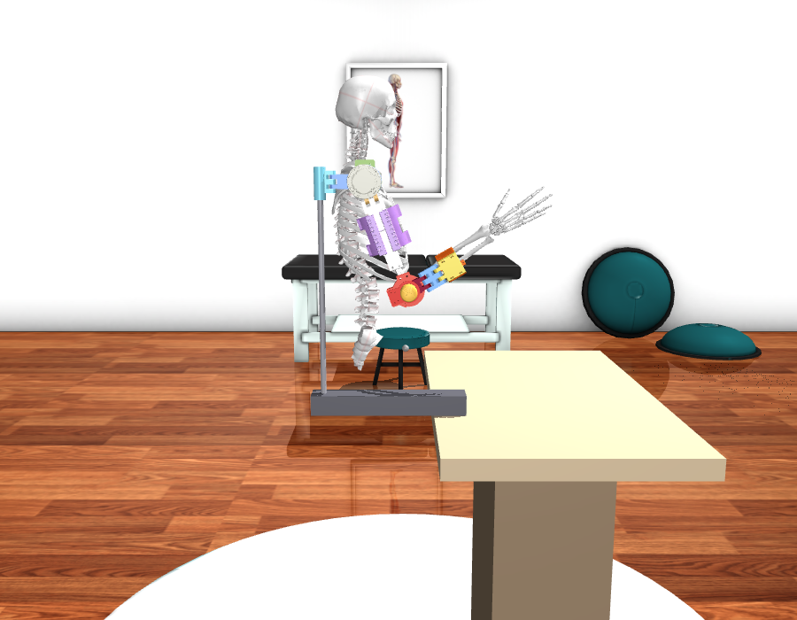
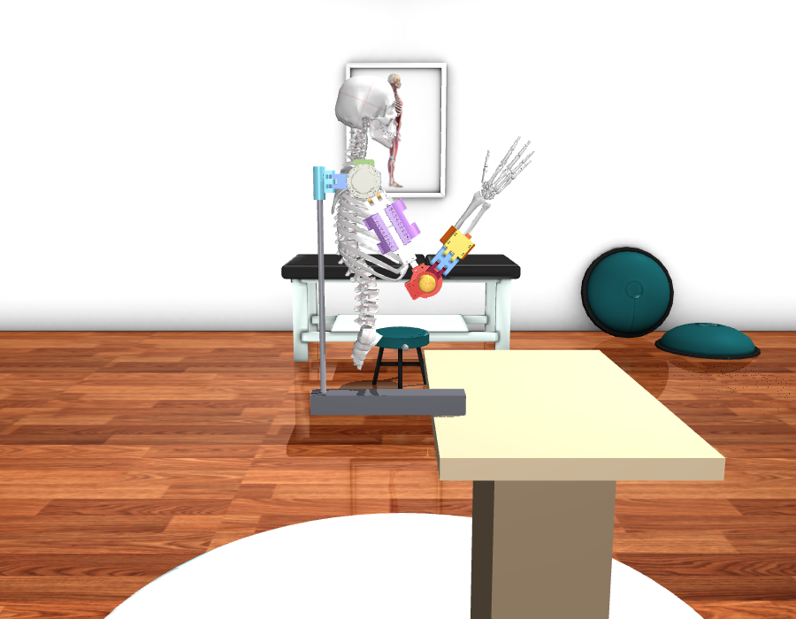
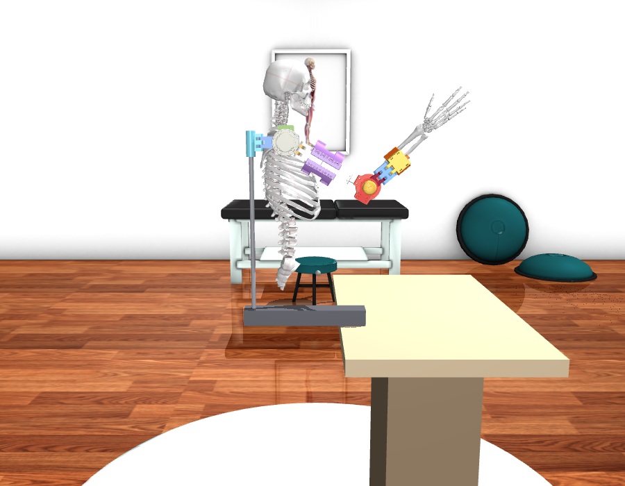
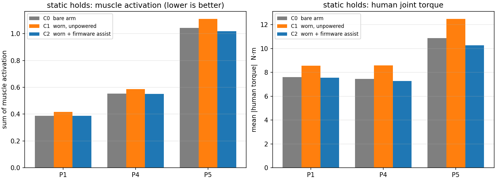
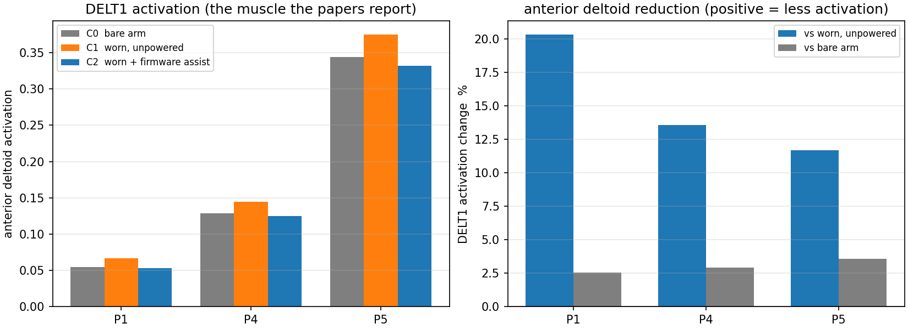
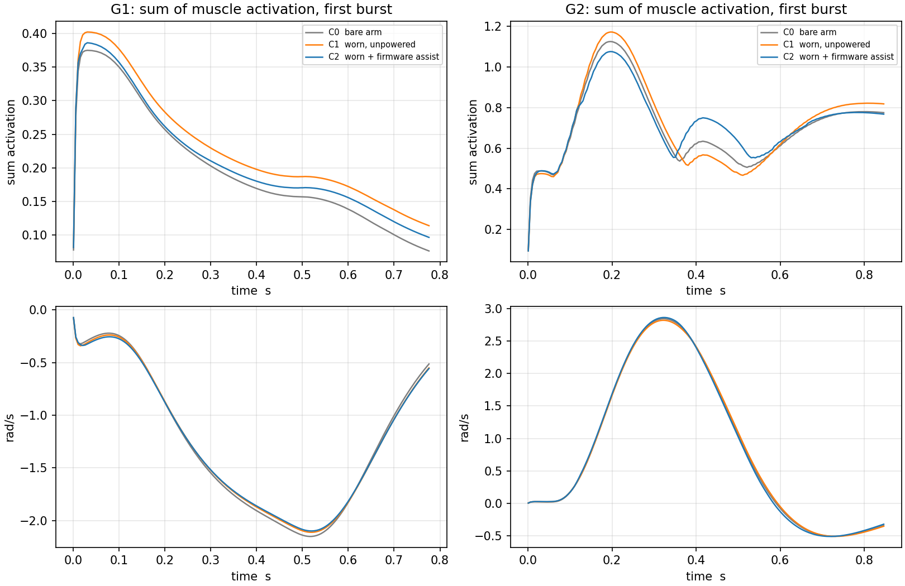
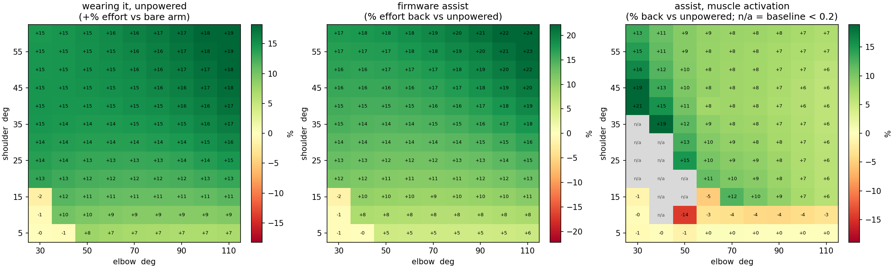

# 上肢外骨骼仿真验证报告（2026-10-28）

本报告汇总 MuJoCo 仿真对当前固件助力效果的验证结果。所有数字均为**模型假设下**的结果：物理参数、人体控制器与绑带模型都带假设，未与实物台架对标（M5 已按用户决定取消）。文中"省力"指人体关节力矩或肌肉激活量下降，不代表真人实测。

## 1. 目的

1. 用仿真**印证**现有固件控制程序确实省力，并给出量化结果。
2. 建立可在其中迭代优化的试验场：改控制逻辑后先在仿真里看结果，不必每次上实机。

## 2. 模型与来源

| 组成 | 来源 | 关键参数 |
|---|---|---|
| 人体 | MyoSim 0.2.3 `myoarm_r` | 站立、躯干固定；只保留肩前屈 `shoulder_elv_r` 与屈肘 `elbow_flexion_r`，63 块肌肉 |
| 外骨骼 | 用户 Fusion 导出包 `model/orthoease/`（只读副本） | 装在右臂外侧；沿 04 调节轨加长到 290.5 mm 与人肘对齐；质量按 STL 体积×ABS：上臂组 0.656 kg、前臂组 0.177 kg |
| 桌子/支架 | 代码构建 | 桌面 0.90 m；竖杆直径 14 mm，穿过 01B 夹持座孔（孔心由 STL 截面算出，Fusion (0.10784, 0.01981) m） |
| 绑带 | 两个软 `weld` | 上臂 03C、前臂 08A 绑定点；solref 0.05 s、torquescale 0.03 |





*三个手术姿势：P1（肩 20°/肘 100°）、P4（30°/110°）、P5（60°/70°）。*

## 3. 控制接入

固件控制代码（`App/control/*.c` + `App/application/s5_site.c`）编译成主机库，仿真每 10 ms 调用一次，与真机同一份代码、同一套参数：

| 参数 | 值 |
|---|---|
| 肩重力模型 | 1.64 N·m × sin(肩角)，增益 1.5 |
| 肩输出上限 | 300 mNm 转子 = 2.4 N·m 关节侧 |
| 肩 Amplify | 300 mNm（速度 >20°/s 时叠加） |
| 肘重力模型 | 10 A × 0.02 N·m/A × sin(肩角+肘角) |
| 肘 Amplify | 10 A（速度 >20°/s 时按运动方向叠加） |
| 输出周期 | 10 ms |

人体侧有两种实现：**理想力矩**（关节直接加力矩）与**肌肉驱动**（计算力矩 → 静态优化 → 63 块肌肉）。本报告以肌肉驱动为主。

## 4. 三种条件

| 条件 | 含义 |
|---|---|
| C0 | 裸臂，不绑外骨骼 |
| C1 | 穿戴但外骨骼不通电（承担外骨骼自重） |
| C2 | 穿戴 + 固件助力 |

## 5. 结果

### 5.1 静态（三个手术姿势，各保持 47 s，肌肉驱动）

| 姿势 | 人体肩力矩 C0 / C1 / C2 | 全部肌肉激活和 C0 / C1 / C2 |
|---|---|---|
| P1（20°/100°） | 5.37 / 6.10 / **5.29** N·m | 0.39 / 0.42 / 0.39 |
| P4（30°/110°） | 5.89 / 6.85 / **5.66** | 0.55 / 0.59 / 0.55 |
| P5（60°/70°） | 8.93 / 10.42 / **8.35** | 1.04 / 1.11 / 1.02 |



**穿戴代价**：不通电时肩力矩增加 13.6–16.7%（外骨骼自重 + 惯性）。
**助力收益**：相对穿戴不通电降低 13–20%；C2 甚至略低于裸臂 C0（P1 −1.5%、P4 −3.9%、P5 −6.5%），说明当前助力已略超"只抵消外骨骼自重"。

### 5.2 论文口径：单块肌肉（前三角肌 DELT1）

肩部外骨骼文献普遍只报特定肌肉（前/中/后三角肌）。同一批数据按该口径：

| 姿势 | C0 裸臂 | C1 穿戴不通电 | C2 助力 | **相对穿戴** | 相对裸臂 |
|---|---:|---:|---:|---:|---:|
| P1 | 0.054 | 0.066 | 0.053 | **−20.3%** | −2.5% |
| P4 | 0.129 | 0.145 | 0.125 | **−13.6%** | −2.9% |
| P5 | 0.344 | 0.375 | 0.332 | **−11.7%** | −3.6% |



与文献对比：

| 研究 | 报告的数字 | 与本项目的关系 |
|---|---|---|
| Frontiers Bioeng. Biotechnol. 2024（MIS 肩外骨骼） | 三角肌前束 −21.0%、中束 −14.6%、后束 −8.3% | **同一区间**（本机 −11.7…−20.3%，相对穿戴） |
| Ergonomics 2026（模拟腹腔镜，软/硬两款） | 前三角肌各姿势均有下降 | 同上量级 |
| Applied Ergonomics 2024（助力 60–100%） | 抬臂阶段最多 −61~64% | 更高，因为助力覆盖整个重力矩 |
| ArmeoPower（整臂完全失重） | 峰值关节力矩 −74.8% | 远高于本机，属"全支撑"设备 |

**为什么"相对裸臂"只有 3% 左右**：本机助力上限 2.4 N·m，而 P5 姿势人臂需要 8.93 N·m，只覆盖约 23%；同时外骨骼自重 0.83 kg 挂在手臂上，给手臂增加约 22% 的负担。两者相抵，净收益自然小——这是**设计定位（助力而非全支撑）**决定的，不是控制逻辑问题。

### 5.3 爆发动作（肌肉驱动，含 Amplify）

| 指标 | G1 锤击（肘 100→45°，参考 180 ms） | G2 快速抬举（肩 5→45°，参考 250 ms） |
|---|---|---|
| 峰值力矩 C0 / C1 / C2 | 4.69 / 4.87 / **4.56** N·m | 44.7 / 46.5 / 46.1 N·m |
| 动作时间 | 435 ms | 225 ms |
| 稳态误差 | 1.2° | 0.2° |
| 人体正功 C0 / C1 / C2 | 18.8 / 19.5 / **18.7** J | 119.6 / 123.0 / 124.5 J |
| 外骨骼正功 | 2.0 J | 13.3 J |
| 助力收益（C2 vs C1，峰值力矩） | **−6.4%** | −0.7% |

Amplify 时序已按 ExoKit 的做法改为"瞬时切换"（原 200 ms 斜坡使增量到 241 ms 才达 90%，即爆发结束才起作用）；改后增量在 **121 ms** 全额介入，肘部收益由 −4.5% 提升到 **−6.4%**，且 C2 的峰值力矩与正功都低于裸臂 C0。

肩部仍只有 −0.7%，因为 250 ms 爆发的峰值力矩由惯性主导（4.6 N·m 对 46 N·m），放开上限到 575 mNm 也无改善（已验证）。

**G2 正功偏高的原因（已查明）**：按阶段拆分 G2 一个周期的做功：

| 阶段 | C1 穿戴不通电 | C2 助力 | 助力效果 |
|---|---:|---:|---|
| 抬臂（爆发） | 4.97 J | 4.63 J | **−6.8%（有用）** |
| 保持 | 4.37 J | 3.75 J | **−14.2%（有用）** |
| 放下（返回） | 2.85 J | 3.15 J | **+10.5%（帮倒忙）** |

原因是**重力补偿本身**：放下手臂时基线仍向上推，人必须用更大的力往下压。这与文献一致（Applied Ergonomics 2024 报告：助力接近或超过 100% 时，下放阶段伸肌激活最多升高 127%）。

**正功率门控**（只在加速段助力）已实现为编译选项 `S5_R5_AMPLIFY_ACCEL_GATE_DPS2`，但实测收益有限：锤击正功 18.7 → 18.4 J，峰值力矩反而由 −6.4% 退到 −4.8%，快速抬举不变；它只能撤掉 Amplify，撤不掉重力基线。**因此默认关闭（0）**，爆发结果均按关闭状态给出。



**为什么爆发收益小（定量）**：把肩部爆发力矩拆成惯性项与重力项：

| 动作时长 | 峰值惯性项 | 峰值重力项 | 重力占峰值 |
|---|---:|---:|---:|
| 250 ms | 80.75 N·m | 7.61 N·m | 8.6% |
| 430 ms | 27.30 | 7.61 | 21.8% |
| 600 ms | 14.02 | 7.61 | 35.2% |
| 800 ms | 7.89 | 7.61 | 49.1% |

现有控制只做重力补偿，爆发 90% 以上是惯性项，因此**理论上限只有 8.6%**；本机 2.4–4.6 N·m 的上限仅为惯性项的 3–6%。Amplify（速度触发增量）已接入肩、肘两通道，但其最大可能做功 4.6 N·m × 0.7 rad ≈ 3.2 J，对一次爆发的约 120 J 只有 2.5% 上限。

### 5.4 工作空间（肩 5–60° × 肘 30–110°）



- 穿戴代价均值 **+13.2%**，助力收益均值 **+9.4%**；
- 抬臂越高、肘越弯收益越大（肩 60°/肘 70–110° 处 12–16%）；
- **低抬臂（肩 5–20°）+ 小屈肘（30–60°）区域助力反而增加肌肉激活**，说明该区域外骨骼自重补偿"帮过头"，需在台架小角度复核。

## 6. 结论

1. **静态/准静态省力成立**：相对穿戴不通电，肩力矩降低 13–20%、前三角肌激活降低 12–20%，与肩部外骨骼文献同一区间。
2. **相对裸臂收益小（约 3%）**：装置主要抵消自身重量，属设计定位问题；要提升需加大助力（上限 575 mNm/gain 3 时 P5 静态收益可达 35%）或给外骨骼减重。
3. **爆发动作收益有限（≤4.5%）**：爆发以惯性为主，重力补偿型控制不适用；若必须助力爆发，需要更大扭矩驱动或把动作定义在 ≥600 ms。
4. **两个独立指标方向一致**：关节力矩与肌肉激活都显示"穿戴更费力、助力后回落"，互为印证。

## 7. 已知限制

- 模型只有肩前屈与屈肘两个自由度；肩外展、内外旋、前臂旋转未建模，因此 DELT3、冈上/冈下肌等在模型里激活为 0。
- "人"是简化 PID + 计算力矩 + 最小激活优化，不是真实运动控制模型；数字适合作**相对比较**，不是真人用力的绝对预测。
- 外骨骼质量、质心、绑带软度、关节阻尼均为估计或假设（见 `model/params.json` 的 `status`）。
- 所有镜像**已编译未刷写**，实机行为未验证。

## 8. 复现

```powershell
cd firmware/Exoskeleton_F446
build\sim-venv\Scripts\python.exe sim\mujoco_arm\scripts\report_muscle_all.py   # 一键全套图
build\sim-venv\Scripts\python.exe sim\mujoco_arm\scripts\workspace_scan.py      # 工作空间热力图
build\sim-venv\Scripts\python.exe sim\mujoco_arm\scripts\check_static.py        # 场景与力学检查
```

## 9. 图索引

| 文件 | 内容 |
|---|---|
| `figures/01_overview.png` | 静态、三角肌、爆发三张结果图拼合 |
| `figures/02_static.png` | 静态：全部肌肉激活与人体力矩 |
| `figures/03_deltoid.png` | 论文口径：前三角肌激活与降幅 |
| `figures/04_burst.png` | 爆发：激活量与角速度曲线 |
| `figures/05_workspace.png` | 工作空间热力图（穿戴代价/助力收益/激活收益） |
| `figures/06_p1.png` `07_p4.png` `08_p5.png` | 三个手术姿势的场景图 |
